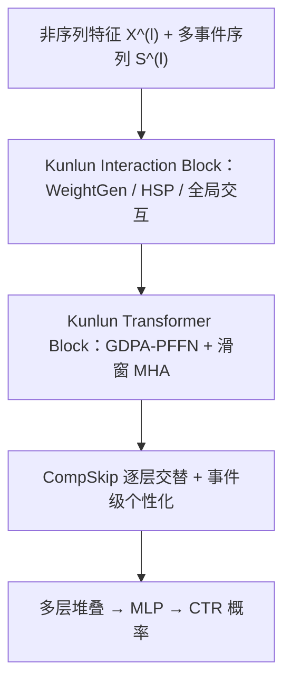

# Kunlun: Establishing Scaling Laws for Massive-Scale Recommendation Systems through Unified Architecture Design（为大规模推荐系统建立缩放定律的统一架构设计）

- **会议/期刊**: KDD 2026
- **作者与机构**: Bojian Hou、Xiaolong Liu、Xiaoyi Liu 等，Meta Platforms；Jade Nie、Chunzhi Yang（部分工作于 Meta，现 OpenAI）
- **推荐链路定位**: 精排 / CTR 预估（端到端训练架构）
- **研究方向**: CTR/CVR 预估与特征交叉 / 大语言模型推荐 (LLM4Rec)（借鉴 LLM 缩放定律与高效注意力范式）
- **论文原文**: [https://arxiv.org/abs/2602.10016v3](https://arxiv.org/abs/2602.10016v3)
- **开源代码**: 暂未开源

## TL;DR (1分钟核心速览)

本文针对大规模推荐系统中“序列+非序列”异构特征联合建模时 MFU 低、缩放效率差的核心痛点，提出 Kunlun 统一架构：低层用 GDPA/HSP/滑窗注意力提升模块计算效率，高层用 CompSkip/事件级个性化/专家并行重分配算力。在 Meta Ads 70B+ 样本、B200 平台上，MFU 从 17% 提升至 37%，180 GFLOPs 下相对 Wukong 取得 0.79% NE 增益，缩放效率约为 InterFormer 的 2×，线上主指标提升 1.2%。

## Background & Motivation (背景与核心矛盾)

- **主流范式**: Wukong 通过堆叠特征交互模块对非序列特征做规模化建模；InterFormer 以双向信息流联合序列与上下文特征；HSTU 则偏重纯序列建模。
- **前人局限**: ① 模块效率低，推荐模型 MFU 仅 3–15%，远低于 LLM 的 40–60%，异构特征空间导致小维度、不规则张量和访存瓶颈；② 算力分配粗放，对所有层/事件等比例扩展带来边际收益递减。
- **核心洞察 (Key Insight)**: 缩放效率可分解为“算法有效性 × 计算效率”，仅改架构不够，必须同时提升单模块 MFU 并把算力投向高价值层与高价值事件；推荐序列还存在强局部性与事件重要性异质性。
- **本文切入点**: 做模型-效率协同设计：低层重构 GDPA、HSP、Sliding Window Attention，高层引入 CompSkip、Event-level Personalization 与 Mixture of Wukong Experts。

## Method (核心方法设计)

### 1. 整体框架 (Overall Architecture)

Kunlun 堆叠 $L$ 层，每层含两个块：Kunlun Transformer Block 用 GDPA 增强的 PFFN 与滑窗多头自注意力做上下文感知序列建模；Kunlun Interaction Block 用 Weight Generation、HSP 与 Global Interaction 完成序列-非序列双向交互。非序列特征生成个性化权重引导序列变换，序列摘要再拼回非序列特征做全局交互；CompSkip 逐层交替跳过冗余模块，事件级个性化按事件价值分配宽度/深度/窗口，最终经 MLP 输出 CTR。

### 2. 关键设计拆解 (Key Designs)

1. **GDPA：把 PFFN 重写成注意力式算子**：原 PFFN 的 $f(X_{\mathrm{sum}})S$由小矩阵乘与逐层激活构成，访存受限、MFU 低。Kunlun 将序列当 Query、非序列上下文生成 Key/Value，令$Q=S$、$K=w_1(X_{\mathrm{sum}})$、$V=w_2(X_{\mathrm{sum}})$，计算$\mathrm{GDPA}_h(Q,K,V)=\mathrm{Act}_h(QK^\top/\tau)V$，其中$\tau=\mathrm{maxlen(seq)}$。该式可像 FlashAttention 一样融合为单核，把访存瓶颈转为计算瓶颈；残差连接还使 PFFN 可稳定堆叠，PFFN 块 MFU 最高提升 6×。

2. **HSP + SumKronLinear：更稳更省的长序列摘要**：PMA 用随机可学习 Query 直接池化，初始化不稳且压缩参数大。HSP 先以超完备 seed 做 seed-level 注意力，再用 Kronecker 分解压缩：$Y_b=\sum_{i=1}^{k}Z_i^\top X_b W_i$，$Z_i\in\mathbb{R}^{S\times T},W_i\in\mathbb{R}^{D\times D}$。参数量从$O(SDTD)$降到$O(k(ST+D^2))$，典型配置约 14× 缩减；rank-$k$ 结构还能刻画序列维与嵌入维的联合相关性，而非 rank-1 可分离分解。

3. **CompSkip + 事件级个性化 + 滑窗注意力**：深层推荐模型存在层冗余。CompSkip 采用隔层交替：偶数层跳过自注意力、计算新 HSP；奇数层跳过 HSP/PFFN、计算自注意力，使每层只贡献“局部细化”或“全局摘要”。滑窗注意力把复杂度从 $O(T^2)$降到$O(Tw)$，利用推荐序列的局部性；事件级个性化按点击/转化/曝光的重要性分别配置$d_{\mathrm{model}}$、头数、摘要 token 数、层数与窗口$w$，把算力向高价值事件倾斜。

- **训练目标、负采样与推理效率**: 点击监督用标准 BCE，曝光日志直接作为样本，未额外构造负采样；单 epoch 训练。推理侧 GDPA/HSP 用 Triton 融合核，CompSkip 降低约 43.1% FLOPs、滑窗注意力提升 31.1% QPS；180 GFLOPs 档下 Kunlun 仅需 154.9 GFLOPs，低于 InterFormer 的 172.3。

## Experimental Setup & Evaluation Protocol (实验设置与评估协议)

- **数据集与预处理**: 采用 Meta Ads 大规模内部数据，impression-level CTR 样本，覆盖点击、转化、曝光等多事件序列。

| 数据集 | #Users | #Items | #Interactions | 稀疏度/密度 | 特征/场景说明 |
| :--- | :---: | :---: | :---: | :---: | :--- |
| Meta Ads Internal | — | — | 70B+ 样本 | — | 数百至数千非序列特征；10+ 序列，长度数百至数千；多事件类型 |

- **数据划分与防穿越 (Splitting Strategy)**: 论文未披露公开切分细节；实验在同一数据集、特征词表与计算预算下比较，单 epoch 训练，属于生产日志的大规模离线评估。
- **排名评测协议 (Ranking Protocol)**: 非全库排序任务，主指标为 NE（归一化交叉熵，越低越好），辅以 MFU、QPS、GFLOPs 与缩放效率；NE 直接反映校准质量，适合拍卖与预算控制场景。
- **对比基线与超参设置**: 基线为 Wukong、Wukong+PMA、InterFormer；统一 B200、全局 batch size 与优化器配置；未报告显著性检验与嵌入维度 $d$ 的完整超参表。

## Key Experimental Results (实验关键数据)

### 1. 主实验对比 (Main Results)

| 方法 | 6G NE Gain(%) | 60G NE Gain(%) | 180G NE Gain(%) | 180G GFLOPs |
| :--- | :---: | :---: | :---: | :---: |
| Wukong | 0（baseline） | 0 | 0 | 174.5 |
| Wukong+PMA | 0.16 | 0.11 | 0.20 | 187.1 |
| InterFormer | 0.31 | 0.36 | 0.50 | 172.3 |
| **Kunlun** | **0.31** | **0.66** | **0.79** | **154.9** |
| Improv. vs InterFormer | 0% | **+83.3%** | **+58.0%** | **-10.1%** |

> NE Gain 越高越好；GFLOPs 越低越好。Kunlun 在 180G 档以更低算力取得更高 NE 增益。

### 2. 消融实验 (Ablation Study)

| 配置 | MFU(%) | ΔQPS(%) | ΔNE(%) | ΔGFLOPs |
| :--- | :---: | :---: | :---: | :---: |
| w/o GDPA | 34.0 | -8 | +0.04 | 持平 |
| w/o HSP（用 PMA） | 30.21 | +8.8 | +0.08 | -25% |
| w/o SumKronLinear | 34.55 | 持平 | +0.03 | -7.5% |
| w/o Sliding Window | 32.90 | -31.1 | 持平 | +29.5% |
| w/o CompSkip | 34.50 | -35 | 持平 | +43.1% |
| w/o Event Personalization | 35.7 | -13 | -0.02 | +11% |
| w/o Expert Parallelism | 35.5 | -4 | 持平 | 持平 |
| **Kunlun (Full)** | **37.0** | baseline | baseline | **154.9** |

> ΔNE 为正表示变差；ΔQPS 为负表示吞吐下降。

### 3. 关键实验发现 (Key Findings)

- **缩放效率确实拉开差距**：6→180 GFLOPs 时，Kunlun 的 NE 增益从 0.31% 涨到 0.79%（2.5×），InterFormer 仅从 0.31% 到 0.50%（1.6×）；180G 档相对 InterFormer 提升 58%，且少用 10.1% FLOPs，说明收益来自“更高效地用算力”而非单纯堆参数。
- **低层优化主要买效率，高层优化买吞吐**：去掉 GDPA 使 MFU 37→34、QPS -8%；去掉滑窗注意力 QPS -31.1%、FLOPs +29.5%；去掉 CompSkip FLOPs +43.1%、QPS -35% 而 NE 持平，验证深层推荐模型存在显著层冗余。
- **HSP 与事件个性化存在精度-效率权衡**：HSP 相比 PMA 带来 0.08% NE 增益，但 PMA 的 QPS 高 8.8%；事件个性化以约 0.02% NE 的极小代价换取 13% QPS 与 11% FLOPs 收益。整体 MFU 17%→37%，线上 Meta Ads 主指标 +1.2%，证明离线效率增益可转化为生产收益。

## Highlights & Limitations (亮点、对比与审稿批判)

- **与代表作对比 (vs. Prior Work)**: Wukong 只做非序列特征交互、缺少序列建模；InterFormer 虽打通序列-上下文双向流，但 PFFN/PMA 访存受限，规模上来后缩放效率不足；HSTU 面向序列主导场景，难以承载数百至数千非序列上下文特征。Kunlun 的本质区别是把“联合建模”与“计算效率”一起设计，并用缩放定律验证。
- **可迁移亮点**: ① GDPA 把个性化 PFFN 统一成注意力式融合核，可迁移到任何“上下文生成权重”的推荐模块；② SumKronLinear 的 rank-$k$ Kronecker 压缩适合长序列摘要与参数敏感场景；③ CompSkip 的隔层交替策略可低成本嫁接到深层 CTR/多任务模型。
- **审稿级局限批判**: ① 仅用 Meta 内部数据，缺少公开基准与显著性检验，复现门槛高；② 缩放定律只验证到 180 GFLOPs、1–6 层，外推到更大预算仍存风险；③ 事件个性化会带来约 0.02% NE 的轻微回退，且 MFU 只在 B200 上报告，跨硬件泛化性待验证。

## Rating (四维评分)

- **方法创新性 (Novelty)**: ⭐⭐⭐⭐ （模型-效率协同设计新颖，GDPA/HSP/CompSkip 均有明确算子级增量，并给出联合序列-非序列建模的缩放定律）
- **评估协议与实验扎实度 (Protocol & Experiments)**: ⭐⭐⭐ （70B+ 工业数据与线上部署有说服力，但仅 3 个基线、无公开数据与显著性检验，消融较完整）
- **写作与数学规范度 (Clarity & Rigor)**: ⭐⭐⭐⭐ （核心公式、复杂度与算法伪代码清晰，NE/MFU/缩放效率定义严谨；部分预处理与切分细节下放附录）
- **工业落地与复现价值 (Industrial & Practical Value)**: ⭐⭐⭐⭐⭐ （已在 Meta Ads 部署，MFU 17%→37%、2× 缩放效率、线上 +1.2%，对大规模精排架构极具工程参考价值）

