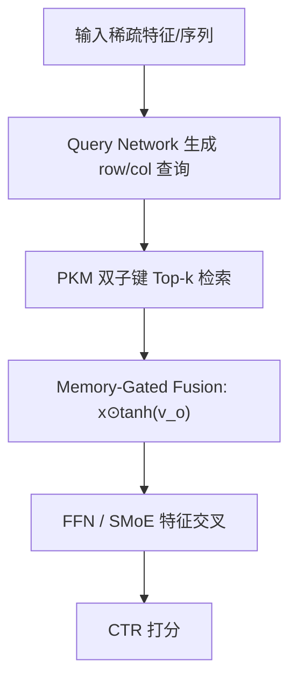
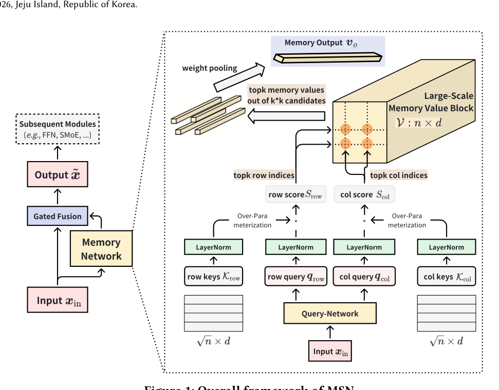

# MSN: A Memory-based Sparse Activation Scaling Framework for Large-scale Industrial Recommendation (面向大规模工业推荐的内存稀疏激活扩展框架)

- **会议/期刊**: KDD 2026
- **作者与机构**: Shikang Wu、Hui Lu、Jinqiu Jin、Zheng Chai 等，ByteDance Search / ByteDance AML
- **推荐链路定位**: 精排（CTR 预估）
- **研究方向**: CTR/CVR 预估与特征交叉 / 工业架构与效率
- **论文原文**: [论文原文链接](https://arxiv.org/abs/2602.07526v2)
- **开源代码**: 暂未开源

## TL;DR (1分钟核心速览)

针对 SMoE 扩展推荐模型时专家 FFN 的 $O(d^2)$ 访存高、专家数受限、个性化不足，MSN 改用产品键记忆做稀疏参数检索，以记忆门控调制输入，并用归一化/过参数化稳定训练。抖音搜索离线 QAUC-Click 相对提升 0.54%、Finish 0.33%，线上 Watch Time +0.2958%。

## Background & Motivation (背景与核心矛盾)

- **主流范式**: DLRM 通过扩大 embedding、加深特征交叉或引入 SMoE 稀疏专家提升容量；SMoE 每 token 只激活少量专家，计算近似常数。
- **前人局限**: 每个激活专家仍是完整 FFN，访存 $O(d^2)$ 成为带宽受限推理瓶颈；同时专家数受参数规模限制，每用户只能从少量专家中选择，个性化粒度不足。
- **核心洞察 (Key Insight)**: 与其“稀疏计算”，不如“稀疏参数检索”——用大规模键值记忆存储细粒度模式，以轻量检索替代大专家路由。
- **本文切入点**: 将 PKM 记忆检索、记忆门控融合与稳定优化组合成即插即用模块，在严格时延下扩展推荐模型容量。

## Method (核心方法设计)

### 1. 整体框架 (Overall Architecture)

MSN 作为即插即用模块插在 FFN/SMoE 前：输入稀疏特征经 Query Network 生成 row/col 查询，PKM 在两个子键空间各取 Top-k 并做笛卡尔组合，得到 $k$个记忆值加权输出$\boldsymbol{v}_o$；再以$\tilde{\boldsymbol{x}}=\boldsymbol{x}_{in}\odot\tanh(\boldsymbol{v}_o)$调制原表征，送入后续特征交叉与 CTR 打分。训练用点式 BCE，推理仅 1–2 层记忆检索，复杂度$O(\sqrt{n}d)$。

<figure class="paper-figure" markdown="span">
  <figcaption>图1：MSN 的整体框架。</figcaption>
</figure>

### 2. 关键设计拆解 (Key Designs)

1. **PKM 子线性记忆检索**：全键检索 $O(nd)$难以扩到十万级记忆；将索引空间分解为$\sqrt{n}\times\sqrt{n}$，查询分别与$\mathbf{K}_{row},\mathbf{K}_{col}$点积，先各取 Top-k 再在$k^2$候选中选最终 Top-k，复杂度降至$O(\sqrt{n}d)$：
   $S_{row}=\mathbf{K}_{row}\boldsymbol{q}_{row},\ S_{col}=\mathbf{K}_{col}\boldsymbol{q}_{col}$；
   $\mathcal{K}=\mathrm{topk}_{(i,j)\in\mathcal{I}\times\mathcal{J}}(S_{row}[i]+S_{col}[j])$；
   $\boldsymbol{v}_o=\sum_{(i,j)\in\mathcal{K}}S[i,j]\mathbf{V}[(\sqrt{n}-1)i+j]$。
2. **记忆门控融合**：直接拼接或替换输入收益微弱，因为激活槽数 $k\ll d$，稀疏记忆不足以覆盖原输入；用 tanh 门控逐元素调制，保留原信息并注入用户/上下文相关记忆：
   $\tilde{\boldsymbol{x}}=\boldsymbol{x}_{in}\odot\tanh(\boldsymbol{v}_o)$。
3. **稳定优化与工程算子**：PKM 相似度方差大导致 softmax 饱和与键值坍缩；对 query/key 做 LayerNorm、学习率 warm-up，并对子键过参数化 $\tilde{\mathbf{K}}_{row}=\boldsymbol{\Theta}_{row}\mathbf{K}_{row}$，使未命中键也能经变换获梯度。工程上用 Sparse-Gather 融合访存/聚合/更新，AirTopK 替代基数排序，P99 延迟从 26ms 降至接近基线。总损失为点式 BCE：
   $\mathcal{L}=-\frac{1}{|\mathcal{D}|}\sum_{(\boldsymbol{x},y)\in\mathcal{D}}[y\log\hat{y}+(1-y)\log(1-\hat{y})]$，无额外负采样。

## Experimental Setup & Evaluation Protocol (实验设置与评估协议)

- **数据集与预处理**: 抖音搜索工业日志，1000+ 异构特征；连续三周数据训练/评估。

| 数据集 | #Users | #Items | #Interactions | 稀疏度/密度 | 特征/场景说明 |
| :--- | :---: | :---: | :---: | :---: | :--- |
| Douyin Search | 数百 M | 十亿级视频 | 十亿级/日 | 未披露 | 数值、类别 ID、交叉、序列行为特征 |

- **数据划分与防穿越 (Splitting Strategy)**: 按连续三周日志组织训练/评估；离线冷启动、线上 checkpoint 热启。原文未给出严格全局时间戳切分细节，需警惕时序泄漏。
- **排名评测协议 (Ranking Protocol)**: Query-Level AUC（query 内 AUC 后平均），非 Full-Ranking；点式 CTR 日志标签，未额外负采样。
- **对比基线与超参设置**: DLRM-MLP、Wukong、RankMixer FFN/GatedFFN/SMoE(2in4/2in6)；默认记忆 $n=256^2$、$k=32$、MSN 层数$L=2$；96 GPU，FLOPs 按 batch 2048 计；无显著性检验。

## Key Experimental Results (实验关键数据)

### 1. 主实验对比 (Main Results)

除 DLRM-MLP 为绝对值外，其余为相对 DLRM-MLP 的 ΔQAUC。

| 方法 | ΔQAUC-Click | ΔQAUC-Finish | #Params (act/total) | FLOPs/Batch |
| :--- | :---: | :---: | :---: | :---: |
| DLRM-MLP | 0.6731 | 0.7545 | 118M/118M | 520G |
| Wukong | +0.25% | +0.13% | 127M/127M | 567G |
| FFN | +0.35% | +0.21% | 120M/120M | 529G |
| GatedFFN | +0.35% | +0.21% | 122M/122M | 541G |
| SMoE (2in4) | +0.38% | +0.22% | 120M/194M | 543G |
| SMoE (2in6) | +0.43% | +0.25% | 120M/267M | 546G |
| **MSN-FFN** | **+0.54%** | **+0.33%** | 122M/252M | 556G |
| MSN-SMoE | +0.50% | +0.31% | 122M/294M | 560G |

### 2. 消融实验 (Ablation Study)

默认 MSN-FFN：1 层 MSN、$n=256^2$、$k=32$、tanh 门控。

| 配置 | ΔQAUC | #Params | 记忆参数占比 |
| :--- | :---: | :---: | :---: |
| Default MSN-FFN | – | 122M/194M | 37.1% |
| $L=2$ | +0.05% | 122M/252M | 51.6% |
| $L=4$ | -0.05% | 122M/327M | 62.9% |
| $n=512^2$ | +0.04% | 122M/398M | 69.3% |
| per-token V | +0.06% | 122M/1.19B | 89.7% |
| $k=64$ | +0% | 122M/194M | 37.1% |
| $k=8$ | -0.05% | 122M/194M | 37.1% |
| w/o tanh | -0.02% | 122M/194M | 37.1% |
| Sigmoid | -0.05% | 122M/194M | 37.1% |

### 3. 关键实验发现 (Key Findings)

- 同等约 120M 激活预算下，MSN-FFN 的 Click Δ 比 SMoE(2in6) 高 0.11 个百分点（+0.54% vs +0.43%），Finish 高 0.08 个百分点，且总参数 252M < 267M，说明记忆检索比继续堆大专家更有效。
- 记忆容量扩展有效但不可过度稀疏：$n=512^2$提升 +0.04%，per-token V 提升 +0.06%；而$L=4$与$k=8$ 均降 -0.05%，需保留足够激活与特征交叉。
- 线上抖音搜索全流量 Active Days +0.0503%、Watch Time +0.2958%、Finish Play +0.2071%、Query Change -0.1337%；双列场景 Active Days +0.0481%、Query Change -0.275%，验证工业收益。

## Highlights & Limitations (亮点、对比与审稿批判)

- **与代表作对比 (vs. Prior Work)**: SMoE 以稀疏计算扩展专家，但专家 FFN 访存 $O(d^2)$且专家数受限；RankMixer 用 SMoE 扩到亿级参数；Wukong 靠堆叠特征交叉扩容量。MSN 改为稀疏参数检索，以 PKM 将检索降到$O(\sqrt{n}d)$，并用门控把记忆作为自适应调制信号。
- **可迁移亮点**: PKM 因子化 + 子键过参数化可迁移到大规模记忆/用户表征检索；tanh 门控比拼接更适合“低维稀疏信号调制高维输入”的融合场景。
- **审稿级局限批判**: 离线仅用抖音搜索私有数据，缺公开基准与显著性检验；per-token V 总参数达 1.19B，存储与多租户部署成本需进一步披露；MSN-SMoE 叠加两种稀疏机制后略逊于 MSN-FFN，说明稀疏模块组合仍非最优。

## Rating (四维评分)

- **方法创新性 (Novelty)**: ⭐⭐⭐⭐ （把 PKM 稀疏检索引入 DLRM 扩展，替代 SMoE 大专家，机制清晰且工程针对性强）
- **评估协议与实验扎实度 (Protocol & Experiments)**: ⭐⭐⭐⭐ （有离线消融与大规模线上 A/B，但仅单一私有数据集、缺显著性检验）
- **写作与数学规范度 (Clarity & Rigor)**: ⭐⭐⭐⭐ （PKM、门控、过参数化公式完整，复杂度与梯度解释到位）
- **工业落地与复现价值 (Industrial & Practical Value)**: ⭐⭐⭐⭐⭐ （抖音搜索已部署，Sparse-Gather/AirTopK 优化具体，线上收益明确；可惜未开源）

