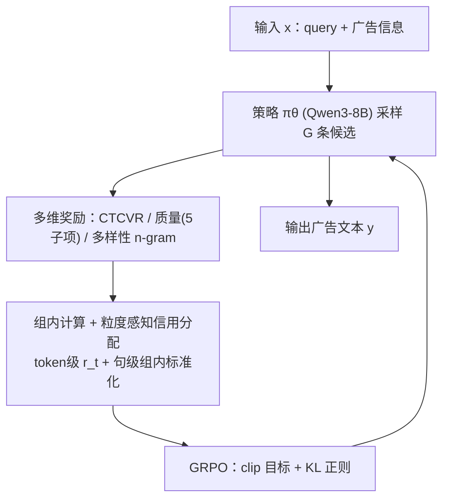

# RELATE: A Reinforcement Learning-Enhanced LLM Framework for Advertising Text Generation (面向广告文本生成的强化学习增强大语言模型框架)

- **会议/期刊**: KDD 2026
- **作者与机构**: Jinfang Wang, Jiajie Liu, Jianwei Wu 等（百度）
- **推荐链路定位**: 端到端生成式（广告创意文本生成 + 在线转化指标对齐）
- **研究方向**: CTR/CVR 预估与特征交叉 / 大语言模型推荐（LLM4Rec）
- **论文原文**: [https://arxiv.org/abs/2602.11780v1](https://arxiv.org/abs/2602.11780v1)
- **开源代码**: 暂未开源

## TL;DR (1分钟核心速览)

工业广告文本普遍采用「先生成候选、再用 CTR/偏好信号对齐」的两阶段范式，生成目标与商业目标解耦，漏斗效率低且质量约束靠后处理补。RELATE 将其重构为约束序列优化问题：以 Qwen3-8B 为策略，构建 CTCVR 奖励、结构化/语义质量奖励与 n-gram 多样性奖励四条信号，经粒度感知信用分配后注入 GRPO 端到端训练。在 40 万百度搜索广告样本上，合规率 93.98%、多样性 0.82，线上 A/B 真实流量下 ΔCTCVR 达 **+9.19%**（SFT 基线仅 +5.25%）。

## Background & Motivation (背景与核心矛盾)

- **主流范式**: 离线侧靠 prompt/SFT 优化流畅度与多样性；在线侧走"生成 → 排序/改写 → 过滤"多阶段流水线，或先生成候选再用 DPO/对比学习对齐 CTR 偏好（UMPG、CTOP、POEM）。
- **前人局限**: ① 生成与对齐解耦，多阶段各自优化局部子目标，梯度不共享、目标不一致，天花板被人为压低；② 质量、合规、多样性与 CTR 被分散建模——多样性多在文本层面用语义熵或偏好数据实现，未与在线反馈联合优化，模式塌缩（mode collapse）与文本疲劳直接损伤长期 CTCVR。
- **核心洞察 (Key Insight)**: 广告文本本质是带硬约束的条件生成——最大化转化率同时满足质量下限 $\tau_q$与多样性下限$\tau_d$。既然约束不可微，就把约束"软化"成奖励，让 MLE 的内在目标被替换为业务目标的期望最大化：$\max_{\pi_\theta}\mathbb{E}_{x\sim\mathcal{D},y\sim\pi_\theta(y|x)}[\text{reward}(x,y)]$。
- **本文切入点**: 用单一策略网络完成生成与对齐，并用**奖励归属粒度**（token 级 vs 句级）来化解多奖励梯度冲突，而非继续堆阶段或堆奖励项。

## Method (核心方法设计)

### 1. 整体框架 (Overall Architecture)

输入 $x$由用户 query 与广告侧信息（bidword、落地页内容）构成；Qwen3-8B 冷启动初始化策略$\pi_\theta$，每个 prompt 采样$G=5$条候选文本。多维奖励系统并行打分：CTCVR 奖励（Qwen3-Embedding-0.6B 编码输入与文本后，交由 Shared-Bottom 多任务网络同时预估 CTR/CTCVR，取 CTCVR 作为信号）、质量奖励（长度/格式/相关性/正确性/风控五子项）、多样性奖励（高频 n-gram 惩罚）。奖励经"组内计算 + 信用分配"转为 token 级优势$A_{i,t}$，送入 GRPO 更新策略，KL 正则约束不偏离参考模型；推理时仅需策略前向解码，无需外部排序或后置改写。

<figure class="paper-figure" markdown="span">
  ![图2：RELATE 的工作流概览。RELATE 基于 GPRO \[15\] 构建，具有多维奖励系统和带信用分配的组计算。前者整合多个奖励维度的奖励，包括 CTCVR 奖励、质量奖励和多样性奖励。后者在组计算中引入信用分配，以得到差异化的 token 级优势。](../../../../assets/papers/2602.11780v1/figure_2.png)<figcaption>图2：RELATE 的工作流概览。RELATE 基于 GPRO [15] 构建，具有多维奖励系统和带信用分配的组计算。前者整合多个奖励维度的奖励，包括 CTCVR 奖励、质量奖励和多样性奖励。后者在组计算中引入信用分配，以得到差异化的 token 级优势。</figcaption>
</figure>

### 2. 关键设计拆解 (Key Designs)

1. **多维奖励统一建模（把硬约束软化为标量奖励）**：原约束问题 $\max \text{ctcvr}(y=\pi_\theta(x))\ \text{s.t.}\ \text{quality}(y)\ge\tau_q,\ \text{diversity}(y)\ge\tau_d$无法直接梯度回传；本文将其合成为$\text{reward}(x,y)=f(\text{ctcvr}(x,y),\text{quality}(y),\text{diversity}(y))$，约束项变成训练期可微/可计算的惩罚。直觉上，把"事后过滤"前移为"生成时就避免"，既压缩漏斗又不牺牲最优性。多样性项设计为可归因的 n-gram 抑制：$\text{reward}_{\text{diversity}}=-\sum_{g\in\text{n-grams}(y)}\mathbb{I}(g\in\mathcal{G}_{high})\cdot\Delta_d$（$n\in[2,10]$），惩罚精确落到触发模板的具体短语，避免句级奖励被稀释。

2. **粒度感知信用分配（本文最核心增量）**：多奖励共享梯度会互相挤压，因此按奖励的**天然归属粒度**拆分：黑名单词与高频短语属 token 级，直接定义 $r^{token}_{t}=-\lambda_1\mathbb{I}(T_t\in\mathcal{V}_{black})-\lambda_2\mathbb{I}(T_t\in\mathcal{G}_{high})$，优势$A^{token}_{i,t}=\alpha\cdot r^{token}_{i,t}$；转化率、相关性、正确性无法可靠分解到 token，保留句级组内标准化$A^{sentence}_{i}=(r_i-\text{mean}(r_{1..G}))/\text{std}(r_{1..G})$。最终$A_{i,t}=A^{sentence}_{i}+A^{token}_{i,t}$。这样局部约束在同一 token 上精确惩罚、全局目标提供句级方向，无需引入额外归因假设。

3. **训练目标与开销**：GRPO 损失 $\mathcal{L}(\theta)=\frac{1}{G}\sum_{i,t}\big[\min(\rho_{i,t}A_{i,t},\text{clip}(\rho_{i,t},1-\epsilon,1+\epsilon)A_{i,t})-\beta D_{KL}(\pi_\theta\Vert\pi_{ref})\big]$，其中$\rho_{i,t}=\pi_\theta(\cdot)/\pi_{\theta_{old}}(\cdot)$。免 critic 网络，仅靠组内相对优势估计基线；每 prompt 5 条采样、全局 batch 1440，8×A800 + ZeRO-2。训练侧需在线推理奖励模型（嵌入 + 多任务 CTCVR 网络），但上线只保留策略模型，服务成本与基线 LLM 同级。

## Experimental Setup & Evaluation Protocol (实验设置与评估协议)

- **数据集与预处理**: 单一工业数据集（百度搜索广告），40 万条真实样本，含用户即时搜索意图与广告核心卖点；无传统 5-core 过滤与用户/物品 ID 体系。

| 数据对象 | 规模 | 输入字段 | 监督/奖励信号 | 场景说明 |
| :--- | :---: | :--- | :--- | :--- |
| 百度搜索广告样本 | 400,000 | query + bidword + 落地页 | CTR/CTCVR 预估器、风控系统、n-gram 频次 | 搜索广告创意生成，意图明确、合规要求强 |

- **数据划分与防穿越 (Splitting Strategy)**: 离线训练/评测基于工业历史样本；最终结论以**线上真实流量 A/B**（实验组 vs 生产基线）为准，属时间在线的真实部署切分，规避离线-线上不一致。
- **排名评测协议 (Ranking Protocol)**: 非传统 Full-Ranking/Sampled Ranking。采用三视角协议：① 业务指标 $\Delta\text{CTCVR}=(\text{CTCVR}_{exp}-\text{CTCVR}_{base})/\text{CTCVR}_{base}$来自线上 A/B；② Compliance Rate 由工业级风控系统判定$\frac{1}{N}\sum_i\mathbb{I}(y_i\in\mathcal{Y}_{safe})$；③ Diversity 直接复用训练奖励打分，保证优化-评测一致。辅以 300 对人工 GSB 双盲评测（语义正确性 + 表达自然度）。
- **对比基线与超参设置**: 基线为 NLG（历史生产预训练模型）与 Qwen-SFT（Qwen3-8B 领域监督微调 + 推理期后处理强约束）。Embedding 维度与模型细节未完全披露；线上称提升具统计显著性，但未给出 $p$ 值与置信区间。

## Key Experimental Results (实验关键数据)

### 1. 主实验对比 (Main Results)

| 模型 | Compliance Rate ↑ | Diversity ↑ | ΔCTCVR ↑ |
| :--- | :---: | :---: | :---: |
| NLG（历史生产模型） | 73.00% | 0.75 | — |
| Qwen-SFT（SFT + 后处理） | 82.70% | 0.72 | +5.25% |
| **RELATE** | **93.98%** | **0.82** | **+9.19%** |
| Improv. (vs Qwen-SFT) | +11.28pp | +0.10 | +3.94pp |
| Improv. (vs NLG) | +20.98pp | +0.07 | — |

人工 GSB（RELATE vs Qwen-SFT，300 样本）为 **49 : 42 : 9**（好/持平/差）。

### 2. 消融实验 (Ablation Study)

所有配置共享同一策略，仅逐步叠加奖励项或改变归属粒度（step 150 快照，数值为各奖励的训练期打分）：

| 配置 | Structural Quality | CTCVR | Diversity | Semantic Quality |
| :--- | :---: | :---: | :---: | :---: |
| Model 1：仅结构质量 | **0.937** | 0.128 | 0.478 | 0.881 |
| Model 2：+ CTCVR | 0.834 | **0.450** | 0.211 | 0.658 |
| Model 3：+ 句级多样性 | 0.824 | 0.320 | 0.894 | 0.621 |
| Model 4：+ 语义质量 | 0.812 | 0.184 | 0.923 | **0.935** |
| **RELATE**：+ token 级信用分配 | 0.815 | 0.203 | **0.965** | 0.939 |

### 3. 关键实验发现 (Key Findings)

1. **业务奖励会吞噬质量与多样性**：Model 1→2 仅加入 CTCVR 奖励，CTCVR 从 0.128 跃至 0.450，但 Diversity 由 0.478 塌到 0.211、Semantic 由 0.881 降至 0.658——在句级共享梯度下，强奖励隐式压制其余未激活约束，定量复现了"目标不一致"的工业痛点。
2. **句级多奖励必然冲突**：Model 3 加入多样性后 Diversity 回升至 0.894，但 CTCVR 反向跌至 0.320；Model 4 加语义质量使 Semantic 达到 0.935，而 Structural 与 CTCVR 改善进一步停滞，说明多项奖励在句级平均梯度会互相稀释。
3. **精细归属优于堆奖励**：RELATE 保持奖励集合完全不变，仅把多样性与风控改为 token 级归属，Diversity 达 0.965、Semantic 达 0.939 双项最优，且 Compliance 较生产模型提升 20.98pp、线上 ΔCTCVR +9.19%，证明"奖励怎么分"比"奖励加多少"更决定上限。

## Highlights & Limitations (亮点、对比与审稿批判)

- **与代表作对比 (vs. Prior Work)**: 相比 UMPG 的三阶段（预训练-微调-RL）与 Youngmann 的"生成-改写"两段式，RELATE 把全部阶段压缩进单一策略，消灭阶段间目标漂移；相比 CTOP（CoT+RAG 偏好对齐）与 POEM（DPO 多样性 + 语义熵），本文不依赖偏好对，而是把多样性写成可直接归因的 n-gram 惩罚，使其能被 token 级信用分配精确使用。
- **可迁移亮点**: ① "奖励按天然粒度归属"的思路可移植到搜索排序的生成式改写、标题生成等任何混合可分解/不可分解奖励的场景；② 高频 n-gram 惩罚是一个零样本外部监督、可与在线指标共存的多样性算子。
- **审稿级局限批判**: ① 仅单一工业广告数据集 + 线上 A/B，无公开基准与代码，无法复现、也无法排除场景特异性；② 消融仅给 step-150 单点快照，缺多 seed 方差与显著性检验，且 CTCVR 列在 RELATE 上反而低于 Model 2（0.203 vs 0.450），提示离线奖励快照与线上指标存在背离，论文未给出逐配置的线上对照表；③ CTCVR 奖励来自离线多任务预估器，长期训练存在 reward hacking 与分布偏移风险，文本疲劳的长期收益亦未验证；④ 每 prompt 5 条采样 + 8×A800 的 RL 训练成本对中小团队门槛偏高。

## Rating (四维评分)

- **方法创新性 (Novelty)**: ⭐⭐⭐ （端到端重构与粒度感知信用分配有真增量，但整体是成熟 RLHF 组件在广告场景的工程化整合，理论贡献有限）
- **评估协议与实验扎实度 (Protocol & Experiments)**: ⭐⭐⭐ （具备线上 A/B、人工 GSB 与递进消融三项证据，但单数据集、缺公开基准、显著性检验与方差报告不完整）
- **写作与数学规范度 (Clarity & Rigor)**: ⭐⭐⭐⭐ （约束建模、奖励公式与优势合成链条清晰，仅消融表各列语义未充分说明，易与真实业务指标混淆）
- **工业落地与复现价值 (Industrial & Practical Value)**: ⭐⭐⭐⭐ （线上 +9.19% CTCVR 且合规率大幅提升，落地价值强；但无开源代码、算力门槛与私有奖励模型限制了复现）

