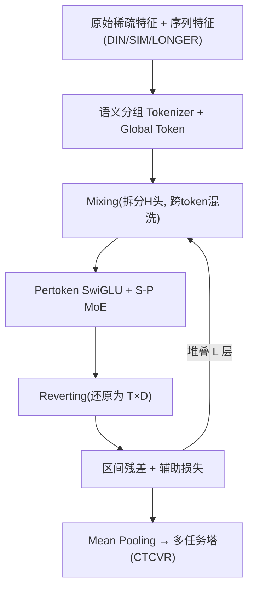

# TokenMixer-Large: Scaling Up Large Ranking Models in Industrial Recommenders (面向工业推荐系统的大规模排序模型扩展)

- **会议/期刊**: KDD 2026（预印本 arXiv:2602.06563v2）
- **作者与机构**: Yuchen Jiang, Jie Zhu, Xintian Han, Hui Lu, Kunmin Bai 等（字节跳动 AML / 抖音电商、广告、直播团队）
- **推荐链路定位**: 精排（Ranking Backbone，多目标 CTR/CVR/CTCVR 预测）
- **研究方向**: CTR/CVR 预估与特征交叉 / 工业级全链路架构与评测基准
- **论文原文**: [https://arxiv.org/abs/2602.06563v2](https://arxiv.org/abs/2602.06563v2)
- **开源代码**: 暂未开源

## TL;DR (1分钟核心速览)

本文针对前置工作 TokenMixer(RankMixer) 无法向深层/超大规模扩展的四大瓶颈（残差语义错位、碎片化算子拖垮 MFU、深层梯度不足、MoE 仅"稠密训练稀疏推理"），提出对称 **Mixing & Reverting** 结构保证维度与语义对齐，辅以区间残差+辅助损失稳定深层训练、Sparse-Pertoken MoE 实现"稀疏训推"，再用 Token Parallel 与 FP8 把工程开销压住。在抖音电商/广告/直播真实日志（点式 AUC/UAUC 评估）上把稠密参数推到 7B（线上）与 15B（离线），相对 MLP-500M 基线 CTCVR AUC 提升 **+1.14%~+1.20%**，线上广告 ADSS **+2.0%**、电商 GMV **+2.98%**。

## Background & Motivation (背景与核心矛盾)

- **主流范式**: DLRM 的特征交叉层从 Wide&Deep/DCN 演进到 DHEN、Wukong 的"统一模块+堆叠"范式，近期以 Transformer/TokenMixer（用轻量 token mixing 替代 self-attention）为主干追求 scaling law。
- **前人局限①：残差语义错位**: TokenMixer 通过 mixing 把 $T$个原始 token 压成$H$个新 token，残差却直接相加 mixing 前后的 token，要求$T'=T$ 才能回传原始语义，否则"位置对齐、语义不对齐"，深层堆叠即失效；同时 Post-Norm 带来数值爆炸。
- **前人局限②：模型不纯 + MoE 不稀疏**: 工业模型保留 LHUC、DCNv2 等访存受限的碎片算子，MFU 被拖低；ReLU-MoE 采用稠密训练稀疏推理，训练成本不降，且每 batch 激活专家数动态不可预测，推理端必须截断兜底。
- **核心洞察 (Key Insight)**: 随着 TokenMixer 主干变大变深，低阶碎片算子所能捕获的交叉信息可被主干自身"吸收"，因此应做"纯模型"设计；同时深层梯度衰减才是深度扩展的真正瓶颈，而非参数量。
- **本文切入点**: 让每个 Block 输入输出严格同形（$T\times D \to T\times D$）以保证处处可加残差，再以逐 token 稀疏专家换参数效率。

## Method (核心方法设计)

### 1. 整体框架 (Overall Architecture)

输入侧先将 500+ 异构特征（用户、物品、DIN 短期、SIM 长期、LONGER 超长期序列、交叉特征）embedding 化，再按语义分组用组专属 MLP 压缩对齐为 $T-1$个定长 token，并追加一个聚合全局信息的 `[CLS]` 式 global token，得到$X\in\mathbb{R}^{T\times D}$。主干由多层 TokenMixer-Large Block 堆叠，每个 Block 执行 "Mixing → Pertoken SwiGLU → Reverting → Pertoken SwiGLU" 的对称双段结构，配合 RMSNorm 的 Pre-Norm、区间残差与辅助损失；FFN 侧由 Sparse-Pertoken MoE 承担稀疏扩容。输出经 mean pooling 聚合后送入多任务塔（CTR/CVR/CTCVR）。训练用 Adagrad（稠密 0.01、稀疏 0.05），推理侧以 FP8 量化 + Token Parallel 切分 token 维完成部署。

<figure class="paper-figure" markdown="span">
  ![图1：TokenMixer-Large 的架构。原始 token 包括所有原始特征以及来自序列聚合与提取的特征（如 din \[39\]/ longer \[3\]）。整个 TokenMixer-Large 模型由多个 TokenMixer-Large Block 组成，每个 Block 的主干由（Norm、Mixing、S-P MoE、Reverting、Norm、S-P MoE）和残差组成。](../../../../assets/papers/2602.06563v2/figure_1.png)<figcaption>图1：TokenMixer-Large 的架构。原始 token 包括所有原始特征以及来自序列聚合与提取的特征（如 din [39]/ longer [3]）。整个 TokenMixer-Large 模型由多个 TokenMixer-Large Block 组成，每个 Block 的主干由（Norm、Mixing、S-P MoE、Reverting、Norm、S-P MoE）和残差组成。</figcaption>
</figure>

### 2. 关键设计拆解 (Key Designs)

1. **Mixing & Reverting 对称残差（解决语义错位）**：原 TokenMixer 残差 $F(x')+x$中$x'$已是混洗后的 token，位置语义断裂。本文把 Block 拆成两段：第一段把$X\in\mathbb{R}^{T\times D}$按特征维切成$H$份、沿 token 维拼接成$H$个"混洗 token"；第二段再把$H$个 token 切回$T$份、沿特征维拼回$\mathbb{R}^{T\times D}$，从而残差恒可写为
$$X_{\text{next}}=\mathrm{Norm}\big(\mathrm{pSwiGLU}(X_{\text{revert}})+X\big),\quad X_{\text{revert}}\in\mathbb{R}^{T\times D}$$
直觉上这相当于给注意力式的跨 token 交互加了一条"可逆通道"，既保留原始 token 语义又完成全通道信息交换，因此深层不再掉点。

2. **区间残差 + 辅助损失（解决深层梯度衰减）**：仅靠标准残差在数十层后梯度仍衰减，作者每隔 2–3 层插入一条跨层短路（末层不加，避免原始低阶信息污染高层抽象），并把中间层 logits 与最终 logits 联合计算轻量辅助损失，使浅层学会"估计高层偏差"。配合 Pre-Norm+RMSNorm 与 SwiGLU 的 down 矩阵小初始化（xavier_uniform 标准差 1→0.01，使 $F(x)+x$ 初期近似恒等映射），深层训练才稳定收敛。

3. **Sparse-Pertoken MoE 与 "先放大后稀疏" 策略**：将每个 token 的 pertoken SwiGLU 拆成 $E$ 个子专家并 Top-k 稀疏激活，损失为
$$\mathrm{S\text{-}PMoE}(x_t)=\alpha\!\!\sum_{j\in\text{TopK}}\!g_j(x_t)\,\mathrm{Expert}_j(x_t)+\mathrm{SharedExpert}(x_t)$$
关键细节：每个 token 拥有**独立路由器**（等价于给标准 MoE 加了路由先验，避免早期路由难学）；共享专家按 token 分配而非全局共享；门控值缩放 $\alpha$与稀疏比成反比（1:2 用$\alpha=2$，1:4 用$\alpha=4$）以补偿 softmax 归一化导致的专家梯度不足。实测负载自动均衡，**无需负载均衡损失**。

4. **训练目标与工程效率**：总损失为多任务主损失 + 辅助层损失之和，无需负采样（点式 CTR 任务）；工程侧自研 MoEPermute / MoEGroupedFFN / MoEUnpermute 融合算子（GroupedFFN 占训练 89.2%、推理 98.4% 时延），FP8 E4M3 训练后量化带来 **1.7×** 推理加速；Token Parallel 把 pertoken 权重按 token 维切分，使 all2all 通信从 $4L$降到$2L+1$，4 路并行吞吐 +29.2%，通信计算重叠后达 **+96.6%**；"纯模型"化后广告主干 MFU 提升至 **60%**。

## Experimental Setup & Evaluation Protocol (实验设置与评估协议)

- **数据集与预处理**: 抖音真实线上日志，采样后电商约 4 亿条/天（两年跨度），广告 3 亿条/天，直播 170 亿条/天；含 500+ 数值/ID/交叉/序列特征，覆盖数亿用户。论文未披露物品数与具体稀疏度（下表以"—"标注）：

| 数据集 | #Users | #Items | #Interactions | 稀疏度/密度 | 特征/场景说明 |
| :--- | :---: | :---: | :---: | :---: | :--- |
| Douyin E-Commerce | 数亿 | — | ~400M/天 × 2 年 | — | 500+ 特征，标签为点击/转化/GMV |
| Douyin Feed Ads | — | — | ~300M/天 | — | 广告 CTR/CVR，指标 ADSS/ADVV |
| Douyin Live Streaming | — | — | ~17B/天 | — | 直播支付金额 |

- **数据划分与防穿越 (Splitting Strategy)**: 采用**按天时间切分**的工业流水线（训练用历史日志、评测用次日流量），论文未给出严格时间戳冻结细节，属本文评估透明度上的弱点。
- **排名评测协议 (Ranking Protocol)**: 使用 **点式 AUC / UAUC**（CTR/CVR/CTCVR），即打分排序质量代理指标，**非 Full-Ranking 全库排序、也非 Sampled Ranking**；效果以相对基线 MLP-500M 的 **ΔAUC** 报告，未给绝对 AUC 值。
- **对比基线与超参设置**: 9 个 SOTA 基线（DLRM-MLP、DCNv2、AutoInt、HiFormer、DHEN、Wukong、Group Transformer、FAT、RankMixer）；效率侧报告纯稠密参数量、每 batch(2048) FLOPs 与 MFU；训练用 64 GPU（广告/直播 256）混部框架，稠密/稀疏 Adagrad 学习率 0.01/0.05。

## Key Experimental Results (实验关键数据)

### 1. 主实验对比 (Main Results)

电商场景 ~500M 量级与放大后的 CTCVR 表现（相对 DLRM-MLP-500M 基线）：

| 模型 | ΔAUC↑ | 稠密参数 | FLOPs/Batch |
| :--- | :---: | :---: | :---: |
| DLRM-MLP-500M | – | 499 M | 125.1 T |
| HiFormer | +0.44% | 570 M | 28.8 T |
| DCNv2 | +0.49% | 502 M | 125.8 T |
| DHEN | +0.63% | 415 M | 103.4 T |
| AutoInt | +0.75% | 549 M | 138.6 T |
| Wukong | +0.76% | 513 M | 4.6 T |
| Group Transformer | +0.81% | 550 M | 4.5 T |
| FAT | +0.82% | 551 M | 4.59 T |
| RankMixer (TokenMixer) | +0.84% | 567 M | 4.6 T |
| **TokenMixer-Large 500M** | **+0.94%** | 501 M | 4.2 T |
| **TokenMixer-Large 4B** | **+1.14%** | 4.6 B | 29.8 T |
| **TokenMixer-Large 7B** | **+1.20%** | 7.6 B | 49.0 T |
| **TokenMixer-Large 4B S-P MoE** | **+1.14%** | 2.3 B(激活)/4.6 B(总) | 15.1 T |

在线 A/B（对照 RankMixer-1B/150M/500M，放大至 7B/4B/2B）：广告 ADSS **+2.0%**（ΔAUC +0.35%）；电商 orders **+1.66%**、人均预览支付 GMV **+2.98%**（ΔAUC +0.51%）；直播 ΔUAUC +0.7%、总收入 **+1.4%**。

### 2. 消融实验 (Ablation Study)

| 消融设置（4B 档） | ΔAUC | ΔParams | ΔFLOPs |
| :--- | :---: | :---: | :---: |
| w/o Mixing & Reverting | −0.27% | – | – |
| Pertoken SwiGLU → 普通 SwiGLU | −0.21% | – | – |
| w/o Residual（标准残差） | −0.15% | – | – |
| Pertoken SwiGLU → Pertoken FFN | −0.10% | – | – |
| w/o 区间残差 & 辅助损失 | −0.04% | 0 | 0 |
| w/o Global Token | −0.02% | – | – |
| S-P MoE → 标准 MoE（对齐参数） | −0.10% | 0 | 0 |
| w/o Gate Value Scaling (α) | −0.03% | 0 | 0 |
| w/o Down-Matrix Small Init | −0.03% | 0 | 0 |
| w/o Shared Expert | −0.02% | 0 | 0 |

### 3. 关键实验发现 (Key Findings)

1. **语义对齐比信息通道更重要**：去掉 Mixing & Reverting 掉 0.27%，是标准残差（−0.15%）与区间残差+辅助损失（−0.04%）的近 2–7 倍，印证 TokenMixer 的核心病灶是残差语义错位而非梯度路径数量；Pertoken 化本身的收益（SwiGLU −0.21% vs FFN −0.10%）说明"逐 token 参数隔离 + 门控激活"共同承担了特征异质性建模。
2. **稀疏换参数几乎"免费"**：仅激活 2.3B/4.6B（50%）即达到稠密 4B 的 +1.14%，FLOPs 从 29.8T 砍到 15.1T，训练与推理 ROI 近翻倍；而同等参数下换成标准 MoE 掉 0.10%，证明"逐 token 独立路由"这一先验的价值。
3. **规模收益需要数据同步放大**：直播场景 90M→2.3B 的收敛天数由 14 天升到 60 天，2.3B 在 30 天样本下仅 +0.41%，延至 60 天才 +0.70%，说明超过 1B 后单纯堆参数会被数据瓶颈限制；同时 D/L/N 需**均衡扩张**（单维扩张均遇瓶颈），这与 1B 以下的 RankMixer 结论相反。

## Highlights & Limitations (亮点、对比与审稿批判)

- **与代表作对比 (vs. Prior Work)**: 相比 RankMixer 仅在"形似"上做 token mixing，本文把残差从"加法"重构为"可逆算子"，原则上解决了 $T\neq H$ 的语义断裂；相比 DHEN/Wukong 的模块打包堆叠，本文以纯化算子换取 60% MFU；相比 HiFormer/AutoInt 依赖注意力，本文保持线性 token mixing 的低 FLOPs 量级（4.2T vs 125T）。
- **可迁移亮点**: ①"混洗-还原"对称残差可直接用于任意跨 token 交互模块（如序列推荐中的 token 压缩主干）；②门控缩放 $\alpha$ 与稀疏比成反比这一经验规律，对任何 softmax 路由 MoE 都适用，且零额外开销。
- **审稿级局限批判**: ①**评估协议薄弱**：仅有工业日志上的点式 AUC/ΔAUC，无公开数据集、无 Full-Ranking 评测、无开源代码，外部无法复现"scaling law 斜率更陡"的结论；②**成本与因果归因不清**：7B/15B 的收益与 60% MFU、FP8 1.7× 加速、Token Parallel 通信重叠等工程项紧密耦合，论文未拆分"架构贡献 vs 工程贡献"的增益份额；FP8 量化的精度损失也未量化报告。

## Rating (四维评分)

- **方法创新性 (Novelty)**: ⭐⭐⭐⭐ （将残差重构为可逆 mixing–reverting 算子是干净的结构性洞察，但整体仍是 TokenMixer 系演化，理论/谱分析支撑缺失）
- **评估协议与实验扎实度 (Protocol & Experiments)**: ⭐⭐⭐ （三业务线离线+线上 A/B 极有说服力，但无公开数据、无全库排序协议、无绝对 AUC 与显著性检验）
- **写作与数学规范度 (Clarity & Rigor)**: ⭐⭐⭐⭐ （Mixing/Reverting 与 S-P MoE 公式完整、三性质 SR/OTR/TSA 的对齐分析清晰，但大量关键结论推入附录导致正文论证略薄）
- **工业落地与复现价值 (Industrial & Practical Value)**: ⭐⭐⭐⭐⭐ （7B 线上部署、MFU 60%、FP8 1.7× 与 Token Parallel +96.6% 吞吐均为可借鉴的工业级工程范式，唯代码未开源）

