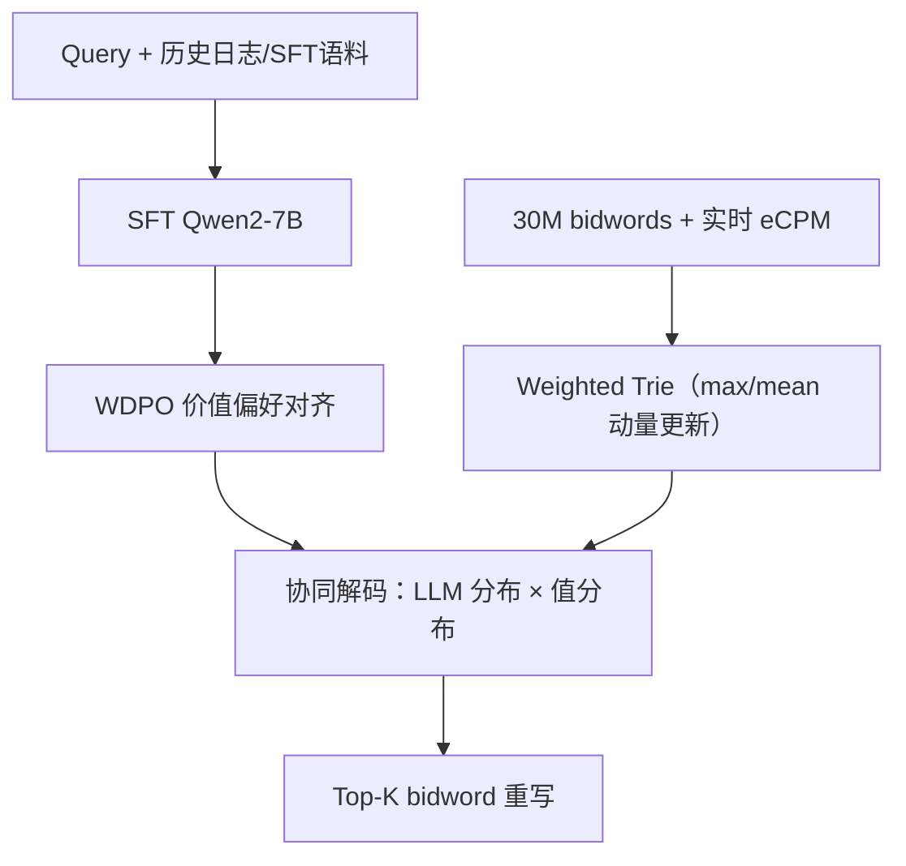
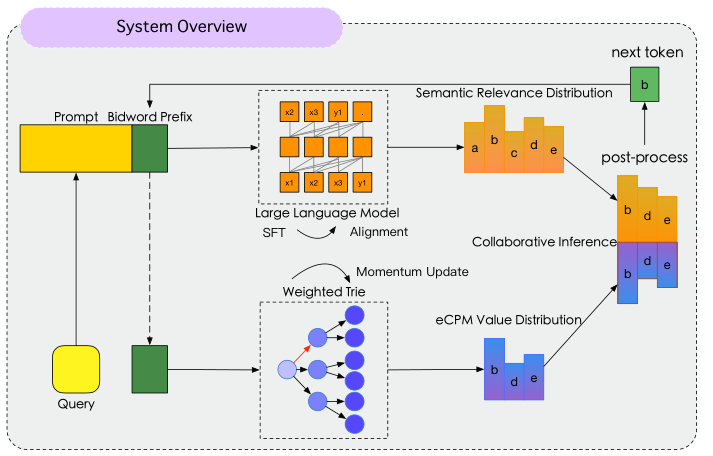

# VALUE: Value-Aware Large Language Model for Query Rewriting via Weighted Trie in Sponsored Search（基于加权 Trie 的价值感知大语言模型查询重写）

- **会议/期刊**: KDD 2026
- **作者与机构**: Xiao Zhang, Guanyu Chen, Boyang Zuo, Feng Li, Pengjie Wang, Jian Xu, Bo Zheng；阿里巴巴、清华大学
- **推荐链路定位**: 召回（Query 理解与 query→bidword 生成）
- **研究方向**: CTR/CVR 预估与特征交叉 / 大语言模型推荐
- **论文原文**: [论文原文链接](https://arxiv.org/abs/2504.05321v2)
- **开源代码**: 暂未开源

## TL;DR (1分钟核心速览)

针对生成式查询重写中语义相关与商业价值错位、DPO 过拟合及 eCPM 实时漂移，VALUE 将实时价值信号写入加权 Trie，并在解码时与 LLM 概率融合，同时用 WDPO 只学习稳定价值差。Top-K 离线评测和 14 天线上 A/B 中，hit@500 达 91.91%，RPM +1.64%。

## Background & Motivation (背景与核心矛盾)

- **主流范式**: 搜索广告 query→bidword 重写通常采用“SFT 注入领域知识 → DPO/PPO 价值对齐 → Trie 约束解码”三段式，以兼顾语义相关与关键词合法性。
- **前人局限**: 语义相关性排序与 bidword 商业价值排序天然不一致，语义最优未必收益最高；同时 eCPM 随竞价实时波动，训练期学到的价值排序在推理期迅速过时。
- **DPO 副作用**: 传统偏好对齐过度强调 bidword 价值顺序，易过拟合稀疏/瞬态价值差，导致 SFT 学到的语义能力被遗忘。
- **核心洞察 (Key Insight)**: 与其把价值信号全部压进训练目标，不如把实时 eCPM 放到解码阶段，用轻量 Trie 约束搜索空间并主动引导生成。
- **本文切入点**: 构建节点带 max/mean eCPM 的 Weighted Trie，配合深度递增的融合权重与 WDPO，实现“先语义、后价值”的协同推理。

## Method (核心方法设计)

### 1. 整体框架 (Overall Architecture)

VALUE 先以清洗后的 query-bidword 对 SFT Qwen2-7B，再用 WDPO 做价值偏好对齐；离线侧用 3000 万 bidword 及实时 eCPM 构建 Weighted Trie，并按动量更新节点价值。推理时，LLM 输出下一 token 分布，Weighted Trie 返回合法子节点及价值分布，二者融合后采样；早期 token 偏语义，后期 token 逐步加大价值权重，最终输出 Top-K 高价值重写。

<figure class="paper-figure" markdown="span">
  <figcaption>图 1：我们提出的 VALUE 框架的系统概述包括三部分：“SFT 与对齐”、“加权 Trie 构建与权重动量更新”和“协同推理”。在 LLM 解码过程中，我们从加权 Trie 得到值分布以约束生成空间，随后将其与另一分布合并以产生最终输出分布。</figcaption>
</figure>
图1：VALUE 整体框架，包括 SFT/对齐、加权 Trie 构建与更新、协同推理三部分。

### 2. 关键设计拆解 (Key Designs)

1. **Weighted Trie 与价值动量更新**：传统 Trie 只做合法性约束，无法表达 bidword 价值。本文为每个节点维护 `children`、`mean_v`、`max_v`、`is_word`，叶节点写入 eCPM 后自底向上聚合：$\mathrm{MaxV}_{new}=\max(eCPM_{new},\mathrm{MaxV}_{old})$，$\mathrm{MeanV}_{new}=\alpha eCPM_{new}+(1-\alpha)\mathrm{MeanV}_{old}$。这样既能追踪高价路径，又能用均值平滑竞价噪声，支持分钟级热更新而无需重训 LLM。

2. **协同推理与深度递增融合**：解码第 $t$步，先由前缀从 Trie 取子节点价值$V_k=\beta\mathrm{MaxV}_k+(1-\beta)\mathrm{MeanV}_k$，归一化为$\hat{V}_k=\mathrm{softmax}_k(V_k)$；随后屏蔽非 Trie 子节点，并按$p_{WT}(k|x_{<t})=p_{LLM}(k|x_{<t})(1+\hat{V}_k\theta_t)$调整概率。$\theta_t$ 随深度线性增大：首 token 主要锚定语义，后续 token 在合法空间中偏向高 eCPM，从而把“相关性约束”和“价值最大化”解耦到不同解码阶段。

3. **WDPO 与训练/推理开销**：DPO 对所有偏好对一视同仁，易被瞬态价值差带偏。WDPO 只采样满足 $|eCPM(y_w)-eCPM(y_l)|>\tau$的 bidword 对，并令损失为$\mathcal{L}_{WDPO}=-\mathbb{E}[\log\sigma(\beta\log\frac{\pi_\theta(y_w|x)}{\pi_{ref}(y_w|x)}-\beta\log\frac{\pi_\theta(y_l|x)}{\pi_{ref}(y_l|x)})\cdot w]$，其中$w=\exp(-\mathrm{KL}([\pi_\theta(y_w|x),\pi_\theta(y_l|x)]\|[P(y_w),P(y_l)]))$，$P(y_i)$ 为归一化 eCPM。稳定大价值差被放大，噪声对被降权，减少过拟合。推理侧 7B 离线生成 top500 覆盖 85% PV，1.5B 在线生成 top50、延迟约 50ms；30M bidword Trie 约 2.7GB，单机多线程构建约 20 分钟。

## Experimental Setup & Evaluation Protocol (实验设置与评估协议)

- **数据集与预处理**:

| 数据集 | #Query | #Bidword/Items | #Records | 稀疏/长度 | 特征/场景说明 |
| :--- | :---: | :---: | :---: | :---: | :--- |
| 训练集（30 天日志清洗） | — | 30M | 1.1 亿 query-bidword 对 | bidword 平均 7.9 字符 | 正则去噪 + CTR/购买行为过滤 + BGE 相关性模型筛选，每 query 最多 50 个 bidword |
| 测试集（随机采样） | 30,000 | — | — | 40% head / 40% torso / 20% tail | 与线上分布对齐的分层 query 集 |

- **数据划分与防穿越 (Splitting Strategy)**: 测试集从历史在线日志随机抽取 30k query 并按 head/torso/tail 分层；论文未报告全局时间戳切分，离线结果应视为同分布历史日志评估，而非严格未来时间泛化。
- **排名评测协议 (Ranking Protocol)**: 采用 Top-K 生成式重写评测，`hitrate@K` 以用户点击 bidword 集合 $C_q$为 ground truth，统计 top-K 重写命中比例；非全库 Full-Ranking，也未采用常规负采样排序。另用 BERTScore 类 Relevance、Spearman’s$\rho$、OOVR 与 eCPM 评价语义、价值一致性和幻觉率。
- **对比基线与超参设置**: 对比线上多路召回系统 OnlineModel、价值导向 DeepNB、生成式 BEQUE，以及 Qwen2-7B 的 SFT/Trie/DPO/WeightedTrie 变体。SFT 学习率 1e-5、batch 128、32×H20 训练 12 小时；WDPO 学习率 1e-6、batch 64、$\beta=0.1$、16×H20 训练 3 小时。论文未报告显著性检验。

## Key Experimental Results (实验关键数据)

### 1. 主实验对比 (Main Results)

| 模型 | hit@50 | hit@500 | Spearman’s $\rho$ | Relevance | OOVR | eCPM |
| :--- | ---: | ---: | ---: | ---: | ---: | ---: |
| OnlineModel（线上） | 59.93% | 85.41% | 0.02 | 68.15% | 0% | 8,676 |
| DeepNB | 44.16% | 79.82% | 0.13 | 46.26% | 0% | 12,852 |
| BEQUE | 39.26% | 62.85% | 0.08 | 74.37% | 38.41% | 7,582 |
| SFT Qwen2-7B | 38.18% | 63.71% | 0.02 | **76.33%** | 34.85% | 7,439 |
| SFT+Trie | 59.11% | 86.38% | -0.01 | 75.31% | 0% | 7,270 |
| SFT+DPO+Trie | 38.61% | 62.19% | 0.05 | 69.48% | 0% | 28,391 |
| SFT+WeightedTrie | 60.37% | 91.52% | 0.46 | 74.55% | 0% | 59,803 |
| SFT+DPO+WeightedTrie | 50.35% | 77.73% | 0.23 | 70.18% | 0% | 38,301 |
| **VALUE（SFT+WDPO+WeightedTrie）** | **62.67%** | **91.91%** | **0.56** | 73.49% | 0% | **63,775** |

VALUE 相对 OnlineModel：hit@50 +4.57%、hit@500 +7.61%、Relevance +7.84%、eCPM 约 7.35 倍；相对 SFT+WeightedTrie：hit@500 +0.39pp、eCPM +6.64%。Relevance 低于纯 SFT Qwen 2.84pp，说明价值引导存在可观测的相关性折损。

### 2. 消融实验 (Ablation Study)

| 变体 | hit@50 | hit@500 | $\rho$ | Relevance | eCPM |
| :--- | ---: | ---: | ---: | ---: | ---: |
| SFT+Trie（无 WeightedTrie） | 59.11% | 86.38% | -0.01 | **75.31%** | 7,270 |
| SFT+WeightedTrie（无 WDPO） | 60.37% | 91.52% | 0.46 | 74.55% | 59,803 |
| SFT+DPO+Trie（有 DPO 无 WeightedTrie） | 38.61% | 62.19% | 0.05 | 69.48% | 28,391 |
| SFT+DPO+WeightedTrie（DPO 对照） | 50.35% | 77.73% | 0.23 | 70.18% | 38,301 |
| **VALUE（WDPO）** | **62.67%** | **91.91%** | **0.56** | 73.49% | **63,775** |

### 3. 关键实验发现 (Key Findings)

- WeightedTrie 单模块带来最大收益：SFT+Trie→SFT+WeightedTrie 的 hit@500 从 86.38% 升至 91.52%（+5.14pp），Spearman 从 -0.01 升至 0.46，eCPM 从 7,270 升至 59,803，而 Relevance 仅降 0.76pp，证明解码期注入价值信号可在不重训 LLM 的情况下显著提升商业价值。
- 传统 DPO 在价值对齐上明显过拟合：SFT+WeightedTrie 加入 DPO 后 hit@50 从 60.37% 降至 50.35%，hit@500 从 91.52% 降至 77.73%，Relevance 降 4.37pp；WDPO 将 hit@500 恢复至 91.91%，eCPM 提升至 63,775，说明“稳定大价值差”筛选比全量偏好对更稳健。
- 线上 14 天 A/B 中，VALUE 全量 query 的 cost +1.53%、RPM +1.64%、PV relevance +0.32pt；tail query 的 RPM +2.66%、cost +2.35%，显著高于 head query 的 +1.03%/+0.97%，表明长尾与复杂 query 受益更大。超参上 $\Theta_3$线性深度权重最佳（hit@500 91.52%、Relevance 74.55%），指数加权$\Theta_4/\Theta_5$ 反而降至 88.63%/73.71% 与 69.85%/60.53%。

## Highlights & Limitations (亮点、对比与审稿批判)

- **与代表作对比 (vs. Prior Work)**: BEQUE 仍以 SFT+PRO/多任务对齐为主，OOVR 高达 38.41%，且价值响应滞后；VALUE 把 Trie 从“合法性约束”升级为“价值感知器”，OOVR=0 且 eCPM 约为 BEQUE 的 8.4 倍。相比 MoBGM 在训练中联合优化 value/fidelity，VALUE 将价值优化后移到解码，避免复杂 reward 权重平衡。相比标准 DPO，WDPO 用价值差阈值与 KL 权重抑制噪声偏好，避免“价值排序压垮相关性”。
- **可迁移亮点**: Weighted Trie 可作为通用“多目标约束生成”插件，把实时业务信号写入前缀树并在解码时融合；WDPO 的稳定差加权思想可迁移到点击/转化/时长等多奖励对齐，尤其适合奖励快速漂移的广告与推荐场景。
- **审稿级局限批判**: 其一，eCPM 作为唯一价值信号会诱导相关性折损，VALUE 的 Relevance 73.49% 低于 SFT Qwen 的 76.33%，且 $\theta_t$需人工调参，$\Theta_4/\Theta_5$ 已显示强价值权重会反噬 hit 与 RPM。其二，离线评测为 Top-K 生成命中而非 Full-Ranking，未报告显著性检验；30M Trie 约 2.7GB 内存、分钟级更新和离线/在线双模型服务带来工程复杂度，且暂无开源代码，复现与跨业务迁移仍需验证。

## Rating (四维评分)

- **方法创新性 (Novelty)**: ⭐⭐⭐⭐ （把 Trie 从被动约束改为主动价值感知器，配合 WDPO 稳定差加权，机制新颖且贴合广告业务）
- **评估协议与实验扎实度 (Protocol & Experiments)**: ⭐⭐⭐⭐ （离线多指标 + 14 天线上 A/B 较完整，但非 Full-Ranking、无显著性检验，相关性折损需正视）
- **写作与数学规范度 (Clarity & Rigor)**: ⭐⭐⭐⭐ （核心公式与部署细节清晰，融合函数与 WDPO 权重定义明确，超参敏感性分析充分）
- **工业落地与复现价值 (Industrial & Practical Value)**: ⭐⭐⭐⭐⭐ （已在阿里广告系统上线并服务双十一，RPM +1.64%，轻量 Trie 与缓存/双模型 serving 具备强落地参考）

