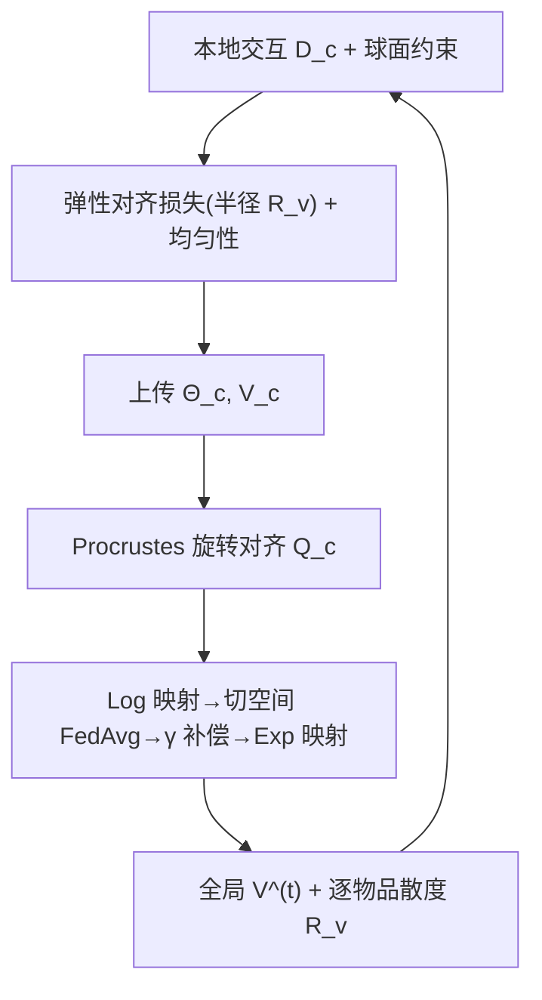
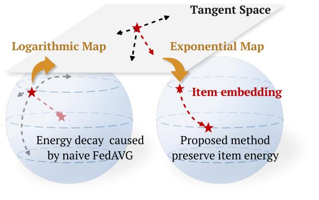
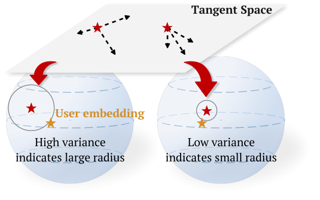

# CanonFedRec: A Canonical Geometric Framework for Personalized Federated Recommendation (面向个性化联邦推荐的典范几何框架)

- **会议/期刊**: KDD 2026
- **作者与机构**: Yunqi Mi, Zeyu Hao, Guoshuai Zhao 等（西安交通大学；City St George's, University of London）
- **推荐链路定位**: 召回 / 端到端嵌入表征学习（联邦训练）
- **研究方向**: 去偏公平、可信隐私与工业架构 / 协同过滤与双塔召回
- **论文原文**: [论文原文链接](https://openaccess.city.ac.uk/id/eprint/38468/1/3770855.3817845.pdf)
- **开源代码**: 暂未开源（原文仅给出 Zenodo DOI）

## TL;DR (1分钟核心速览)

主流 FedRec 靠"解耦本地偏置/私有个性化参数"绕开数据异构，代价是放弃聚合物品嵌入的协同收益（FedCIA 更以 $O(N^2)$ 相似度矩阵换取精度）。本文实证+理论指出病根在于**客户端局部过滤气泡**（范数无界膨胀、表示同质化）与**服务器全局几何失配**（欧氏 FedAvg 使方向冲突相互抵消、物品能量衰减）。CanonFedRec 将优化搬到单位超球面，用 Procrustes 对齐 + 切空间黎曼投影聚合、客户端散度感知弹性对齐，在 4 个数据集的 Top-10 排序上全面 SOTA，LastFM 上 F1@10 相对最优基线提升 47.2%，显存最高降低 40×。

## Background & Motivation (背景与核心矛盾)

- **主流范式**: 服务器聚合 $\{\Theta,\mathbf{V}\}$，用户嵌入$\mathbf{U}$ 永不出本地；为对抗异构，PFedRec/FedRAP/GPFedRec/MetaMF 普遍引入本地偏置项或客户端私有的物品表示来"修正"聚合结果。
- **前人局限**: ① 解耦越彻底，聚合嵌入越被闲置，联邦协同收益被丢弃，且边缘设备要为每客户端额外存一份物品表示；② FedCIA 改聚合相似度矩阵虽保精度，却带来 $O(N^2)$ 存储与通信，难以规模化。
- **核心洞察 (Key Insight)**: 在 ML-100k 上追踪训练过程发现三个悖论现象——客户端交互物品嵌入范数无界膨胀（且与流行度无关）、本地物品间相似度急剧升高（坍缩进窄超锥）、而服务器上**逐物品聚合能量反而衰减**。根因是推荐嵌入表达的是共现**拓扑结构**而非语义属性（啤酒-尿布），异构客户端在互不兼容的流形上各自优化这些拓扑，欧氏平均把学习到的结构"相互抵消"。
- **本文切入点**: 把聚合与本地优化统一到单位超球面这一典范几何空间，让"聚合"变成保持拓扑的测地位移而非欧氏坐标平均。

## Method (核心方法设计)

### 1. 整体框架 (Overall Architecture)

每轮服务器下发 $\{\Theta^{(t)},\mathbf{V}^{(t)}\}$；客户端在超球面上用"弹性对齐 + 均匀性"目标做本地优化，回传除用户嵌入外全部参数；服务器先用正交 Procrustes 把各客户端更新旋转到上一轮全局锚点坐标系，再把嵌入对数映射到全局切空间做加权 FedAvg，乘全局学习率$\gamma$后用指数映射拉回球面；同时由切空间散度估计逐物品不确定半径$R_v$并随模型下发，指导下一轮客户端松弛高分歧物品。全流程无额外私有参数、无$N^2$矩阵，空间$O(Nd)$。

### 2. 关键设计拆解 (Key Designs)

1. **超球面约束 (HMH) 消除幅值噪声**：BPR 类目标可用无界放大嵌入把损失压到 0 却不提升语义（Prop. 3.1），稀疏监督又使本地嵌入集中于低维用户子空间（Prop. 3.2）。将 $\|\mathbf{v}\|=1$ 后，模长这一与流行度无关的自由度被彻底剥夺，模型只能靠角度（方向）表达偏好，天然抑制局部过自信。

2. **黎曼投影聚合 (RPA) 修复全局几何失配**：设局部更新 $\mathbf{v}_c=r_c\mathbf{p}_c$，则欧氏聚合满足$\|\hat{\mathbf{v}}\|^2\le\sum_c w_c^2r_c^2+\rho\sum_{c\neq c'}w_cw_{c'}r_cr_{c'}$（$\rho$ 为方向异构因子，Prop. 3.3），方向越不一致能量衰减越重。做法是先对齐再在切空间平均：
$\mathbf{Q}_c=\arg\min_{\mathbf{Q}^\top\mathbf{Q}=\mathbf{I}}\|\mathbf{V}^{(t-1)}_{\text{anch}}-\mathbf{V}^{(t)}_{c,\text{anch}}\mathbf{Q}\|_F$，锚点集合用"已交互物品 + 随机未交互物品"，避免稀疏时对齐病态；
$\mathbf{T}_{c,v}=\frac{\theta}{\sin\theta}\big(\tilde{\mathbf{v}}_c-\mathbf{v}^{(t-1)}\cos\theta\big),\ \theta=\arccos(\mathbf{v}^{(t-1)\top}\tilde{\mathbf{v}}_c)$；
$\mathbf{V}^{(t)}=\mathrm{Exp}_{\mathbf{V}^{(t-1)}}(\gamma\sum_c w_c\mathbf{T}_c)$。切空间是流形的局部欧氏近似，故 FedAvg 在此局部有效，聚合的是"测地位移"而非绝对坐标，能量不再抵消；$\gamma$ 补偿投影出流形造成的残余衰减。

<figure class="paper-figure" markdown="span">
  <figcaption>图3：通过黎曼投影进行聚合。</figcaption>
</figure>

3. **散度感知弹性对齐 (DEA) 打破本地过滤气泡**：球面上强制拉近正样本对会把"争议物品"（口碑两极分化）的复杂语义压成一点。作者用逐物品切空间方差作客户端认知分歧代理：$\sigma_v^2=\mathbb{E}_c[\|\gamma\mathbf{T}_{c,v}\|^2]-\|\mathbb{E}_c[\gamma\mathbf{T}_{c,v}]\|^2$，令不确定半径$R_v=2\beta\sigma_v^2+\epsilon$，把 vMF 似然在高斯近似下转化为弹性损失$\mathcal{L}^{(c)}_{\text{rec}}=\mathbb{E}_{(u,v)}\frac{\|f(u)-f(v)\|^2}{R_v}+\lambda\mathcal{L}_{\text{uniform}}$：分歧越大的物品边界越松，实现个性化和全局一致性的动态折中。

<figure class="paper-figure" markdown="span">
  <figcaption>图4：散度感知的弹性对齐。</figcaption>
</figure>

4. **训练目标与开销**：客户端损失即上式（免负采样、不含 BPR 采样式），$\lambda$控制均匀性；推理为标准内积 Top-K，无额外解码开销；上传量仅$\Theta$与$\mathbf{V}$，通信与$O(Nd)$ 同阶。

## Experimental Setup & Evaluation Protocol (实验设置与评估协议)

- **数据集与预处理**: 四个公开数据集，未报告显式 `5-core` 过滤细节（**可复现性扣分点**）：

| 数据集 | #Users | #Items | #Interactions | 密度 | 特征/场景 |
| :--- | :---: | :---: | :---: | :---: | :--- |
| ML-100k | 943 | 1,682 | 100,000 | 6.30% | 电影，稠密小规模 |
| LastFM | 992 | 10,000 | 517,817 | 5.22% | 音乐社交 |
| BX | 18,964 | 19,998 | 482,153 | 0.13% | 图书，极稀疏 |
| Video | 24,303 | 10,672 | 231,780 | 0.09% | 亚马逊游戏，最稀疏 |

- **数据划分与防穿越**: `比例划分` 8:2，训练集再切 10% 作验证；默认 100 客户端；异构性实验把客户端数从 100 扫到 943（每客户端单用户，约束最强）。
- **排名评测协议**: 报告 F1@10 / MRR@10 / NDCG@10（$K=10$）及多样性 ILD、Coverage。原文**未明确声明 Full-Ranking 还是采样排序**，实验基于 RecBole 的 LightGCN 评测实现，这是评估严谨性的主要不确定项。
- **对比基线与超参**: 8 个基线覆盖"带个性化策略"(PFedRec/GPFedRec/FedRAP/MetaMF/FedCIA) 与"不带"(FedMF/FedNCF/FedLightGCN)；嵌入维度 $d=512$，Adam，300 epoch，早停 10 轮；$\gamma\in\{1,1.5,2,2.5,3\}$，$\beta\in[0.1,1]$；5 个随机种子取均值，配对 t 检验$p\le0.01$。

## Key Experimental Results (实验关键数据)

### 1. 主实验对比 (Main Results)

| 方法 | ML-100k F1 | ML-100k M@10 | ML-100k N@10 | LastFM F1 | LastFM M@10 | LastFM N@10 |
| :--- | :---: | :---: | :---: | :---: | :---: | :---: |
| FedMF | 13.08 | 43.43 | 52.31 | 4.02 | 34.10 | 43.39 |
| FedNCF | 16.93 | 55.82 | 61.98 | 4.39 | 40.11 | 48.45 |
| PFedRec | 14.51 | 47.64 | 55.80 | 4.41 | 33.20 | 46.23 |
| GPFedRec | 14.01 | 46.77 | 55.51 | 4.76 | 41.57 | 49.95 |
| FedRAP | 16.19 | 47.76 | 56.13 | 4.96 | 43.31 | 50.01 |
| MetaMF | 17.76 | 43.19 | 52.53 | 5.51 | 34.20 | 46.92 |
| FedCIA | 23.29 | 60.14 | 67.58 | 5.81 | 45.76 | 53.83 |
| FedLightGCN | 23.06 | 55.73 | 64.57 | 4.68 | 46.01 | 54.06 |
| **CanonFedRec** | **23.06** | **61.79** | **68.76** | **8.55** | **58.17** | **65.33** |
| Improv. | -0.99% | +2.74% | +1.75% | **+47.2%** | **+26.4%** | **+20.8%** |

（Video 数据集上 FedCIA 为 0.99/1.68/2.27，CanonFedRec 达 **2.21/3.82/5.83**，F1 翻倍；BX 上 F1 1.21→**1.88**。）

### 2. 消融实验 (Ablation Study)

| 组件组合 | ML-100k F1 | ML-100k M@10 | ML-100k N@10 | LastFM F1 | LastFM M@10 | LastFM N@10 |
| :--- | :---: | :---: | :---: | :---: | :---: | :---: |
| 欧氏基线 | 20.71 | 55.73 | 64.57 | 4.02 | 34.10 | 43.39 |
| +HMH (仅球面) | 22.39 | 59.33 | 66.92 | 7.01 | 51.33 | 59.58 |
| +RPA (仅投影聚合) | 22.17 | 57.78 | 66.29 | 3.99 | 34.08 | 43.37 |
| +HMH+RPA | 22.86 | 61.46 | 68.51 | 7.96 | 54.61 | 62.53 |
| +HMH+DEA | 21.20 | 55.52 | 64.08 | 5.50 | 44.15 | 52.43 |
| **Full** | **23.06** | **61.79** | **68.76** | **8.55** | **58.17** | **65.33** |

### 3. 关键实验发现 (Key Findings)

1. **球面约束是收益主体，投影聚合负责"接住"收益**：仅加 HMH 就把 LastFM F1 从 4.02 抬到 7.01（+74.4%），说明幅值噪声是稀疏联邦场景下的首要污染源；再叠加 RPA 才把 M@10 从 51.33 推到 58.17（+13.3%），印证欧氏平均在方向异构下的抵消效应。
2. **DEA 必须与 RPA 配对，否则负收益**：仅 HMH+DEA 时 ML-100k F1 跌到 21.20（低于只有 HMH 的 22.39），因为弹性边界放出的多样方向被欧氏聚合当成噪声抹平，产生破坏性干涉；三者齐备后升至 23.06，说明"允许分歧"与"能吸收分歧的聚合算子"是耦合设计而非可自由拼装的正交模块。
3. **稀疏度越高、客户端越碎，几何框架优势越大**：Video（密度 0.09%）上 F1 相对 FedCIA 提升 123%；客户端从 100 增至 943 时 FedCIA 与本文差距持续拉大；且 Pareto 图上 3×（ML-100k）/20×（LastFM）/40×（BX）的存储节省来自 $O(Nd)$取代$O(N^2)$。加噪鲁棒性上，Laplace 强度 0.2 时仍保留 98%+ NDCG@10；与 FedLightGCN-1 结合 F1 从 4.77 提到 6.67（+39.8%），但编码器越强增益越小，说明全局几何结构与局部图卷积部分功能重叠。

## Highlights & Limitations (亮点、对比与审稿批判)

- **与代表作对比**: 与 FedRAP/MetaMF 的"解耦 + 本地私有偏置"路线相反，本文主张**不新增任何私有参数**、让聚合嵌入重新承担协同职责；与 FedCIA 相比，同属"对齐而非统一"思路，但用旋转对齐+切空间平均替代 $O(N^2)$ 相似度矩阵，把精度-存储三难问题解耦；与 DirectAU 的超球面均匀性相比，DEA 用逐物品方差自适应放宽边界，适应联邦稀疏异构。
- **可迁移亮点**: ① 用"逐物品切空间方差"作为分歧代理并转成自适应损失权重，可迁移到集中式去噪/难样本加权；② 用上一轮全局嵌入作锚点做 Procrustes 旋转对齐，可直接用于多源/多场景嵌入坐标系统一，而不必共享原始数据。
- **审稿级局限批判**: ① 评测协议未明确 Full-Ranking 或采样负例比例，稀疏数据集（BX/Video）指标绝对值极低（F1≈1–2%），结论对候选集构造敏感；② 需要多轮 Log/Exp 映射与逐物品 Procrustes（SVD 级开销），且超参 $\gamma$在$\{1,\dots,3\}$呈先升后降的尖峰（ML-100k 最优$\gamma=2$），$\beta\ge0.8$ 即崩，工程调参成本与通信轮次开销未被量化；③ 数据过滤（是否 5-core）与客户端划分随机种子未披露，多样性与精度的权衡也缺少与用户满意度/线上指标的对应。

## Rating (四维评分)

- **方法创新性 (Novelty)**: ⭐⭐⭐⭐ （把 FedRec 聚合失效归因为方向异构下的能量抵消并给出 Prop. 3.3 解析上界，用黎曼投影把 FedAvg 无损搬进切空间，几何视角清晰且非拼装式创新）
- **评估协议与实验扎实度 (Protocol & Experiments)**: ⭐⭐⭐ （4 数据集 + 5 种子 + 配对 t 检验 + 异构/加噪/骨干可插拔分析齐全，但排序协议未声明、预处理细节缺失、极稀疏集上绝对值过低）
- **写作与数学规范度 (Clarity & Rigor)**: ⭐⭐⭐⭐ （三条命题与两张几何示意图对应紧凑，Log/Exp 映射与弹性损失推导自洽；对 vMF 采用高斯近似属工程妥协，未给近似误差界）
- **工业落地与复现价值 (Industrial & Practical Value)**: ⭐⭐⭐⭐ （$O(Nd)$ 存储、40× 显存节省、最小通信气泡、可插拔任意内积编码器，对边缘设备友好；扣分在于未真正开源且逐物品 SVD 对齐的在线时延未评估）

