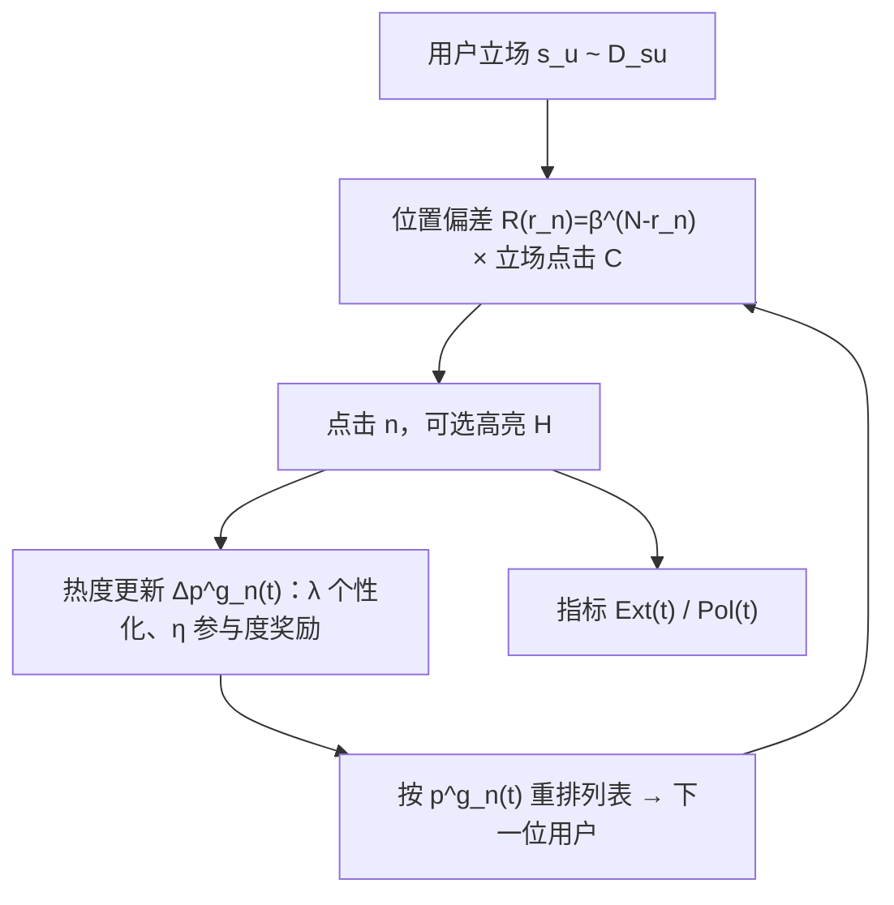
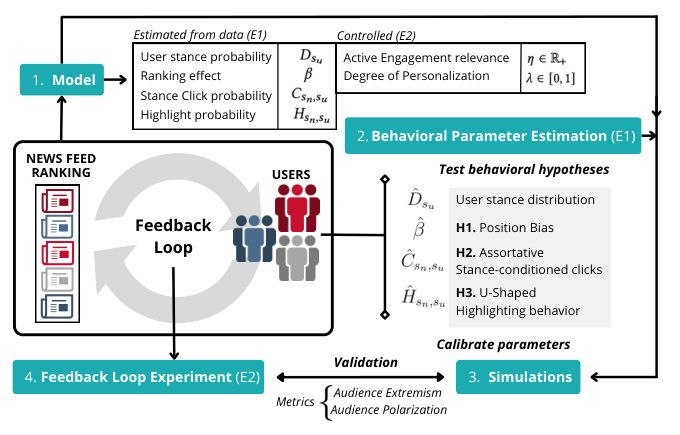

# Rewarding Engagement and Personalization in Popularity-Based Rankings Amplifies Extremism and Polarization (奖励参与度与个性化如何放大极端化与极化)

- **会议/期刊**: KDD 2026 (V.2, pp. 875–886)
- **作者与机构**: Jacopo D'Ignazi, Emma Fraxanet, Andreas Kaltenbrunner, Gaël Le Mens, Fabrizio Germano, Vicenç Gómez（Universitat Pompeu Fabra / Barcelona Supercomputing Center / BSE）
- **推荐链路定位**: 重排（Feed 级流行度排序与热度更新）
- **研究方向**: 去偏公平、可信隐私与工业架构 / 社交与群组推荐
- **论文原文**: [arXiv:2510.24354v3](https://arxiv.org/abs/2510.24354v3)
- **开源代码**: [Zenodo 复现包](https://doi.org/10.5281/zenodo.20475404)

## TL;DR (1分钟核心速览)

平台把点击/点赞/分享（"参与度"）纳入排序目标并叠加个性化，究竟会不会把用户推向更极端的内容？本文不靠观测数据，而是构造一个仅含 5 个可解释参数的流行度排序动力模型，先用 432 名被试（E1）极大似然估计出位置偏差、同立场点击与 U 型参与度三条行为规律，再以 1534 名被试、24 条动态排序轨迹（E2）做因果检验：从中性排序切换到"强个性化 + 强参与度奖励"后，左右翼用户对极端同立场内容的点击提升约 20%，中间新闻点击下降 15–20%，中心用户无显著变化；实验与仿真相关 $r=0.88$（指标）、$r=0.97$（点击分布）。

## Background & Motivation (背景与核心矛盾)

- **主流范式**: 工业排序普遍以点击、分享、评论等参与度信号定义热门度，再按用户画像做个性化重排（如 Facebook 2018 "Meaningful Social Interactions" 更新同时提高了参与度权重与个性化程度）。
- **前人局限**: (i) 田野实验/观测研究结论高度混杂——改变曝光对态度影响有限，甚至出现"接触对立观点反而加剧敌意"的反弹效应，难以识别因果；(ii) 已有 agent-based 与理论模型缺少可估计、可实验检验的参数化，无法把行为规律与算法旋钮对应起来。
- **核心洞察 (Key Insight)**: 四条有实证支撑的弱假设——位置偏差、同立场偏好、极端用户更活跃、排序按热度分配位置——在"参与度奖励 + 个性化"同时开启时会自组织成正反馈闭环：极端用户的点击与高亮被重复加权 → 内容位置上移 → 位置偏差让更多人点击它。
- **本文切入点**: 把该闭环压缩成一个可 MLE 标定的小参数模型，再用人类被试在动态更新的排序上做对照实验，验证模型预测。

## Method (核心方法设计)

### 1. 整体框架 (Overall Architecture)

框架分四段闭环：模型 → 行为参数估计（E1）→ 数据驱动仿真 → 反馈回路实验（E2）。新闻与用户在五点立场谱 $S=\{-2,-1,0,1,2\}$上取值，用户按顺序到达，看到$N=10$条排序列表后点击一条并可选"高亮"（点赞/分享）；点击同时更新该条在各用户群体$g\in\{L,C,R\}$中的热度$p^{g}_{n}(t)$，下一用户的列表即按$p^{g}_{n}(t)$降序生成。E1 用随机且不更新的静态列表估计$(D_{s_u},\beta,C,H)$；仿真把估计值注入模型、以$\lambda,\eta$ 网格扫描；E2 用真实被试在线交互、动态更新热度，并把观测指标与仿真预测对齐。

<figure class="paper-figure" markdown="span">
  <figcaption>图 1：研究基于参与度的排序与用户行为之间反馈回路的建模与实验框架概览。四个主要组成部分为：(i) 模型参数；(ii) 行为参数估计（E1）及相应量；(iii) 数据驱动的模拟步骤；(iv) 反馈回路实验（E2）。</figcaption>
</figure>

### 2. 关键设计拆解 (Key Designs)

1. **乘性位置偏差 + 立场条件点击的归一化算子**：痛点是把"位置效应"和"内容偏好"混在一个 softmax 里无法分离。本文将点击概率写成可分解形式
$P(n\mid r,s_u)=\dfrac{R(r_n)C_{s_n,s_u}}{\sum_{n'}R(r_{n'})C_{s_{n'},s_u}}$，其中$R(r_n)=\beta^{N-r_n}$、$\beta\ge1$。
指数形式使 $\beta$具有"下移一位点击率缩小$\beta$倍"的直接乘性解释（$R(r_n)/R(r_n+1)=\beta$），避免了对数线性模型难以跨列表比较的问题；换成幂律衰减结论不变。

2. **双旋钮热度更新算子（个性化 $\lambda$+ 参与度奖励$\eta$）**：痛点是平台的两个设计选择总被同时部署，无法在理论层面拆开。本文用一条更新式同时参数化二者：
$\Delta p^{g}_{n}(t)=\big(\mathbb{I}[s_u\in g]+(1-\lambda)\mathbb{I}[s_u\notin g]\big)\,(1+\eta\,\mathbb{I}[\text{highlight}])$。
$\lambda=0$表示全站共享排序，$\lambda=1$表示群体排序完全忽略外群体活动；$\eta=0$表示只看点击，$\eta>0$ 表示高亮获得额外热度。该式的物理直觉是：个性化削弱了"跨立场点击对新热度的稀释"，参与度奖励则把极端用户的高活跃度直接折算成曝光。

3. **参数估计目标与推理开销**：无梯度训练，全部参数由 E1 的极大似然估计得到（$\hat\beta=1.09\pm0.01$，$\hat C$、$\hat H$为$5\times5$条件概率表），用户立场分布$\hat D_{s_u}$由经验频率给出。排序更新是$O(N)$ 的加法；仿真侧每个配置 1000 次独立运行、每次 250 名合成用户，指标在约 200–300 次交互后收敛，因此 E2 每条轨迹配置 ~253 次交互。

## Experimental Setup & Evaluation Protocol (实验设置与评估协议)

- **实验与数据规模**:

| 阶段 | 参与者/实体 | 物品 | 交互量 | 初始化 | 场景说明 |
| :--- | :---: | :---: | :---: | :---: | :--- |
| E1 参数估计 | 432 名 Prolific 美国被试 | 4 主题 × 10 条新闻 | ~1728 次点击 + 高亮 | 随机静态排序 | Ground.news 硬新闻（性别政策/疫苗/移民/气候），5 点立场 |
| E2 反馈回路实验 | 1534 名被试，24 条轨迹 | 10 条/列表 | ~253 次交互/轨迹 | $p^{g}_n(0)=0$ + 随机破平 | 2 配置 × 4 主题 × 3 轨迹，动态更新 |
| 仿真 | 250 合成用户 × 1000 次/配置 | 同上 | 25 万级 | 随机排序 | $\lambda\in[0,1]$、$\eta\in[0,100]$ 对数网格 |

- **划分与防穿越**: 无监督/测试划分概念，靠**随机化**防混淆——被试随机分配主题顺序、随机分配算法配置与轨迹，E1 的列表对被试行为**不更新**（切断反馈），E2 才启用更新；指标只取最后 $w=200$ 次点击窗口并丢弃前 ~50 次交互以去除初始排序瞬态。
- **评测协议**: 指标为 $\text{Ext}(t)=\langle|\hat{s}_n(\tau)|\rangle_{\tau\in W}$（点击内容立场的平均绝对偏移）与$\text{Pol}(t)=\langle\hat{s}_n\rangle_{W_R}-\langle\hat{s}_n\rangle_{W_L}$（左右翼受众平均点击立场差）。统计检验使用单侧 Mann–Whitney U（对单次点击），并对连续点击做 10–50 块聚合做稳健性复核；点击分布用$\chi^2$ 列联检验；参数误差棒来自 1000 次用户级 bootstrap。
- **对比设置**: 基线为中性排序 $(\lambda=0,\eta=0)$，处理组为$(\lambda=1,\eta=100)$；两者的独立作用由仿真网格与四个角点配置（$2\times2$）分离。

## Key Experimental Results (实验关键数据)

### 1. 主实验对比 (Main Results)

E2 因果结果（↑/↓ 表示相对中性排序的变化，显著性为单侧 Mann–Whitney U）：

| 主题 | Audience Extremism | 显著性 | Audience Polarization | 显著性 |
| :--- | :---: | :---: | :---: | :---: |
| Gender 政策 | ↑ | ** | ↑（不显著） | n.s. |
| Vaccines 疫苗 | ↑ 增幅最大 | ** | ↑ 增幅最大 | *** |
| Immigration 移民 | ↑ | * | ↑ | *** |
| Climate 气候 | ↑（不显著） | n.s. | ↑ | *** |

热度排序的机理证据（Table 1，数值越小越靠前）：

| 配置 / 分组 | EL | ML | C | MR | ER |
| :--- | :---: | :---: | :---: | :---: | :---: |
| $\lambda=0,\eta=0$（全站共享） | 6.0 | 4.7 | **2.4** | 6.7 | 7.7 |
| $\lambda=1,\eta=100$ Left | **4.1** | **3.3** | 3.9 | 7.6 | 8.7 |
| $\lambda=1,\eta=100$ Center | 5.9 | 6.1 | **3.1** | 5.7 | 6.6 |
| $\lambda=1,\eta=100$ Right | 7.7 | 7.0 | 5.5 | **4.0** | **3.2** |

### 2. 消融实验 (Ablation Study)

仿真四角点配置（每主题 1000 次独立仿真，趋势在 4 个主题上一致）：

| 配置 | Ext | Pol | 归因 |
| :--- | :---: | :---: | :--- |
| $\lambda=0,\eta=0$ | 最低 | 最低 | 中性基线，中心新闻占据榜首 |
| $\lambda=0,\eta=100$（仅参与度奖励） | ↑ | ↑ | 极端用户的高亮被折算成曝光 |
| $\lambda=1,\eta=0$（仅个性化） | ↑ | ↑↑ | 跨立场点击不再稀释同立场热度 |
| $\lambda=1,\eta=100$（联合） | **最高** | **最高** | 4 主题一致最高；Fig. 5 显示两指标对$\lambda,\eta$ 单调递增 |

点击分布层面（E2 vs 仿真，$r=0.97$，$p\sim10^{-18}$）：

| 用户组 | 极端同立场点击 | 中心新闻点击 | $\chi^2$ p 值 |
| :--- | :---: | :---: | :---: |
| Left | +20% | −15~20% | 0.005 |
| Center | 无显著变化 | 无显著变化 | 0.888 |
| Right | +20% | −15~20% | 0.031 |

### 3. 关键实验发现 (Key Findings)

1. **三条行为假设被数据确认**：$\hat\beta=1.09\pm0.01$（每下移一位点击率除以 1.09，位置偏差温和但稳健）；同立场点击 lift 在中心用户最高（$\approx2\times$随机基线）、极端用户$\approx1.5\times$；高亮概率呈 U 型，极左 ~50%、极右 ~47%，中间派仅 30–40%——正是这条 U 型曲线把参与度奖励变成了极端内容的"曝光放大器"。
2. **联合配置的因果增益可量化**：全部用户对同立场新闻的点击 +13%，左右翼对极端同立场内容点击 +20%，代价主要由中心新闻承担（−15~20%），而中心用户自身点击分布几乎不变（$p=0.888$）——说明是被动"被推送"而非主动寻求。
3. **个性化比参与度奖励更"毒"**：仿真中 $\lambda$轴（个性化）对极化指标的增速快于$\eta$轴；在 Immigration/Climate 上"仅个性化"的极端化水平甚至高于"仅奖励高亮"，且实验-仿真在 8 个主题-配置对上的相关达$r=0.88$（$p=0.004$），说明模型抓住了主效应而非过拟合。

## Highlights & Limitations (亮点、对比与审稿批判)

- **与代表作对比**: 相比 Facebook 2020 选举的田野 RCT（干预曝光、结论受上下文与短期性困扰），本文把"算法旋钮"显式参数化并做被试内动态排序实验，识别的是机制而非单点效应；相比既有 agent-based/理论模型（如其所依托的 Fraxanet 等），本文引入离散立场类别、显式建模中心用户、并用人类数据标定 $C,H,\beta$，使预测可被实验证伪。
- **可迁移亮点**: (i) 位置偏差的乘性指数形式 $R(r_n)=\beta^{N-r_n}$可直接用于离线评估中的 position-based IPS 加权；(ii) 把$(\lambda,\eta)$ 当作排序策略上线前的"审计旋钮"，在仿真中扫描即可给出极端化/极化的风险热力图，成本极低。
- **审稿级局限批判**: (i) 生态效度有限——Prolific 短期任务、单次高亮、10 条硬新闻列表，且完全不测量态度/信念变化，只能断言"消费模式"而非"观点极端化"；作者亦承认真实平台更丰富的参与信号（评论、转发链）可能让机制更强；(ii) 实验只测联合配置，$\lambda$与$\eta$的独立与交互效应仅由仿真给出，未做$2\times2$ 的四条件人类实验，因此"个性化主导"这一结论尚缺实验层面的因果支撑；(iii) 主题间差异（疫苗最敏感、气候最钝）依赖 E1 的 432 人估计，样本量与主题级参数不确定性未被纳入显著性检验。

## Rating (四维评分)

- **方法创新性 (Novelty)**: ⭐⭐⭐⭐ （把"位置偏差 + 同立场偏好 + U 型参与度"三条经验规律压缩成 5 参数可标定动力系统，并用双旋钮算子显式拆解平台设计，机制清晰、可证伪）
- **评估协议与实验扎实度 (Protocol & Experiments)**: ⭐⭐⭐⭐ （1534 人动态排序实验 + 1000 次仿真 + 块聚合稳健性 + bootstrap 误差棒，实验-仿真 $r=0.88/0.97$ 的交叉验证相当有说服力；扣分在于未做四条件解耦实验）
- **写作与数学规范度 (Clarity & Rigor)**: ⭐⭐⭐⭐ （模型极简、每个参数都有行为学解释与估计来源，指标定义干净；但仿真数值多以热力图呈现，正文未给逐点表格，复现需依赖 Zenodo 包）
- **工业落地与复现价值 (Industrial & Practical Value)**: ⭐⭐⭐⭐ （代码与处理后数据全开源；$O(N)$ 更新与轻量仿真使其可作为排序策略的"社会风险沙盒"，但结论外推到真实平台仍需日志级校准）

