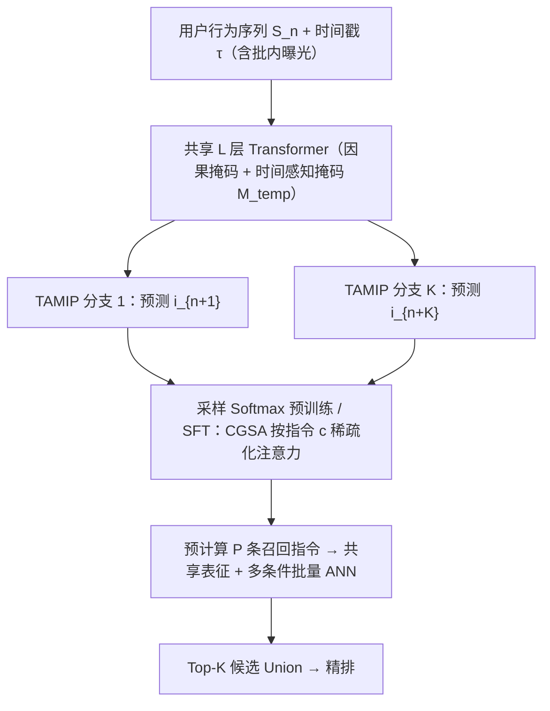
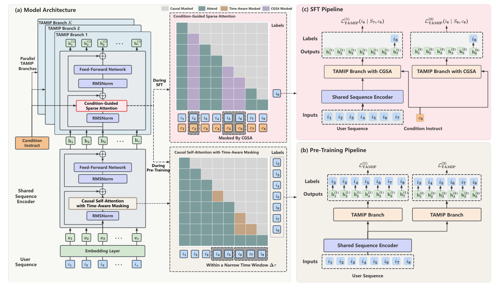
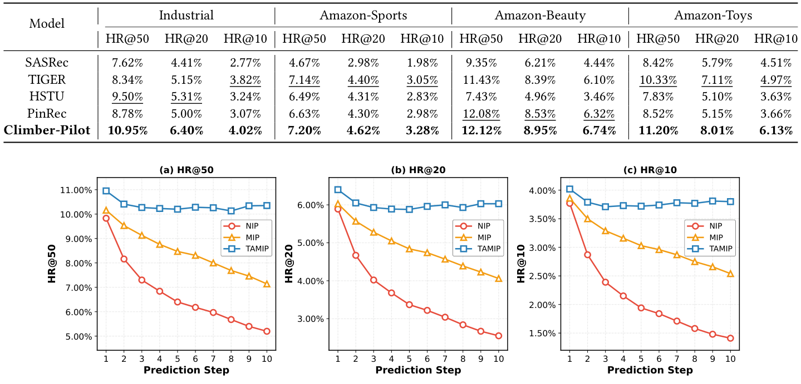

# Climber-Pilot: A Non-Myopic Generative Recommendation Model Towards Better Instruction-Following (面向指令遵循的非短视生成式召回模型)

- **会议/期刊**: KDD 2026（Jeju Island）
- **作者与机构**: Da Guo, Shijia Wang, Qiang Xiao 等，网易云音乐（NetEase Cloud Music）
- **推荐链路定位**: 召回（工业级单步生成式检索 + 多条件批量推理）
- **研究方向**: 生成式推荐与离散语义 ID / 序列与会话推荐
- **论文原文**: [论文原文链接](https://arxiv.org/abs/2602.13581v2)
- **开源代码**: 暂未开源

## TL;DR (1分钟核心速览)

生成式召回在工业延迟约束下只能单步推理，配合 Next-Item Prediction 目标会产生"固有短视"（意图坍缩到高频局部最优）；同时业务侧的品类/语种等召回指令难以优雅注入。本文提出 Climber-Pilot：预训练阶段用 **TAMIP**（多分支多目标预测 + 时间感知掩码）把长程多物品前瞻蒸馏进参数，SFT 阶段用 **CGSA**（条件引导稀疏注意力）在注意力级过滤无关历史以遵循指令。在 Amazon 三集与网易云工业集上以 Leave-One-Out + 全库 ANN 排序评测，工业集 HR@50 从 9.50% 提升至 10.95%（+15.3%），线上 Like Rate +4.24%、延迟仅 7.26ms。

## Background & Motivation (背景与核心矛盾)

- **主流范式**: 双塔 ANN 召回受限于单向量表达瓶颈，生成式检索（TIGER / HSTU / OneRec / PinRec）以自回归序列建模替代内积检索，端到端优化且无需近似最近邻。
- **前人局限 1（短视）**: 服务端延迟只允许单步推理，训练却用 NIP 目标，二者错配使模型只优化即时相关性，多样意图坍缩为少数高概率物品，长程与多物品消费模式丢失。
- **前人局限 2（指令）**: 工业召回需遵循品类/语种/新歌等显式约束；朴素条件注入精度不足，后置硬过滤又会损伤相关性并增加推理开销，PinRec/LUM 仅支持粗粒度 action-type 条件，非真正指令遵循。
- **核心洞察 (Key Insight)**: 曝光的**批内并行**特性会被日志机械序列化成"伪序列"（Consumption Lag）——同一次请求内 3–4 首歌本无因果先后，却被模型当作真实意图演化，这正是短视被放大的根因。
- **本文切入点**: 把复杂度从推理搬到训练、从后处理搬到模型内部归纳偏置：训练时用时间掩码切断批内伪相关，服务时单步推理不变。

## Method (核心方法设计)

### 1. 整体框架 (Overall Architecture)

两阶段范式。**预训练**：用户序列 $\{i_1,\dots,i_n\}$经哈希 ID 嵌入 + 类目特征融合为$\mathbf{e}_k$，送入带因果掩码与时间感知掩码的$L$层 Transformer 编码器得到$\mathbf{h}_n$；在共享表征上接$K$条（工业取$K=2$）参数独立的单层 TAMIP 分支，一次性预测$\{i_{n+1},\dots,i_{n+K}\}$。**SFT**：把品类/语种等业务条件$c$视作指令，分支改用不同长度的截断历史$S_{n-K+1}\sim S_n$预测同一目标$i_{n+1}$，末段分支接入 CGSA 稀疏掩码。**推理**：离线预计算用户 Top-$P$兴趣类目为召回指令，共享$L$层编码器只算一次并复用 KV Cache，$P$ 个条件在同一次前向中批量并行，各条件经 ANN 取回后 Union 送精排。

<figure class="paper-figure" markdown="span">
  <figcaption>图1：Climber-Pilot框架概览。(a) 模型架构。本部分详述TAMIP模块中采用的Time-Aware mask，并说明CGSA的工作机制。在SFT阶段，TAMIP分支采用CGSA以实现指令遵循能力。(b) 预训练流程。(c) SFT流程。</figcaption>
</figure>

### 2. 关键设计拆解 (Key Designs)

1. **TAMIP + 时间感知掩码（切断消费滞后伪相关）**：多目标预测（MIP）虽能延长视野，但直接叠加会继续从批内序列里学伪模式。作者以**首个目标时间戳** $\tau_{n+1}$为锚，把落在$[\tau_{n+1}-\Delta\tau,\ \tau_{n+1}]$内的历史全部屏蔽，$\Delta\tau$ 取线上平均请求间隔 15 分钟：
$M_{\text{temp}}(i,j)=-\infty\ \text{if}\ \tau_j\in[\tau_{n+1}-\Delta\tau,\tau_{n+1}],\ \text{else}\ 0$，
并与因果掩码共同进入注意力 $\text{softmax}\big(QK^{\top}/\sqrt{d_k}+M_{\text{causal}}+M_{\text{temp}}\big)V$。直觉：强行让模型"看不见刚刚同批曝光的物品"，只能从更早的真实长程兴趣推断，短视被结构性打破；$\tau_{n+1}$ 仅用于遮蔽、不泄露标签，且服务端因消费滞后天然不存在这些近邻交互，训练/推理信息面对齐。

2. **CGSA（注意力级指令遵循）**：MHA 全局聚合会把无关类目噪声摊薄到目标意图上。CGSA 用指令 $c$构造稀疏掩码$M_{\text{sparse}}(i,j)=0$若$\mathcal{C}(\text{item}_j)=c$，否则$-\infty$，即在注意力层直接剔除与指令不匹配的历史；且仅作用于最后的 TAMIP 分支层，前$L$ 层沿用预训练掩码以复用共享主干、保留预训练语义。相比后置过滤（召回 40% 命中率被丢弃）与 AdaLN 式全局调制，这是"逐 token 选择性去噪"，在不增推理步数的前提下兼顾合规与相关性。

3. **训练目标、负采样与推理效率**：预训练损失为 $K$个分支的采样 Softmax 之和$\mathcal{L}_{\text{PT}}=\sum_{k=1}^{K}-\log\frac{\exp(\phi(\mathbf{h}_n^{(k)},\mathbf{e}_{n+k}))}{\exp(\phi(\mathbf{h}_n^{(k)},\mathbf{e}_{n+k}))+\sum_{j\in\mathcal{N}}\exp(\phi(\mathbf{h}_n^{(k)},\mathbf{e}_j))}$，$\mathcal{N}$为**共享 in-batch 负样本**（非全库 softmax，免额外负采样器）；SFT 损失$\mathcal{L}_{\text{SFT}}=\sum_{k=1}^{K}\mathcal{L}^{(k)}_{\text{TAMIP}}(i_{n+1}\mid S_{n-k+1},c_{n+1})$，同一指令复用于$K$条不同长度上下文，既省算力又提升对服务端历史长度波动的鲁棒性；SFT 采用$1\times10^{-5}$ 小学习率防灾难性遗忘。线上单请求 7.26ms（基线 6.94ms）。

## Experimental Setup & Evaluation Protocol (实验设置与评估协议)

- **数据集与预处理**:

| 数据集 | #Users | #Items | 平均序列长 | 稀疏度/密度 | 特征/场景说明 |
| :--- | :---: | :---: | :---: | :---: | :--- |
| Amazon-Sports | 18,357 | 35,598 | 8.32 | 极稀疏 | 公开基准，ID+类目嵌入 |
| Amazon-Beauty | 22,363 | 12,101 | 8.87 | 极稀疏 | 公开基准 |
| Amazon-Toys | 19,412 | 11,924 | 8.63 | 极稀疏 | 公开基准 |
| Industrial | >40M | >6M | >100 | 稠密长序列 | 网易云音乐真实日志，45B 交互预训练语料 |

- **数据划分与防穿越 (Splitting Strategy)**: `Leave-One-Out`——每序列最后一项为测试标签，其余为历史；SFT 数据单独从线上日志构建且与预训练语料**不重叠**。
- **排名评测协议 (Ranking Protocol)**: 采用**全库 ANN 排序**（FAISS + HNSW 在完整物品库建索引取 Top-$K$），而非采样负例排序；指标 HR@{10,20,50}，另设条件合规率 CC@$K$（Top-$K$ 中满足指令类目的比例）。
- **对比基线与超参设置**: SASRec、TIGER、HSTU、PinRec（预训练）；PinRec、LUM、AdaLN-Zero（SFT 条件范式）；3 层 Transformer，$d=128$（工业）/32（Amazon），$K=2$，Adam，lr$5\times10^{-4}$，batch 256，$\Delta\tau=15$min。

## Key Experimental Results (实验关键数据)

### 1. 主实验对比 (Main Results)

| 模型 | Industrial HR@50 | Industrial HR@20 | Sports HR@50 | Beauty HR@50 | Beauty HR@10 | Toys HR@50 | Toys HR@10 |
| :--- | :---: | :---: | :---: | :---: | :---: | :---: | :---: |
| SASRec | 7.62% | 4.41% | 4.67% | 9.35% | 4.44% | 8.42% | 4.51% |
| TIGER | 8.34% | 5.15% | **7.14%** | 11.43% | 6.10% | 10.33% | 4.97% |
| HSTU | 9.50% | 5.31% | 6.49% | 7.43% | 3.46% | 7.83% | 3.63% |
| PinRec | 8.78% | 5.00% | 6.63% | 12.08% | 6.32% | 8.52% | 3.66% |
| **Climber-Pilot** | **10.95%** | **6.40%** | **7.20%** | **12.12%** | **6.74%** | **11.20%** | **6.13%** |
| **Improv.** | **+15.3%** | **+20.5%** | +0.8% | +0.3% | +6.6% | **+8.4%** | **+23.3%** |

（Amazon 三集按原表在多数指标上占优；Beauty/Toys 的 HR@10 相对最优基线 +6.6%/+23.3%，工业集领先幅度最大。）

### 2. 消融实验 (Ablation Study)

**A. 时间感知掩码窗口 $\Delta\tau$（=0 即退化为 MIP）**

| $\Delta\tau$ | HR@50 | HR@20 | HR@10 |
| :--- | :---: | :---: | :---: |
| 0 min (MIP) | 10.16% | 6.03% | 3.86% |
| 7.5 min | 10.11% | 6.07% | 3.91% |
| **15 min** | **10.95%** | **6.40%** | **4.02%** |
| 30 min | 9.89% | 5.94% | 3.86% |

**B. SFT 条件注入范式（同一预训练 checkpoint 微调）**

| 模型 | HR@50 | HR@20 | HR@10 | CC@10 |
| :--- | :---: | :---: | :---: | :---: |
| PinRec | 13.82% | 9.16% | 6.29% | **85.57%** |
| LUM | 11.45% | 7.51% | 5.24% | 77.84% |
| AdaLN-Zero | 15.84% | 10.27% | 6.88% | 80.96% |
| **CGSA** | **18.53%** | **11.69%** | **7.73%** | 81.75% |

<figure class="paper-figure" markdown="span">
  <figcaption>图3：TAMIP在缓解固有短视问题上的有效性。我们在工业数据集上比较三种训练范式：NIP（红色）、MIP（橙色）和TAMIP（蓝色）。TAMIP曲线展现出显著的长期稳定性。</figcaption>
</figure>

### 3. 关键实验发现 (Key Findings)

1. **掩码窗口必须对齐系统级统计量而非调参**：$\Delta\tau$ 从 0→7.5min 几乎无变化（10.16%→10.11%），说明窗口窄于真实请求间隔时批内物品仍可见、伪序列未被切断；15min（≈3–4 首 4 分钟歌 + 间隔）时 HR@50 相对提升约 8%；再放宽到 30min 反而跌至 9.89%（低于 MIP），因为误屏蔽了真正有信息量的早期交互。
2. **注意力级约束优于硬过滤与全局调制**：CGSA 相比 AdaLN-Zero 在 HR@10 上 6.88%→7.73%（+12.4%）且 CC 不降（80.96%→81.75%）；PinRec 虽 CC@10 最高（85.57%），但 HR@50 比 CGSA 低 4.7 个百分点——纯硬约束在满足业务规则的同时牺牲了相关性，CGSA 是"合规 + 满意"的联合最优。
3. **线上收益随条件场景放大且延迟近零代价**：通用场景 Like Rate +4.24%（无 SFT 仅 +2.03%，翻倍）、总收听时长 +3.25%；垂类场景 +4.10%，候选类目命中率由 40% 提升至 77.9%；延迟 7.26ms vs 7.94ms 内的基线 6.94ms（<5% 开销）；多样性增益随用户活跃度递增（高活跃 Genre +2.56%、Language +2.63%）。

## Highlights & Limitations (亮点、对比与审稿批判)

- **与代表作对比 (vs. Prior Work)**: 相比 TIGER/HSTU 等纯 NIP 生成式检索，本文不改动推理路径即获得长程前瞻能力，这是与"多步 beam / 规划式解码"路线的本质区别；相比 PinRec/LUM 的粗粒度 action-type 条件，CGSA 支持类目/语种/新歌等细粒度业务指令；相比 MIND/ComiRec 的静态胶囊多兴趣，TAMIP 在生成框架内建模动态兴趣轨迹。
- **可迁移亮点**: ①"消费滞后 → 时间掩码"这一数据侧诊断，对所有**批量曝光日志**（短视频 feed、电商坑位）的序列建模都成立，可直接复用为一种正则；②共享主干 + 多条件末层分支 + KV Cache 复用的批量多条件推理，是把可控生成压进毫秒级延迟的通用工程范式。
- **审稿级局限批判**: ①工业集结果无法复现，公开 Amazon 三集上提升并不显著（Sports HR@50 仅 +0.8%、Beauty HR@50 +0.3%），泛化性证据偏弱；②$K=2$且$d=32$的小模型配置使"多目标前瞻"的规模效应未验证，$K$增大后的收益/延迟曲线缺失；③$\Delta\tau$ 强依赖请求间隔统计（15min 对音乐成立），跨场景（如电商 30s 曝光）迁移需重新标定，且评测只用 HR 类指标，缺乏 NDCG/多样性离线指标与显著性检验。

## Rating (四维评分)

- **方法创新性 (Novelty)**: ⭐⭐⭐⭐ （把"批内并行被日志伪序列化"这一数据机理转化为时间掩码归纳偏置，洞察比算子本身更值钱；CGSA 属注意力级条件化的合理工程化）
- **评估协议与实验扎实度 (Protocol & Experiments)**: ⭐⭐⭐⭐ （全库 ANN 排序 + CC 合规率双视角 + 两周线上 A/B 与多样性分桶，工业验证扎实；但公开集提升幅度小、缺显著性检验与多 $K$ 分析）
- **写作与数学规范度 (Clarity & Rigor)**: ⭐⭐⭐⭐ （掩码公式与训练/推理信息面一致性论证清晰，$\Delta\tau$ 的物理量纲解释到位；复杂度分析与分支数选择的理论依据略欠）
- **工业落地与复现价值 (Industrial & Practical Value)**: ⭐⭐⭐⭐⭐ （7.26ms 延迟、45B 交互训练、单模型替代多条垂类召回管线、KV Cache 批量多条件推理，落地价值极高；扣分项为未开源）

