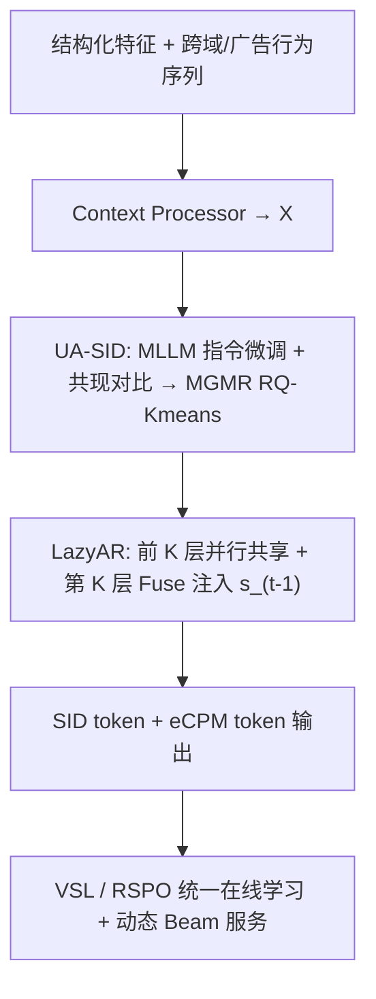
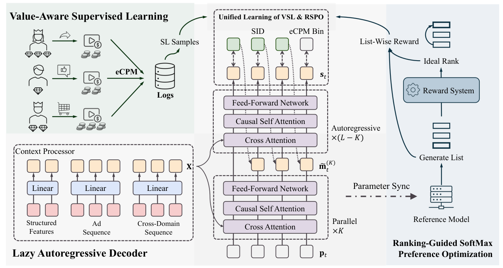

# Generative Recommendation for Large-Scale Advertising (面向大规模广告的生成式推荐)

- **会议/期刊**: KDD 2026 (under review, arXiv v3)
- **作者与机构**: Ben Xue, Dan Liu, Lixiang Wang 等（快手科技，通讯作者 Peng Jiang）
- **推荐链路定位**: 端到端生成式（替代 DLRM 召回/排序栈，实时在线学习）
- **研究方向**: 生成式推荐与离散语义 ID / 强化学习与动态探索推荐
- **论文原文**: [https://arxiv.org/abs/2602.22732v3](https://arxiv.org/abs/2602.22732v3)
- **开源代码**: 暂未开源

## TL;DR (1分钟核心速览)

本文针对“LLM 式生成式推荐配方无法直接用于大规模实时广告”的三处断层（广告多模态+商业信号无法统一 token 化、逐点监督与列表级 eCPM/NDCG 目标错位、多候选生成在严格延迟预算下不可用），提出工业级系统 GR4AD：UA-SID 语义 ID（MLLM 指令微调+共现对比学习+MGMR RQ-Kmeans）、LazyAR 惰性自回归解码、VSL/RSPO 统一在线价值对齐，以及动态 Beam 服务。快手全量线上 A/B（4 亿用户）广告收入最高 +4.28%、单卡吞吐 +117%，延迟 <100ms。

## Background & Motivation (背景与核心矛盾)

- **主流范式**: 以 TIGER/OneRec 为代表的生成式推荐把物品编码为分层 Semantic ID，用自回归 Transformer 做 next-token 生成式检索，工业界已开始替换 DLRM 双塔。
- **前人局限 1（Tokenization）**: 广告创意融合视频、商品、广告主 B2B 元数据，且转化类型、账户 ID 等强商业信号无“语义”，纯内容量化会产生大量 SID 碰撞，同一创意在不同转化目标下投放轨迹完全不同。
- **前人局限 2（Learning）**: 广告优化的是排序列表上的 eCPM 与 NDCG，逐 token 交叉熵只在拟合日志分布；DPO/GRPO 等偏好优化是离线、pair-wise 的，缺乏列表级、可流式更新的价值对齐。
- **核心洞察 (Key Insight)**: 作者发现第一级 SID（$s_1$）损失最大、最难学，但在 Beam Search 中因从 BOS 出发其有效 beam 恒为 1，几乎不占解码开销；绝大部分算力反而花在“更容易”的高层 SID 上——学习难度与推理成本严重错配。
- **本文切入点**: 按“表征—学习—服务”三位一体重设计：让难学的层全层计算、易学的层延迟注入条件依赖，并把监督信号直接对齐到列表级商业价值。

## Method (核心方法设计)

### 1. 整体框架 (Overall Architecture)

输入侧将结构化特征、跨域行为序列、广告行为序列经轻量线性 Context Processor 编码为上下文 $\mathbf{X}$；目标侧把广告映射为 UA-SID 序列$y=(s_1,\dots,s_T)$并附加一个 eCPM 离散桶 token。解码器由$L=9$层“cross-attn + causal self-attn + FFN”构成，前$K=6$层对所有 SID 层与所有 beam 并行计算，第$K$层才注入上一级 SID 嵌入，后$L-K$ 层自回归生成。训练采用 VSL（SID 交叉熵 + eCPM token + MTP 辅助）与 RSPO（列表级 RL）在单流中按样本级对齐分数动态加权；线上由 Reward System 打分回灌、Realtime Index 秒级更新 SID↔Item 双向索引，并以动态 Beam 服务在峰谷流量间调度算力。

<figure class="paper-figure" markdown="span">
  <figcaption>图 1：我们提出的 GR4AD 概述：模型架构与学习算法。</figcaption>
</figure>

### 2. 关键设计拆解 (Key Designs)

1. **UA-SID：让语义 ID 同时装下内容与商业信号**：痛点是无端到端广告 embedding，且内容量化对“同素材不同转化目标”无区分力。UAE 用 MLLM（Qwen3-VL-7B）对 6 类广告指令微调，再以 Swing 共现强度构造正样本做 InfoNCE：$\mathcal{L}_{\text{NCE}}(i)=-\log\frac{\sum_{j\in P_i}\exp(\mathbf{z}_i^\top\mathbf{z}_j/\tau)}{\sum_{k\neq i}\exp(\mathbf{z}_i^\top\mathbf{z}_k/\tau)}$；量化端用多分辨率 RQ-Kmeans（低层大码本 16384 抓主因子、高层小码本 4096/1024 建模低熵残差 + 平衡聚类），最后一层改为非语义特征（账户 ID、转化类型）的哈希映射。直觉：把“商业 ID”从连续残差中剥离，碰撞率骤降且几乎不增量化误差。
2. **LazyAR：把自回归依赖推迟到中间层**：针对上述“难度—成本错配”，前 $K$层不条件于$s_{t-1}$：$\{\mathbf{m}_t^{(K)}\}_{t=1}^{T}=\mathrm{Dec}^{(1:K)}(\{\mathbf{p}_t\},X)$，在第$K$层做门控融合$\tilde{\mathbf{m}}_t^{(K)}=\mathbf{W}_f[\mathbf{m}_t^{(K)}\odot(\mathbf{W}_g\mathbf{s}_{t-1});\mathbf{s}_{t-1}]$，再走$L-K$层自回归。因前$K$层与$s_{t-1}$无关，可跨层、跨 beam 一次性算完，Beam Search 的串行深度从$L$降到$L-K$；同时加 MTP 辅助损失（令$\mathbf{h}_t^{(K)}\triangleq\mathbf{m}_t^{(K)}$ 直接预测）迫使 trunk 在潜空间完成推理，避免 DeepSeek-MTP 式“另加浅层解码器”带来的参数膨胀与性能回退。
3. **VSL + RSPO：与列表级商业价值对齐的统一在线学习**：VSL 在 $\mathcal{L}_{\text{SID}}$外追加 eCPM 桶预测$\mathcal{L}_{\text{eCPM}}$，并按$w=w_{\text{user}}\cdot w_{\text{behavior}}$加权样本（购买 > 点击）。RSPO 把 RL 目标写成 NDCG-cost 的上界：$\mathcal{L}_{\text{RSPO}}=-\mathbb{E}\big[\log 2\sigma\big(-\log\sum_{y_j\in E_i}M_{ij}\exp(\beta\Delta_{ij})\big)\big]$，其中$\Delta_{ij}=\log\frac{p_\theta(y_j|X)}{p_{\text{ref}}(y_j|X)}C_{ij}-\log\frac{p_\theta(y_i|X)}{p_{\text{ref}}(y_i|X)}C_{ij}$，Lambda 权重$M_{ij}=|\frac{1}{D_{|i-j|}}-\frac{1}{D_{|i-j|+1}}|\,|G_i-G_j|$；$C_{ij}$是参考分布可用性门控，当模型与$p_{\text{ref}}$偏离超阈值$\delta$时直接丢弃参考项，避免脏正则。二者不再分阶段串联，而以排名错位度$A^{(i)}=|r_p^{(i)}-r_v^{(i)}|/(n-1)$动态加权：$w_{\text{VSL}}^{(i)}=w_0\exp(A^{(i)}\log(1+v_i))$，$w_{\text{RL}}^{(i)}=w_0Z_{\max}(1-A^{(i)})$。
4. **训练目标与推理效率**：总体 $\mathcal{L}=\mathbb{E}_i[w_{\text{VSL}}^{(i)}\mathcal{L}_{\text{VSL}}^{(i)}+w_{\text{RL}}^{(i)}\mathcal{L}_{\text{RSPO}}^{(i)}]$，$\mathcal{L}_{\text{VSL}}=\mathbb{E}[w(\mathcal{L}_{\text{SID}}+\lambda_e\mathcal{L}_{\text{eCPM}}+\lambda_{\text{mtp}}\mathcal{L}_{\text{MTP}})]$；无人工负采样，全依赖 softmax 全库 SID 生成。推理侧：动态 Beam 宽度（如 512-512-512 → 128-256-512 的渐进放大）+ 流量自适应 TABS（低谷 beam +60%）、推荐结果短 TTL 缓存、Beam-Shared KV Cache（KV 读取$O(B\cdot L)\to O(L)$）、TopK 预裁剪与 FP8。

## Experimental Setup & Evaluation Protocol (实验设置与评估协议)

- **评估规模与部署**: 快手广告系统全量，4 亿+ 用户；线上模型 0.16B，单 L20 上 <100ms 延迟、500+ QPS。
- **数据划分与防穿越**: 无经典离线划分，采用**在线流式学习**：实请求/交互流实时构造 VSL 正样本日志与 RL 样本，参数实时同步至推理服务器；SID 质量另建**离线 photo-to-photo 召回测试集**（两图属同一广告商品即命中）。
- **排名评测协议**: 生产流量 **A/B 实验**（非离线 Full-Ranking / Sampled Ranking）。因生成式模型与 DLRM 多模型共服 GPU 配置不同，单模型 QPS 不可直接比，故一律报**相对 GR-Base 的 QPS 变化**与**相对 DLRM 的收入提升**。
- **对比基线与超参**: 基线为 DLRM 生产栈与 OneRec-V2；RL 对照 DPO、GRPO；效率对照 DeepSeek-MTP。LazyAR 取 $L=9$、$K=6$；Beam 默认 512，扩展实验至 1024。

| 部署/评估项 | 规模或数值 |
| :--- | :---: |
| 服务用户量 | 400M+ |
| 线上模型参数 | 0.16B |
| 单卡吞吐/延迟 | 500+ QPS / <100ms (L20) |
| SID 层级/码本 | 3 层 (16384, 4096, 1024*，末层哈希) |
| 解码层数 | $L=9$, 共享$K=6$ |

## Key Experimental Results (实验关键数据)

### 1. 主实验对比 (Main Results)

| 模型设置 | ΔRevenue (vs. DLRM) | ΔQPS (vs. GR-Base) |
| :--- | :---: | :---: |
| DLRM (Base) | – | – |
| OneRec-V2 (GR-Base) | +1.68% | – |
| + UA-SID | +1.92% | 0% |
| + VSL | +2.80% | −25% |
| + VSL + DPO | +3.16% | −25% |
| + VSL + GRPO | +3.21% | −25% |
| + VSL + RSPO | +3.86% | −25% |
| + Unified VSL & RSPO (UVR) | +4.01% | −25% |
| + UVR + DBS | **+4.32%** | +20% |
| + UVR + DBS + DeepSeek-MTP | +3.98% | +117% |
| **GR4AD (+UVR+DBS+LazyAR)** | +4.28% | **+117%** |

### 2. 消融实验 (Ablation Study)

| 组件消融 | R@1 | R@5 | R@10 | Cpr↓ | Col↓ | Util↑ |
| :--- | :---: | :---: | :---: | :---: | :---: | :---: |
| QARM (仅视频内容) | 0.541 | 0.812 | 0.893 | – | – | – |
| Qwen3-VL-7B | 0.769 | 0.948 | 0.977 | – | – | – |
| + IT + CL (UAE) | **0.896** | **0.985** | **0.994** | – | – | – |
| RQ-Kmeans | – | – | – | 3.54 | 85.44% | 0.10‰ |
| + MR | – | – | – | 1.78 | 59.72% | 0.20‰ |
| + MG + MR (UA-SID) | – | – | – | **1.07** | **18.26%** | **0.34‰** |

| 规模缩放 | 0.03B | 0.08B | 0.16B | 0.32B | Beam 128 → 1024 |
| :--- | :---: | :---: | :---: | :---: | :---: |
| ΔRevenue | +2.13% | +2.68% | +4.01% | **+4.43%** | +2.33% → **+4.21%** |
| QPS | – | – | – | – | 200% → 30% |

### 3. 关键实验发现 (Key Findings)

- **列表级 RL 是最大单项增益，且必须与 VSL 统一**：VSL 单独带来 +0.88pt（1.92→2.80），而 RSPO 再加 +1.06pt，显著超过同位置的 DPO（+0.36pt）与 GRPO（+0.41pt）；UVR 动态加权再补 +0.15pt，说明“逐点拟合 + 列表级价值偏置”互补而非替代。
- **LazyAR 用 0.04pt 收入换取 117% 吞吐，远优于“另加浅层解码器”**：DeepSeek-MTP 同样达 +117% QPS，但收入从 +4.32% 跌至 +3.98%（−0.34pt）；LazyAR 以共享前 $K=6$ 层的潜空间推理几乎无损，验证“延迟注入 + MTP 辅助”优于“新增参数”的路线。
- **语义 ID 的收益主要来自碰撞率而非纯语义**：MGMR 把碰撞率从 85.44% 降至 18.26%、压缩比 3.54→1.07，其中末层哈希专治“同素材不同转化目标”；但整条 tokenization 链路只贡献 +0.24pt 收入，说明生成式推荐的天花板在优化目标对齐（+2.09pt）而非表征本身。
- **双侧缩放律成立**：模型 0.03B→0.32B 收入单调 +2.13%→+4.43%；Beam 128→1024 收入 +2.33%→+4.21% 但 QPS 从 200% 降至 30%，构成显式的“效果—算力”可调曲线，为固定预算下的服务调度提供依据。业务侧还带来中小广告主投放量 +17.5%、转化率 +10.17%（低活跃用户 +7.28%）。

## Highlights & Limitations (亮点、对比与审稿批判)

- **与代表作对比**: 相较 TIGER/QARM 只用内容量化 SID，本文把广告商业 ID 显式注入末层哈希，直接压低碰撞率；相较 OneRec-V2 的 LazyDecoder 与分阶段 SFT+RL，LazyAR 进一步放松层间依赖并把 VSL/RSPO 融合为单流在线学习；相较 DPO/GRPO 的 pair-wise 离线偏好，RSPO 给出 NDCG-cost 上界并带参考分布可靠性门控。
- **可迁移亮点**: (1) “难层全算、易层延迟注入 + 跨 beam 共享前 $K$层”的解码器改造可平移至任何短多候选生成式召回；(2) 末层哈希承接非语义 ID 的反碰撞技巧，适用于电商/本地生活等强业务属性场景；(3) 用排名错位度$A^{(i)}$ 自适应调和模仿与探索，可复用到其他在线学习系统。
- **审稿级局限批判**: 全部结论建立在单一平台线上 A/B 上，无公开离线基准、无重复实验与显著性检验（缺 $p$值/置信区间），外部无法复现，且“收入提升”强依赖 Reward Model 的估计偏差；LazyAR 仍有 −0.04pt 的效果损失且$K$为手工设定（$K=6/L=9$），对层级深度与码本配置的敏感性未给出分析；此外 Beam 1024 时 QPS 仅剩 30%，DBS 依赖峰谷流量假设，在平稳高负载下收益会收窄。

## Rating (四维评分)

- **方法创新性 (Novelty)**: ⭐⭐⭐⭐ （LazyAR 的“难度—成本错配”观察与延迟注入算子颇具巧思，RSPO 给出 NDCG-cost 上界并处理参考分布失效，属工程与理论兼具的增量创新）
- **评估协议与实验扎实度 (Protocol & Experiments)**: ⭐⭐⭐ （4 亿用户全量 A/B 与双侧缩放律很有说服力，但缺公开离线基准、缺显著性检验、SID 消融仅单次离线指标）
- **写作与数学规范度 (Clarity & Rigor)**: ⭐⭐⭐⭐ （三处痛点与三块设计一一对应，RSPO 与权重公式完整；部分符号如 $C_{ij}$阈值$\delta$、$Z_{\max}$ 取值未给具体数值）
- **工业落地与复现价值 (Industrial & Practical Value)**: ⭐⭐⭐⭐⭐ （完整闭环系统：实时索引、在线学习、动态 Beam、KV 共享与 FP8，给出 <100ms/500+ QPS 的可迁移工程基线，唯代码未开源）

