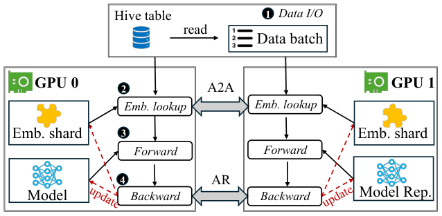
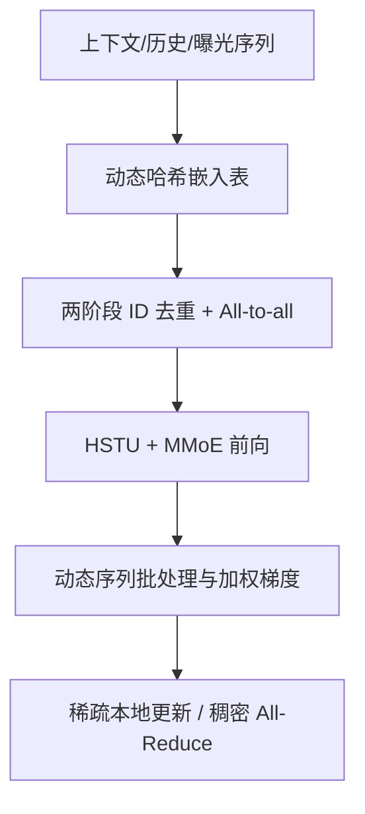
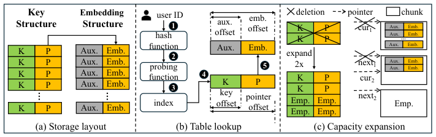

# MTGenRec: An Efficient Distributed Training System for Generative Recommendation Models in Meituan（美团生成式推荐模型高效分布式训练系统）

- **会议/期刊**: KDD 2026
- **作者与机构**: Yuxiang Wang、Chi Ma、Xiao Yan 等；武汉大学、美团
- **推荐链路定位**: 端到端生成式推荐模型训练系统
- **研究方向**: 生成式推荐与离散语义ID / 工业级训练系统架构
- **论文原文**: [论文原文链接](https://arxiv.org/abs/2505.12663v3)
- **开源代码**: 暂未开源

## TL;DR (1分钟核心速览)

生成式推荐模型（GRM）以 HSTU 自注意力提升精度，却在工业训练中受静态嵌入表无法实时增删、重复 ID 引发冗余 all-to-all、变长序列造成 GPU 负载失衡三重拖累。MTGenRec 以动态哈希嵌入表、自动合表、两阶段 ID 去重和动态序列批处理重构训练系统；在美团 10 天、日均超 2 亿序列上取得 1.6–2.4× 吞吐提升，128 GPU 近线性扩展，线上 PV_CTR 提升 1.31%。

## Background & Motivation (背景与核心矛盾)

- **主流范式**: 美团推荐已从 MLP 型 DRM 转向“稀疏嵌入表 + HSTU/MMoE 稠密网络”的 GRM，用完整用户行为序列建模。
- **前人局限**: TorchRec 的静态嵌入表容量固定，新用户/新商品只能回退默认 embedding，且须过度预分配内存；动态增删与扩容均不支持。
- **通信与负载矛盾**: 序列内重复 ID 使同一 embedding 被多次传输，lookup 的 all-to-all 成为瓶颈；变长序列若截断/填充会损精度，直接整序列训练又造成最高 25.8 ms 的设备同步空转。
- **核心洞察 (Key Insight)**: 稀疏侧应解耦“键映射”与“值存储”，让扩容只迁移轻量键结构；稠密侧应以 token 数而非样本数均衡负载。
- **本文切入点**: 不改 GRM 算图，针对稀疏表、通信、批处理三处系统算子做协同优化。

## Method (核心方法设计)

### 1. 整体框架 (Overall Architecture)

输入为上下文序列、历史行为序列和曝光候选序列，经嵌入层映射后进入多层 HSTU 与 MMoE，输出多目标预测。MTGenRec 沿用 TorchRec 的混合并行：稀疏嵌入按模型并行分片，稠密 HSTU/MMoE 按数据并行复制；前向做跨设备嵌入交换，反向对稀疏分片本地更新、稠密梯度 All-Reduce。系统在数据 I/O、lookup、前向、反向四个阶段插入动态表、自动合表、两阶段去重与动态批处理，形成同步端到端训练闭环。

<figure class="paper-figure" markdown="span">
  <figcaption>图4：MTGenRec用于GRM训练的工作流。</figcaption>
</figure>
*图4：MTGenRec 的 GRM 训练工作流（数据 I/O、嵌入查表、前向/反向与异构参数更新）。*

### 2. 关键设计拆解 (Key Designs)

1. **动态哈希嵌入表（支持实时增删）**：静态表无法为新 ID 分配条目。MTGenRec 将键映射与 embedding 值分离，键结构仅存 ID 与指针，值结构按 chunk 分配；采用 MurmurHash3 与分组并行开放寻址，探测步长 $S=(k\%(M/\text{threads}-1)+1\vert1)\times\text{threads}$，保证奇数步长遍历全表并降低聚簇。扩容按 2 倍增长，只迁移小键表、保留 chunk 值区，避免大规模 embedding 拷贝。

<figure class="paper-figure" markdown="span">
  <figcaption>图5：MTGenRec中的动态嵌入表。</figcaption>
</figure>
*图5：动态嵌入表的键值解耦存储、查表探测与容量扩展。*

2. **自动合表与动态偏移（消除人工配置）**：多表合并可减少 lookup 算子，但动态表行数未知，静态行偏移失效。系统用 FeatureConfig 按维度自动合并，并以高位编码表号：$ID=(i\ll(63-k))\vert x$，其中$k=\lceil\log_2(m+1)\rceil$。这样不同表的同值 ID 不冲突，且无需预知各表容量。

3. **两阶段 ID 去重 + 动态序列批处理（降通信、均负载）**：先在设备内去重再交换 ID，收到后再去重一次，减少重复 embedding 的 all-to-all；序列批处理按 token 预算 $B\bar{\ell}$二分切分，使$\sum_{j=1}^{k}\ell_j\approx B\bar{\ell}$，梯度按各设备样本数加权$g=\sum_i n_i g_i/\sum_i n_i$，保证变 batch 下的数值正确。

**训练目标、负采样与推理效率**：目标为 CTR/CTCVR 交叉熵 $\mathcal{L}=-\sum_i[y_i\log\hat{y}_i+(1-y_i)\log(1-\hat{y}_i)]$，MMoE 多专家加权；工业全量样本二分类，不采用负采样。推理不改变模型结构，收益主要来自训练吞吐；动态表扩容与去重均不增加线上算图。

## Experimental Setup & Evaluation Protocol (实验设置与评估协议)

- **数据集与预处理**: 论文未采用 `5-core` 过滤，直接使用美团 10 天线上用户日志，所有模型共享同一数据。

| 数据集 | #Users | #Items | #Interactions | 稀疏度/密度 | 特征/场景 |
| :--- | :---: | :---: | :---: | :---: | :--- |
| 美团 10 日日志 | 未披露 | 未披露 | 约 2B 序列 | 未披露 | 日均 >2 亿序列；均长 600、最大 3000；上下文/历史/曝光序列；CTR/CTCVR |

- **数据划分与防穿越**: 以 10 天日志训练；论文未明示全局时间戳切分或 Leave-One-Out 细节；线上采用 2% 流量 A/B，对比持续学习 2 年的 DLRM。
- **排名评测协议**: 非 `Full-Ranking`/`Sampled Ranking` 的 top-k 排序评测，而是离线 GAUC（CTR、CTCVR）与系统吞吐（tokens/s）；无负采样协议。
- **对比基线与超参**: 训练系统唯一可比基线为 TorchRec；动态表对比 MCH；线上对比 DLRM。模型为 GRM 4G/110G，嵌入维度 1D/8D/64D；Adam；A100 80GB，8–128 GPU，NVLink 600 GB/s、IB 200 GB/s。论文未报告显著性检验。

## Key Experimental Results (实验关键数据)

### 1. 主实验对比 (Main Results)

系统论文缺少 5–8 个同类训练框架基线（TorchRec 是唯一 PyTorch 原生 GRM 框架），下表保留核心效率对比；时间为 100 步累计秒数。

| 设置 | 方法 | Lookup | Forward | Backward | 相对吞吐 |
| :--- | :--- | :---: | :---: | :---: | :---: |
| GRM 4G 1D | TorchRec | 7.0 | 14.8 | 50.7 | 1.00× |
| GRM 4G 1D | **MTGenRec** | **3.2** | **14.0** | **32.6** | **1.60×** |
| GRM 110G 64D | TorchRec | 95.2 | 27.8 | 177.7 | 1.00× |
| GRM 110G 64D | **MTGenRec** | **14.4** | **19.9** | **54.7** | **2.44×** |

线上：GRM 110G 相对 DLRM 的 PV_CTR +1.90%、UV_CTCVR +1.02%；摘要报告交付平台订单量 +1.22%、PV_CTR +1.31%。

### 2. 消融实验 (Ablation Study)

| 配置（累计） | GRM 4G 1D 吞吐提升 | GRM 110G 1D 吞吐提升 |
| :--- | :---: | :---: |
| Base | 0 | 0 |
| + 自动合表 | +5.3% | +11.0% |
| + 两阶段 ID 去重 | +50.0% | +82.6% |
| + 动态序列批处理 | **+59.8%（1.60×）** | **+144.3%（2.44×）** |

### 3. 关键实验发现 (Key Findings)

- **通信与更新是主瓶颈**：110G 64D 下 lookup 从 95.2 s 降至 14.4 s（约 6.6×），backward 从 177.7 s 降至 54.7 s（约 3.2×），说明合表、去重与动态表主要削减跨设备 embedding 交换及稀疏更新延迟。
- **ID 去重贡献最稳定**：4G 与 110G 分别累计 +50.0%、+82.6%；64D 设置下两阶段去重比无去重吞吐高 1.1–3.7×，维度越高收益越大，因为带宽浪费被放大。
- **动态批处理随规模变复杂而更关键**：110G 在 64 GPU 上吞吐 +33.5%，显存利用率由 75.3% 升至 90.3%，batch 80→116；动态哈希表相对 MCH 提升 47.6%–97.4%，且 64D 下 MCH 出现 OOM 而 MTGenRec 可运行。

## Highlights & Limitations (亮点、对比与审稿批判)

- **与代表作对比 (vs. Prior Work)**: 相比 TorchRec 的静态表与人工合表，本文把表容量从“预分配”变为“按需扩容”；相比 MCH 的固定映射与二分查找，分组并行哈希探测降低碰撞解析成本；相比固定 batch，token 级动态批处理直接针对 GRM 不可截断的长序列。
- **可迁移亮点**: 键值解耦 + chunk 扩容适合任意大规模稀疏特征系统；“先本地去重、再通信后去重”的两阶段策略可迁移到多塔召回/精排的 embedding 同步。
- **审稿级局限批判**: 训练框架基线仅 TorchRec，缺少与其他工业系统的横向比较与显著性/方差报告；离线只报 GAUC，未给出 top-k 全库排序或采样排序协议，推荐质量证据仍偏系统指标。此外，位编码表号限制表数量，哈希表在高负载因子下的最坏探测延迟未充分展开，线上收益周期较短。

## Rating (四维评分)

- **方法创新性 (Novelty)**: ⭐⭐⭐⭐ （系统级增量扎实：动态哈希表、动态偏移合表与 token 级批处理均针对 GRM 特有问题，但算法理论新意有限）
- **评估协议与实验扎实度 (Protocol & Experiments)**: ⭐⭐⭐⭐ （8–128 GPU 扩展、消融与 2% 流量 A/B 较完整；但基线单一且无显著性检验）
- **写作与数学规范度 (Clarity & Rigor)**: ⭐⭐⭐⭐ （公式与系统流程清晰，哈希探测定理有证明；部分实验口径与时间/吞吐换算需读者自行对齐）
- **工业落地与复现价值 (Industrial & Practical Value)**: ⭐⭐⭐⭐⭐ （已在美团多业务部署、日均数百亿请求，吞吐与线上收益明确；但系统代码未开源，复现门槛高）

