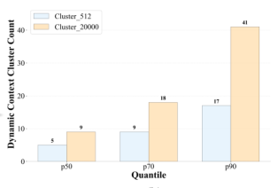
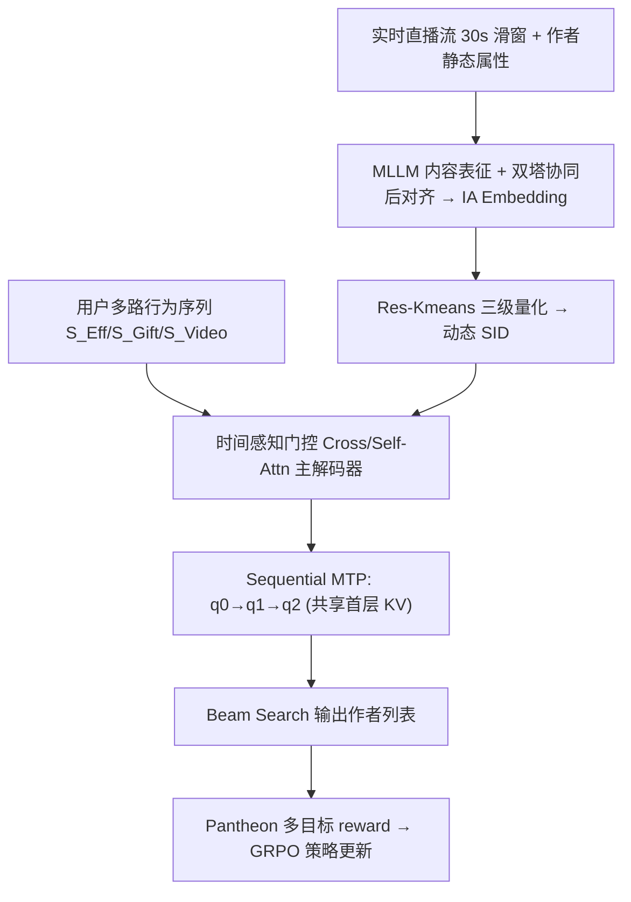
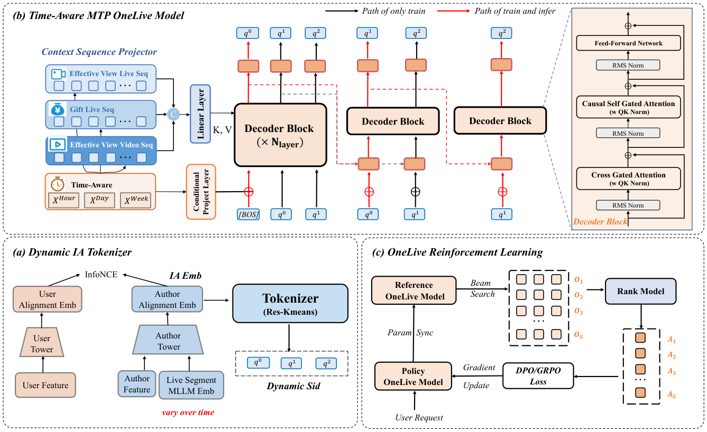

# OneLive: Dynamically Unified Generative Framework for Live-Streaming Recommendation (直播推荐的动态统一生成式框架)

- **会议/期刊**: KDD 2026 (Work in progress)
- **作者与机构**: Shen Wang, Yusheng Huang, Ruochen Yang 等，快手科技 (Kuaishou Technology)
- **推荐链路定位**: 端到端生成式（替代 召回→粗排→精排 级联）
- **研究方向**: 生成式推荐 / 强化学习与动态探索推荐
- **论文原文**: [arXiv:2602.08612v1](https://arxiv.org/abs/2602.08612v1)
- **开源代码**: 暂未开源

## TL;DR (1分钟核心速览)

直播场景的内容在直播中被持续重构、生命周期极短、延迟极严、反馈目标高度异质，使得 TIGER/OneRec 式的**静态 SID 分词 + 常规 Encoder-Decoder** 直接失效。OneLive 用 **动态 IA Tokenizer**（30s 滑窗 MLLM 内容 + 实时协同对齐 → Res-Kmeans 量化）、**时间感知门控注意力**、**Sequential MTP + QK Norm**、以及 **GRPO 多目标对齐** 四位一体重构生成式链路。离线在直播日志上以 beam-search 生成 Top-K 计算 HR/MRR，Click HR@128 / MRR@128 相对最强基线 OneRec 提升 **16.70% / 14.26%**；线上快手与快手极速版近一月 A/B，曝光 +1.32%/+1.96%、点击量 +1.73%/+2.70%。

## Background & Motivation (背景与核心矛盾)

- **主流范式**: 工业界沿用 召回-粗排-精排 漏斗级联；近期 GR（OneRec/TIGER）用 RQ 量化 SID + 统一 Transformer 自回归生成，端到端替代级联并提升 MFU。
- **前人局限 1（静态分词失效）**: 短视频/图文上传后内容固定，可"一次编码、反复复用"；直播作者在聊天/唱歌/跳舞间频繁切换，30s 片段聚类数随直播进程持续变化（图 1b），静态 SID 无法跟踪内容漂移。
- **前人局限 2（生命周期与延迟）**: 只有"正在开播"的作者可被推荐，候选池随时间强约束；且级联架构目标错位（召回重覆盖、精排重精度）造成不可逆信息瓶颈。
- **核心洞察 (Key Insight)**: 直播的分词单元不应是"作者 ID"，而应是"作者在其生命周期该时刻的状态"——内容与协同信号都必须实时对齐；同时解码开销应尽量后移到条件概率更简单的残差码位。
- **本文切入点**: 把动态分词、时间条件、推理加速、多目标对齐拆成四个可独立插拔的模块，全部塞进同一个 decoder-only 生成骨架。

<figure class="paper-figure" markdown="span">
  <figcaption>图1：(a) 在直播生命周期中，作者展示多样化的内容类型，并伴随多目标用户交互。(b) 对整个直播中的30秒片段进行聚类，并报告平均聚类数，以量化连续内容动态。</figcaption>
</figure>

## Method (核心方法设计)

### 1. 整体框架 (Overall Architecture)

实时流处理侧：30s 滑窗 MLLM 抽取直播内容表征 → 与作者静态属性门控融合 → 双塔用户-作者 In-Batch Softmax 协同后对齐得到 IA Embedding → Res-Kmeans 三级量化产出动态 SID 并写入码本；训练侧：用户多路行为序列（有效观看/送礼/短视频）经 MLP 投影成跨注意力 KV 上下文，`[BOS]+q0+q1` 作为解码前缀，主解码器生成 $q_0$，两个轻量 MTP 模块接力生成$q_1,q_2$；对齐侧：Pantheon 多目标融合分作 reward，按 1% 流量采样做 GRPO。在线仅走 beam search 前向，无编码器阶段。

<figure class="paper-figure" markdown="span">
  <figcaption>图2：OneLive 的整体框架。2 方法</figcaption>
</figure>

### 2. 关键设计拆解 (Key Designs)

1. **动态 IA Tokenizer（内容漂移 + 协同漂移双解）**: 纯 MLLM 表征语义相近片段近乎同向量、区分不出主播，而把协同信号塞进 MLLM 预训练又只能用静态历史行为。本文改为"先内容、后协同"两段式：$x^{MLLM}=\mathrm{MLP}(x^{MLLM}_{30s}\oplus x^{MLLM}_{pooling})$，$x^{Author}=\lambda x^{AId}+(1-\lambda)x^{MLLM}$，再以双塔$\mathcal{L}_{Alignment}=\mathrm{In\text{-}Batch\text{-}Softmax}(x^{User},x^{Author})$注入实时交互监督，最后对$x^{IA}$做残差 K-means：$q_l=\arg\min_k\|c^l_k-x^l\|,\ x^{l+1}=x^l-c^l_{q_l}$。直觉：门控$\lambda$ 让静态身份与瞬时状态解耦，协同对齐把"当前这批用户喜欢这个主播什么"压进码本，量化后 SID 才具备个体区分度（作者级碰撞率 1.76% vs. MLLM 9.47%）。
2. **时间感知门控注意力（生命周期约束显式化）**: 级联模型靠规则过滤过期直播，生成式模型必须自己"知道现在几点"。作者在三个位置注入多粒度时间偏置（时/日/周）：历史物品 $x_{i\_ta}=x_i+\mathrm{MLP}(\mathrm{Concat}(x^{Hour}_i,x^{Day}_i,x^{Week}_i))$、生成锚点$x_{[BOS]\_ta}$同理；并在跨/自注意力后加门控$O=\big(\mathrm{MultiHeadAttn}(XW_Q,X'W_K,X'W_V)\odot\sigma(XW_\theta)\big)W_O$。直觉：时间偏置给出"何时"，Sigmoid 门控给出"看哪段历史"，二者相乘等价于对上下文做时变软选择，推理时有效开播作者占比提升 **14.29%**（无效曝光下降）。
3. **Sequential MTP + QK Norm 与训练目标**: 标准自回归在 beam search 下 $q_1,q_2$的 batch 膨胀严重，而$q_1,q_2$只是$q_0$的残差分量、条件任务较易。故主解码器（$L$层）出$q_0$，两个单层 lite 解码器共享主解码器首层参数（除 FFN）以复用 KV cache：$h^k_i=\mathrm{MLP}(\mathrm{Concat}(\{h'^{k-1}_i,\mathrm{Emb}(q_i)\}))$，$\mathcal{L}_{MTP}=w_0\mathcal{L}^{main}_{MTP}+w_1\mathcal{L}_{MTP_1}+w_2\mathcal{L}_{MTP_2}$（后续权重更小）。深堆叠下 bf16 的 QK logits 爆炸使 Softmax 近 one-hot、梯度消失，故$\mathrm{Attn}=\mathrm{Softmax}\big(\mathrm{RMSNorm}(Q)\mathrm{RMSNorm}(K)^\top/\sqrt{d}\big)V$。总损失$\mathcal{L}_{OneLive}=\mathcal{L}_{MTP}+w\mathcal{L}_{RL}$，RL 采用 GRPO：$A_i=(r_i-\mathrm{mean}(r))/\mathrm{std}(r)$，reward 直接取 Pantheon 多目标融合分，免手工加权；负样本来自 beam 内相对优势，无需额外全库负采样。

## Experimental Setup & Evaluation Protocol (实验设置与评估协议)

- **数据集与预处理**: 快手直播真实日志（正文未列明用户/物品量级与过滤规则，细节见附录 B.1）；分词质量统计基于约 400 万作者 Embedding。

| 数据集 | #Users | #Items | #Interactions | 稀疏度/密度 | 特征/场景说明 |
| :--- | :---: | :---: | :---: | :---: | :--- |
| Kuaishou Live (离线) | 未披露 | 作者级候选池（仅在线主播） | 未披露 | — | 多路行为序列 $S_{Eff}/S_{Gift}/S_{Video}$，长度$3\times500$ |
| 线上 A/B | 4 亿 DAU 量级 | 百万级主播 | 近 1 月连续观测 | — | 快手 App + 快手极速版 |

- **数据划分与防穿越**: 采用流式（streaming）在线训练 + 离线评测，训练使用 teacher-forcing 的 ground-truth SID $\{q_0,q_1,q_2\}$；正文未明确时间戳切分细节。
- **排名评测协议**: **非全库 Full-Ranking**，而是 beam search 生成 Top-K（64/128）候选后计算 HR@K / MRR@K，并报告训练侧 ACC@all；候选空间受"仅在线主播"生命周期硬过滤。LVTR（LongView）、Click 两套目标分别评测。
- **对比基线与超参**: SASRec、KuaiFormer（ANN 检索工业架构）、GNN、TIGER、OneRec（Encoder-Decoder + $3\times512$MLLM 码）；OneLive 部署版 0.08B 参数，SID 为 3 层 × 8192 码本，$w_{RL}$ 与 MTP 权重未公开。

## Key Experimental Results (实验关键数据)

### 1. 主实验对比 (Main Results)

| 模型 | LV HR@64 | LV MRR@64 | LV HR@128 | LV MRR@128 | Click HR@128 | Click MRR@128 |
| :--- | :---: | :---: | :---: | :---: | :---: | :---: |
| SASRec | 0.2525 | 0.0665 | 0.3047 | 0.0671 | 0.2924 | 0.0629 |
| KuaiFormer | 0.3181 | 0.0907 | 0.3762 | 0.0913 | 0.3750 | 0.0897 |
| GNN | 0.4720 | 0.1548 | 0.5465 | 0.1556 | 0.5319 | 0.1478 |
| TIGER | 0.2847 | 0.0795 | 0.3395 | 0.0801 | 0.3442 | 0.0791 |
| OneRec | 0.5967 | 0.2836 | 0.6347 | 0.2840 | 0.6209 | 0.2671 |
| **OneLive** | **0.6887** | **0.3213** | **0.7388** | **0.3218** | **0.7246** | **0.3052** |
| **Improv.↑** | +15.42% | +13.29% | +16.40% | +13.31% | +16.70% | +14.26% |

### 2. 消融实验 (Ablation Study)

| 变体（Click） | ACC@all | Improv. | HR@128 | Improv. |
| :--- | :---: | :---: | :---: | :---: |
| OneRec + 3×512 MLLM (基线) | 0.613 | — | 0.621 | — |
| + 3×8192 MLLM | 0.592 | -3.42% | 0.643 | +3.54% |
| + 3×512 IA | 0.616 | +0.49% | 0.640 | +3.06% |
| + 3×8192 **IA** | 0.608 | -0.82% | 0.684 | +10.14% |
| + Standard Dec-Only | 0.618 | +0.82% | 0.695 | +11.92% |
| + Lazy Dec-Only | 0.621 | +1.31% | 0.710 | +14.33% |
| + MTP | 0.619 | +0.98% | 0.708 | +14.01% |
| + TA Gated-Attn | **0.630** | +2.77% | 0.717 | +15.46% |
| **OneLive (Full)** | **0.641** | **+4.57%** | **0.725** | **+16.75%** |

| 变体 | QPS↑ | Latency 均值 (ms) | Latency P99 (ms) |
| :--- | :---: | :---: | :---: |
| 6 层 Lazy Dec-Only | — | 6.82 | 13.34 |
| 6 层 + MTP | **+62.0%** | 2.97 | 5.04 |
| 3 层 Lazy Dec-Only | — | 5.05 | 8.48 |
| 3 层 + MTP | +31.8% | 2.25 | 3.62 |

### 3. 关键实验发现 (Key Findings)

1. **分词质量而非模型容量是主要瓶颈**：仅把 MLLM 码换成 IA 码（3×8192），HR@128 从 0.621 跃至 0.684（+10.14%），占最终增益（0.725）的约 2/3；但 ACC@all 反而微降，说明协同对齐的收益体现在"难样本区分度"上，训练侧指标与推理侧存在系统性错位，不能用作选模依据。
2. **GRPO 优于 DPO 且对小 beam 更鲁棒**：Top64 下 GRPO 将 LVTR/CTR/WTR/GTR 全面抬升至 0.04070/0.05042/0.00549/0.00136（基线 0.03808/0.04883/…），而 DPO 全面下降；Top256 下 GRPO 增益更大（LVTR 0.03066→0.03405），说明组内相对优势比正负对二元反馈更能抗偏好噪声。
3. **时间条件化直接改善供给侧有效性**：单纯加门控注意力对指标几乎无贡献（0.710→0.710），叠加多粒度时间偏置后才跃到 0.717 并带来 **14.29%** 的推理有效开播率提升——说明门控本身只是"容量"，时间先验才是"信号"；MTP 则几乎不损精度（0.710→0.708）却换来 62% QPS、55% 图执行延迟下降与 22.78% MFU（在线排序模型仅 2.56%）。

## Highlights & Limitations (亮点、对比与审稿批判)

- **与代表作对比 (vs. Prior Work)**: 相较 TIGER 静态语义 ID + Encoder-Decoder，本文把"分词"从离线一次编码改为在线滑窗 + 协同后对齐的持续更新；相较 OneRec 的全序列显式编码，本文用 lazy decoder-only 把算力迁到解码侧并用 MTP 复用 KV；相较 OneRec 的 RL 对齐，本文用 ensemble 排序模型给出用户自适应 reward，而非固定权重融合 CTR/LVTR。
- **可迁移亮点**: ①「内容 Embedding → 双塔 In-Batch Softmax 协同后对齐 → 残差量化」这套流水线可平移到短视频、商品等任何存在内容漂移的物料；② MTP lite 解码器共享主解码器首层（去掉 FFN）以复用 KV cache，是生成式推荐低延迟部署的通用技巧。
- **审稿级局限批判**: ① 离线评测用 beam 生成 Top-64/128 计算 HR/MRR，既非全库 Full-Ranking 也未做负采样对照，候选池又被"仅在线主播"过滤，跨模型可比性与绝对数值意义存疑；② 关键超参（$w_{RL}$、MTP 权重比、码本层数选择依据、RL 仅 1% 流量的收敛性分析）与数据集统计均缺失，且 30s 滑窗 MLLM 推理 + 在线更新码本带来未量化的系统开销与码本抖动风险。

## Rating (四维评分)

- **方法创新性 (Novelty)**: ⭐⭐⭐⭐ （首次将生成式推荐完整落地直播场景，动态 IA Tokenizer 与 Sequential MTP 的组合具有明确增量，但各模块多为已有技术的场景化组合，缺少理论/谱分析支撑）
- **评估协议与实验扎实度 (Protocol & Experiments)**: ⭐⭐⭐⭐ （离线五基线 + 逐模块堆叠消融 + QPS/延迟 + 双端近一月线上 A/B 闭环完整，但离线仅 beam 生成式排序、缺全库排序与显著性检验）
- **写作与数学规范度 (Clarity & Rigor)**: ⭐⭐⭐ （公式与符号基本清晰、图 3/图 4 诊断充分，但附录外关键设置缺位，MTP 模块参数共享与推理流程描述偏简，部分公式编号引用错位）
- **工业落地与复现价值 (Industrial & Practical Value)**: ⭐⭐⭐⭐⭐ （已在快手双端服务 4 亿 DAU 量级，给出 QPS/延迟/MFU/参数 scaling 曲线与 0.08B 部署选型，对工业生成式推荐极具参考价值，遗憾的是未开源）

