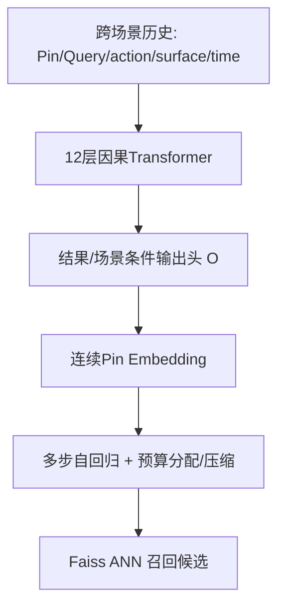
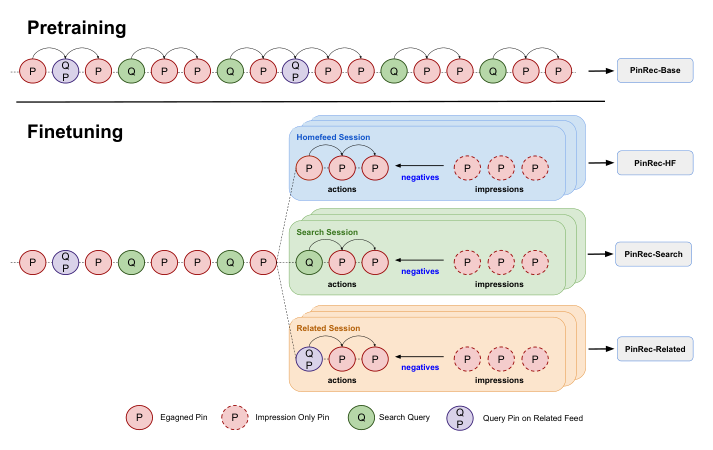

# PinRec: Unified Generative Retrieval for Pinterest Recommender Systems (PinRec：面向Pinterest推荐系统的统一生成式检索)

- **会议/期刊**: KDD 2026
- **作者与机构**: Edoardo Botta、Jaewon Yang 等，Pinterest
- **推荐链路定位**: 召回（Candidate Generation），端到端生成式候选生成
- **研究方向**: 生成式推荐与离散语义ID（连续Embedding路线） / 跨域与多场景推荐
- **论文原文**: [论文原文链接](https://arxiv.org/abs/2504.10507v7)
- **开源代码**: 暂未开源（论文称发表后公开）

## TL;DR (1分钟核心速览)

PinRec针对生成式检索“一场景一模型、单目标、仅预测下一物品”的痛点，用跨场景预训练+场景微调和结果条件生成，在Pinterest三场景的1M负样本Recall@10与在线A/B中提升搜索收藏+3.88%、分享+5.30%，并支持多步自回归候选生成。

## Background & Motivation (背景与核心矛盾)

- **主流范式**: 工业召回仍以双塔为主，每场景维护独立query塔与索引；生成式检索（TIGER/HSTU）用Transformer序列建模直接生成候选。
- **前人局限**: 现有GR通常按单场景、单参与目标训练，难以适配搜索重外点、首页重收藏、Related重探索深度的差异化目标；语义ID在Pinterest规模下出现严重ID坍缩与无效ID幻觉。
- **核心洞察 (Key Insight)**: 用户跨场景行为可统一为“下一物品/下一动作”序列，连续Embedding输出既避免ID坍缩，又能复用ANN索引与多步生成。
- **本文切入点**: 先跨场景预训练一个基础模型，再按场景曝光日志微调，并用动作/场景条件控制生成结果。

## Method (核心方法设计)

### 1. 整体框架 (Overall Architecture)

PinRec把用户跨场景终生行为序列（Pin、Query、action、surface、时间）统一编码进12层因果Transformer；输出头在动作/场景条件嵌入下生成连续Pin向量，经Faiss ANN召回候选。训练分两阶段：跨场景next-item预训练（不含曝光未互动）→场景曝光日志微调，并把曝光未互动作为in-batch hard negatives；推理时多步自回归生成多条候选，按预算分配与相似度压缩后检索。

<figure class="paper-figure" markdown="span">
  <figcaption>图2：PinRec 使用由条目（Pin）和搜索查询组成的用户活动序列进行预训练；随后针对每个场景的特定数据进行微调，这些数据包含用户动作和曝光条目（Pin）。</figcaption>
</figure>

### 2. 关键设计拆解 (Key Designs)

1. **统一预训练-场景微调**：双塔需按场景复制query塔/索引，PinRec共享Transformer与surface embedding，先学跨场景共性再适配分布。微调序列为 $G(u,s,t)=H(u,t)\parallel\{(i_j,a_j,t_j):(i_j,a_j,t_j)\in F(u,s,t),a_j\in\mathcal{A}\}$；直觉是既保留长期兴趣，又让场景曝光动作成为监督。
2. **结果条件生成**：单一engagement目标无法区分收藏、外点、分享等业务结果。输出头条件于动作/场景嵌入 $\hat{i}_{u,t}=O(h_{u,t},c_1,\ldots,c_k)$；推理时一次前向产出多结果向量，再采样一个反馈到下一步，实现可控多目标生成。
3. **连续Embedding+曝光负样本+多步AR**：TIGER式语义ID在工业库易坍缩且会幻觉无效ID，PinRec改用连续向量，理论上只能检索真实物品。训练用带偏置校正的sampled softmax $s(\hat{i}_{u,t},i_c)=\lambda\hat{i}_{u,t}^{\top}i_c-Q(i_c)$，损失$L_s=-\log\frac{\exp(s(\hat{i}_{u,t},i_{target}))}{\exp(s(\hat{i}_{u,t},i_{target}))+\sum_{i_n\in\mathcal{N}}\exp(s(\hat{i}_{u,t},i_n))}$；曝光未互动入负样本集，推理多步AR并用相似度阈值压缩冗余向量。

## Experimental Setup & Evaluation Protocol (实验设置与评估协议)

- **数据集与预处理**: 论文未公开绝对规模；评估覆盖Pinterest三场景：

| 数据集/场景 | #Users | #Items | #Interactions | 稀疏度/密度 | 特征/场景说明 |
| :--- | :---: | :---: | :---: | :---: | :--- |
| Home Feed | 未披露 | Pin库 | 未披露 | 未披露 | 曝光+action；重收藏/网格点击 |
| Related Pins | 未披露 | Pin库 | 未披露 | 未披露 | 重 session 深度与继续探索 |
| Search | 未披露 | Pin+Query | 未披露 | 未披露 | 查询上下文；重外点商品点击 |

- **数据划分与防穿越 (Splitting Strategy)**: 主离线对比用held-out用户；微调评估用全局时间戳切分（cutoff前训练、cutoff后评估）；推理关闭teacher forcing，避免目标泄漏。
- **排名评测协议 (Ranking Protocol)**: 离线为`Sampled Ranking`：从1M随机物品索引中检索，指标为unordered recall@10；在线为真实流量A/B，显著水平 $p<0.05$。
- **对比基线与超参设置**: SASRec、PinnerFormer（序列模型），TIGER、HSTU（生成式推荐）；PinRec为12层、12头、768隐藏维，Pin/Query用OmniSage/OmniSearchSage特征。

## Key Experimental Results (实验关键数据)

### 1. 主实验对比 (Main Results)

| 模型 | Home Feed | Related Pins | Search |
| :--- | :---: | :---: | :---: |
| SASRec | 0.382 | 0.426 | 0.142 |
| PinnerFormer | 0.461 | 0.412 | 0.257 |
| TIGER | 0.208 | 0.230 | 0.090 |
| HSTU | 0.596 | **0.539** | 0.179 |
| PinRec-UC | 0.608 | 0.521 | 0.350 |
| PinRec-OC | **0.625** | 0.537 | **0.352** |
| **Improv. vs 最强非PinRec** | **+4.9%** | **-0.4%** | **+37.0%** |

注：加粗为列最优；Search提升相对PinnerFormer，Related略低于HSTU。

### 2. 消融实验 (Ablation Study)

| 配置（相对最佳变化） | Home Feed | Related Pins | Search |
| :--- | :---: | :---: | :---: |
| PinRec-OC {FT, IN} | 0.0% | 0.0% | 0.0% |
| Remove OC | -12.6% | -7.5% | -11.9% |
| Remove IN | -0.4% | +0.1% | 0.0% |
| Remove IN, add IP | -0.4% | -3.0% | -6.8% |
| Remove FT | -4.5% | -2.0% | -2.5% |

### 3. 关键实验发现 (Key Findings)

- **结果条件生成是最大增益源**：去掉OC使三场景Recall@10下降12.6%/7.5%/11.9%；定向优化稀有结果更明显，搜索商品外点+16%、其他动作+8%，在线Search收藏+3.88%、分享+5.30%、履约+2.24%。
- **微调与曝光负样本互补**：去掉FT降4.5%/2.0%/2.5%；把曝光负样本改为曝光正样本后Related/Search降3.0%/6.8%，说明“展示未互动”不应做正样本。在线HF网格点击+4.01%、Related时长+0.38%。
- **多步AR与零样本迁移有效**：16步相对1步Recall@10提升+8.8%/+71.4%/+11.1%，Related最显著；零样本Related Searches履约+1.66%、模块CTR+4.04%，Ads CPA-1.83%。

## Highlights & Limitations (亮点、对比与审稿批判)

- **与代表作对比 (vs. Prior Work)**: TIGER依赖语义ID且存在坍缩/幻觉，PinRec连续Embedding可直接ANN检索；HSTU偏单场景单目标，PinRec用跨场景预训练+OC实现横向统一；PinnerFormer是序列编码器而非多步生成式召回。
- **可迁移亮点**: 曝光未互动作hard negative；按业务结果分配生成预算；生成向量相似度压缩以提升候选多样性。
- **审稿级局限批判**: 离线仅用1M随机负样本而非全库排序，可能高估绝对Recall；系统强依赖Pinterest私有特征与日志，代码/数据未开源，且p50延迟约为双塔3–4倍，预算阈值与压缩阈值需场景调参。

## Rating (四维评分)

- **方法创新性 (Novelty)**: ⭐⭐⭐⭐ （结果条件生成+跨场景预训练-微调组合有工业创新，理论新颖性中等。）
- **评估协议与实验扎实度 (Protocol & Experiments)**: ⭐⭐⭐⭐ （离线、在线A/B、零样本齐全，但离线为采样排序且数据不可公开。）
- **写作与数学规范度 (Clarity & Rigor)**: ⭐⭐⭐⭐ （架构、训练与服务描述清晰，部分统计与超参披露有限。）
- **工业落地与复现价值 (Industrial & Practical Value)**: ⭐⭐⭐⭐ （三场景上线与Triton/Faiss部署细节价值高，但复现门槛高、代码未开源。）

