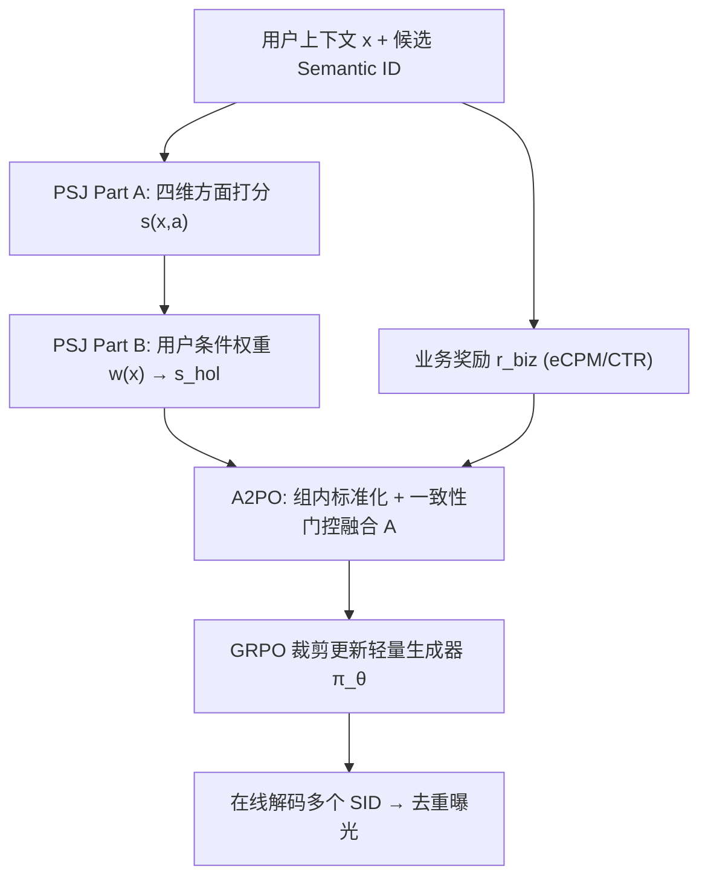
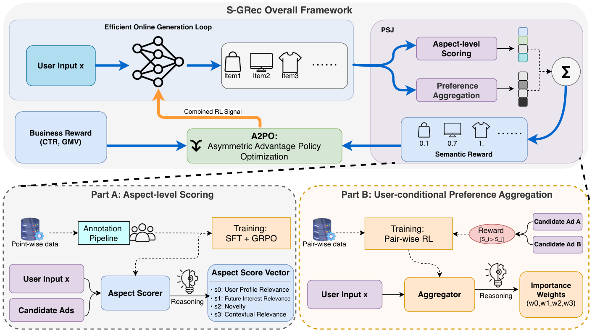
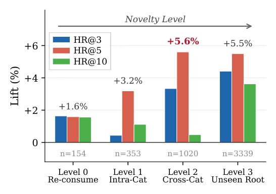

# S-GRec: Personalized Semantic-Aware Generative Recommendation with Asymmetric Advantage (个性化语义感知生成式推荐与非对称优势优化)

- **会议/期刊**: KDD 2026（arXiv:2602.10606v3）
- **作者与机构**: Jie Jiang, Hongbo Tang, Wenjie Wu, Yangru Huang, Zhenmao Li 等（腾讯，微信视频号广告团队）
- **推荐链路定位**: 端到端生成式召回/排序（Semantic ID 自回归生成）
- **研究方向**: 生成式推荐与离散语义 ID / 大语言模型推荐（LLM4Rec）
- **论文原文**: [https://arxiv.org/abs/2602.10606v3](https://arxiv.org/abs/2602.10606v3)
- **开源代码**: 暂未开源

## TL;DR (1分钟核心速览)

生成式推荐靠行为日志训练，监督信号弱且难以刻画"用户为什么点"，而直接把 LLM 塞进线上又面临语义信号与业务指标（eCPM/GMV）冲突、推理成本过高两大死结。S-GRec 把 LLM 降格为**离线训练期语义裁判**：两阶段 PSJ 先打四维方面分、再用 pairwise 反馈学用户条件聚合权重产出标量语义奖励；A2PO 在**优势空间**内以业务优势为锚、按方向一致性门控注入语义优势。Amazon Office/Industrial 上全指标最优（HR@10 相对 +2.9%/+3.4%，NDCG@10 +3.0%/+5.3%），微信视频号线上 A/B 取得 GMV +1.19%、CTR +1.16%，服务端零 LLM 开销。

## Background & Motivation (背景与核心矛盾)

- **主流范式**: 以 Semantic ID 序列生成替代"召回-排序"级联（TIGER / LC-Rec / HSTU / OneRec 系），用 next-token 似然拟合行为序列。
- **前人局限①（Cost-Scalability Conflict）**: "LLM as Backbone"（LoRA 微调生成）与"LLM as Enhancer"（特征增强）都把 LLM 拖到推理链路，毫秒级、百万 QPS 的场景无法承受；小模型裁判又对 prompt 措辞与候选顺序极敏感，判断漂移严重。
- **前人局限②（Objective Alignment Conflict）**: 通用 LLM 的开放域语义偏好与平台 eCPM 目标异构——业务奖励是校准过的货币量纲，语义奖励带裁判方差，简单做 $r=r_{biz}+\alpha r_{sem}$ 会让语义项淹没排序目标（本文实测直接崩掉 44.6%~63.1% HR@10）。
- **核心洞察 (Key Insight)**: 语义监督的价值不在"更大模型"，而在"更对的领域对齐"——4B 模型经 SFT+GRPO 方面打分准确率即可达 0.8687，远超零样本 DeepSeek-R1 的 0.4726；且方向一致性统计显示 $A_{biz}$与$A_{sem}$ 符号一致率仅 45.4%（线上 49.8%），说明冲突是常态、必须门控。
- **本文切入点**: 把 LLM 变成离线 reward provider，只蒸馏"可对齐的语义增量"，在线仍是轻量生成器。

## Method (核心方法设计)

### 1. 整体框架 (Overall Architecture)

输入统一上下文 $x$（用户画像 + 行为序列 + 时空信号），候选广告由 RQ-VAE Semantic ID$y=(y_1,...,y_T)$表示，自回归策略$\pi_\theta(y|x)$生成多条合法 SID 构成 rollout 组。离线侧 PSJ 对每个$(x,a)$先输出四维离散方面分$\mathbf{s}(x,a)$（画像相关、未来兴趣、新颖性、情境相关），再经用户条件聚合得到标量语义奖励$s_{hol}$；训练侧 A2PO 将$s_{hol}$ 与业务奖励（线上为 eCPM，离线用真值 next-item 的排序代理）各自组内标准化为优势，做一致性门控融合后送入 GRPO 裁剪目标。服务期只保留生成器，PSJ 完全离线。

<figure class="paper-figure" markdown="span">
  <figcaption>图2：S-GRec 概述。离线 PSJ 通过两阶段评分（方面级证据 → 用户条件聚合）生成语义奖励。A2PO 在优势空间中以一致性门控融合语义奖励与业务奖励，训练轻量级生成器，且服务时无需 LLM 推理。</figcaption>
</figure>

### 2. 关键设计拆解 (Key Designs)

1. **两阶段 PSJ：把"打分"与"权衡"解耦**：单阶段整体打分既不可解释也无法刻画用户间差异，故 Part A 用人工校验的 point-wise 数据 SFT + GRPO（奖励含精确匹配与序一致性项 $r_{asp}=\sum_d \omega_d[r^{d}_{acc}+r^{d}_{ord}]$）学四维离散分；Part B 固定方面证据、只学聚合权重$\mathbf{w}(x)=g_\psi(x)$，$\sum_d w_d=1$，得$s_{hol}(x,a)=\mathbf{w}(x)^\top\mathbf{s}(x,a)$。Part B 用 pairwise 奖励$r_{pw}=\mathbb{I}[s_{hol}(x,a_i)>s_{hol}(x,a_j)]$ 做 GRPO+KL 优化。直觉：人类对"哪个更好"的判断比绝对打分稳定得多，跨方面权衡交由可学习的用户条件权重承载。
2. **A2PO：把融合从奖励空间搬到优势空间**：奖励量纲异构导致 $r_{biz}+\alpha r_{sem}$脆弱，先各自组内标准化得$A_{biz},A_{sem}$，再定义非对称融合$A^{(i)}=A^{(i)}_{biz}+\lambda^{(i)}A^{(i)}_{sem}$，其中
$$\lambda^{(i)}=\mathbb{I}\big[\mathrm{sign}(A^{(i)}_{biz})=\mathrm{sign}(A^{(i)}_{sem})\big]\cdot\frac{\min(|A^{(i)}_{biz}|,|A^{(i)}_{sem}|)}{\max(|A^{(i)}_{biz}|,|A^{(i)}_{sem}|)+\epsilon}$$
方向门控保证语义不逆着业务梯度推策略，幅度项自动把语义贡献上界钉死为 $|\lambda^{(i)}A^{(i)}_{sem}|\le|A^{(i)}_{biz}|$，从而**免调**$\alpha$ 也不产生语义尖峰。
3. **训练目标、稀疏采样与推理开销**：最终目标为 GRPO 裁剪式 $\mathcal{L}=\mathbb{E}[\min(\rho^{(i)}A^{(i)},\mathrm{clip}(\rho^{(i)},1-\delta,1+\delta)A^{(i)})]$，$\rho=\pi_\theta/\pi_{\theta_{old}}$，$G=16$，KL 系数$0.04$，学习率$1\times10^{-5}$。关键工程点是**语义奖励稀疏采样**：仅对比例$p$的样本查询 PSJ，$p=0.05$ 已达全量性能的 99.1%/99.6%（约 20× 成本削减）；PSJ 基于 Qwen3-4B，用 20k point-wise + 40k pairwise 人工校验样本训练；生成器为 Qwen2.5-1.5B + RQ-VAE，从 MiniOneRec SFT 检查点初始化，全程无需负采样构造（组内 rollout 自带对比）。

## Experimental Setup & Evaluation Protocol (实验设置与评估协议)

- **数据集与预处理**: 沿用 MiniOneRec / TIGER 的 Amazon Review 预处理，用户与物品均做 `5-core` 过滤：

| 数据集 | #Users | #Items | #Interactions | 稀疏度 | 特征/场景说明 |
| :--- | :---: | :---: | :---: | :---: | :--- |
| Office Products | 4,905 | 2,420 | 53,258 | 99.55% | 办公用品，仅文本元数据，无时空信号→离线丢弃 Context 维度 |
| Industrial & Scientific | 2,617 | 1,776 | 23,560 | 99.49% | 工业科研用品，同上 |

- **数据划分与防穿越**: 与 MiniOneRec 完全一致的 `Leave-One-Out` 式序列切分（最后一项为测试、倒数第二项为验证），统计口径未改动以保证可比。
- **排名评测协议**: `Full-Ranking`（对全库合法 SID 生成候选后统一排序，非采样负例），报告 HR@{3,5,10} 与 NDCG@{3,5,10}。
- **对比基线与超参**: 非 LLM 组 GRU4Rec / Caser / SASRec / HSTU / TIGER / LC-Rec；LLM 组 BIGRec / D3 / S-DPO / MiniOneRec（基座）。PSJ=Qwen3-4B，生成器=Qwen2.5-1.5B，$G=16$，$\delta$ 为 GRPO 裁剪阈值；线上流量 5% 做 A/B。

## Key Experimental Results (实验关键数据)

### 1. 主实验对比 (Main Results)

| Method | Industrial HR@10 | Industrial NDCG@10 | Office HR@10 | Office NDCG@10 |
| :--- | :---: | :---: | :---: | :---: |
| SASRec | 0.1088 | 0.0806 | 0.1120 | 0.0858 |
| HSTU | 0.1163 | 0.0958 | 0.1400 | 0.1126 |
| TIGER | 0.1321 | 0.0908 | 0.1408 | 0.1002 |
| LC-Rec | 0.1332 | 0.0952 | 0.1237 | 0.0920 |
| BIGRec | 0.1370 | 0.0997 | 0.1434 | 0.1091 |
| D3 | 0.1500 | 0.1082 | 0.1634 | 0.1213 |
| S-DPO | 0.1524 | 0.1082 | 0.1587 | 0.1255 |
| MiniOneRec (base) | 0.1586 | 0.1167 | 0.1634 | 0.1242 |
| **S-GRec** | **0.1632** | **0.1202** | **0.1689** | **0.1308** |
| Improv.% vs base | +2.90% | +3.00% | +3.37% | +5.31% |

### 2. 消融实验 (Ablation Study)

| 变体 | Office HR@10 | Office NDCG@10 | Industrial HR@10 | Industrial NDCG@10 |
| :--- | :---: | :---: | :---: | :---: |
| MiniOneRec（仅业务奖励） | 0.1634 | 0.1242 | 0.1586 | 0.1167 |
| + Aspect only（$w_d=0.25$ 均匀） | 0.1665 | 0.1257 | 0.1613 | 0.1170 |
| + Holistic only（单阶段标量裁判） | 0.1677 | 0.1281 | 0.1637 | 0.1177 |
| **S-GRec（两阶段 PSJ）** | **0.1689** | **0.1308** | 0.1632 | **0.1202** |
| A2PO: Reward-Sum（$r_{biz}+r_{sem}$） | 0.0904 | 0.0761 | 0.0585 | 0.0543 |
| A2PO: Adv-Sum（仅优势空间求和） | 0.1515 | 0.1223 | 0.1348 | 0.1020 |
| A2PO: w/o Gate | 0.1691 | 0.1302 | 0.1591 | 0.1169 |
| A2PO: w/o Magnitude | 0.1652 | 0.1294 | 0.1624 | 0.1189 |

### 3. 关键实验发现 (Key Findings)

1. **融合层级比奖励设计更致命**：奖励层直接相加使 HR@10 相对基座暴跌 44.6%（Office）/63.1%（Industrial），改到优势空间求和即回升至 0.1515/0.1348，但仍不及基座；只有叠上方向门控+幅度平衡才反超，说明"标准化解决量纲、门控解决方向"是两道独立且必需的关卡，去掉 Gate 使 Industrial NDCG@10 掉到 0.1169（低于基座），是损伤最大的单项。
2. **语义监督的收益与历史新颖度正相关**：按目标偏离历史的程度分桶后，重购桶（Level 0）HR@5 仅 +1.6%，同子类 +3.2%，跨子类 +5.6%，历史中未见根类（Level 3）达 +5.5%；案例中用户买素描铅笔、真值为"绘图橡皮"，基线排 #6（miss@5），S-GRec 升至 #1，其 $s_{hol}=0.92$ 来自未来兴趣满值与新颖性满分，而画像相似的高分候选被降权。
3. **成本可截断且性能近饱和**：$p=0.05$时已达全量语义监督性能的 99.1%/99.6%，$p<0.05$ 才快速衰减；线上 5% 流量的 A/B 结果为 GMV +1.19%、GMV-Normal +1.55%、CTR +1.16%、负反馈率 −2.02%，仿真环境 eCPM +5.5%，验证"离线蒸馏 + 轻量在线"路径的商业可行性。

<figure class="paper-figure" markdown="span">
  <figcaption>图5：在 Office 测试集上，S-GRec 相较 MiniOneRec 在各新颖性水平上的相对 HR 提升（%）。𝑛 表示每个桶的测试样本数。</figcaption>
</figure>

## Highlights & Limitations (亮点、对比与审稿批判)

- **与代表作对比**: 相对 TIGER/LC-Rec（RQ-VAE + 似然拟合），本文不动 tokenization 与解码架构，只换训练信号；相对 MiniOneRec（纯行为 SFT），增益来自训练期语义监督而非模型容量；相对 D3/S-DPO（偏好对齐），本文的 pairwise 偏好仅用于**训练裁判**而非直接对齐生成器，避免了偏好数据与业务目标的直接冲撞。
- **可迁移亮点**: ①"优势空间内按符号一致性门控 + 幅度比缩放"是一个与 $\alpha$ 无关的通用多目标融合算子，可直接搬到多任务精排的损失加权；②先分解方面证据、再学用户条件权重的两段式裁判，比单阶段标量打分更稳且天然可解释，适合任何需要可审计监督信号的场景。
- **审稿级局限批判**: ①离线实验缺时空元数据，Context 维度被整体丢弃，PSJ 在完整四维上的收益未被公开数据验证；②$r_{biz}$在公开集上以真值 next-item 排序代理替代 eCPM，与线上真实货币目标存在分布差，离线增益对线上的可预测性存疑；③语义采样比例$p$ 与裁判样本量（20k/40k）是隐性成本，论文未给出 PSJ 训练与批量推理的实际 GPU-hour，且裁判质量依赖持续人工校验闭环，长期存在标注漂移风险。

## Rating (四维评分)

- **方法创新性 (Novelty)**: ⭐⭐⭐⭐ （"LLM-as-Judge 离线蒸馏 + 非对称优势门控"组合新颖，$\lambda$ 的有界性给出免调参的稳定性保证，但组件本身均为已知技术的巧妙重组）
- **评估协议与实验扎实度 (Protocol & Experiments)**: ⭐⭐⭐⭐ （两个 Amazon 基准 Full-Ranking + 严格对齐 MiniOneRec 划分，A2PO 五变体逐项拆解清晰，并有真实线上 A/B；扣分在离线仅两数据集且缺时空特征）
- **写作与数学规范度 (Clarity & Rigor)**: ⭐⭐⭐⭐⭐ （公式紧凑、$\lambda$的门控与界$|\lambda A_{sem}|\le|A_{biz}|$ 推导一目了然，两类冲突的动机—算子—验证链条闭环）
- **工业落地与复现价值 (Industrial & Practical Value)**: ⭐⭐⭐⭐⭐ （服务期零 LLM 推理、$p=0.05$ 即饱和的 20× 成本削减，加上 GMV/CTR/负反馈三向同增的线上证据，是目前 LLM4Rec 落地叙事中最完整的一档；唯代码未开源）

