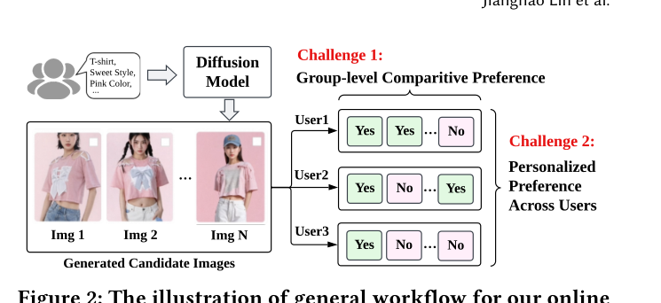
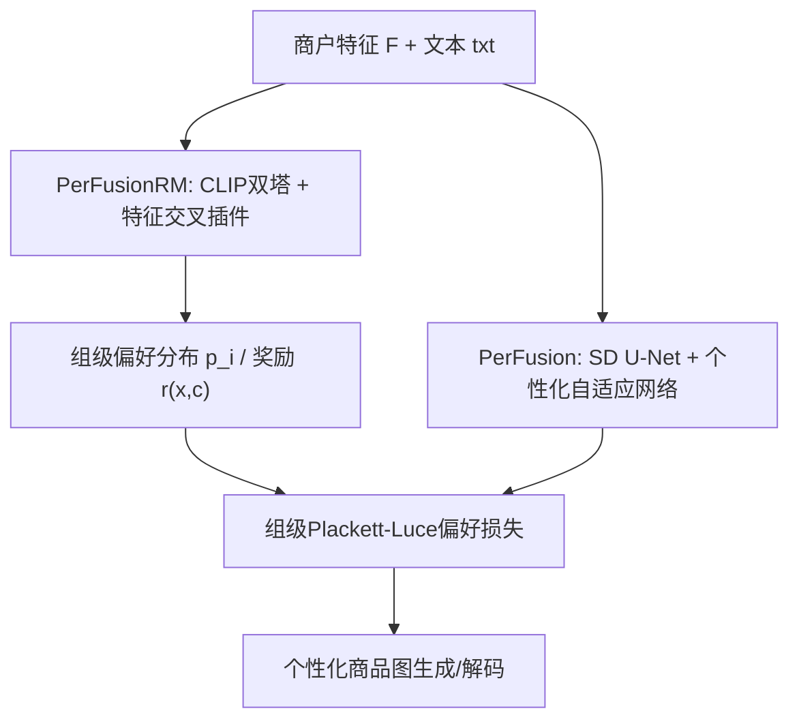
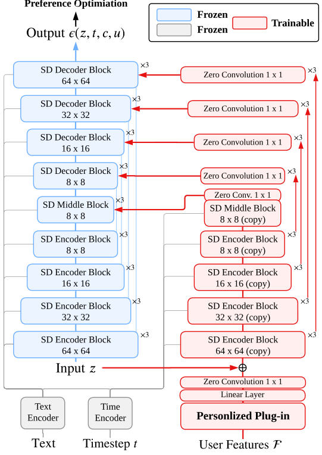

# Sell It Before You Make It: Revolutionizing E-Commerce with Personalized AI-Generated Items (先卖后造：用个性化AI生成商品革新电商)

- **会议/期刊**: KDD 2026 (ADS Track)
- **作者与机构**: Jianghao Lin, Peng Du, Jiaqi Liu, Weite Li, Yong Yu, Weinan Zhang, Yang Cao；上海交通大学 & 阿里巴巴
- **推荐链路定位**: 端到端生成式（商品设计图生成）
- **研究方向**: 生成式推荐与离散语义ID / 多模态推荐
- **论文原文**: [论文原文链接](https://arxiv.org/abs/2503.22182v2)
- **开源代码**: 暂未开源

## TL;DR (1分钟核心速览)

针对电商“先产后售”设计/库存成本高，本文提出PerFusion：先用CLIP+特征交叉个性化插件构建PerFusionRM估计商户组级偏好，再用个性化自适应网络与组级Plackett-Luce偏好损失对齐Stable Diffusion。Industrial上MAP 0.9220（+45.15%），线上搜索CTR +17.81%、CVR +17.27%、退货率 -7.9%。

## Background & Motivation (背景与核心矛盾)

- **主流范式**: 传统电商需先设计、制造、拍摄再上架；生成式文生图开始用于商品图，但多为通用偏好对齐或参考图重绘。
- **前人局限**: ① DPO/SPO等成对偏好只比较一对正负，丢失组级全局视图；② 个性化方法多依赖参考图重绘/外扩，难以从零生成捕捉商户隐式视觉偏好。
- **核心洞察 (Key Insight)**: 商户在$N$张候选图中同时多选，反馈本质是组级比较分布；用户档案特征能显著影响最终选择。
- **本文切入点**: 先训练PerFusionRM验证个性化信息有效，再将其作为奖励模型指导扩散模型做组级个性化对齐。

<figure class="paper-figure" markdown="span">
  <figcaption>图2：我们在线服务的总体流程示意图，以及两个关键挑战：组级比较偏好和跨用户的个性化偏好。</figcaption>
</figure>

## Method (核心方法设计)

### 1. 整体框架 (Overall Architecture)

输入商户特征$F$与文本$txt$：PerFusionRM用CLIP双塔+特征交叉插件输出每张候选图得分；PerFusion在SD U-Net上复制编码/中间块构建个性化自适应网络，将用户表征注入去噪过程；训练以组级Plackett-Luce DPO损失同时利用组内多正多负样本；推理按文本+用户特征一次扩散生成商品图。

<figure class="paper-figure" markdown="span">
  <figcaption>图4：基于U-Net架构构建的PerFusion总体框架。左侧为经典U-Net模型，右侧为与4.2节所述个性化插件相关联的自适应网络。</figcaption>
</figure>

### 2. 关键设计拆解 (Key Designs)

1. **PerFusionRM 特征交叉个性化插件**：CLIP只建模图文一致性，忽略商户隐式偏好。将用户特征经嵌入与多层交叉$u_{l+1}=u_0u_l^\top w_l+b_l+u_l$得$u$，再经AdaNet生成零初始化$u^l_{attn},u^l_{ffn}$注入每层Transformer：$h'_{l,i}=MHA([h_{l,i}\oplus u^l_{attn}])$。冻结CLIP主干，仅训插件，保留通用知识。组级奖励损失：$p_i=y_i/\sum_j y_j$，$\hat p_i=\operatorname{softmax}(s(txt,x_i))$，$\mathcal{L}_{RM}=-\sum_i p_i\log\hat p_i+(1-p_i)\log(1-\hat p_i)$。

2. **个性化自适应网络 PAN**：SD U-Net编码块复制为可训练分支；用户表征线性reshape为2D后与$z_t$逐元素相加得$z'_t$，复制块输出经零初始化$1\times1$卷积加回原U-Net中间/解码块，得到$\epsilon_\theta(z_t,t,c,u)$。零卷积保证初始不破坏预训练去噪，插件只学个性化残差。

3. **组级偏好优化 GOBJ**：DPO的Bradley-Terry只比较一对正负，丢失组级全局视图。将正集$P$、负集$N$的联合偏好用Plackett-Luce建模：$p^*(x_p\succ x_n,\forall x_p\in P,\forall x_n\in N)=\sum_{x_p\in P}\frac{1}{1+\sum_{x_n\in N}\exp(r(x_n,c)-r(x_p,c))}$。代入扩散得分$s(x,c,t,u)=\|\epsilon^*-\epsilon_\theta\|_2^2-\|\epsilon^*-\epsilon_{ref}\|_2^2$，损失$\mathcal{L}=-\mathbb{E}\sum_{x_p\in P}\log\sigma(-\log\sum_{x_n\in N}\exp(\beta s(x_p)-\beta s(x_n)))$。组内未选图即负样本，无需额外采样；推理约2倍耗时。

## Experimental Setup & Evaluation Protocol (实验设置与评估协议)

- **数据集与预处理**: 过滤每用户至少10条组级记录；PickaPic为公开偏好数据，Industrial为阿里线上数据。

| 数据集 | #Users | #Prompts | #Samples | 组大小/场景 |
| :--- | :---: | :---: | :---: | :---: |
| PickaPic | 3,094 | 33,164 | 529,219 | 2 / 公开文生图偏好 |
| Industrial | 54,995 | 60,616 | 607,328 | 5 / 电商商户设计 |

- **数据划分与防穿越 (Splitting Strategy)**: 按组级记录8:1:1划分，hold-out测试；所有评估在留出集完成。
- **排名评测协议 (Ranking Protocol)**: 偏好估计为组内排序（正图应高于负图），报告MAP与GAUC；生成任务报告Aesthetic、CLIP Score、PickScore与PerFusionRM。非全库Full-Ranking，而是候选组内评估。
- **对比基线与超参设置**: 偏好估计对比Aesthetics、CLIP-H、ImageReward、HPSv1、HPSv2、PickScore；生成对比SD1.5、SFT、DPO、SPO、PMG。正文未列显著性检验p值，主要报告相对提升。

## Key Experimental Results (实验关键数据)

### 1. 主实验对比 (Main Results)

| 奖励模型 | PickaPic MAP | PickaPic GAUC | Industrial MAP | Industrial GAUC |
| :--- | :---: | :---: | :---: | :---: |
| CLIP-H | 0.8148 | 0.6295 | 0.6352 | 0.7060 |
| ImageReward | 0.8216 | 0.6431 | 0.5538 | 0.6115 |
| HPSv1 | 0.8293 | 0.6585 | 0.4565 | 0.5030 |
| HPSv2 | 0.8177 | 0.6353 | 0.5783 | 0.6420 |
| PickScore | 0.8711 | 0.7422 | 0.5241 | 0.5820 |
| **PerFusionRM** | **0.8822** | **0.7644** | **0.9220** | **0.9564** |
| Rel.Improv. | +1.27% | +2.99% | +45.15% | +35.47% |

| 生成模型 | PickaPic Aes. | PickaPic CLIP | PickaPic PickScore | PickaPic PerFusionRM | Industrial Aes. | Industrial CLIP | Industrial PickScore | Industrial PerFusionRM |
| :--- | :---: | :---: | :---: | :---: | :---: | :---: | :---: | :---: |
| SD1.5 | 5.39 | 32.82 | 20.29 | 21.23 | 5.36 | 17.73 | 17.01 | 13.44 |
| SFT | 5.71 | 34.58 | 20.89 | 21.80 | **5.44** | 24.39 | 18.07 | 24.33 |
| DPO | 5.67 | 34.67 | 21.13 | 22.62 | 5.19 | 25.68 | 18.19 | 25.03 |
| SPO | 5.60 | 31.51 | 20.72 | 21.57 | 5.25 | 19.27 | 14.63 | 17.72 |
| PMG | 5.70 | 35.21 | 21.32 | 22.51 | 5.25 | 25.49 | 18.27 | 25.33 |
| **PerFusion** | **5.80** | **35.93** | **21.65** | **23.03** | 5.41 | **25.74** | **18.54** | **26.44** |

### 2. 消融实验 (Ablation Study)

| 变体 | 关键结果 |
| :--- | :--- |
| PerFusionRM 共享双塔插件 | PickaPic/Industrial GAUC均下降（图5） |
| PerFusionRM 仅视觉/仅文本 | 均下降，双塔独立最优 |
| PerFusion w/o PAN | PerFusionRM指标下降（图6） |
| PerFusion w/o GOBJ | 下降，组级比较信息丢失 |
| PerFusion w/o Both | 下降更大 |

### 3. 关键实验发现 (Key Findings)

1. Industrial上PerFusionRM MAP 0.9220 vs CLIP-H 0.6352（+45.15%）、GAUC 0.9564 vs 0.7060（+35.47%），说明当通用图文质量已被在线模型满足后，商户个性化成为主要增益；PickaPic仅+1.27%/+2.99%，因公开数据通用质量噪声大。
2. 生成任务PerFusion在PickaPic四项指标均最优（Aesthetic 5.80、CLIP 35.93、PickScore 21.65、PerFusionRM 23.03）；Industrial PerFusionRM 26.44 vs PMG 25.33，且Aesthetic 5.41高于SD1.5 5.36但低于SFT 5.44，说明组级偏好对齐主要提升个性化而非通用美学。
3. 线上6个月17品类A/B：搜索CTR +17.81%、推荐CTR +13.35%、CVR +17.27%、退货率 -7.9%；专家6维评分AI/人工总体94.30%，但工艺设计仅82.28%，说明AIGI可支撑“先售后产”但复杂工艺仍是短板。

## Highlights & Limitations (亮点、对比与审稿批判)

- **与代表作对比 (vs. Prior Work)**: 相比DPO/SPO的成对偏好，本文将Bradley-Terry替换为Plackett-Luce组级比较；相比PMG等参考图重绘/外扩，本文从零生成并注入商户特征；PerFusionRM用特征交叉插件而非纯文本prompt，个性化信号更直接。
- **可迁移亮点**: ① 将用户特征经零初始化AdaNet注入CLIP每层，可低成本适配任意双塔多模态模型；② 组级PL-DPO损失可迁移到列表级生成/重排与多候选偏好对齐。
- **审稿级局限批判**: ① 推理耗时约2倍（3.03s vs 1.49s/样本）、显存9GB vs 5GB，在线成本高；② 评估集中在时尚品类与商户侧，端消费者未知，PickaPic提升小，跨品类泛化与复杂工艺细节仍需验证。

## Rating (四维评分)

- **方法创新性 (Novelty)**: ⭐⭐⭐⭐ （组级Plackett-Luce偏好+个性化插件有新意，理论深度中等）
- **评估协议与实验扎实度 (Protocol & Experiments)**: ⭐⭐⭐⭐ （离线双数据集+线上6个月A/B+专家评审，但消融仅图形式、无显著性检验）
- **写作与数学规范度 (Clarity & Rigor)**: ⭐⭐⭐⭐ （公式推导清晰，附录有推导；符号略多）
- **工业落地与复现价值 (Industrial & Practical Value)**: ⭐⭐⭐⭐⭐ （真实阿里部署，业务指标强；但未开源、推理成本高）

