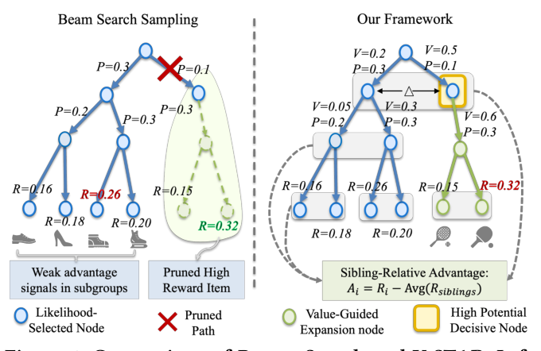
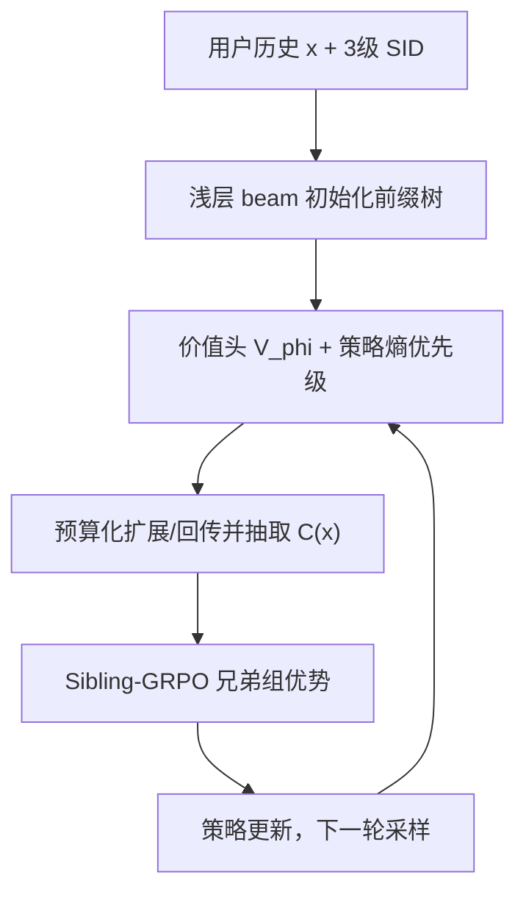
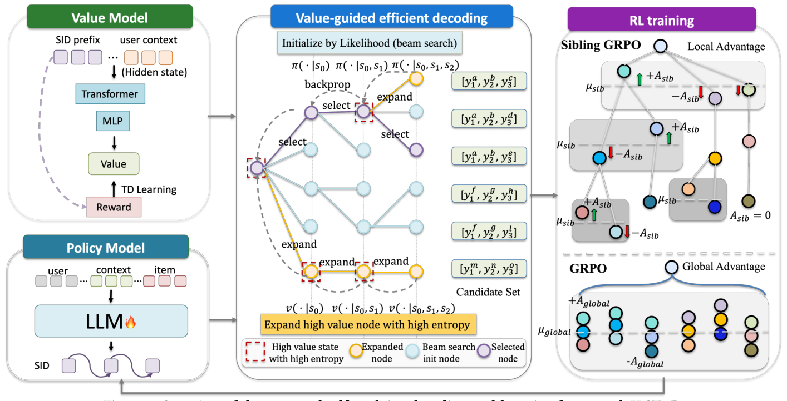

# Spend Search Where It Pays: Value-Guided Structured Sampling and Optimization for Generative Recommendation（把搜索花在刀刃上：面向生成式推荐的价值引导结构化采样与优化）

- **会议/期刊**: KDD 2026
- **作者与机构**: Jie Jiang、Yangru Huang、Zeyu Wang 等，腾讯
- **推荐链路定位**: 端到端生成式召回
- **研究方向**: 生成式推荐 / 强化学习与动态探索推荐
- **论文原文**: [论文原文链接](https://arxiv.org/abs/2602.10699v2)
- **开源代码**: 暂未开源

## TL;DR (1分钟核心速览)

本文针对 SID 自回归生成推荐中 beam search 概率剪枝导致高奖励低概率分支不可达、GRPO 组内奖励同质化造成优势压缩的问题，提出 V-STAR：用价值+熵引导预算化解码 VED 只扩展高价值高不确定前缀，并用 Sibling-GRPO 在同一父前缀的兄弟节点上归一化优势。Amazon Industrial/Office 的 Next-Item Top-K 评估中，HR@10/NDCG@10 较 MiniOneRec 提升 3.5%/4.3% 与 6.9%/7.9%，线上微信 GMV +1.23%。

## Background & Motivation (背景与核心矛盾)

- **主流范式**: 将物品编码为 RQ-VAE 语义 ID，用自回归模型逐 token 生成候选，并以 beam search 采样、GRPO 类 RL 对齐点击/转化奖励。
- **前人局限**: 概率剪枝不可逆地丢弃低概率但高奖励的 SID 前缀；同时共享前缀的候选奖励高度相关，组内方差小，GRPO 的全局归一化会压缩真正分支决策的优势信号。
- **核心洞察 (Key Insight)**: 固定解码预算下，探索并非在每个前缀上都等价；真正值得多花算力的是“高价值且高不确定”的 decisive prefix。解码同时决定候选的 reachability 与 RL 的 learnability。
- **本文切入点**: 把候选构造建模为预算约束下的价值引导前缀树搜索，并把优势归一化下沉到兄弟节点层级。

<figure class="paper-figure" markdown="span">
  <figcaption>图1：Beams Search 与 V-STAR 的比较。左：基于概率的剪枝会移除高奖励项并产生同质候选。右：V-STAR 在固定预算下扩展高价值前缀，并借助 Sibling-GRPO 强化组内学习。</figcaption>
</figure>
*图1：Beam Search 概率剪枝与 V-STAR 价值引导解码的对比。*

## Method (核心方法设计)

### 1. 整体框架 (Overall Architecture)

V-STAR 将候选构造与策略优化耦合成自演化闭环：用文本嵌入构造前缀桶密集回报，训练轻量价值头 \(V_\phi\)；解码先以 beam search 建浅前缀树，再用 \(V_\phi\) 与策略熵的联合优先级和 UCB 遍历，只在深度平均优先级以上的 decisive 前缀扩展，按 token 预算抽取高价值叶节点；随后按共同父前缀划分兄弟组，计算节点级相对优势并做 Sibling-GRPO，更新后的策略又改善下一轮采样。测试默认 beam search，可选 VED。

<figure class="paper-figure" markdown="span">
  <figcaption>图2：所提出的自演化解码与学习框架 V-STAR 概述。</figcaption>
</figure>
*图2：V-STAR 自演化解码与学习框架总览。*

### 2. 关键设计拆解 (Key Designs)

1. **语义感知价值学习（缓解稀疏终局奖励）**：仅用最终命中反馈训练中间前缀价值太稀疏。本文用候选桶平均嵌入与真实物品嵌入的余弦相似度构造密集回报：命中前缀取正权 \(w_\ell\)，否则取 $-w_\ell(1-\cos(\bar{e},e(y^\star)))$，再用一步 TD 训练 \(V_\phi\)：$\mathcal{L}_V=\mathbb{E}[(V_\phi(s_\ell)-(r_\ell+\gamma V_\phi(s_{\ell+1})))^2]$。语义相近的错前缀仍获得有信息梯度，价值估计更平滑。

2. **VED 预算化解码（把搜索花在 decisive prefix）**：候选构造目标同时最大化期望奖励与组内对比度，受 token 预算 \(B\) 约束。前缀优先级为 $G(s)=V_\phi(s)+\lambda H_\theta(s)$，终端前缀仅用 \(V_\phi\)；遍历分数为$U(s)=G(s)+\beta\sqrt{\ln(N_{\mathrm{root}}+1)/(N(s)+1)}$。仅当$G(s)\ge\bar{G}_\ell$ 时扩展，避免穷举树搜索与无效高概率分支扩张。

3. **Sibling-GRPO 与训练目标**：对父前缀 \(h\) 下的子节点 \(v\)，以路由候选平均奖励 $\bar{R}(x;h,v)$在兄弟节点集合 \(S(h)\) 内归一化：$A_{\mathrm{node}}(x;h,v)=(\bar{R}(x;h,v)-\mu_h(x))/(\sigma_h(x)+\epsilon)$。总目标联合全局 GRPO 与兄弟级目标$\mathcal{L}=\mathcal{L}_{\mathrm{GRPO}}+\mathcal{L}_{\mathrm{sib}}$，把梯度集中到真正区分兄弟物品的分支 token 上。训练用 VED 每 query 构造 16 个候选，无 BPR 式负采样；价值头仅一层浅 Transformer+MLP，推理默认 beam search，避免线上延迟膨胀。

## Experimental Setup & Evaluation Protocol (实验设置与评估协议)

- **数据集与预处理**: 公开 Amazon Review 的 Industrial、Office 两个子集，按 [20] 预处理，物品用 RQ-VAE 构造 3 级 SID；原文未报告用户/物品/交互统计与稀疏度。

| 数据集 | #Users | #Items | #Interactions | 稀疏度/密度 | 特征/场景说明 |
| :--- | :---: | :---: | :---: | :---: | :--- |
| Amazon Industrial | 未报告 | 未报告 | 未报告 | 未报告 | 工业品评论，3 级 SID，Next-Item |
| Amazon Office | 未报告 | 未报告 | 未报告 | 未报告 | 办公用品，3 级 SID，Next-Item |

- **数据划分与防穿越**: 按用户时间序组织交互，输入完整历史预测下一物品，属末位留出式 Next-Item 预测；未明确全局时间戳切分。
- **排名评测协议**: 报告 HR@3/5/10 与 NDCG@3/5/10，生成输出强制限制为合法 SID；未报告全库 Full-Ranking 或采样负例比例。
- **对比基线与超参**: 覆盖 GRU4Rec、SASRec、HSTU、TIGER、D3、S-DPO、MiniOneRec 等；骨干 Qwen2.5-1.5B，先 SFT 后 RL，SID 长度 \(L=3\)，候选数 16，层级权重 \([0.3,0.5,1.0]\)，\(\gamma=0.99\)，\(\lambda=0.1\)，初始化 beam width=8，学习率 \(1\times10^{-5}\)，KL 系数 \(10^{-3}\)；未报告显著性检验。

## Key Experimental Results (实验关键数据)

### 1. 主实验对比 (Main Results)

| 模型 | Ind. HR@5 | Ind. HR@10 | Ind. NDCG@10 | Off. HR@5 | Off. HR@10 | Off. NDCG@10 |
| :--- | ---: | ---: | ---: | ---: | ---: | ---: |
| GRU4Rec | 0.0774 | 0.0999 | 0.0669 | 0.0789 | 0.1019 | 0.0669 |
| SASRec | 0.0909 | 0.1088 | 0.0806 | 0.0949 | 0.1120 | 0.0858 |
| HSTU | 0.1037 | 0.1163 | 0.0958 | 0.1252 | 0.1400 | 0.1126 |
| TIGER | 0.1010 | 0.1321 | 0.0908 | 0.1163 | 0.1408 | 0.1002 |
| D3 | 0.1213 | 0.1500 | 0.1082 | 0.1406 | 0.1634 | 0.1213 |
| S-DPO | 0.1238 | 0.1524 | 0.1082 | 0.1356 | 0.1587 | 0.1255 |
| MiniOneRec | 0.1321 | 0.1586 | 0.1167 | 0.1420 | 0.1634 | 0.1242 |
| **Ours** | **0.1361** | **0.1641** | **0.1217** | **0.1500** | **0.1746** | **0.1340** |

Ours 相对 MiniOneRec：Industrial HR@10 +3.5%、NDCG@10 +4.3%；Office HR@10 +6.9%、NDCG@10 +7.9%。线上 5 天 A/B（微信 Channels，5% 流量）GMV +1.23%、GMV-Normal +1.87%。

### 2. 消融实验 (Ablation Study)

| 变体 | Ind. NDCG@10 | Ind. HR@10 | Off. NDCG@10 | Off. HR@10 |
| :--- | ---: | ---: | ---: | ---: |
| Beam Search | 0.1194 | 0.1606 | 0.1299 | 0.1684 |
| Top-K | 0.1090 | 0.1538 | 0.1226 | 0.1644 |
| VED (Ours) | **0.1217** | **0.1641** | **0.1340** | **0.1746** |
| w/o 熵项，仅 \(V_\phi\) | 0.1202 | 0.1627 | 0.1333 | 0.1742 |
| w/o 价值项，仅 \(H_\theta\) | 0.1198 | 0.1604 | 0.1259 | 0.1688 |
| w/o Sibling，仅 GRPO | 0.1189 | 0.1598 | 0.1302 | 0.1712 |
| Sibling-GRPO | 0.1204 | 0.1640 | 0.1335 | 0.1749 |
| Joint GRPO+Sibling | **0.1217** | **0.1641** | **0.1340** | **0.1746** |

### 3. 关键实验发现 (Key Findings)

1. VED 相较 beam search 在 Industrial 上 NDCG@10 从 0.1194 提至 0.1217、HR@10 从 0.1606 提至 0.1641；Top-K 仅 0.1090/0.1538，说明随机探索不如“高价值+高不确定”定向扩展。
2. 仅用价值项虽优于仅用熵项，但联合 \(G(s)\) 最优；Office 上熵单用 NDCG@10 降至 0.1259，表明熵应作为“扩展门控”，而非独立排序信号。
3. Sibling-GRPO 比全局 GRPO 在 Industrial/Office NDCG@10 提升 0.0015/0.0033，联合目标再获最佳；同时 VED 候选多样性 0.8167 vs beam 0.7949，MaxReward 0.2475 vs 0.2303，线上 GMV 亦验证商业价值。

## Highlights & Limitations (亮点、对比与审稿批判)

- **与代表作对比 (vs. Prior Work)**: TIGER/LCRec/D3 仍以似然主导 SID 解码，MiniOneRec 用 GRPO 但把候选近似 i.i.d.；V-STAR 首次显式利用前缀树拓扑做预算化价值探索与兄弟级信用分配。相较 beam+GRPO，本文把“解码器”从推理启发式提升为训练信号构造器。
- **可迁移亮点**: 价值+熵的预算分配可迁移到多模态/对话生成式召回；兄弟组优势归一化适用于任何层级离散码本的 RL 微调。
- **审稿级局限批判**: 测试默认回退 beam search，VED 的推理收益未在严格线上延迟下充分释放；仅两个 Amazon 子集且未报告数据统计/显著性，超参 \(\lambda,\beta,w_\ell\) 敏感性与训练解码开销仍需补充。

## Rating (四维评分)

- **方法创新性 (Novelty)**: ⭐⭐⭐⭐ （把概率-奖励错配拆成 reachability 与 learnability，并用前缀树统一解码与 RL 优势分配，机制新颖。）
- **评估协议与实验扎实度 (Protocol & Experiments)**: ⭐⭐⭐⭐ （离线双数据集+线上 A/B 较完整，但缺少数据统计、全库排序协议说明与显著性检验。）
- **写作与数学规范度 (Clarity & Rigor)**: ⭐⭐⭐⭐ （价值回报、优势压缩界与 Sibling-GRPO 目标定义清晰，复杂度与超参分析略简。）
- **工业落地与复现价值 (Industrial & Practical Value)**: ⭐⭐⭐ （腾讯线上验证有说服力，但未开源且测试端默认 beam，VED 部署成本与收益需进一步验证。）

