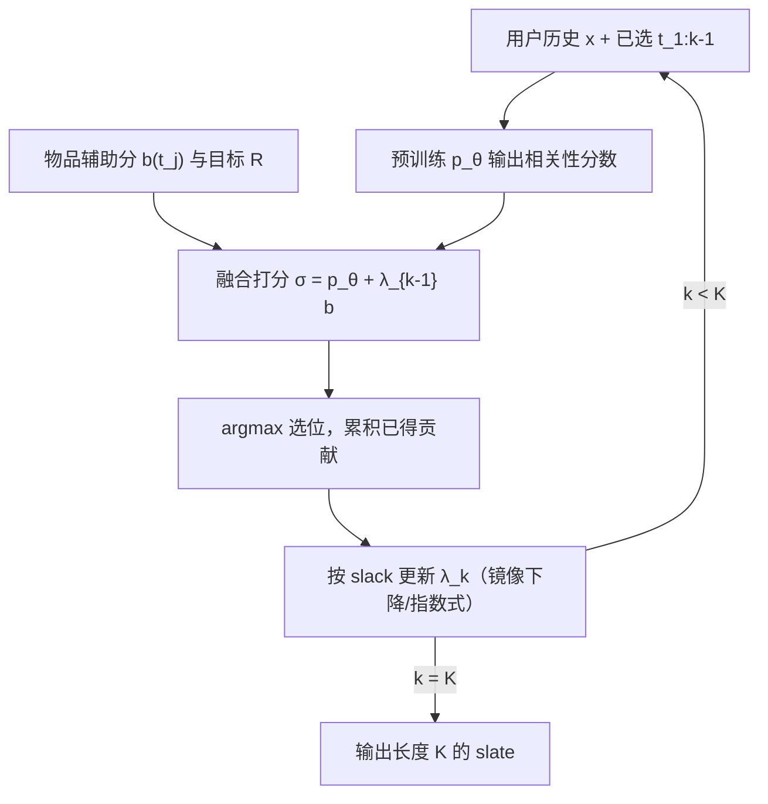
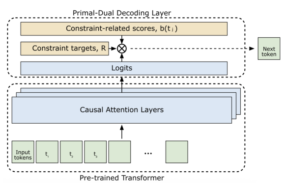
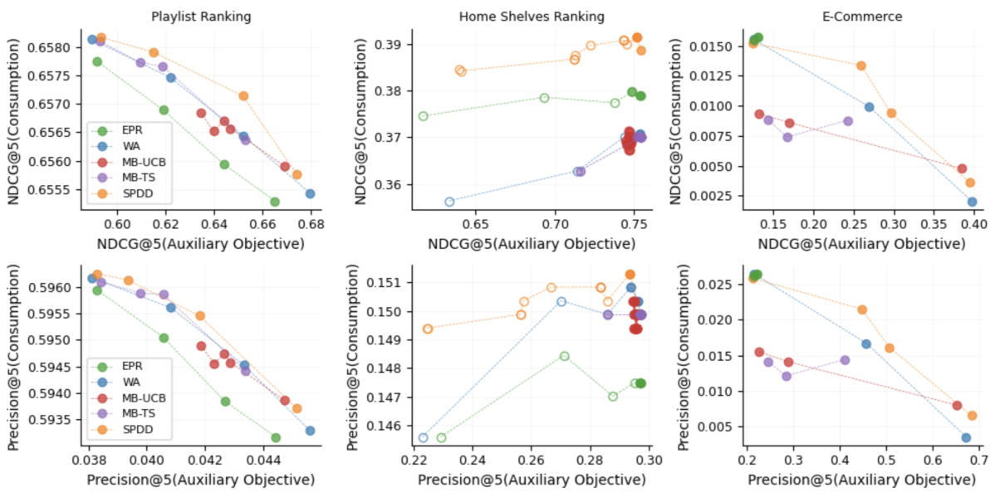

# Stochastic Primal-Dual Decoding for Multiobjective Generative Recommender Systems (面向多目标生成式推荐系统的随机原始-对偶解码)

- **会议/期刊**: KDD 2026（Spotify 工业界论文）
- **作者与机构**: Dmitrii Moor, Ben Carterette, Senthilkumar Krishnamoorthy, Mounia Lalmas 等（Spotify）
- **推荐链路定位**: 端到端生成式（自回归解码层，等价于列表级重排）
- **研究方向**: 生成式推荐与离散语义 ID / 强化学习与在线分配（约束优化）
- **论文原文**: [https://arxiv.org/abs/2607.19357v1](https://arxiv.org/abs/2607.19357v1)
- **开源代码**: 暂未开源

## TL;DR (1分钟核心速览)

生成式推荐（SASRec/TransAct/LM-Rec 类自回归模型）在构造长度为 $K$的列表时，除相关性外还需满足品类占比、公平性等**列表级约束**。已有做法要么在生成后做重排（无视自回归的序列依赖），要么把目标写进训练（属性一改就得重训）。本文把解码视为在线约束分配问题，用**随机原始-对偶**在推理期动态调节拉格朗日乘子$\lambda$：约束松弛大则加鞭、接近达标则回落。离线三域 Pareto 全面支配 EPR/WA/MB-UCB/MB-TS，线上 A/B（1M 用户）辅助目标 stream share$+5.44\%$（WA 仅$+3.60\%$），消费不降、跳过率反降。

## Background & Motivation (背景与核心矛盾)

- **主流范式**: 用因果 Transformer 把用户历史 $x$分解为逐位置条件概率$p_\theta(t_j|x,t_{1:k-1})$，自回归采样出整条 slate；多目标任务则依赖事后重排（EPR）或加权标量化（WA）/多目标 bandit（GGI+UCB/TS）。
- **前人局限**: ①EPR 在全部相关性分数算完后才重排，忽略"选中 $t_k$会改变后续所有$p_\theta$"的序列依赖，且当目标物品仅占约 15%（电商）时几乎抽不到、无从重排；②训练期注入目标（Decision-Transformer 类）把目标绑死在参数上，属性或目标$R$ 一变就需重训百亿级模型，工业不可行；③固定权重 WA 不会随约束进度自适应，bandit 类的 explore 开销抵消收益。
- **核心洞察 (Key Insight)**: 自回归解码天然是一个**在线到达**过程——每步才揭示全部候选分数，未来分数未知；而约束是**累积型**的，因此真正该调的不是权重本身，而是"还剩多少没满足"（slack）。
- **本文切入点**: 把解码写成带约束的在线 0-1 分配问题，用对偶变量 $\lambda$ 作为约束的影子价格，在推理期逐步镜像下降更新，不改模型、不重训。

## Method (核心方法设计)

### 1. 整体框架 (Overall Architecture)

输入用户历史 $x$，预训练$p_\theta$在每步$k$输出全候选相关性$p_\theta(t_j|x,t_{1:k-1})$；解码层将预训练分数与物品级辅助分$b(t_j)$按当前乘子$\lambda_{k-1}$线性融合，取 argmax 落位；随后依据该步实际获得的辅助贡献与人均目标$R/K$的差额，用指数形式更新$\lambda_k$，进入下一步。整个过程仅替换模型最后一层 scoring，$O(KM)$ 线性复杂度，可与 SASRec / TransAct / LLM 语义 ID 生成器即插即用。

<figure class="paper-figure" markdown="span">
  <figcaption>图1：随机原始-对偶解码器（Stochastic Primal-Dual Decoder）：解码层依赖预训练 Transformer 𝑝𝜃 输出的分数以及与约束相关的分数，将生成引导至期望方向。</figcaption>
</figure>

### 2. 关键设计拆解 (Key Designs)

1. **松弛感知的拉格朗日打分（Primal-Dual Scoring）**：痛点是不动模型就无法控制列表级占比。将约束 $\sum_{k,j}b(t_j)a_{kj}\ge R$对偶化后，固定$\lambda_k$时内层最大化退化为逐项加权排序，得到唯一改动算子$\sigma(t_j)=p_\theta(t_j|x,t_{1:k-1})+\lambda_{k-1}b(t_j)$。直觉：$\lambda$ 即"辅助目标一分值多少相关性"，随约束进度自动涨落，等价于在解码路径上做动态标量化而非固定权重。
2. **指数式乘子更新（乘性、非负、稳定）**：乘子需在线更新且恒非负。对 $\lambda$做负熵 Bregman 散度正则的镜像下降，得闭式解$\lambda_{k}=\lambda_{k-1}\exp\{-\eta\,(b(t_{j^{*}})-R/K)\}$；若本步贡献低于人均配额$R/K$，指数项放大$\lambda$，反之平滑衰减。相比加性梯度更新，乘性更新在违约时响应更快、接近达标时不过冲，正是"先补短板、后回归相关性"的物理机制。
3. **语义 ID 上的 token 级辅助分映射**：LLM 生成器以 3 个 8-bit 语义 token 表示物品，但 $b(t_j)$定义在物品级。本文对 token$s^{\ell}_j$取包含该前缀的所有物品的期望属性分$b(s^{\ell}_j)=\sum_i b(t_i)\Pr(t_i|s^{1}_j,\dots,s^{\ell}_j)$，使解码层在开放词表空间同样可约束，且前缀越深估计越准。
4. **训练与推理开销**：模型侧完全冻结，无新增损失、无负采样改动（沿用 in-batch 负采样，1 正 100 负）；推理仅需 1 次全候选打分 + 1 次 argmax + 1 次标量更新，相对 Transformer 前向可忽略，满足线上低延迟。

## Experimental Setup & Evaluation Protocol (实验设置与评估协议)

- **数据集与预处理**:

| 数据集 | #Users | #Items | #Interactions | 稀疏度/密度 | 特征/场景说明 |
| :--- | :---: | :---: | :---: | :---: | :--- |
| Playlist Ranking（工业） | 62M | 42M tracks | ~40B | 极稀疏 | 两周日志，序列长 100，SASRec，辅助目标=指定曲目 stream share |
| Home Shelves（工业） | ~5亿请求 | 卡片/货架 | 5.3B 曝光 | 稀疏 | 一周日志，TransAct，辅助目标=指定货架曝光占比 |
| Amazon Sports&Outdoors | — | >1M | >5M | 5-core 过滤 | Camping&Hiking + Cycling 约占 15% 物品，$b(t_j)\in\{0,1\}$，Llama-3.2-1B + Semantic ID |

- **数据划分与防穿越 (Splitting Strategy)**: 按用户交互时间戳构造时序序列做 next-item 预测（SASRec 式），Home 场景为 90/10 train/validation 比例划分；测试阶段在**已记录日志分布上重排**，不涉及未来信息泄漏。
- **排名评测协议 (Ranking Protocol)**: 非全库 Full-Ranking，而是对生成 slate 的 $K$个位置分别计算**消费侧**与**辅助目标侧**的 NDCG@k / Precision@k，扫描$R$（或标量权重）得到两点后连成 Pareto 前沿；线上以 Control 为基准报告相对变化。
- **对比基线与超参设置**: EPR（事后重排）、WA（在线固定加权）、MB-UCB、MB-TS（GGI + bandit 学权重）与本文 SPDD，全部叠加在同一基座模型上以隔离解码层效应；SASRec $d=80$、2 层 5 头（约 250M 参数），TransAct$d=64$、4 层 4 头、3 小时时间窗，$\lambda_0=1$，步长$\eta>0$ 为唯一关键超参。

## Key Experimental Results (实验关键数据)

### 1. 主实验对比 (Main Results)

原文离线结果以 Pareto 前沿（图 2）呈现而非单点表格，下表为三域上的**相对支配关系**（同等辅助占比下消费越高越优）：

| 方法 | 机制 | Playlist | Home Shelves | Amazon | 说明 |
| :--- | :--- | :---: | :---: | :---: | :--- |
| Base（仅相关性） | 无约束 | 前沿左下端点 | — | — | 辅助占比极低 |
| EPR | 事后重排 | 劣（低 $R$ 时接近） | 劣 | 最差 | 无视序列依赖；目标物品稀缺时失效 |
| WA | 在线固定权重 | 中 | 中 | 中 | 一致优于 EPR |
| MB-UCB | GGI + UCB | 中 | 中 | 中 | explore 开销抵消自适应收益 |
| MB-TS | GGI + Thompson | 中 | 中 | 中 | 同上，无稳定超额收益 |
| **SPDD（本文）** | 原始-对偶 | **最优** | **最优** | **最优** | 几乎全 $R$ 区间均匀支配 |

线上 A/B（1M 用户、150+ 国家、60 万歌单，相对 Control 的 SASRec）：

| 组别 | 辅助目标 stream share | 消费（总播放分钟） | Skip Rate |
| :--- | :---: | :---: | :---: |
| Control（仅相关性） | 基准 | 基准 | 基准 |
| WA | $+3.60\%$| 持平 |$+0.42\%$ |
| **SPDD** | **$+5.44\%$** | **持平（零成本）** | **$+0.16\%$** |

<figure class="paper-figure" markdown="span">
  <figcaption>图2：三个不同领域中消费与辅助目标流占比的帕累托前沿。</figcaption>
</figure>

### 2. 消融实验 (Ablation Study)

原文未做逐组件剥离式消融（解码层本身即最小增量），代之以位置级归因与步长敏感性分析：

| 分析维度 | 设置 | 关键现象 |
| :--- | :--- | :--- |
| 位置级分布 | SPDD vs 其他 | 位置 1 分配更多高 $b$ 物品，消费几乎无损；后续位置迅速回落、消费抬升 |
| 步长 $\eta$| 小$\eta$vs 大$\eta$| 低目标$R$时小$\eta$前沿占优（低 regret）；高$R$时小$\eta$难达约束，大$\eta$ 占优 |
| 基座模型 | SASRec / TransAct / LM-Rec | 三架构归一化增益方向一致，说明与模型无关 |
| 表征空间 | item ID vs Semantic ID | 语义 token 级 $b(\cdot)$ 映射后收益保留，无退化 |

### 3. 关键实验发现 (Key Findings)

1. **EPR 在稀缺目标域近乎失效**：Amazon 上辅助子类仅占约 15% 物品，纯相关性模型本就极少生成，事后重排无从纠正；SPDD 靠前位强制注入才拿到可行解，印证"约束必须在解码内解"。
2. **自适应优于探索**：MB-UCB/MB-TS 相对 WA 无一致增益，说明收益来自对 slack 的确定性响应而非对权重的探索；SPDD 却在同消费下把辅助占比进一步抬高，线上 $+5.44\%$vs$+3.60\%$。
3. **约束"前置兑现"是零成本的关键**：位置 1 多放目标物品未损消费，随后 $\lambda$自动衰减使后位回归相关性，最终整体 skip rate 反而从$+0.42\%$降至$+0.16\%$，即理论上的$O(1/\eta\log\frac{1}{b_{\max}-R/K})$违约界与$O(1/\eta+\eta K)$ regret 界在实践中可同时逼近。

## Highlights & Limitations (亮点、对比与审稿批判)

- **与代表作对比 (vs. Prior Work)**: 相比 EPR（Mehrotra et al., CIKM'18）与多目标 bandit（Mehrotra et al., KDD'20），本文在**生成序列内部**做在线分配而非独立假设下的重排/探索；相比 Future-conditioned Decision Transformer（Gao et al., 2025）把目标编码进参数，本文零重训、目标 $R$ 可在线热调，工程性更强。
- **可迁移亮点**: ①"乘性指数更新 + 松弛感知打分"可平移到任何自回归生成器的可控生成（多样性、去重、曝光预算）；②语义 ID 的 token 级 bid 期望映射，是把物品级业务约束接入 LLM 生成推荐的通用水位线技巧。
- **审稿级局限批判**: ①全文仅推导并实验**单个**辅助约束，多约束需多乘子联合更新，收敛性与乘子间耦合未讨论；②理论依赖"相关性扰动服从独立高斯随机游走"的时序一致性假设，真实场景中位置偏置与曝光偏差会破坏该假设；③离线评估基于日志重排、非全库排序，且线上增益幅度（$+1.8\%$辅助目标）虽显著但偏小，$\eta$与$R$ 的调参成本在冷启动业务中不低。

## Rating (四维评分)

- **方法创新性 (Novelty)**: ⭐⭐⭐⭐ （把约束解码严格落到在线原始-对偶框架，算子极简但理论闭环，属"小而正确"的增量）
- **评估协议与实验扎实度 (Protocol & Experiments)**: ⭐⭐⭐⭐ （三域 + 三架构 + 百万用户线上 A/B 很强，但离线仅日志重排、缺全库排序与逐组件消融）
- **写作与数学规范度 (Clarity & Rigor)**: ⭐⭐⭐⭐⭐ （对偶推导、违约与 regret 双界清晰，且明确给出 $\eta$ 的实践选取指南）
- **工业落地与复现价值 (Industrial & Practical Value)**: ⭐⭐⭐⭐⭐ （零重训、$O(KM)$ 开销、已在大规模流媒体上线，直接可复用；可惜未开源）

