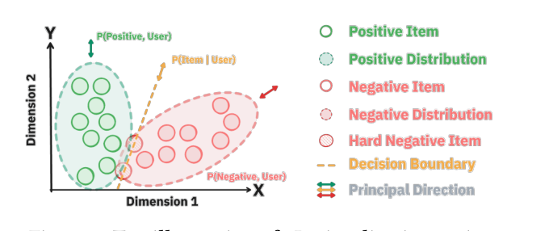
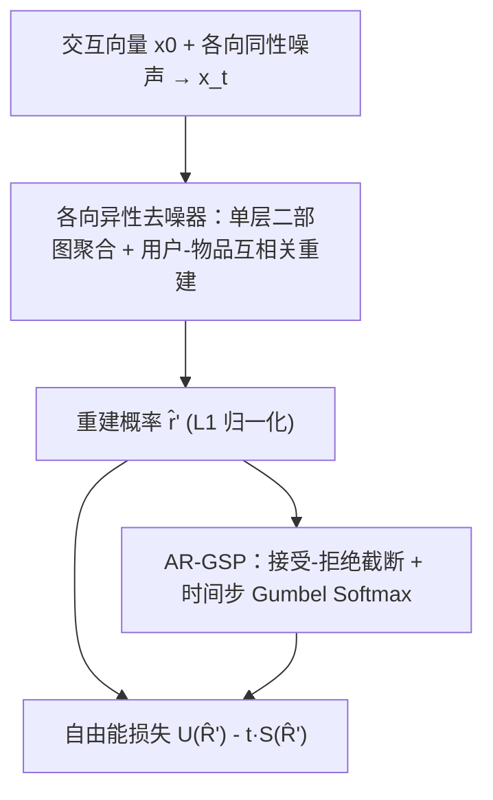

# Towards A Tri-View Diffusion Framework for Recommendation (三视图扩散推荐框架)

- **会议/期刊**: KDD 2026 (First Cycle)
- **作者与机构**: Ximing Chen, Pui Ieng Lei, Yijun Sheng, Yanyan Liu, Zhiguo Gong（澳门大学）
- **推荐链路定位**: 端到端生成式召回（用户级 Top-K 排序）
- **研究方向**: 生成式推荐与离散语义ID / 图神经网络推荐
- **论文原文**: [https://arxiv.org/abs/2511.20122v1](https://arxiv.org/abs/2511.20122v1)
- **开源代码**: [https://github.com/umsimonchen/TV-Diff](https://github.com/umsimonchen/TV-Diff)

## TL;DR (1分钟核心速览)

现有扩散推荐（DiffRec 等）盲搬 MSE 目标，只“最大化能量”却不“降低熵”，而 BPR/LightGCN 等经典模型恰恰相反，二者互补却被割裂。本文先用五数据集实验把这一现象定量坐实，再以 Helmholtz 自由能 $F=U-tS$ 把两类目标统一为单一损失，辅以保留二部图各向异性的单层去噪器与 AR-GSP 硬负采样。在 5 个数据集、8:2 随机划分、Top-10/20 全库排序协议下，R@10 平均超 DiffRec 约 12%、超最强图对比基线 SGCL 约 3.5%。

## Background & Motivation (背景与核心矛盾)

- **主流范式**: 以用户完整交互向量 $x_0$为扩散对象，前向注入各向同性高斯噪声、反向用去噪网络重建$r_u$，训练目标基本沿用视觉/生成领域的 MSE。
- **前人局限**: ① MSE 建模联合分布 $P(item,user)$ 对隐式反馈排序次优，而把 BPR 与 MSE 简单耦合的代理目标会因去噪器参数纠缠产生 *biphasic oscillation*，在通用推荐上不收敛；② 各向同性噪声抹平二部图固有的拓扑各向异性（用户/物品度分布不一致），随机负采样又几乎不提供判别信息，传统硬负采样与正分布“次线性相关”还会牺牲泛化。
- **核心洞察 (Key Insight)**: 实验测得 DiffRec 训练中**能量**（重建交互数 $U(\hat{R}')$）持续上升、**熵**（$\hat{R}'$ 的 Shannon 熵）近乎等熵；BPR/LightGCN 则显著降熵，且 LightGCN 的多层消息传递降熵更强（Thm 3.2 证明其熵差非正）。二者是热力学中相互对抗又互补的两股力。
- **本文切入点**: 用自由能 $F=U-tS$ 同时“增能量+降熵”，并只在**单层**图上保留各向异性信号，避免多层传播把熵降过头。

<figure class="paper-figure" markdown="span">
  <figcaption>图1：物品二维可视化的玩具示例。</figcaption>
</figure>

## Method (核心方法设计)

### 1. 整体框架 (Overall Architecture)

输入用户交互向量 $x_0$，按预设方差日程加噪得$x_t$；反向阶段不再用“用户侧单体编码-解码”，而由**各向异性去噪器**将$x_t$与物品侧拓扑矩阵做互相关重建，输出$\hat{r}'_u$并做 L1 归一化。重建结果同时喂入两处：一是**自由能损失**（MSE 能量项 + BCE 熵项，温度$t$调节配比）；二是 **AR-GSP**，先按分数排名截断候选池、再以时间步相关 Gumbel-Softmax 采出可靠硬负例回灌损失。推理时迭代去噪$T$ 步得到最终排序分数，无需预训练嵌入。

### 2. 关键设计拆解 (Key Designs)

1. **Helmholtz 自由能最大化（统一两类目标）**: 针对“能量/熵各行其是”，把能量项取 MSE、熵项取 BCE（二者逐用户计算粒度一致），得到
$\mathcal{L}_{H}=U(\hat{R}')-t\cdot S(\hat{R}')=-\sum_{u\in\mathcal{B}}\sum_{i}(\hat{r}_{u,i}-\hat{r}'_{u,i})^{2}-t\big(\hat{r}_{u,i}\log\sigma(\hat{r}'_{u,i})-c_{u,i}(1-\hat{r}_{u,i})\log(1-\sigma(\hat{r}'_{u,i}))\big)$，
其中 $c_{u,i}\sim\mathrm{Bernoulli}(|N(u)|/n)$控制负例置信度。直觉：单纯 MSE 会让熵停在高位（等熵塌缩到次优），加上熵项相当于给扩散过程装了“决策边界收紧器”，$t$ 是能量/熵的权衡温度。

2. **各向异性去噪器（保住二部图拓扑）**: 针对“单体用户编码器只建模用户度分布、默认物品度同分布”的缺陷，把去噪器拆成用户/物品两支，用显式对称归一化邻接 $\bar{R}$ 做**单层**聚合后取互相关：
$\tilde{x}_\theta(x_t,t)=\tanh\big(\mathrm{Agg}(x_t W_I,e_t)\big)\cdot\tanh(\bar{R}^{\top}W_U)^{\top},\quad \hat{r}'_u=\tilde{x}_\theta/\|\tilde{x}_\theta\|_1$。
为什么单层：Thm 3.2 表明多层消息传递会继续压低熵并推高整体能量，反而破坏自由能平衡；单层同时省掉大图上的多层开销。

3. **AR-GSP 硬负采样（DM 专用负例）**: Thm 3.3 证明 BPR 期望损失的**上界**当且仅当 $p_n(j|u)=C\cdot p_d(i|u)$取得，次线性相关会退化为逐点目标，因此改为“正交式”截断：先按$\mathrm{Rank}(\tilde{r}_{u,j})\le\gamma n$以$1/(\gamma n)$接受、否则以$\epsilon$ 拒绝，再用时间步相关 Gumbel-Softmax 软化
$\hat{p}_n(j|u)=\frac{\exp((\log p_n(j|u)+g_j)/\exp(-\lambda\bar{t}))}{\sum_{j'}\exp((\log p_n(j'|u)+g_{j'})/\exp(-\lambda\bar{t}))},\ \bar{t}=1-t/T$。
即 $t\to T$（噪声最大、分数最不可信）时温度趋 1、负例退回近均匀分布，避免把真阳性误判为硬负例。

- **训练目标、负采样与推理效率**: 总损失即 $\mathcal{L}_H$，每正例配 1 负例（与 BPR 公平对齐），负例由 AR-GSP 生成；空间复杂度$O((m+n)d)$，时间$O(|B|nd+|R^+|d)$，AR 排序项$O(|B|n\log n)$ 可忽略。

## Experimental Setup & Evaluation Protocol (实验设置与评估协议)

- **数据集与预处理**: 评分全部二值化为隐式反馈，未做 k-core 过滤：

| 数据集 | #Users | #Items | #Interactions | 密度 | 场景说明 |
| :--- | :---: | :---: | :---: | :---: | :--- |
| LastFM | 1,892 | 17,632 | 92,834 | 0.2783% | 音乐社交，小规模 |
| Amazon-Beauty | 22,364 | 12,102 | 198,502 | 0.0733% | 电商评论 |
| Douban-Book | 13,024 | 22,347 | 792,062 | 0.2721% | 图书评论 |
| Gowalla | 29,858 | 40,981 | 1,027,370 | 0.0840% | LBS 签到 |
| Yelp2018 | 31,668 | 38,048 | 1,561,406 | 0.1296% | 本地生活 |

- **数据划分与防穿越**: **8:2 随机比例划分**（非 Leave-One-Out、非全局时间戳切分，存在轻度未来交互泄漏风险）。
- **排名评测协议**: **全库排序 Full-Ranking**（对全部未交互物品打分），指标 Recall@{10,20}、NDCG@{10,20}；训练阶段每轮一正一负配对采样。
- **对比基线与超参设置**: 5 类基线——基础 (BPR-MF, NeuMF)、自编码 (CDAE, MultiVAE)、图 (LightGCN, ChebyCF, LinkProp, SGCL)、负采样 (MixGCF, AHNS)、扩散 (CODIGEM, DiffRec, BSPM, GiffCF, DDRM, HDRM)。统一 $d=64$、正则$1e^{-4}$、Gumbel 松弛率$\lambda=3$、早停 patience=10、Xavier 初始化 + Adam、随机种子固定为 0；相对提升 >1% 视为显著。

## Key Experimental Results (实验关键数据)

### 1. 主实验对比 (Main Results)

| 模型 | LastFM R@10/N@10 | Beauty | Douban-Book | Yelp2018 | Gowalla |
| :--- | :---: | :---: | :---: | :---: | :---: |
| LightGCN | 0.1980/0.2347 | 0.0921/0.0596 | 0.1000/0.1161 | 0.0342/0.0390 | 0.1278/0.1297 |
| SGCL | 0.1899/0.2305 | 0.1004/0.0678 | 0.1405/0.1704 | 0.0416/0.0472 | 0.1498/0.1516 |
| MixGCF | 0.1935/0.2306 | 0.0933/0.0607 | 0.0940/0.1104 | 0.0334/0.0378 | 0.1248/0.1254 |
| DiffRec | 0.2127/0.2538 | 0.0850/0.0586 | 0.1356/0.1682 | 0.0380/0.0443 | 0.1383/0.1439 |
| BSPM | 0.1962/0.2349 | 0.0814/0.0602 | 0.1296/0.1594 | 0.0401/0.0455 | 0.1484/0.1498 |
| **TV-Diff** | **0.2220/0.2605** | **0.1046/0.0719** | **0.1474/0.1863** | **0.0416/0.0481** | **0.1517/0.1578** |
| Improv. vs DiffRec (R@10) | +4.37% | +23.06% | +14.71% | +9.47% | +9.69% |

### 2. 消融实验 (Ablation Study)

| 配置 | 关键现象/数值 | 结论 |
| :--- | :--- | :--- |
| Vanilla (DiffRec) | 基线 | 仅能量目标 |
| +View I 自由能 | 全指标稳定提升 | 熵项必要，BCE/BPR/NLL 均优于 None |
| +View II 各向异性去噪器 | 相对 View I 平均 **+8%** | 贡献最大，说明拓扑各向异性此前被严重浪费 |
| +View III AR-GSP | 平均 **+3%**（小数据集更小） | 扩散去噪本身已部分替代硬负采样 |

| 负采样方式（LightGCN 骨架） | LastFM R@10/N@10 | Douban-Book R@10/N@10 | Gowalla R@10/N@10 |
| :--- | :---: | :---: | :---: |
| 次线性相关 SL | 0.2098/0.2419 | 0.1274/0.1431 | 0.1318/0.1375 |
| **接受-拒绝 AR** | **0.2165/0.2533** | **0.1353/0.1587** | **0.1437/0.1459** |

### 3. 关键实验发现 (Key Findings)

1. **收益与稀疏度正相关**：Beauty（密度 0.0733%）上 R@10 相对 DiffRec 提升 **23.06%**、Douban-Book 提升 14.71%，而密度最高的 LastFM 仅 +4.37%，说明自由能中的熵项主要在稀疏场景收紧决策边界。
2. **组件贡献严重不均**：各向异性去噪器单独带来 **+8%**，AR-GSP 仅 **+3%** 且在小数据集上更弱——即扩散模型的迭代去噪已隐含了相当程度的难负例挖掘能力，盲目叠加 Hard-NS 性价比有限。
3. **AR 优于次线性相关在长尾上更明显**：Douban-Book 上 AR 相比 SL 的 R@10 提升 6.2%、N@10 提升 10.9%，验证 Thm 3.3 关于“正负分布正交优于次线性”的论断；同时 Gowalla 每 epoch 仅 5.162s、45 轮收敛，远快于 DiffRec（19.303s/113 轮）与 LightGCN（14.748s/368 轮）。

## Highlights & Limitations (亮点、对比与审稿批判)

- **与代表作对比 (vs. Prior Work)**: 相较 DiffRec 仅用 MSE 且用户侧单体建模，本文把目标换成自由能并显式建模物品侧拓扑；相较 BSPM/GiffCF 把消息传递塞进扩散过程，本文只用**单层**图聚合即取得更优效果；相较 MixGCF/AHNS 的次线性相关硬负采样，AR-GSP 用“截断+时间步退火”避免高噪声步的假负例。
- **可迁移亮点**: ① 用“能量-熵”双指标诊断任意生成式推荐模型的训练完整性，可作为通用分析工具；② 时间步相关 Gumbel 温度调度（$\tau=e^{-\lambda\bar{t}}$）可直接移植到其他带噪监督的负采样模块。
- **审稿级局限批判**: ① 仅 8:2 随机划分，未做时间切分与冷启动划分，存在隐式未来信息泄漏，且未给出显著性检验（仅以 >1% 相对提升判显著）；② 熵项选 BCE 还是 BPR 依赖数据集规模（小数据偏好 BPR、大数据偏好 BCE），温度 $t$ 在 0.1–15 间的最优值跨度达两个数量级，超参敏感度高；③ Yelp2018 上 R@10 与 SGCL 打平（0.0416），"全面最优"的说法略强。

## Rating (四维评分)

- **方法创新性 (Novelty)**: ⭐⭐⭐⭐ （热力学自由能视角统一两类目标颇具巧思，Thm 3.2/3.3 给出了熵与拓扑、正负分布相关性的可证刻画，但去噪器结构本身仍属常规图聚合）
- **评估协议与实验扎实度 (Protocol & Experiments)**: ⭐⭐⭐ （5 数据集 + 5 类 15 个基线较完整，但仅随机 8:2 划分、无显著性检验、消融以图代数的部分偏定性）
- **写作与数学规范度 (Clarity & Rigor)**: ⭐⭐⭐⭐ （三视图组织清晰、动机实验与理论一一对应，个别公式符号约定（如 $\hat{r}_{u,i}$与$\hat{r}'_{u,i}$ 的角色）略绕）
- **工业落地与复现价值 (Industrial & Practical Value)**: ⭐⭐⭐⭐ （代码已开源，单层图聚合 + 免预训练使大图训练开销显著低于 LightGCN 多层与 DiffRec 批训练，适合稀疏场景召回）

