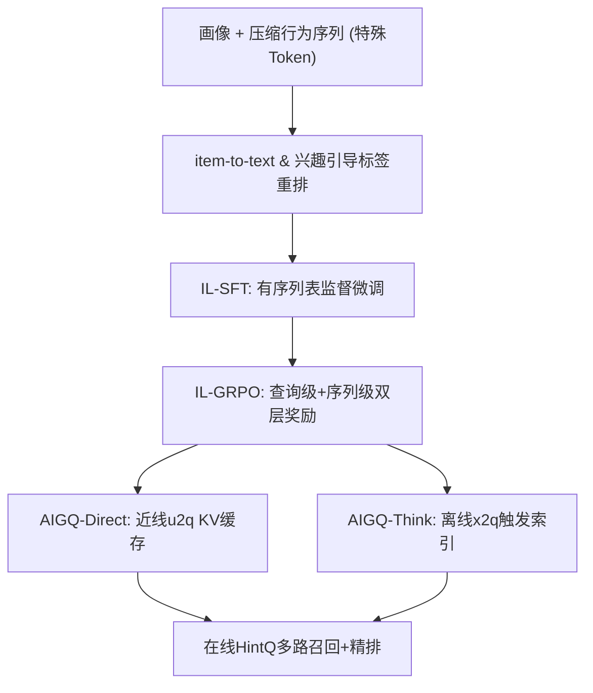
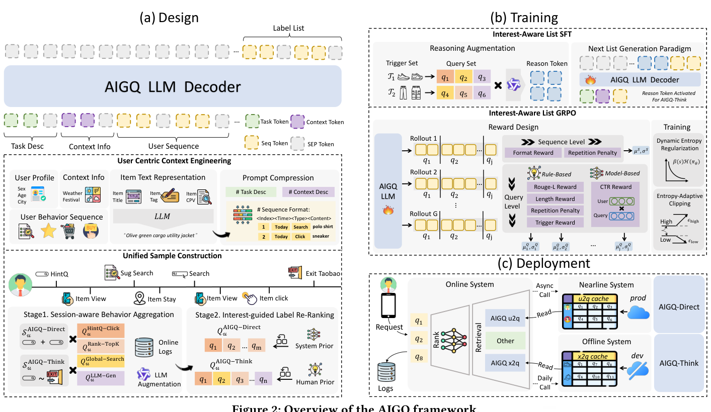

# AIGQ: An End-to-End Hybrid Generative Architecture for E-commerce Query Recommendation (面向电商查询推荐的端到端混合生成式架构)

- **会议/期刊**: KDD 2026
- **作者与机构**: Jingcao Xu, Jianyun Zou, Renkai Yang, Zili Geng, Qiang Liu, Haihong Tang（阿里巴巴淘宝天猫 / 电子科技大学）
- **推荐链路定位**: 召回（Pre-search 查询推荐 / HintQ）
- **研究方向**: LLM4Rec / 生成式推荐
- **论文原文**: [arXiv:2603.19710](https://arxiv.org/abs/2603.19710v1)
- **开源代码**: 暂未开源

## TL;DR (1分钟核心速览)

面向淘宝首页搜索前置的 HintQ（查询推荐）场景，现有基于 ID 匹配与共点击启发式的方法存在语义浅、冷启动差、惊喜度低三大痛点。本文提出首个端到端生成式框架 AIGQ：以列表级监督 **IL-SFT** 建模有序兴趣列表，配合双层奖励的 **IL-GRPO** 实现查询级细粒度信用分配，并设计 AIGQ-Direct（近线 u2q）+ AIGQ-Think（离线 x2q 推理）混合部署架构满足实时延迟。在淘宝 1M PV 离线集上 Query HR@30 从 0.0100（EBR）提升至 0.0745；线上 30 天 A/B 全漏斗提升，GMV +10.68%、UCTR +7.42%、7 日留存 +3.73%。

## Background & Motivation (背景与核心矛盾)

- **主流范式**: HintQ 无当前 query，只依赖用户画像与历史行为序列生成 K 条推荐查询。工业界普遍用 ID 双塔匹配或"离线 context→query 静态映射 + 在线触发召回"的伪生成范式。
- **前人局限**: (1) ID/共点击启发式无法泛化至冷启动长尾 query，语义易碎；(2) 静态映射无法覆盖多面兴趣，常输出语义不连贯的列表，且下游 ranker 只优化短期 CTR，与"语义合理性"产生错位。
- **核心洞察**: LLM 预训练已内化意图到类目的语义映射，甚至零样本即超 EBR；但直接把 HintQ 当作 NTP 会丢失"有序列表"结构，标准 GRPO 又对整条序列只给单一 reward，强 query 被弱 query 拖累。
- **本文切入点**: 将 HintQ 重定义为"兴趣感知的有序列表生成"，从监督信号（IL-SFT）、策略优化（IL-GRPO）到部署（混合双路）三处协同改造。

## Method (核心方法设计)

### 1. 整体框架 (Overall Architecture)

输入为自然语言化画像 + 压缩后的 `index|time|type|content` 行为序列（离散字段转为专用特殊 token，item 用 Qwen3-32B 蒸馏的 item-to-text 生成器转写为短文本以替代 ID）。模型基于 Qwen3-30B-A3B MoE，先经 IL-SFT 学习"按兴趣强度排序的标签列表"，再用 IL-GRPO 以在线 CTR 模型为动态奖励做策略微调；部署时分两条路：AIGQ-Direct 在近线异步推理并写入用户级 KV cache 充当 u2q 召回源，AIGQ-Think 离线将 CoT 推理固化为 trigger→query 的 x2q 倒排索引以规避实时延迟。

<figure class="paper-figure" markdown="span">
  <figcaption>图2：AIGQ 框架概述</figcaption>
</figure>

### 2. 关键设计拆解 (Key Designs)

**1. 兴趣引导的列表监督 IL-SFT**：常规 SFT 目标是裸 token 序列且无排序概念，本文把标签构造成按兴趣强度排序的 list：Direct 取 `$Q^{\text{Direct}}_u = \text{Concat}(Q^{\text{HintQ-Click}}_u, Q^{\text{Rank-TopK}}_u)$`；Think 进一步引入跨域全局搜索与 LLM 增广：`$Q^{\text{Think}}_u = \text{Concat}(Q^{\text{HintQ-Click}}, Q^{\text{Global-Search}}, Q^{\text{Rank-TopK}}, Q^{\text{LLM-Gen}})$`，使标签按置信度递减排布。这样 SFT 直接学到"工业级排序先验"而非孤立 query 集合。

**2. IL-GRPO 双层奖励与细粒度信用分配**：针对 GRPO 整序列单一 reward 的错题归因缺陷，将第 j 位生成的精确定位到第 j 位参考，定义优势
`$A_{i,t} = \frac{R^{\text{query}}(q_{i,j})-\mu^Q_j}{\sigma^Q_j} + \lambda\frac{R^{\text{seq}}(o_i)-\mu_S}{\sigma_S}$`
其中 `$R^{\text{query}}$` 融合 CTR 点击概率、ROUGE-L 与长度约束，`$R^{\text{seq}}$` 惩罚格式错误与重复。CTR reward 经 `$r_{\text{CTR}}(q_j)=\text{Clip}(\gamma\cdot\hat{p}_{\phi_T}(q_j|u),0,\beta)$` 线性缩放+上限截断，避免概率过小导致梯度湮灭；并每日用新日志更新 `$\phi_{T}$`，形成"CTR 模型→奖励→策略"的持续对齐闭环。Think 分支对 trigger token 用单独 ROUGE-L 奖励并严格与 query token 信号隔离。

**3. 训练与推理效率**：总损失为 IL-SFT 交叉熵 + IL-GRPO 策略梯度项（附熵衰减正则 `$\beta(s)\mathcal{H}(\pi_\theta)$` 与按 token 熵分位阈值自适应裁剪）。在线采用"近线异步 + 离线索引"策略规避 LLM 秒级推理瓶颈：Direct 端近线批量推理写缓存，请求时零耗时命中；Think 端离线将 `$\{T_k \to Q_k\}$` 映射为倒排，在线按 `$S_{\text{final}}(x,q)=\alpha S_{\text{rel}}+(1-\alpha)S_{\text{eff}}$` 打分召回。

## Experimental Setup & Evaluation Protocol (实验设置与评估协议)

- **数据集与预处理**: 淘宝真实线上日志（2025 年 10–11 月），训练用 1–30 天、测试用 31–32 天；采样后 ~1M PV（页面曝光）。

| 数据集 | 训练区间 | 测试区间 | 交互规模 | 特征/场景说明 |
| :--- | :---: | :---: | :---: | :--- |
| Taobao HintQ | day 1–30 | day 31–32 | ~1M PV | 画像+行为序列，首页无 query 场景 |

- **数据划分与防穿越 (Splitting Strategy)**: 全局时间戳切分（按自然日严格切分，测试集按用户级按单日聚合），有效规避未来信息泄漏。
- **排名评测协议 (Ranking Protocol)**: 生成式命中评估（首 K 条生成 query 命中真实交互）——Query HR@K 与 Cate HR@K，辅以 Sem. Sim. 与 Unique leaf categories；非全库排序，属生成式检索特有协议。
- **对比基线与超参设置**: 三大类基线——EBR 双塔、零样本 GPT-5.1 / Gemini 3 Pro / Qwen3-30B-A3B，以及 AIGQ 各消融变体。骨干 Qwen3-30B-A3B MoE（PPU 810E），SFT 2 epoch、lr=2e-3；IL-GRPO 采用 ROLL 框架，rollout=512、lr=1e-6、8 条采样、温度 1.0/top-k=100。

## Key Experimental Results (实验关键数据)

### 1. 主实验对比 (Main Results)

| 模型 | Cate HR@30 | Sem. Sim. | Query HR@30 | Unique Cates |
| :--- | :---: | :---: | :---: | :---: |
| EBR (生产最强) | 0.1998 | 0.5198 | 0.0100 | 8.4 |
| Gemini 3 Pro | 0.3449 | 0.5475 | 0.0017 | 7.0 |
| GPT-5.1 | 0.3353 | 0.5606 | 0.0021 | 4.6 |
| AIGQ-Direct_IL-SFT | 0.4305 | 0.5946 | 0.0442 | 7.5 |
| AIGQ-Think_IL-SFT | 0.4653 | 0.6478 | 0.0559 | **10.3** |
| AIGQ-Direct_IL-SFT+IL-GRPO | **0.4695** | 0.6341 | 0.0679 | 6.7 |
| AIGQ-Think_IL-SFT+IL-GRPO | **0.4704** | **0.6624** | **0.0745** | 9.8 |

Cate HR@30 相对 EBR 提升 **+135.4%**；Query HR@30 由 0.0100 提升至 **0.0745（约 7.5×）**。零样本 LLM 已显著超 EBR（Cate 提升 >50%），说明基座语义映射贡献巨大。

### 2. 消融实验 (Ablation Study)

| 变体 | Cate HR@30 | Query HR@30 |
| :--- | :---: | :---: |
| AIGQ-Direct_SFT | 0.4181 | 0.0428 |
| + 兴趣引导标签重排 | 0.4260 | 0.0442 |
| + Prompt 压缩 | 0.4305 | 0.0442 |
| + IL-GRPO | **0.4695** | **0.0679** |
| AIGQ-Think_SFT | 0.4437 | 0.0549 |
| + 兴趣引导标签重排 | 0.4492 | 0.0594 |
| + 推理增广 | 0.4653 | 0.0559 |
| + IL-GRPO | **0.4704** | **0.0745** |

### 3. 关键实验发现 (Key Findings)

1. **IL-GRPO 是增益最大组件**：在 Direct 上 Cate +0.0390、Query +0.0237；在 Think 上 Query HR 从 0.0559 跃至 0.0745，验证查询级细粒度信用分配相比序列级 GRPO（甚至出现下降：Direct 0.3906 vs 0.4695）关键价值。
2. **推理增广带来多样性红利**：Think 相对 Direct 在 Sem. Sim. 上 +0.0044、Unique Cates +1.7~3.6；且 37.3% 叶子类目未被其他召回源覆盖，说明"先兴趣点再 query"化解了 Direct 4.7~6.7 类目的收敛困境。
3. **线上全漏斗正向且长期收益**：30 天 A/B 显示 UCTR +7.42%、Attributed GMV +10.68%、LT-7 留存 +3.73%；每日 RL 更新在 10 天 A/B 中持续提升 PVR/CTR，证实在线 CTR reward 有效缓解训练-部署漂移。

## Highlights & Limitations (亮点、对比与审稿批判)

- **与代表作对比 (vs. Prior Work)**: 相较 OneSug / GQR 等有上下文约束的 query recommendation，AIGQ 在完全无 trigger 下须同时优化相关性与惊喜度；相较 TIGER 类 SID 生成范式，AIGQ 直接工作在自然语言 query 空间，无需离散码本且天然兼容下游 CTR 模型；相较 OneRec 的单序列奖励，本文把奖励拆到列表内查询粒度。
- **可迁移亮点**: (1) "标签构造即兴趣引导排序"思路可迁移到任何 list-wise 生成召回（如 POG、短视频标题生成）；(2) "近线 KV cache + 离线 trigger 索引"双路并行是 LLM 在秒级延迟场景落地的通用范式，可直接复用于搜索建议/对话推荐。
- **审稿级局限批判**: (1) 离线评测采用生成式命中协议而非全库排序，缺乏与其他召回源的公平对比基线，且未报告显著性检验；(2) 混合部署复杂度高（离/近/在线三套系统 + 每日 CTR/策略双更新），资源成本与维护开销对中小规模场景不友好，且 Direct 的缓存滞后使最新兴趣反映在后续访问；此外对 IL-GRPO 多奖励超参（λ、γ、β、τ）敏感性缺乏系统分析。

## Rating (四维评分)

- **方法创新性 (Novelty)**: ⭐⭐⭐⭐ （列表级 SFT + 双层奖励 GRPO 在查询推荐场景属首创，与既有 SID 生成范式形成明显路径差异）
- **评估协议与实验扎实度 (Protocol & Experiments)**: ⭐⭐⭐⭐ （离线 + 30 天线上大规模 A/B + 每日 RL 影响 A/B，工业级实证扎实；但离线命中协议相对单薄、缺显著性检验）
- **写作与数学规范度 (Clarity & Rigor)**: ⭐⭐⭐⭐ （IL-GRPO 优势归一化与自适应裁剪推导清晰，公式符号一致；部分工程细节（如 item-to-text 蒸馏质量）描述偏简）
- **工业落地与复现价值 (Industrial & Practical Value)**: ⭐⭐⭐⭐⭐ （亿级用户线上部署，GMV/留存双位数百分点提升，混合架构可复现模板价值高；可惜暂未开源）

