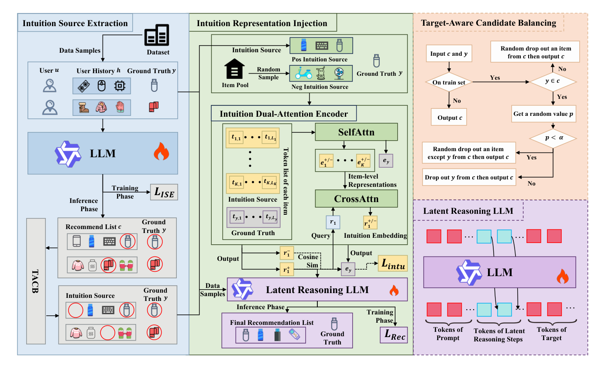
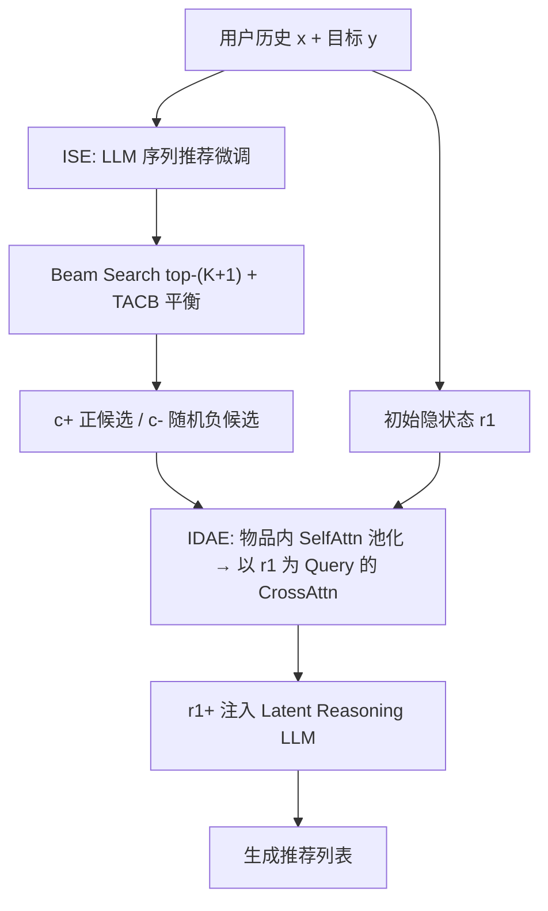

# Intuition-Guided Latent Reasoning for LLM-Based Recommendation (直觉引导的 LLM 推荐隐空间推理)

- **会议/期刊**: KDD 2026 (Jeju Island)
- **作者与机构**: Chang Liu, Yimeng Bai, Xiaoyan Zhao, Yang Zhang, Qifan Wang, Fuli Feng, Wenge Rong（北航、中科大、CUHK、NUS、Meta AI）
- **推荐链路定位**: 端到端生成式（Next-Item 生成 + 隐空间推理）
- **研究方向**: 大语言模型推荐 (LLM4Rec) / 序列推荐
- **论文原文**: [https://arxiv.org/abs/2606.27684v1](https://arxiv.org/abs/2606.27684v1)
- **开源代码**: [https://github.com/Ten-Mao/IntuRec](https://github.com/Ten-Mao/IntuRec)

## TL;DR (1分钟核心速览)

现有 LLM 隐空间推理（latent reasoning）只在最终推荐输出端做监督，推理起点 $\boldsymbol{r}_1$完全无约束、与目标物品嵌入语义错位，多步推理极易漂入“次优推理盆地”。本文借鉴认知神经科学“直觉先验”，提出两阶段框架 IntuRec：先用 LLM 序列推荐模型 beam search 出 top-$K$ 候选集，再由双注意力编码器压成单个偏好对齐的“直觉嵌入”替换推理起点。在 Amazon CDs/Toys/Games 三数据集、beam=10 + 约束解码的生成式排序协议下，IntuRec-D 的 Recall@5/NDCG@10 全面超越 LatentR3-D 与 D3，Recall@5 相对提升 4.8%–9.0%。

## Background & Motivation (背景与核心矛盾)

- **主流范式**: 以 BIGRec/D3 为代表的 LLM 推荐直接自回归生成物品；LatentR3/ReaRec 在离散 token 之外插入 $N$步连续隐状态$\boldsymbol{r}_n$ 做“先思考再推荐”，以更低步数替代 CoT。
- **前人局限**: ① 隐状态只受末端推荐损失约束，起点随机初始化，与物品嵌入空间不共享度量；② 一旦起点偏离，后续 $N-1$ 步只能在该子空间内自我强化，形成不可逆的轨迹偏移。
- **核心洞察 (Key Insight)**: 人类多步推理并非从零 deliberative 展开，而是先有粗粒度直觉把解空间裁剪到有希望的流形上。作者据此将“推荐直觉”定义为 top-$K$ 候选集所张成的偏好子空间。
- **本文切入点**: 用一段“离线候选集 + 轻量编码器”为隐推理提供一个语义落地 (semantically grounded) 的起点 $\boldsymbol{r}_1^{+}$。

<figure class="paper-figure" markdown="span">
  <figcaption>图2：所提出的IntuRec框架概览。左侧两个模块ISE和IRI展示两阶段过程，右侧给出TACB与潜在推理LLM组件的详细内部视图。具体而言，IntuRec首先在标准序列推荐设置下执行ISE以提取直觉来源。该来源随后被输入IDAE，以生成经BPR损失优化的直觉嵌入。最后，基于LLM的推荐器在这些嵌入的引导下进行潜在推理以产生最终结果。</figcaption>
</figure>

## Method (核心方法设计)

### 1. 整体框架 (Overall Architecture)

IntuRec 分两阶段串行。**ISE 阶段**：用标准 next-token 预测在用户历史 $x$上微调 Qwen2.5-1.5B，收敛后对每条样本 beam search 出 top-$(K{+}1)$候选，经 TACB 平衡得到正候选集$c^{+}$与随机负候选集$c^{-}$，离线落盘。**IRI 阶段**：IDAE 把$c^{+}$编码为$\boldsymbol{r}_1^{+}$ 并注入 LLM 隐推理链，LLM 与 IDAE 端到端联合优化，解码仍用 beam search + 约束解码。整个闭环的关键是把“候选集合”这一集合型证据压成单个向量，从而不引入额外推理步数。

### 2. 关键设计拆解 (Key Designs)

1. **Target-Aware Candidate Balancing (TACB)**：直接拿 top-$K$候选做直觉源会触发 shortcut learning——若目标$y$恰好落在候选集中且比例过高，模型只学“抄候选”，比例过低又削弱监督。TACB 先取 top-$(K{+}1)$，再按概率$\alpha$决定保留还是剔除$y$，并按验证集分布标定：

$\alpha = \frac{\beta_{\text{valid}}}{\beta_{\text{train}}}$其中$\beta$ 为候选集中含真值的目标比例。该式使训练期的“候选命中率”期望上等于验证/测试期，避免人为分布漂移。

2. **Intuition Dual-Attention Encoder (IDAE)**：候选集是变长物品列表，直接拼进 prompt 与历史同质、引导太间接（消融中掉点最狠）。IDAE 先做物品内 self-attention 再取末位池化得 $\boldsymbol{e}_k^{+}$，再以初始隐状态$\boldsymbol{r}_1$ 为 Query 做 cross-attention：

$\boldsymbol{e}_k^{+}=\mathrm{SelfAttn}(\{\boldsymbol{t}_{k,l}\}_{l=1}^{L_k})[-1],\quad \boldsymbol{r}_1^{+}=\mathrm{CrossAttn}(Q{=}\boldsymbol{r}_1,\,K{=}V{=}\{\boldsymbol{e}_k^{+}\}_{k=1}^{K})$直觉解释：self-attn 抓物品内部 token 结构，cross-attn 让直觉“条件于”用户上下文，从而与$\boldsymbol{r}_1$ 处在同一坐标系内，而非另起炉灶。

3. **训练目标、负采样与推理效率**：总损失为

$\mathcal{L}_{\text{IRI}}=\mathcal{L}_{\text{rec}}+\lambda\mathcal{L}_{\text{intu}},\quad \mathcal{L}_{\text{intu}}=-\log\sigma\big(\mathrm{sim}(\boldsymbol{r}_1^{+},\boldsymbol{e}_y)-\mathrm{sim}(\boldsymbol{r}_1^{-},\boldsymbol{e}_y)\big)$负例$\boldsymbol{r}_1^{-}$由随机采样物品经同一 IDAE 编码得到（in-batch 式 BPR，无需 hard negative）。$\mathcal{L}_{\text{intu}}$ 的作用是防止只用高质量候选训练导致“结构合理但语义偏置”的嵌入。推理期仅第 1 步做一次直觉聚合，后续步骤与 LatentR3 相同，实测推理延迟反而低于 LatentR3（后者每步都要过 LatentRTT），但训练延迟更高（需回传末层隐状态）。

## Experimental Setup & Evaluation Protocol (实验设置与评估协议)

- **数据集与预处理**:

| 数据集 | #Users | #Items | #Train/#Valid/#Test | 稀疏度 | 特征/场景说明 |
| :--- | :---: | :---: | :---: | :---: | :--- |
| CDs | 7,685 | 5,841 | 49,251 / 6,156 / 6,158 | 99.86% | Amazon 音乐 CD，标题文本 |
| Toys | 11,311 | 6,299 | 53,898 / 6,737 / 6,738 | 99.91% | Amazon 玩具，标题文本 |
| Games | 13,577 | 5,308 | 75,175 / 9,397 / 9,397 | 99.87% | Amazon 电子游戏，标题文本 |

- **数据划分与防穿越**: 先做 `5-core` 过滤；再按 LatentR3 的**动态时间窗切分**（终点固定 2018-10，起点从 2017-10 回退直至物品数 > 5,000），按 `8:1:1` 划分训练/验证/测试；序列截断或补齐至长度 10，保留最近交互。
- **排名评测协议**: **非 Full-Ranking**。所有 LLM 类方法用 beam size = 10 生成候选并截断至 $K$，配合约束解码抑制幻觉；指标为 Recall@5/10 与 NDCG@5/10。需注意该协议下指标会被 beam 宽度与约束解码策略共同影响，跨论文比较需谨慎。
- **对比基线与超参**: 传统方法 Caser/GRU4Rec/SASRec/ReaRec；LLM 方法 LLM-Base/LLM-CoT/AlphaRec/BIGRec/D3/LatentR3-B/LatentR3-D。骨干 Qwen2.5-1.5B，AdamW，学习率 $\{3e\text{-}3,3e\text{-}4,3e\text{-}5\}$，早停 patience=1；$K\in\{5,\dots,30\}$，$N\in\{1,\dots,5\}$，$\lambda\in\{0.5,1.0\}$。原文未报告显著性检验。

## Key Experimental Results (实验关键数据)

### 1. 主实验对比 (Main Results)

| 数据集 | 指标 | SASRec | ReaRec | BIGRec | D3 | LatentR3-B | LatentR3-D | **IntuRec-D** | Improv. |
| :--- | :--- | :---: | :---: | :---: | :---: | :---: | :---: | :---: | :---: |
| CDs | R@5 | 0.0841 | 0.0845 | 0.0757 | 0.1122 | 0.0918 | 0.1077 | **0.1174** | +9.0% |
| CDs | N@10 | 0.0691 | 0.0737 | 0.0672 | 0.0955 | 0.0828 | 0.0960 | **0.0995** | +3.6% |
| Toys | R@5 | 0.0601 | 0.0565 | 0.0701 | 0.0830 | 0.0773 | 0.0880 | **0.0922** | +4.8% |
| Toys | N@10 | 0.0510 | 0.0472 | 0.0582 | 0.0674 | 0.0665 | 0.0740 | **0.0773** | +4.5% |
| Games | R@5 | 0.0416 | 0.0576 | 0.0461 | 0.0608 | 0.0590 | 0.0713 | **0.0751** | +5.3% |
| Games | N@10 | 0.0350 | 0.0487 | 0.0414 | 0.0505 | 0.0513 | 0.0580 | **0.0625** | +7.8% |

（Improv. 为相对最强基线 LatentR3-D 的涨幅；IntuRec-B 亦全面优于 LatentR3-B，如 CDs R@5 0.0986 vs 0.0918。）

### 2. 消融实验 (Ablation Study)

CDs 数据集，基座为 IntuRec-B：

| 变体 | R@5 | R@10 | N@5 | N@10 |
| :--- | :---: | :---: | :---: | :---: |
| **IntuRec-B (full)** | **0.0986** | **0.1221** | **0.0795** | **0.0871** |
| w/o TACB | 0.0949 | 0.1187 | 0.0777 | 0.0854 |
| w/ random intu | 0.0953 | 0.1156 | 0.0771 | 0.0835 |
| w/ low-pop intu | 0.0937 | 0.1143 | 0.0776 | 0.0841 |
| w/o IRI | 0.0822 | 0.1015 | 0.0669 | 0.0731 |
| w/ text injection | 0.0762 | 0.0962 | 0.0601 | 0.0667 |
| w/o SelfAttn | 0.0963 | 0.1189 | 0.0776 | 0.0849 |
| w/o CrossAttn | 0.0892 | 0.1098 | 0.0718 | 0.0784 |
| w/o $\mathcal{L}_{\text{intu}}$ | 0.0957 | 0.1194 | 0.0787 | 0.0863 |

### 3. 关键实验发现 (Key Findings)

1. **注入形式比注入内容更关键**：把候选集作为纯文本拼进 prompt（w/ text injection）R@5 仅 0.0762，甚至低于完全不做 IRI 的 0.0822，说明与历史同质的文本证据反而干扰推理；而单嵌入注入达 0.0986，验证了“集合→单向量”的压缩才是增益来源。
2. **直觉语义质量决定收益量级**：换成随机候选（0.0953）或最低流行度 5% 候选（0.0937）仍好于 w/o IRI，但均显著低于真候选，说明模型利用的是候选的方向性而非仅“额外 token 带来的计算深度”；TACB 去除后掉 3.8%，证明候选命中率分布对齐有实质作用。
3. **起点即答案**：$N$的最优值为 1，随$N$ 增大 Recall@5 单调微降（图 4 右）；配合图 3 中 IntuRec 起点 A 显著贴近目标 B 而 LatentR3 起点 C 偏移的可视化，说明一旦起点被锚定在偏好流形上，额外推理步数只带来一致性维护成本而非探索收益。

## Highlights & Limitations (亮点、对比与审稿批判)

- **与代表作对比 (vs. Prior Work)**: 与 LatentR3 的差异不在“多加推理模块”，而在**改推理起点**——LatentR3 每步都过 LatentRTT 且需 GRPO 调优，IntuRec 只在第 1 步做一次 cross-attn 聚合，训练更简单、推理更省；与 ReaRec 在 ID-based SASRec 上的隐推理相比，本文把同一思想搬进 LLM 语义空间并引入 item 级先验；与 D3 相比，本文不靠去偏解码技巧，而是从轨迹源头纠偏。
- **可迁移亮点**: ①“集合 → 单嵌入 + 起点替换”这一范式可无痛迁移到 RQ-VAE 生成式推荐的语义 ID 初始化、多模态候选融合；② TACB 的 $\alpha=\beta_{\text{valid}}/\beta_{\text{train}}$ 标定思路，可泛化到任何“teacher 候选可能泄题”的知识蒸馏/重排场景。
- **审稿级局限批判**: ① 评测为 beam=10 的生成式截断排序，非 Full-Ranking，且未做显著性检验，候选集泄漏与 beam 宽度耦合会影响结论稳健性；② ISE 阶段的 top-$K$ 候选需离线预生成并落盘，随用户序列更新需重跑 beam search，工程上引入额外存储与刷新成本，论文未给出大规模数据下的生成/存储开销与延迟数据。

## Rating (四维评分)

- **方法创新性 (Novelty)**: ⭐⭐⭐⭐ （把认知科学的“直觉先验”落成可算子化的起点替换，机制简洁且有嵌入空间可视化支撑，但组件本身均为已有注意力/BPR 的重组）
- **评估协议与实验扎实度 (Protocol & Experiments)**: ⭐⭐⭐ （三数据集 + 8 类基线 + 9 组消融较完整，但生成式 beam 排序非全库排序、无显著性检验、无大规模或线上验证）
- **写作与数学规范度 (Clarity & Rigor)**: ⭐⭐⭐⭐ （两阶段流程与公式编号清晰、算法 1 完整；跨注意力中 $K,V$与超参$K$ 符号复用易混淆）
- **工业落地与复现价值 (Industrial & Practical Value)**: ⭐⭐⭐⭐ （代码已开源，推理期仅首步聚合、延迟低于 LatentR3，适合延迟敏感场景；代价是训练需回传末层隐状态与离线候选缓存）

