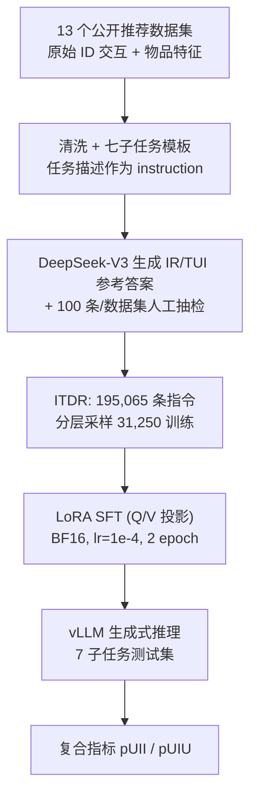

# ITDR: An Instruction Tuning Dataset for Enhancing Large Language Models in Recommendations (面向推荐系统的大模型指令微调数据集)

- **会议/期刊**: KDD 2026 (32nd ACM SIGKDD)
- **作者与机构**: Zekun Liu, Xiaowen Huang, Jitao Sang（北京交通大学计算机学院 / 交通数据挖掘与具身智能北京市重点实验室）
- **推荐链路定位**: 端到端生成式（LLM 直接输出推荐结果、评分与画像，替代传统判别式排序器）
- **研究方向**: 大语言模型推荐 (LLM4Rec) / 序列与会话推荐（TKR、NIR 子任务）
- **论文原文**: [https://arxiv.org/abs/2508.05667v2](https://arxiv.org/abs/2508.05667v2)
- **开源代码**: [https://github.com/hellolzk/ITDR](https://github.com/hellolzk/ITDR)

## TL;DR (1分钟核心速览)

推荐数据是 ID 型交互记录，与自然语言存在结构性鸿沟，纯 prompt 方法让 LLM"不懂推荐任务"而性能受限。本文不做新模型，而是造数据：把 13 个公开推荐数据集按“用户-物品交互 (UII)”与“用户-物品理解 (UIU)”两根任务、七个真实子任务重构为 195,065 条标准化指令，并配套两个把 RMSE/ACC/NDCG/Hit/BLEU/ROUGE 归一化到同一量纲的复合指标 $p_{\mathrm{UII}}$、$p_{\mathrm{UIU}}$。在分层采样划分（31,250 训练 / 7,811 测试）的生成式评测上，LoRA 微调后 LLaMA-3.2-3B 的$p_{\mathrm{UII}}$ 由 28.22 升至 64.77（+129.5%），GLM-4-9B 由 43.87 升至 70.44（+60.6%），四个开源模型全面超过 GPT-3.5-Turbo (56.95) 与 Gemini 2.5 Flash (60.57)。

## Background & Motivation (背景与核心矛盾)

- **主流范式**: LLM4Rec 分两派——直接设计 prompt 让 LLM 零/少样本输出推荐（Chat-REC、LLM4CDR、RecPrompt），或把 LLM 当特征/知识增强器喂给传统协同过滤（LLMRec、LLM-CF）。
- **前人局限 1**: 传统推荐数据集只有隐式/显式 ID 反馈，缺乏任务描述与多样自然语言指令，指令微调的数据前提根本不成立。
- **前人局限 2**: 推荐任务天然异构（评分回归、Top-K 排序、跨域迁移、序列预测、画像理解），单任务指令集无法覆盖，模型泛化与适配性受限。
- **核心洞察 (Key Insight)**: 推荐能力可拆成“交互建模 (UII)”与“物品语义理解 (UIU)”两层；后者是通用语言能力的自然延伸，前者才是需要注入的任务知识——两者之间存在可观测的知识迁移。
- **本文切入点**: 以人工标准化模板把 13 个基准数据集统一为 $(x,y)$ 指令对，用一套跨任务可比的复合分数做整体验收。

## Method (核心方法设计)

### 1. 整体框架 (Overall Architecture)

流水线为纯数据工程 + 参数高效微调：先收集 13 个权威基准（MovieLens-32M/1M、Amazon Reviews 2023、BookCrossing、MIND、MicroLens、PixelRec、Steam、Yelp、Last.FM 1K/360K、Anime 2023 等），剔除无关物品特征与不合格用户；再为每个数据集手工定制模板，把「子任务描述」作为 instruction、模板填充结果作为 input；对 IR/TUI 这类原数据无标注的生成任务，用 DeepSeek-V3 生成参考答案并随机抽 100 条/数据集人工校验。得到 195,065 条指令后，做比例分层采样取出 39,061 条（31,250/7,811）用于统一的 LoRA 微调与评测，最终由 $p_{\mathrm{UII}}$、$p_{\mathrm{UIU}}$ 两个复合分给出整体结论。

### 2. 关键设计拆解 (Key Designs)

1. **双根任务 × 七子任务的分类学（Taxonomy）**：前人数据集是"任务盲"的交互日志，本文把它显式拆成 UII（RP 评分预测、TKR Top-K 推荐、CDR 跨域推荐、NIR 下一物品推荐）与 UIU（UAP 用户属性预测、IR 兴趣识别、TUI 目标用户识别）。关键增量在于 UII 与 UIU 互为对偶：前者 user→item 正向打分，后者 item→user 反向推断，从而强迫模型同时学到"给谁推什么"和"这个东西适合谁"两套语义；CDR 的域对按 Beauty→Fashion、CDs&Vinyl→VideoGames、Appliances→Industrial&Scientific、Home&Kitchen→Grocery 四组固定，保证跨域迁移方向可控。

2. **复合评价指标 $p_{\mathrm{UII}}$/$p_{\mathrm{UIU}}$（跨任务可比的归一化）**：痛点是 RP 用 RMSE（越小越好）、TKR 用 NDCG（越大越好）、IR 用 BLEU，量纲与方向都不一致，无法回答"这份数据到底让模型变强了多少"。本文对 RMSE 取负对数拉回同量纲，再按子任务/指标条数取平均：

$$p_{\mathrm{UII}}=\frac{1}{8}\left[\sum_{D_j\in\{D_{\mathrm{TKR}},D_{\mathrm{CDR}}\}}\frac{\sum_{m\in M}\sum_{i\in D_j}m(i)}{|D_j|}+\frac{\sum_{i\in D_{\mathrm{NIR}}}H@1(i)}{|D_{\mathrm{NIR}}|}-\log\frac{\sum_{i\in D_{\mathrm{RP}}}\mathrm{RMSE}(i)}{|D_{\mathrm{RP}}|}\right]\cdot 100$$

其中 $M=\{N@10,H@1,P@5\}$；$p_{\mathrm{UIU}}$同理由 ACC(gender/country/location/occupation/age group)、对数化 RMSE(age/birth year) 与$M'=\{BLEU\text{-}1\&2, ROUGE\text{-}1\&2\&L\}$ 共 16 项平均而成。直觉上，它把"排序质量、回归误差、生成相似度"三类信号压到 0–100 的同一标尺，使 3B 与 9B 模型、开源与闭源模型可以直接横向比较。

3. **训练目标、模板负例与推理开销**：训练完全沿用标准自回归指令微调目标 $\max_\theta \mathbb{E}_{(x,y)\sim\mathcal{D}}\sum_{t=1}^{|y|}\log P_\theta(y_t\mid x,y_{<t})$，无任何推荐专属损失、无负采样设计（排序靠 LLM 逐候选生成/打分，而非全库对比）。可训练参数仅为 LoRA 低秩增量$\Delta W=BA$，$h'=Wh+\frac{\alpha}{r}BAh$，仅注入多头注意力的 Q/V 投影，基座冻结；BF16 + lr 1e-4 + cosine + 2 epoch + per-device batch 1 + 梯度累积 8，推理用 vLLM 批式生成。

## Experimental Setup & Evaluation Protocol (实验设置与评估协议)

- **数据集与预处理**: ITDR 总量 195,065 条指令，实验用分层采样子集 39,061 条；原文主文未逐项披露各子任务样本数（见附录 A）。

| 子任务 | 源数据集（示例） | 任务形式 | 评测指标 |
| :--- | :--- | :---: | :--- |
| RP 评分预测 | MovieLens-32M、BookCrossing、Anime2023、Yelp | 回归 | RMSE↓ |
| TKR Top-K 推荐 | Amazon Reviews 2023、MicroLens、PixelRec、MIND 等 | 排序 | N@10 / H@1 / P@5↑ |
| CDR 跨域推荐 | Amazon Reviews 2023（4 组域对） | 排序 | N@10 / H@1 / P@5↑ |
| NIR 下一物品 | Amazon Reviews 2023、MicroLens、MovieLens-32M | 序列 | H@1↑ |
| UAP 属性预测 | Last.FM 1K/360K、Anime2023、BookCrossing、ML-1M | 分类/回归 | ACC↑ / RMSE↓ |
| IR 兴趣识别 | Anime2023、Amazon Books、Steam | 生成 | BLEU-1&2、ROUGE-1&2&L↑ |
| TUI 目标用户识别 | 9 个数据集（含 MIND、Yelp、PixelRec） | 生成 | BLEU-1&2、ROUGE-1&2&L↑ |

- **数据划分与防穿越 (Splitting Strategy)**: `比例分层采样划分`（31,250 训练 / 7,811 测试，约 8:2），**非** Leave-One-Out、**非**全局时间戳切分——同一用户的多条指令可能分落训练/测试两侧，存在隐性泄漏风险（审稿关注点）。
- **排名评测协议 (Ranking Protocol)**: 采用 `Sampled / 生成式评测`——由 LLM 按指令直接生成 top-K 列表或答案文本，再对参考答案算 N@10/H@1/P@5 与 BLEU/ROUGE；**未使用无偏 Full-Ranking 全库排序**，也未报告采样负例比例，因此指标与经典 RecSys 论文不可直接对齐。
- **对比基线与超参设置**: 四个开源骨干（LLaMA-3.2-3B、Qwen2.5-7B、Qwen2.5-7B-Instruct、GLM-4-9B）+ 两个闭源参照（GPT-3.5-Turbo、Gemini 2.5 Flash）；统一 LoRA 超参（lr 1e-4、cosine、2 epoch、grad-accum 8），8×RTX 3090 24GB；作者明确声明不做超参搜索与显著性检验（$p$ 值缺失）。

## Key Experimental Results (实验关键数据)

### 1. 主实验对比 (Main Results)

| 模型 | 参数量 | $p_{\mathrm{UII}}$(w/o FT) |$p_{\mathrm{UII}}$(ITDR-FT) | Improv. |$p_{\mathrm{UIU}}$(w/o FT) |$p_{\mathrm{UIU}}$ (ITDR-FT) | Improv. |
| :--- | :---: | :---: | :---: | :---: | :---: | :---: | :---: |
| LLaMA-3.2-3B | 3B | 28.22 | 64.77 | +129.5% | 4.26 | 24.91 | +484.7% |
| Qwen2.5-7B | 7B | 39.23 | 66.32 | +69.1% | 8.97 | 26.01 | +190.0% |
| Qwen2.5-7B-Instruct | 7B | 32.97 | 65.09 | +97.4% | 12.66 | 26.68 | +110.7% |
| GLM-4-9B | 9B | **43.87** | **70.44** | +60.6% | 10.72 | **31.38** | +192.7% |
| GPT-3.5-Turbo (闭源) | – | 56.95 | – | – | 13.87 | – | – |
| Gemini 2.5 Flash (闭源) | – | 60.57 | – | – | 11.44 | – | – |

### 2. 消融实验 (Ablation Study)

以 GLM-4-9B 为主体的两类消融（↓ 越低越好，↑ 越高越好）：

| 配置 | RP↓ | TKR↑ | CDR↑ | NIR↑ | UAP↑ | IR↑ | TUI↑ | $p_{\mathrm{UII}}$|$p_{\mathrm{UIU}}$ |
| :--- | :---: | :---: | :---: | :---: | :---: | :---: | :---: | :---: | :---: |
| w/o FT（基座） | 0.2266 | 0.6003 | 0.5467 | 0.2956 | 0.0309 | 0.1292 | 0.1770 | 43.87 | 10.72 |
| w/o 任务描述 | 0.2001 | 0.8411 | 0.8254 | 0.7951 | 0.1442 | **0.3779** | **0.4465** | 68.90 | 30.68 |
| 全量 ITDR-FT | **0.1927** | **0.8436** | **0.8346** | **0.7982** | **0.1529** | 0.3756 | 0.4449 | **70.44** | **31.38** |
| w/o NIR 子任务 | 0.1837 | 0.8384 | 0.8318 | 0.3955 | 0.1450 | 0.3772 | 0.4446 | – | – |
| w/o TUI 子任务 | 0.1980 | 0.8410 | 0.7970 | 0.8022 | 0.1517 | 0.3744 | 0.0846 | – | – |
| 仅用 UIU 训练 | – | – | – | – | – | – | – | 68.94 | 31.13 |
| 仅用 UII 训练 | – | – | – | – | – | – | – | 49.13 | 1.64 |

### 3. 关键实验发现 (Key Findings)

1. **UIU 是 UII 的"通用助推器"，反向则灾难性遗忘**：仅用 UIU 数据微调，UII 仍达 68.94（接近全量 70.44，远高于基座 43.87），说明语义理解能力可跨任务迁移；而仅用 UII 微调，UIU 从 10.72 崩到 1.64，参数被交互任务表征主导，预训练语义理解被显著侵蚀。
2. **子任务存在负迁移，简单拼接并非最优**：去掉 RP 后 RP 反而退化至 0.2459（差于基座 0.2266），去掉 TUI 后 TUI 跌至 0.0846（远低于基座 0.1770）；但去掉 CDR 后 NIR 升至 0.8155，说明域间知识既互补也相互干扰，需要数据配比策略。
3. **任务描述对判别式任务有效、对生成式任务反噬**：加入描述使 UAP 0.1442→0.1529、CDR 0.8254→0.8346、NIR 0.7951→0.7982，但 IR 0.3779→0.3756、TUI 0.4465→0.4449 轻微下降——生成式任务中长描述更可能充当噪声。此外数据规模从 25%→100% 时 $p_{\mathrm{UII}}$单调升（67.33→70.44），$p_{\mathrm{UIU}}$ 基本不敏感（30.24→31.38，75% 处 30.68 出现回落）。

## Highlights & Limitations (亮点、对比与审稿批判)

- **与代表作对比 (vs. Prior Work)**: 与 Chat-REC / LLM4CDR / RecPrompt 等 prompt 工程路线的本质区别在于——后者靠零样本激发涌现能力，ITDR 直接把推荐任务"格式化"进参数；与 LLMRec / LLM-CF 的区别在于后者把 LLM 当外部特征供给器，ITDR 则让 LLM 成为推荐器本体。相较同类的 TALLRec/InstructRec 式二分类指令数据，ITDR 覆盖 7 个任务并给出跨任务可比复合指标。
- **可迁移亮点**: (1) "判别式 + 生成式"双根任务 + 复合归一化指标的设计，可原样搬到冷启动、跨域、POI 等方向的 LLM 评测；(2) 用仅 UIU 数据做"语义预热"再上交互任务的两阶段微调，是一条低成本防遗忘路径。
- **审稿级局限批判**: 第一，评测协议薄弱——采用约 8:2 的分层随机划分而非时间切分，同用户指令跨集泄漏难以排除，且排序用生成式 top-K 而非 Full-Ranking，指标与经典 RecSys 不可比、也未做显著性检验。第二，IR/TUI 的 ground truth 由 DeepSeek-V3 生成（仅 100 条/数据集抽检），存在模型自蒸馏式的"伪标签闭环"风险；且 13 个数据集的知名内容很可能已进入基座预训练语料，未做去污染检验。第三，全篇仅 3B–9B、无超参分析与推理延迟报告，而在线部署时逐候选生成的开销远高于双塔召回，工业落地价值需补测。

## Rating (四维评分)

- **方法创新性 (Novelty)**: ⭐⭐⭐ （数据/评测范式创新而非模型创新，双根任务分类学与复合指标是实用增量，但缺少新算子或理论支撑）
- **评估协议与实验扎实度 (Protocol & Experiments)**: ⭐⭐⭐ （4 个骨干 + 2 个闭源对照、任务级/根任务级/描述/数据量四类消融较完整，但缺 Full-Ranking、时间切分与显著性检验）
- **写作与数学规范度 (Clarity & Rigor)**: ⭐⭐⭐⭐ （任务定义、模板与复合指标公式交代清楚，$p_{\mathrm{UII}}$/$p_{\mathrm{UIU}}$ 权重口径明确，但部分符号与附录统计分散）
- **工业落地与复现价值 (Industrial & Practical Value)**: ⭐⭐⭐⭐ （数据集、全部 LoRA 模块与完整实验结果已开源，LoRA+vLLM 的复现门槛低，但生成式推理时延限制线上大规模使用）

