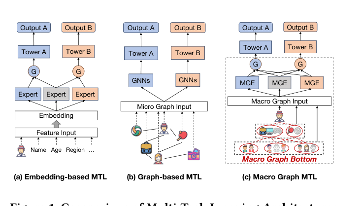
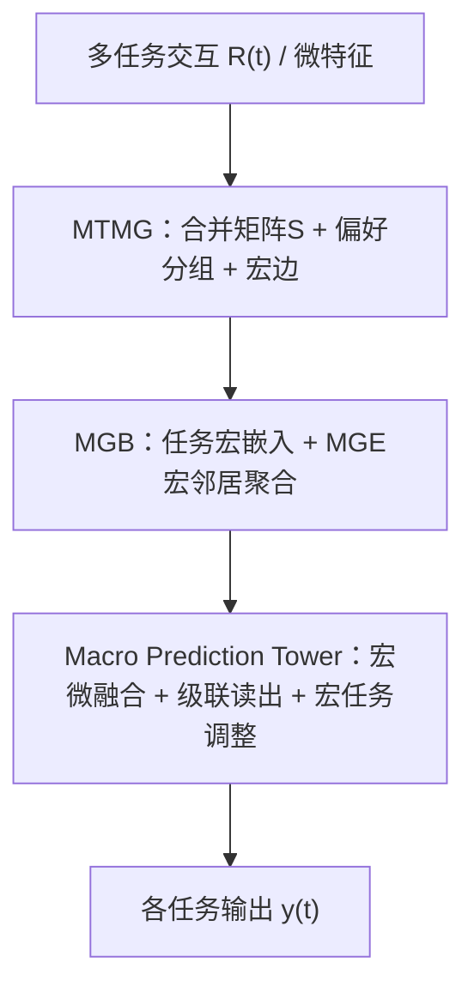
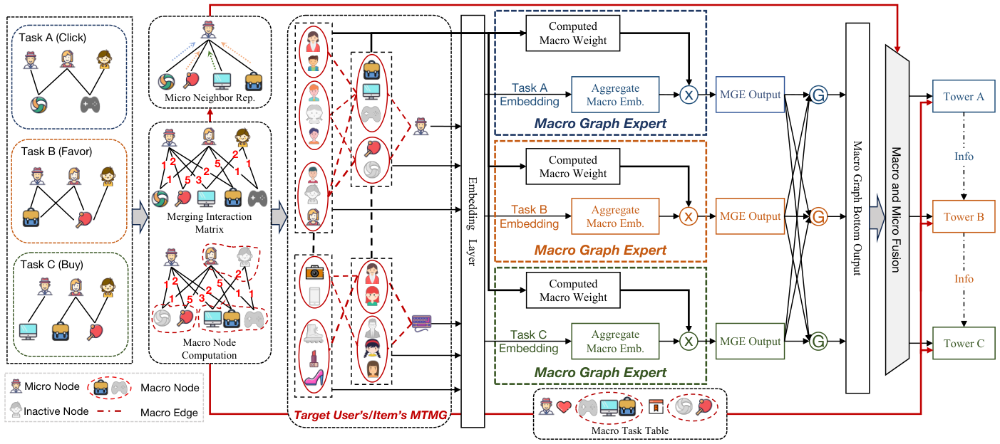

# Macro Graph of Experts for Billion-Scale Multi-Task Recommendation（十亿级多任务推荐的宏图专家）

- **会议/期刊**: KDD 2026 (SIGKDD 2026)
- **作者与机构**: Hongyu Yao, Zijin Hong, Hao Chen, Zhiqing Li, Qijie Shen, Zuobin Ying, Qihua Feng, Huan Gong, Feiran Huang；暨南大学、香港理工大学、澳门城市大学、阿里巴巴、北京理工大学、国防科技大学、北京航空航天大学
- **推荐链路定位**: 精排（多任务 CTR/CVR 预估）
- **研究方向**: 多任务学习与列表级重排 / 图神经网络与知识图谱推荐、CTR 预估与特征交叉
- **论文原文**: [论文原文链接](https://arxiv.org/abs/2506.10520v5)
- **开源代码**: [开源代码仓库链接](https://github.com/RainmannnnN/MGOE)

## TL;DR (1分钟核心速览)

针对十亿级多任务推荐中“每任务一张十亿图”导致 GNN 不可用、而嵌入型 MTL 又丢失图结构的问题，MGOE 用 MTMG 把多任务交互合并为统一宏图，并以宏图专家和级联读出融合宏/微信息。三公开数据集平均 AUC 分别提升 13.42%/7.84%/3.65%，线上 GMV 较 MMoE 提升 16.46%。

## Background & Motivation (背景与核心矛盾)

- **主流范式**: 工业精排以 MMoE、PLE、STEM 等嵌入型多任务模型为主，用共享/任务专家加门控建模任务相关性；图增强方法则在 user-item 二部图上用 GNN 提取高阶协同信号。
- **前人局限**: ①嵌入型 MTL 只依赖单用户/单物品向量，忽略任务图结构；②多任务对应多张十亿级图，逐任务 GNN 的在线开销不可承受；MacGNN 虽引入单任务宏图，但未解决多任务图合并与跨任务专家耦合。
- **核心洞察 (Key Insight)**: 多任务交互可以先投影到“宏节点”粒度，同一用户/物品在不同任务下的组合模式可由统一合并偏好分数表达，从而用一张宏图替代多张微图。
- **本文切入点**: 构建 Macro Task Merging Graph（MTMG），再用 Macro Graph Expert（MGE）与 Macro Prediction Tower 在接近专家级开销下注入高阶图信息。

<figure class="paper-figure" markdown="span">
  <figcaption>图1：多任务学习架构对比，其中“G”表示门控机制，“MGE”表示所提出的 Macro Graph Expert（宏图专家）。（a）基于嵌入的 MTL 依赖特征表示。（b）基于图的 MTL 利用 GNN 捕获关系语义。（c）Macro Graph MTL 引入宏图底层以融合宏图信息。</figcaption>
</figure>
*图1：嵌入型、微图型与宏图型多任务架构对比，凸显 MGOE 以宏图底层替代十亿微图 GNN。*

## Method (核心方法设计)

### 1. 整体框架 (Overall Architecture)

输入为任务 $t$的 user-item 微特征及 MTMG 宏邻居：MTMG 先合并多任务交互矩阵$\mathbf{S}$，经偏好加权聚类得到宏用户/宏物品并建宏边；Macro Graph Bottom 对每任务取宏嵌入，MGE 用对数平滑宏权重与 attention 聚合宏邻居；Macro Prediction Tower 拼接宏/微邻居表示，经多门专家层后以级联读出和用户宏任务查找表调整，输出各任务概率。训练用加权 BCE 加正则，推理只查宏表与少量 attention，避免在线构造十亿图邻接。

<figure class="paper-figure" markdown="span">
  <figcaption>图2：Macro Task Merging Graph（宏任务合并图）的构建与 Macro Graph of Experts（专家宏图）概览。</figcaption>
</figure>
*图2：MTMG 构建与 MGOE 整体框架：多任务交互合并、偏好分组、宏图专家与宏预测塔。*

### 2. 关键设计拆解 (Key Designs)

1. **MTMG：多任务图合并与偏好分组**：多任务不能直接共享微图，本文用任务组合排序 $\rho(\mathcal{C}_{ui})$构造合并偏好分数$s_{ui}=\frac{[\rho(\mathcal{C}_{ui})+1]^\beta-1}{\beta}$（$\beta\ne0$）或$s_{ui}=\ln[\rho(\mathcal{C}_{ui})+1]$（$\beta=0$），形成合并矩阵$\mathbf{S}$；再按$w_v$区分活跃/不活跃微节点，加权聚类得宏节点$\boldsymbol{\mu}_k=\frac{\sum_{v\in V_k}w_v\mathbf{d}_v}{\sum_{v\in V_k}w_v}$，宏边由微边和聚合。这样把任务组合强度编码进图结构，避免维护多张十亿图。

2. **MGE：对数平滑的宏图专家**：宏边权重跨任务差异大，直接 softmax 易被极值主导；先对边权和取对数再加温度 $\gamma$平滑：$w^{(j)}_{v;\tilde{p}}=\mathrm{softmax}(\log(\sum_{\tilde{q}\in\tilde{N}^{(j-1)}_v}\tilde{s}^{(j)}_{v;\tilde{p},\tilde{q}}+1),\gamma)$，再用 attention 聚合宏邻居。该算子压缩重尾边权、保留任务趋势，且比 GCN 邻域卷积更适合十亿级在线推理。

3. **Macro Prediction Tower：级联读出与宏任务调整**：并行塔忽略任务依赖，稀疏任务易欠拟合；将上一任务输出以可学习权重注入下一任务：$\hat{y}^{(t_j)}_{ui}=\sigma(\mathrm{MLP}(x_{t_j})+w_{t_{j-1}}\hat{y}^{(t_{j-1})}_{ui})$；并用用户宏任务查找表做 Hadamard 调整：$\hat{\mathbf{Y}}_{ui}=\sigma(\mathbf{T}_u)\odot\mathbf{Y}_{cat}$。前者建模任务链式迁移，后者把用户宏偏好拉到最终打分。

4. **训练目标、负采样与推理效率**：总损失 $\mathcal{L}_{\mathrm{MGOE}}=\sum_{t}\alpha_t\mathcal{L}_t+\lambda_1\|\theta\|_1+\lambda_2\|\theta\|_2^2$，$\mathcal{L}_t$ 为 BCE；训练使用曝光样本二分类标签，正文未见额外负采样。推理预计算宏聚类与查找表，仅做轻量 attention，参数量 5.04M。

## Experimental Setup & Evaluation Protocol (实验设置与评估协议)

- **数据集与预处理**: 正文仅给 Taobao、QB-video、QK-article 三组数据，统计与过滤细节置于附录 A.1，正文未披露，故不臆造：

| 数据集 | #Users | #Items | #Interactions | 稀疏度/密度 | 特征/场景说明 |
| :--- | :---: | :---: | :---: | :---: | :--- |
| Taobao | 未披露 | 未披露 | 未披露 | 未披露 | Click/Favor/Cart/Buy 电商多任务 |
| QB-video | 未披露 | 未披露 | 未披露 | 未披露 | Click/Like/Share/Follow 短视频 |
| QK-article | 未披露 | 未披露 | 未披露 | 未披露 | Read/Like/Favor/Follow 图文 |

- **数据划分与防穿越 (Splitting Strategy)**: 正文未说明是 Leave-One-Out、比例划分、全局时间戳切分还是冷启动划分；复现时需回查附录。
- **排名评测协议 (Ranking Protocol)**: 采用 AUC 与 Logloss 的样本级二分类评估，不是 Full-Ranking 全库排序；负采样比例与候选集构造未披露，因此不能直接等同于 Top-K 排序指标。
- **对比基线与超参设置**: 对比 13 个模型，含 MMoE/PLE/ESMM/AITM/STEM/MoME、MoGENet/MMoCEG/POGCN/MacGNN 及 DeepFM/DIN/DIEN；嵌入维度 $d=10$，batch=1024，Adam，学习率搜 {1e-2,5e-2,1e-3,5e-3}，正则搜 {1e-4,5e-5,1e-5}，五次随机种子并报告标准差。

## Key Experimental Results (实验关键数据)

### 1. 主实验对比 (Main Results)

下表保留 8 个代表性基线，数值为各数据集全部任务平均；`Improv.%` 为 MGOE 相对该数据集最佳基线的提升。

| 数据集/指标 | MMoE | PLE | ESMM | STEM | MoGENet | MMoCEG | MacGNN | MGOE | Improv.% |
| :--- | :---: | :---: | :---: | :---: | :---: | :---: | :---: | :---: | :---: |
| Taobao Avg AUC↑ | 0.5567 | 0.5565 | 0.5705 | 0.5773 | 0.6076 | 0.5905 | 0.6155 | **0.6981** | **13.42%** |
| Taobao Avg Logloss↓ | 0.2172 | 0.2169 | 0.2169 | 0.2229 | 0.2949 | 0.2358 | 0.2120 | **0.2042** | **3.68%** |
| QB-video Avg AUC↑ | 0.6403 | 0.6331 | 0.6906 | 0.7161 | 0.6343 | 0.7269 | 0.6973 | **0.7839** | **7.84%** |
| QB-video Avg Logloss↓ | 0.1283 | 0.1281 | 0.1262 | 0.1296 | 0.1483 | 0.1192 | 0.1185 | **0.1123** | **5.23%** |
| QK-article Avg AUC↑ | 0.7652 | 0.7640 | 0.7562 | 0.7761 | 0.7580 | 0.8035 | 0.8394 | **0.8700** | **3.65%** |
| QK-article Avg Logloss↓ | 0.0692 | 0.0735 | 0.0571 | 0.0565 | 0.0622 | 0.0607 | 0.0483 | **0.0431** | **10.77%** |

### 2. 消融实验 (Ablation Study)

| 变体 | Taobao Avg AUC↑ | Taobao Avg Logloss↓ | QB-video Avg AUC↑ | QB-video Avg Logloss↓ |
| :--- | :---: | :---: | :---: | :---: |
| MGOE | **0.6936±0.0040** | **0.2057±0.0010** | **0.7715±0.0114** | **0.1124±0.0020** |
| w/o preference | 0.6919±0.0048 | 0.2060±0.0009 | 0.7700±0.0201 | 0.1127±0.0023 |
| w/o adjustment | 0.6836±0.0047 | 0.2080±0.0031 | 0.7513±0.0162 | 0.1140±0.0040 |
| w/o cascading | 0.6927±0.0058 | 0.2066±0.0009 | 0.7640±0.0135 | 0.1142±0.0033 |

### 3. 关键实验发现 (Key Findings)

1. **宏图信息在三类场景均有效**：MGOE 在 Taobao/QB-video/QK-article 平均 AUC 达 0.6981/0.7839/0.8700，分别较最佳基线提升 13.42%/7.84%/3.65%，且 Logloss 同步下降，说明收益不只是排序头部，概率校准也改善。
2. **宏任务调整是最关键组件**：去掉 adjustment 后，Taobao AUC 由 0.6936 降至 0.6836（-0.0100），QB-video 由 0.7715 降至 0.7513（-0.0202）；去偏好分组与去级联分别只降 0.0017/0.0009（Taobao）与 0.0015/0.0075（QB-video），表明用户宏任务查找表对稀疏任务迁移贡献最大。
3. **精度与效率兼得**：MGOE 推理在 Taobao 比 MoGENet 快 72.64%、比 MMoCEG 快 45.13%，参数量仅 5.04M、GPU 1194MiB、训练 258s；线上 vs MMoE 的 PCTR +2.16%、CVR +5.88%、GMV +16.46%，vs MacGNN 的 PCTR +0.93%、CVR +3.69%、GMV +7.74%。

## Highlights & Limitations (亮点、对比与审稿批判)

- **与代表作对比 (vs. Prior Work)**: MMoE/PLE/STEM 是纯嵌入型 MTL，缺少高阶图信号；MoGENet/MMoCEG 用微图 GNN，精度受限于十亿图开销；MacGNN 只做单任务 CTR 宏图。MGOE 的本质增量是把宏图推广到多任务，用 MTMG 合并多图、MGE 解耦任务专家、级联塔做跨任务迁移。
- **可迁移亮点**: ①用偏好加权聚类构建宏节点，可迁移到大规模图召回/精排；②对数平滑+温度 softmax 处理重尾边权，适合噪声图；③级联读出可移植到多目标精排，缓解稀疏任务负迁移。
- **审稿级局限批判**: ①评估协议披露不足：未说明划分方式、负采样比例与全库排序细节，AUC/Logloss 不能完全代表 Top-K 效果；②超参敏感：$\gamma$ 在 Taobao 最优 1.1、QB-video 最优 1.5，宏用户节点数最优约 20，线上仅两周 A/B，缺长期留存与公平性分析。

## Rating (四维评分)

- **方法创新性 (Novelty)**: ⭐⭐⭐⭐ （首次把宏图与多任务专家结合，MTMG 合并多任务图有新意；但整体可视为 MacGNN+MoE 的扩展）
- **评估协议与实验扎实度 (Protocol & Experiments)**: ⭐⭐⭐ （三数据集+线上 A/B 较完整，但划分/负采样/排序协议缺失，离线仅 AUC/Logloss）
- **写作与数学规范度 (Clarity & Rigor)**: ⭐⭐⭐⭐ （模块与公式清晰，宏图/专家/塔的层次分明；部分统计置于附录，正文符号略密）
- **工业落地与复现价值 (Industrial & Practical Value)**: ⭐⭐⭐⭐⭐ （阿里十亿级部署，5.04M 参数、推理快，线上 GMV 提升显著，代码已开源）

