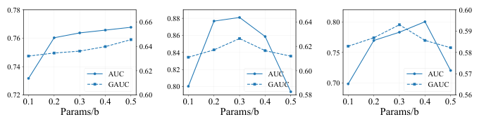
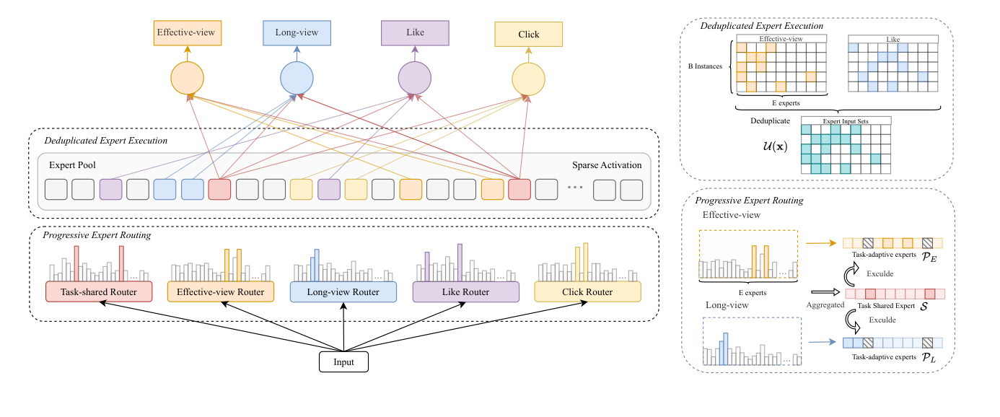
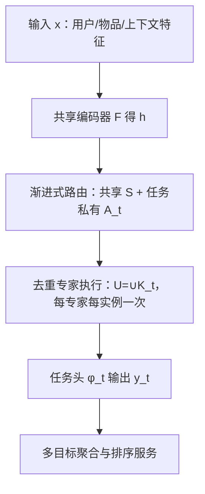

# SMES: Towards Scalable Multi-Task Recommendation via Expert Sparsity (面向可扩展多任务推荐的专家稀疏化)

- **会议/期刊**: KDD 2026
- **作者与机构**: Yukun Zhang, Si Dong, Xu Wang 等，快手
- **推荐链路定位**: 精排
- **研究方向**: 多任务学习与列表级重排 / 工业级推荐系统
- **论文原文**: [https://arxiv.org/abs/2602.09386v1](https://arxiv.org/abs/2602.09386v1)
- **开源代码**: 暂未开源

## TL;DR (1分钟核心速览)

SMES 针对多任务精排中稠密扩容成本高、稀疏任务过参数化退化的问题，将专家激活拆成任务共享 $K_s$与任务私有$K_a$，并以去重执行和全局负载均衡约束实例级专家并集。在 KuaiRand-1K 与 Kuaishou 工业集按 AUC/GAUC 逐曝光评估，SMES-L 相对最强基线 GAUC 提升 0.11–0.47 pp；线上 A/B 观看时长 +0.31%，延迟较稠密 MoE 降 50%。

## Background & Motivation (背景与核心矛盾)

- **主流范式**: 工业精排以 MMoE/PLE 等多任务网络为主干，近期 HSTU、RankMixer 等工作尝试用更大参数提升推荐效果。
- **前人局限**: 稠密 MoE 对每个实例计算全部专家，在线延迟随专家数线性增长；同时不同任务的监督密度差异巨大，统一扩容会让 Like/Follow 等稀疏交互任务过拟合或退化。
- **核心洞察 (Key Insight)**: 参数稀疏化能解耦“模型容量”与“实例计算量”，但把单任务 MoE 直接搬到多任务会遇到两个系统级问题——任务独立 top-$K$ 导致实例级专家并集爆炸，以及多任务流量叠加造成专家负载倾斜。
- **本文切入点**: 用“共享专家 + 任务私有专家”的渐进式路由显式控制每实例专家并集，再用跨任务全局负载正则约束多门路由。

<figure class="paper-figure" markdown="span">
  <figcaption>图 1：KuaiRand 数据集上各任务的性能趋势。曲线显示 AUC（实线）与 GAUC（虚线）随模型参数规模（十亿）增加的变化趋势。对于观看时长任务、Effective-view 等任务，性能随参数规模增加持续提升。相反，对于 Like、Follow 等交互任务，盲目增加模型容量可能导致性能下降。</figcaption>
</figure>

## Method (核心方法设计)

### 1. 整体框架 (Overall Architecture)

输入为拼接用户/物品/上下文的 $x$，共享编码器$F$得$h$。每个任务先通过渐进式路由选择跨任务共享专家集合$S$，再在剩余专家中选择任务私有集合$A_t$，得到$K_t=S\cup A_t$；系统对所有任务激活集合取并集$U$，每个专家每实例只执行一次，输出经任务内重归一化权重聚合到各自任务头。训练联合任务损失与全局负载正则，线上以重索引 Grouped GEMM 执行不规则稀疏计算。

<figure class="paper-figure" markdown="span">
  <figcaption>图 2：用于多任务推荐的 SMES 架构。它包含两个关键组件：（1）渐进式专家路由（Progressive Expert Routing）使用任务共享路由器和任务自适应子路由器选择专家（清晰起见，仅可视化 Effective-view 和 Long-view 任务）。（2）去重专家执行（Deduplicated Expert Execution）消除跨任务的冗余专家计算。</figcaption>
</figure>

### 2. 关键设计拆解 (Key Designs)

1. **渐进式专家路由（PER）**：直接多任务 top-$K$会使实例级并集$|\cup_t K_t|$随任务数膨胀。SMES 先算跨任务池化分数$s_e=\sum_{t=1}^T w_t p_{t,e}$，选$S=\mathrm{TopK}(\{s_e\}_{e=1}^E,K_s)$；任务$t$再从$S$外选取$A_t=\mathrm{TopK}(\{z_{t,e}\}_{e\notin S},K_a)$，最终$K_t=S\cup A_t$。共享子集对齐跨任务共性，私有子集保留任务特化，并把每任务预算固定为$K_s+K_a$。

2. **去重专家执行（Deduplicated Execution）**：按任务独立执行会重复计算同一专家。SMES 仅对 $U=\bigcup_{t=1}^T K_t$中的专家计算一次，$|U|\le K_s+T K_a$，任务表示按$p_{t,e}$重归一化后从索引映射取结果。这样把在线 FLOPs 从$O(TK)$降到$O(|U|)$，且$|U|$与总专家池$E$ 解耦。

3. **全局多门负载均衡与训练**：独立任务路由会把多任务流量叠加到少数专家。定义 $\bar f_e=\frac{1}{BT}\sum_{b=1}^{B}\sum_{t=1}^{T}\mathbb{I}[e\in K_t^{(b)}]$、$\bar p_e=\frac{1}{BT}\sum_{b=1}^{B}\sum_{t=1}^{T}p_{t,e}^{(b)}$，最小化$\mathcal{L}_{lb}=\frac{E}{K}\sum_{e=1}^{E}\bar f_e\bar p_e$，总损失$\mathcal{L}=\mathcal{L}_{task}+\beta\mathcal{L}_{lb}$。该正则同时压低“被选中频率”与“路由概率质量”的共现，直接缓解跨任务热点。训练为各任务 BCE 加权和，无检索负采样；推理逐曝光候选打分，去重 kernel 与工作区分配降低动态 shape 开销。

## Experimental Setup & Evaluation Protocol (实验设置与评估协议)

- **数据集与预处理**:

| 数据集 | #Users | #Items | #Interactions | 稀疏度/密度 | 特征/场景说明 |
| :--- | ---: | ---: | ---: | :---: | :--- |
| KuaiRand-1K | 1,000 | 4,369,953 | 1.17×10^7 | 极稀疏（未披露） | 短视频，92 特征，12 任务 |
| Kuaishou | 4×10^8 | 3×10^8 | 5×10^10 | 极稀疏（未披露） | 短视频工业日志，326 特征，21 任务 |

- **数据划分与防穿越 (Splitting Strategy)**: 论文未披露离线切分方式与 5-core 等过滤规则；工业集由曝光日志构造样本，无法确认时间戳切分细节，这是评估复现的主要缺口。
- **排名评测协议 (Ranking Protocol)**: 使用 AUC/GAUC 逐曝光二分类评估，GAUC 按用户样本数加权；不是 Full-Ranking，也未说明采样负例比例，因此不等价于 top-$K$ 排序评估。
- **对比基线与超参设置**: 对比 MMoE、PLE、MoME、HoME、RankMixer；SMES-S 对齐基线参数预算，SMES-L 在 8% 专家稀疏率下扩至 510M/633M。离线未报告显著性检验，线上 A/B 报告统计显著。

## Key Experimental Results (实验关键数据)

### 1. 主实验对比 (Main Results)

下表仅列主指标 GAUC；AUC 同向且交互任务增益更大。`K-R`=KuaiRand-1K，`KS`=Kuaishou。

| 模型 | K-R Eff | K-R Like | K-R Follow | K-R Comm | KS Eff | KS Long | KS Click | KS Like | #Params (K-R/KS) |
| :--- | ---: | ---: | ---: | ---: | ---: | ---: | ---: | ---: | ---: |
| MMoE | 0.6355 | 0.6119 | 0.6188 | 0.5957 | 0.7319 | 0.7645 | 0.6663 | 0.8479 | 386.84M/243.96M |
| PLE | 0.6363 | 0.6280 | 0.6220 | 0.5990 | 0.7325 | 0.7640 | 0.6659 | 0.8476 | 387.79M/251.16M |
| HoME | 0.6417 | 0.6251 | 0.5997 | 0.6031 | 0.7332 | 0.7626 | 0.6664 | 0.8477 | 387.31M/269.66M |
| MoME | 0.6313 | 0.6201 | 0.5922 | 0.5943 | 0.7319 | 0.7641 | 0.6660 | 0.8478 | 389.68M/271.47M |
| RankMixer | 0.6419 | 0.6230 | 0.5975 | 0.5932 | 0.7342 | 0.7658 | 0.6665 | 0.8488 | 387.31M/280.90M |
| SMES-S | 0.6426 | 0.6284 | 0.6224 | 0.6046 | 0.7356 | 0.7663 | 0.6690 | 0.8492 | 386.13M/272.70M |
| **SMES-L** | **0.6448** | **0.6309** | **0.6251** | **0.6052** | **0.7371** | **0.7671** | **0.6712** | **0.8499** | 510M/633M |
| **Δpp (vs 最强基线)** | +0.29 | +0.29 | +0.31 | +0.21 | +0.29 | +0.13 | +0.47 | +0.11 | - |

### 2. 消融实验 (Ablation Study)

| 数据/任务 | ours | w/o Task-SHA | w/o Task-ADA | w/o Reg |
| :--- | ---: | ---: | ---: | ---: |
| KuaiRand-Eff | **0.6426** | 0.6342 | 0.6409 | 0.6422 |
| KuaiRand-Like | **0.6284** | 0.6017 | 0.6010 | 0.6135 |
| KuaiRand-Follow | **0.6224** | 0.6198 | 0.6144 | 0.6174 |
| KuaiRand-Comment | **0.6046** | 0.5891 | 0.6045 | 0.5956 |
| Kuaishou-Eff | **0.7356** | 0.7344 | 0.7342 | 0.7345 |
| Kuaishou-Long | **0.7663** | 0.7650 | 0.7648 | 0.7649 |
| Kuaishou-Click | **0.6690** | 0.6670 | 0.6666 | 0.6681 |
| Kuaishou-Like | **0.8492** | 0.8484 | 0.8481 | 0.8483 |

### 3. 关键实验发现 (Key Findings)

- **共享专家是跨任务迁移主通道**：去掉 Task-SHA 后，KuaiRand Like 从 0.6284 降至 0.6017、Comment 从 0.6046 降至 0.5891；去掉 Task-ADA 后 Like 进一步降至 0.6010，说明共享抓共性、私有保特化，二者并非冗余。
- **全局负载正则不可省**：去掉 Reg 后 KuaiRand Like 0.6284→0.6135、Follow 0.6224→0.6174；多任务独立路由的流量叠加若不全局约束，会形成专家热点并拖累稀疏任务。
- **扩容与低延迟可兼得**：SMES-L 比 SMES-S 再增 GAUC 0.21–0.31 pp（K-R）；扩至 0.6B 时平均 GAUC +0.84% 而延迟仅 +4 ms，稠密 MoE 延迟近似线性增长。线上 A/B 观看时长 +0.31%、Like +0.64%、Follow +1.56%、Comment +2.45%，推理延迟较稠密 MoE 降 50%。

## Highlights & Limitations (亮点、对比与审稿批判)

- **与代表作对比 (vs. Prior Work)**: MMoE/PLE 仍执行全部专家，扩容直接推高延迟；RankMixer 虽引入稀疏 MoE，但按任务独立路由，未显式约束实例级专家并集。SMES 的共享/私有渐进路由、去重执行与全局负载均衡形成闭环。
- **可迁移亮点**: “共享专家 + 私有专家”的路由分解可迁移到多场景/跨域推荐；重索引 Grouped GEMM 与工作区池化适合任何动态稀疏专家线上服务。
- **审稿级局限批判**: 离线仅报 AUC/GAUC，未给全库排序或 top-$K$指标，且切分、过滤与负采样协议未披露，公开集仅 1K 用户；此外$K_s/K_a/\beta$ 与任务分组敏感，延迟收益依赖定制 kernel，复现门槛高且未开源。

## Rating (四维评分)

- **方法创新性 (Novelty)**: ⭐⭐⭐⭐ （渐进式共享/私有路由与实例级专家并集上界控制结合，点子不颠覆但针对多任务 MoE 痛点很准）
- **评估协议与实验扎实度 (Protocol & Experiments)**: ⭐⭐⭐⭐ （公开集 + 400M DAU 工业集 + 线上 A/B 较完整，但离线切分与排序协议披露不足）
- **写作与数学规范度 (Clarity & Rigor)**: ⭐⭐⭐⭐ （问题—公式—执行链路清楚，复杂度与 kernel 描述扎实，符号稍密）
- **工业落地与复现价值 (Industrial & Practical Value)**: ⭐⭐⭐⭐⭐ （已全量部署 400M DAU，延迟降 50% 且线上收益明确；但无开源，复现需自建稀疏执行栈）

