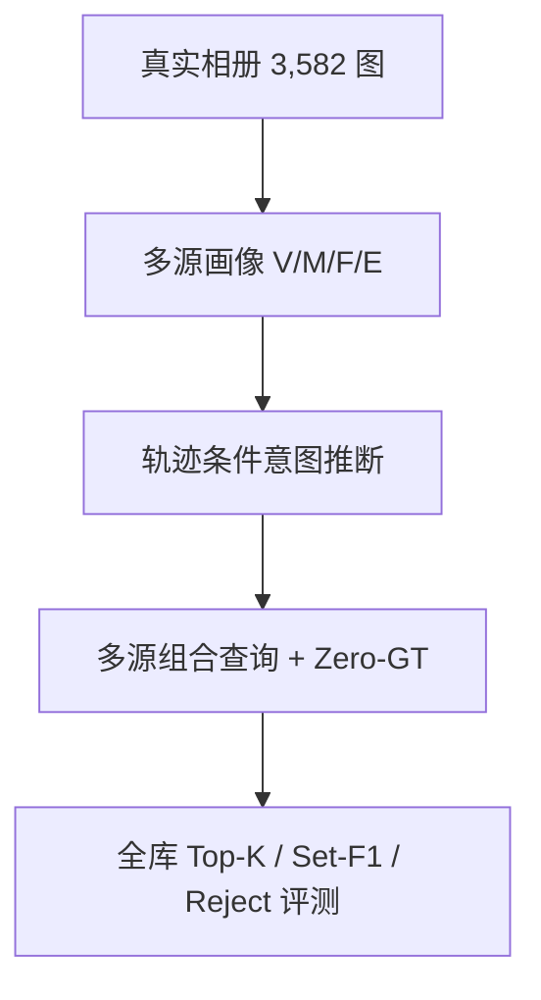
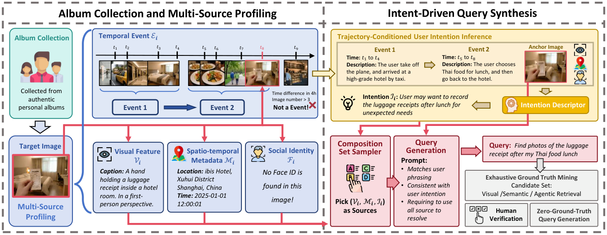

# PhotoBench: Beyond Visual Matching Towards Personalized Intent-Driven Photo Retrieval（超越视觉匹配：面向个性化意图驱动的相册检索基准）

- **会议/期刊**: KDD 2026（Benchmark Track）
- **作者与机构**: Tianyi Xu、Rong Shan、Junjie Wu 等；上海交通大学 & OPPO
- **推荐链路定位**: 召回（检索/评测基准）
- **研究方向**: 多模态推荐与内容理解 / 对话推荐与智能体仿真
- **论文原文**: [arXiv:2603.01493v2](https://arxiv.org/abs/2603.01493v2)
- **开源代码**: [PhotoBench](https://github.com/LaVieEnRose365/PhotoBench)

## TL;DR (1分钟核心速览)

针对现有图文检索基准“网页快照化、缺少个人上下文”的痛点，本文构建 PhotoBench：从真实个人相册抽取视觉、时空元数据、社交身份与事件画像，合成 1,188 条中英双语意图查询，并用全库排序、集合 F1 与 Zero-GT 拒答评测。结果显示统一嵌入模型在非视觉约束上坍塌，最佳 Agent 集合 F1 达 51.9，但拒答 F1 仅 9.1，暴露“模态鸿沟”与“源融合悖论”。

## Background & Motivation (背景与核心矛盾)

- **主流范式**: 多模态检索以 CLIP/SigLIP、VLM2Vec 等统一嵌入做图文相似度匹配，或用 Caption→文本嵌入做间接检索。
- **前人局限**: MSCOCO/Flickr30k 等图像上下文孤立，缺时间连续性与社交元数据；INQUIRE/VisualNews 查询仍偏描述式，难以覆盖“事件+人物+时间”的多源约束。
- **核心洞察 (Key Insight)**: 个人相册是“活的生态档案”，真实查询往往由生活轨迹中的事件意图驱动，而非单图视觉描述。
- **本文切入点**: 用多源画像重建每张照片的上下文，再以轨迹条件意图合成查询，把评测从视觉匹配推向多源约束推理。

## Method (核心方法设计)

### 1. 整体框架 (Overall Architecture)

PhotoBench 不做模型训练，而是构造“相册采集→多源画像→意图查询合成→穷举真值挖掘→多系统评测”的闭环。每张图先扩展为视觉、时空、身份、事件四元组；再按用户事件轨迹推断拍摄意图，采样信息源组合生成自然查询；随后用视觉/语义/Agent 三路召回加人工校验建立密集真值，并反事实合成 Zero-GT 查询测试拒答。评测同时覆盖固定 Top-K 嵌入模型和可变长集合的 Agent/手机相册系统。

<figure class="paper-figure" markdown="span">
  <figcaption>图1：PhotoBench 数据集构建流程示意图。</figcaption>
</figure>

### 2. 关键设计拆解 (Key Designs)

1. **多源画像：把像素扩成上下文四元组**：网页数据只有视觉语义，个人相册却由时间、地点、人物关系共同定义。本文为图像 $i$建立$\mathcal{P}_i=\{V_i,M_i,F_i,E_i\}$，其中$V_i$为 GPT-4o 细粒度视觉描述，$M_i$将 GPS/时间反解为 POI 与“周末/节日”等语义标签，$F_i$由人脸聚类加专家角色标注得到，$E_i$ 用 4 小时自适应窗口、最少 3 图聚类并按时间生成事件摘要。其有效性在于把“找那次旅行中的合照”转成可过滤的结构化约束。
2. **意图驱动查询合成与穷举真值**：单图 caption 无法表达“吃完泰餐后拍的行李回执”这类动机。作者以锚点图及前序事件推断意图 $I_i=\mathrm{MLLM}(\mathcal{P}_i,\{E_j\}_{j\le i})$，再采样组合集$H\subseteq\{V_i,M_i,F_i,I_i\}$生成查询$q=\mathrm{LLM}(H,I_i)$，强制查询需融合$H$ 才能消歧。真值不局限锚点图，而用视觉 Top-50、语义 Top-50、Agent 多工具召回并人工复核，覆盖连拍、近重复与事件相关图。
3. **Zero-GT 与源感知分类体系**：真实用户会产生“假记忆”查询，因此用元数据扰动、实体替换、场景错配构造无真值查询，并以空预测为拒答事件计算 Reject-P/R/F1。查询按必要信息源划为 $S_V,S_M,S_F$及$S_{VM},S_{VF},S_{MF},S_{VMF}$，且互斥不重复计数，便于把失败精确归因到视觉、元数据或身份模块。本文无训练损失与负采样；嵌入模型离线编码后 FAISS 全库召回，Agent 多轮工具调用，推理开销随工具链增长。

## Experimental Setup & Evaluation Protocol (实验设置与评估协议)

- **数据集与预处理**: 无 5-core 过滤，仅做隐私筛查与掩码；保留原始时间、GPS、设备头与自然噪声。

| 数据源 | #Albums | #Images | #Queries | 元数据覆盖 | 人像比例 | 核心人物 |
| :--- | :---: | :---: | :---: | :---: | :---: | :---: |
| PhotoBench | 3 | 3,582 | 1,188（中英双语） | 83.4% | 25.1% | 20 |

- **数据划分与防穿越 (Splitting Strategy)**: 不设训练/测试划分；每条查询在所属相册全部图像上检索，真值由穷举挖掘加人工校验给出，避免采样负例穿越。
- **排名评测协议 (Ranking Protocol)**: 嵌入模型采用无偏 **Full-Gallery 全库排序**（约 1K 相册内），报告 Recall@K、NDCG@K，$K\in\{1,5,10,20\}$；Agent/手机返回可变长集合，报告 Precision/Recall/F1；Zero-GT 报告 Reject-P/R/F1。
- **对比基线与超参设置**: 13 个统一嵌入、9 个 ReAct Agent、6 款商用手机；模型规模 0.14B–671B，原文未统一披露嵌入维度，也未报告显著性检验或方差。

## Key Experimental Results (实验关键数据)

### 1. 主实验对比 (Main Results)

**表1：中文查询 Top-K 检索（全库排序）**

| 模型 | 规模/B | R@1 | R@10 | N@10 |
| :--- | ---: | ---: | ---: | ---: |
| CLIP-ViT-B-32-multilingual | 0.14 | 1.2 | 6.1 | 4.7 |
| SigLIP2-giant | 1.88 | 20.8 | 47.6 | 44.1 |
| VLM2Vec | 8.29 | 23.1 | 52.4 | 48.9 |
| Qwen3-VL-Embedding-8B | 8.14 | 24.9 | 53.0 | 50.9 |
| QQMM-embed-v2 | 8.29 | 26.6 | 57.8 | 55.4 |
| **RzenEmbed-v2-7B** | 8.29 | **27.2** | **58.0** | **56.0** |
| Qwen3-Embedding-8B（Caption） | 7.60 | 25.4 | 51.7 | 49.7 |

注：Rzen 相对最强嵌入次优 QQMM，R@1 **+2.3%**、R@10 **+0.3%**、N@10 **+1.1%**；Caption 管线仍低于多模态嵌入。

**表2：集合级 F1 与 Zero-GT 拒答**

| 系统 | Normal F1 | Reject F1 |
| :--- | ---: | ---: |
| ToolACE-2 | 39.0 | 21.1 |
| Qwen3-8B | 41.0 | 16.7 |
| Qwen3-32B | 41.4 | 20.3 |
| **Qwen3-235B-A22B** | **51.9** | 9.1 |
| GPT-4o | 46.4 | 15.4 |
| OpenAI-o3 | 48.0 | 33.9 |
| Claude-Opus-4.5 | 50.5 | 15.4 |
| Phone F（商用相册） | 40.2 | **46.3** |

注：Qwen3-235B 相对 Phone F，Normal F1 **+11.7（+29.1%）**；Reject F1 低 **37.2**。

### 2. 消融实验 (Ablation Study)

**表3：Qwen3-235B 工具消融（F1，$T_S$ 始终开启）**

| 工具 | $S_V$|$S_M$|$S_F$|$S_{VM}$|$S_{VF}$|$S_{MF}$|$S_{VMF}$ |
| :--- | ---: | ---: | ---: | ---: | ---: | ---: | ---: |
| $T_V$ | 30.5 | 2.6 | 8.7 | 31.4 | 32.1 | 6.1 | 35.1 |
| $T_V+T_M$ | 32.3 | 54.7 | 12.9 | 34.1 | 33.2 | 25.5 | 33.4 |
| $T_V+T_F$ | 32.2 | 3.3 | 69.0 | 29.7 | 26.8 | 30.1 | 25.4 |
| $T_V+T_M+T_F$ | **36.9** | **69.7** | **90.1** | **44.7** | 30.1 | **76.8** | 32.5 |

### 3. 关键实验发现 (Key Findings)

1. **模态鸿沟真实存在，且嵌入模型只是“视觉相似度计算器”**：在纯视觉 $S_V$上嵌入均值 72.3，反超 Agent 的 71.1；但到$S_M$仅 7.2、$S_F$ 仅 11.7，Agent 达 57.9/75.1，差距 **+50.8/+63.4**，说明非视觉约束无法被统一嵌入空间稳定编码。
2. **源融合悖论：工具齐全不等于融合正确**：加 $T_M$使$S_M$从 2.6 升至 69.7，加$T_F$使$S_F$从 8.7 升至 90.1；但最复杂$S_{VMF}$上全工具反降至 32.5，低于仅$T_V$ 的 35.1，表明 Agent 在扩大决策空间时易生成次优计划或过度交集。
3. **Agent 抬高召回上限，却牺牲拒答可靠性**：最佳 Agent Normal F1 51.9，高于最强手机 40.2；但 Reject F1 仅 9.1，远低于 Phone F 的 46.3。商用相册倾向“宁可漏答不误答”，而 Agent 存在为不存在查询强行匹配的检索幻觉。

## Highlights & Limitations (亮点、对比与审稿批判)

- **与代表作对比 (vs. Prior Work)**: MSCOCO/Flickr30k 是上下文孤立网页图；INQUIRE 虽大规模但缺个人元数据与社交图；VisualNews 有元数据但新闻场景非个人相册。PhotoBench 首次把真实相册、多源画像、密集 one-to-many 真值与 Zero-GT 拒答统一到一个评测框架。
- **可迁移亮点**: 源感知查询分类 $S_V/S_M/S_F$ 可直接迁移到相册搜索、Lifelog、POI 本地生活检索做失败归因；穷举真值挖掘与 Reject-F1 也适合任何“多解+不可答”的生成式检索评测。
- **审稿级局限批判**: 规模仅 3 个相册、3,582 图、约 1K 候选，用户画像与场景多样性有限，且未报告显著性检验/方差，结论外推需谨慎；画像与查询由 GPT-4o 等生成，存在模型版本漂移与生成偏差，手机端又是黑盒评估，复现实验环境不完整。

## Rating (四维评分)

- **方法创新性 (Novelty)**: ⭐⭐⭐⭐ （首个真实个人相册多源意图检索基准，并以模态鸿沟/源融合悖论形成清晰诊断价值）
- **评估协议与实验扎实度 (Protocol & Experiments)**: ⭐⭐⭐⭐ （全库排序、集合 F1、Zero-GT 与 13+9+6 系统对比较完整，但仅 3 个相册且无显著性检验）
- **写作与数学规范度 (Clarity & Rigor)**: ⭐⭐⭐⭐ （源感知分类与指标定义清楚，公式简洁；部分构造细节依赖附录，统计严谨性一般）
- **工业落地与复现价值 (Industrial & Practical Value)**: ⭐⭐⭐⭐ （开源数据与手机黑盒评测贴近相册搜索落地，但小规模与 Agent 高推理成本限制直接部署）

