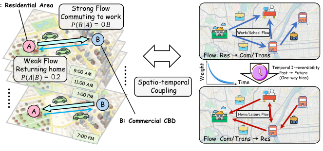
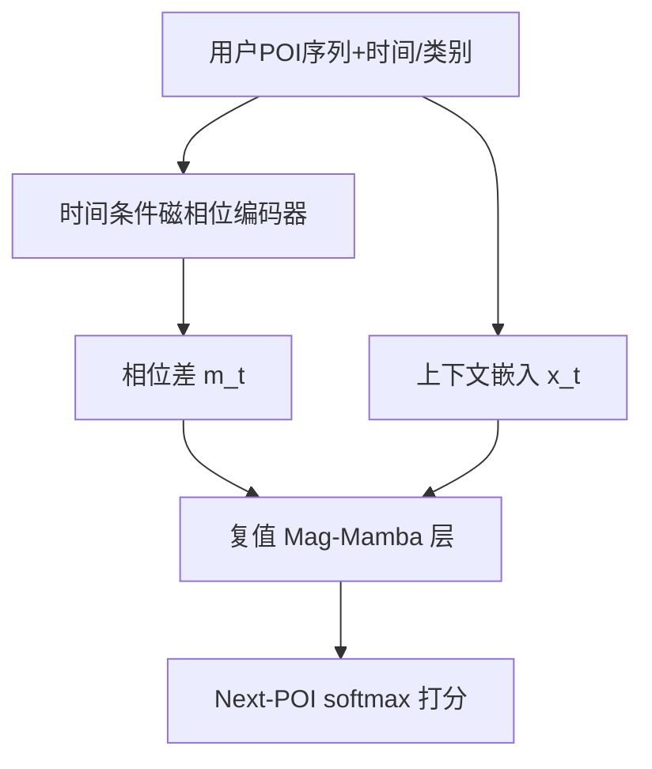
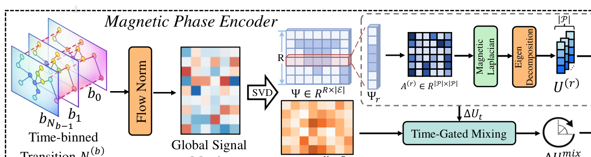

# Mag-Mamba: Modeling Coupled spatiotemporal Asymmetry for POI Recommendation（面向POI推荐的耦合时空不对称建模）

- **会议/期刊**: KDD 2026（目标目录；论文 arXiv 2026-02）
- **作者与机构**: Zhuoxuan Li、Tangwei Ye 等，同济大学、浙江工业大学等
- **推荐链路定位**: 端到端序列预测（Next-POI 排序）
- **研究方向**: 时空轨迹与POI本地生活推荐 / 序列与会话推荐
- **论文原文**: [https://arxiv.org/abs/2603.00053v1](https://arxiv.org/abs/2603.00053v1)
- **开源代码**: 暂未开源

## TL;DR (1分钟核心速览)

针对城市出行中“方向随时刻反转、时间间隔又调节状态更新”的耦合时空不对称，Mag-Mamba 用时间条件磁拉普拉斯生成全局相位差，并驱动复值 Mamba 的衰减-旋转递推。在 NYC/TKY/CA 的 NDCG@k/MRR 评测上，NDCG@1 相对最佳基线提升 1.96%/14.71%/13.85%，MRR 提升 2.30%/6.08%/3.14%。

## Background & Motivation (背景与核心矛盾)

- **主流范式**: 图 GNN 编码地理邻近，LSTM/Transformer/Mamba 建模用户轨迹；地理方向多作为辅助特征注入。
- **前人局限**: 图方法用对称邻接或拆入/出度，难统一表达互反方向及时变反转；Mamba 类多为实值状态压缩，时间只做静态嵌入/衰减，缺显式地理方向场。
- **核心洞察 (Key Insight)**: 复平面单位复数旋转可把互反方向表示为相位取负；磁拉普拉斯谱相位提供全局一致方向基，时间间隔可映射为步长缩放更新强度。
- **本文切入点**: 用“时间条件磁相位”编码全局方向场，再用“复值 Mamba”把方向与时间间隔纳入统一递推。

<figure class="paper-figure" markdown="span">
  <figcaption>图1：城市出行中耦合时空不对称性的示意图。</figcaption>
</figure>  
图 1：城市出行中“去程/回程”方向强度随时间段反转的耦合时空不对称。

## Method (核心方法设计)

### 1. 整体框架 (Overall Architecture)

输入用户 POI 序列、类别与时间特征。离线在半径地理图上统计双向转移数，构造时变反对称边信号 $S$并做截断 SVD 得时段系数$\Pi$与共享方向基$\Psi$；每个基生成磁拉普拉斯，取特征向量相位得到 POI 相位 token。每步用当前/源 POI 的共轭积得相位差并混合为$m_t$；上下文嵌入$x_t$与$m_t$ 送入 Mag-Mamba，由内容角速度与磁相位角速度共同驱动复值旋转，时间间隔控制衰减与注入，最后与 POI 嵌入内积 softmax 预测下一 POI。谱分解离线预计算，线上仅查表与线性递推。

<figure class="paper-figure" markdown="span">
  <figcaption>图2：所提出的 Mag-Mamba 框架概览，包含磁相位编码器、上下文特征嵌入模块和 Mag-Mamba 层。</figcaption>
</figure>  
图 2：Mag-Mamba 框架：磁相位编码器、上下文嵌入与复值 Mag-Mamba 层。

### 2. 关键设计拆解 (Key Designs)

1. **时间条件磁相位编码器（全局时变方向基）**：静态无向图丢失方向，逐时段建图又太贵。对边按时段算平滑 log-ratio 并压到 $[-1,1]$：$s_e^{(b)}=\tanh((\log(N_{i\to j}^{(b)}+\alpha)-\log(N_{j\to i}^{(b)}+\alpha))/\kappa)$，堆成$S\in\mathbb{R}^{N_b\times|E|}$后做$S\approx\Pi\Psi$；每个基构造反对称$A^{(r)}$，令$\Phi_{ij}^{(r)}=2\pi qA_{ij}^{(r)}$、$H_{ij}^{(r)}=W_{ij}\exp(i\Phi_{ij}^{(r)})$，归一化磁拉普拉斯$L^{(r)}=I-D_g^{-1/2}H^{(r)}D_g^{-1/2}$，取最小$k$ 特征向量并归一化为单位模相位 token。直觉：谱相位保证全局一致方向，低秩分解让时变方向可实时混合。

2. **复值 Mag-Mamba（衰减-旋转递推）**：实值 SSM 只有标量衰减，无法表达方向旋转。把 $D$维拆成$D/2$个二维旋转对，角速度$\theta_t=\theta_t^{tok}+\theta_t^{mag}$，时间步长$\delta_t=\mathrm{softplus}(W_\Delta\log(1+\Delta t_t)+b_\Delta)$，每对旋转角$\varphi_t=\delta_t^{half}\odot\theta_t$。状态递推为$h_t=\alpha_t\odot R_t(h_{t-1})+\beta_t\odot R_t(B_{t-1}\odot u_{t-1})+\gamma_t\odot(B_t\odot u_t)$，$\alpha_t=\exp(\delta_t\odot A)$。磁相位作为拓扑强迫项控制“往哪转”，$\Delta t$ 控制“转多少/衰减多少”。

3. **训练目标、负采样与推理效率**：总损失为下一 POI 交叉熵 $\mathcal{L}=-\sum_{t=1}^{L-1}\log\frac{\exp(s_t(p_{t+1}))}{\sum_{p'\in\mathcal{P}}\exp(s_t(p'))}$；训练用全 POI softmax（免显式负采样）。谱分解离线一次，线上每步为$O(Rk+D)$ 相位混合与 Mamba 线性递推。

## Experimental Setup & Evaluation Protocol (实验设置与评估协议)

- **数据集与预处理**: 移除少于 5 次 check-in 的 POI；用户轨迹切为长度 3–101 的序列；按 8:1:1 比例划分训练/验证/测试。

| 数据集 | #Users | #Items | #Interactions | #Traj | 密度 | 场景 |
| :--- | :---: | :---: | :---: | :---: | :---: | :--- |
| NYC | 1,047 | 4,980 | 101,760 | 13,955 | 0.016 | 纽约 Foursquare |
| TKY | 2,281 | 7,832 | 403,148 | 65,914 | 0.018 | 东京 Foursquare |
| CA | 3,956 | 9,689 | 221,717 | 42,982 | 0.005 | 加州/内华达 Gowalla |

- **数据划分与防穿越**: 比例划分（8:1:1）；转移统计与 SVD 仅在训练集上计算。
- **排名评测协议**: 报告 NDCG@1/5/10 与 MRR；原文未显式声明 Full-Ranking 或采样负例比例，按全 POI softmax 训练推测为全库排序，复现时需补全协议。
- **对比基线与超参**: 11 个基线（LSTM、PLSPL、HME、GETNext、AGRAN、ROTAN、MCLP、MTNet、GeoMamba、HMST、HVGAE）；$D=96$、时间嵌入 32、2 层 Mag-Mamba、$k=16$、$R=12$、$q=0.20$（NYC/TKY）/$0.15$（CA）、半径 1.5 km、168 个 hour-of-week 时段；Adam，lr$1\times10^{-3}$，batch 128，50 epochs。未报告显著性检验。

## Key Experimental Results (实验关键数据)

### 1. 主实验对比 (Main Results)

| 方法 | NYC ND@1 | NYC MRR | TKY ND@1 | TKY MRR | CA ND@1 | CA MRR |
| :--- | ---: | ---: | ---: | ---: | ---: | ---: |
| GETNext | 0.2244 | 0.3472 | 0.1767 | 0.2934 | 0.1342 | 0.2121 |
| AGRAN | 0.2202 | 0.3343 | 0.1755 | 0.2879 | 0.1329 | 0.2043 |
| ROTAN | 0.2192 | 0.3468 | 0.1822 | 0.3186 | 0.1345 | 0.2256 |
| MCLP | 0.2404 | 0.3507 | 0.1662 | 0.3199 | 0.1324 | 0.1895 |
| MTNet | 0.2346 | 0.3522 | 0.2107 | 0.3191 | 0.1401 | 0.2387 |
| GeoMamba | 0.1988 | 0.3246 | 0.1851 | 0.2858 | 0.1256 | 0.1962 |
| HMST | 0.2138 | 0.3482 | 0.1925 | 0.3257 | 0.1356 | 0.2300 |
| HVGAE | 0.2271 | 0.3470 | 0.1977 | 0.3180 | 0.1391 | 0.2367 |
| **Mag-Mamba** | **0.2451** | **0.3603** | **0.2417** | **0.3455** | **0.1595** | **0.2462** |
| **Improv.%** | +1.96 | +2.30 | +14.71 | +6.08 | +13.85 | +3.14 |

### 2. 消融实验 (Ablation Study)

| 变体 | TKY ND@5 | TKY MRR | CA ND@5 | CA MRR |
| :--- | ---: | ---: | ---: | ---: |
| w/o Mamba | 0.3096 | 0.2862 | 0.2046 | 0.1998 |
| w/o Spatial | 0.3314 | 0.3117 | 0.2122 | 0.2085 |
| w/o Phase | 0.3467 | 0.3248 | 0.2340 | 0.2295 |
| Real-Mamba | 0.3550 | 0.3405 | 0.2398 | 0.2359 |
| MLP-Eigen | 0.3491 | 0.3279 | 0.2233 | 0.2290 |
| w/o TC | 0.3525 | 0.3372 | 0.2443 | 0.2396 |
| **Full model** | **0.3602** | **0.3455** | **0.2528** | **0.2462** |

### 3. 关键实验发现 (Key Findings)

1. **序列动力学是主骨架**：去掉 Mamba 后 TKY ND@5 从 0.3602 降至 0.3096（-5.06 pt），CA 从 0.2528 降至 0.2046（-4.82 pt），跌幅最大，说明长程轨迹递推不可替代。
2. **相位信号必须配复值旋转**：w/o Phase 使 TKY ND@5 降 1.35 pt、CA 降 1.88 pt；Real-Mamba 仍降 0.52/1.30 pt，证明“复特征+复动力学”需配对，实值 Mamba 无法有效演化相位。
3. **时变调制与全局谱基比局部近似更关键**：w/o TC 在 TKY/CA 的 ND@5 分别降 0.77/0.85 pt；MLP-Eigen 在 CA 降 2.95 pt，表明全局谱一致性难以由局部 MLP 替代；超参 $k=16$、$R=12$、$q=0.2$ 附近饱和/最优。

## Highlights & Limitations (亮点、对比与审稿批判)

- **与代表作对比 (vs. Prior Work)**: ROTAN 只做时间维度旋转，缺地理拓扑；GeoMamba 有 Mamba+地理编码但实值状态无方向场；HMST/HVGAE 的双曲旋转多用于层次/语义嵌入对齐，并非时空不对称耦合。Mag-Mamba 的本质区别是“磁谱全局方向基 + 复值 Mamba 的 decay-rotation 统一递推”。
- **可迁移亮点**: 用低秩 SVD 把时变有向边场压缩为“共享空间基 × 时段系数”，可迁移到交通/轨迹预测；共轭积相位差对特征向量列相位漂移不敏感（gauge-invariant），可接入其他序列模型。
- **审稿级局限批判**: 方向统计依赖训练轨迹，新增 POI/冷启动需重算谱；评测未显式声明全库/采样候选与负例比例，且无显著性检验；$q$、$R$、$k$ 敏感，线上延迟与图更新成本未量化。

## Rating (四维评分)

- **方法创新性 (Novelty)**: ⭐⭐⭐⭐（磁拉普拉斯谱相位与复值 Mamba 旋转递推结合有新意，gauge-invariant 有理论支撑）
- **评估协议与实验扎实度 (Protocol & Experiments)**: ⭐⭐⭐（三数据集、11 基线、消融与不对称分层较完整，但候选/负例协议和显著性检验缺失）
- **写作与数学规范度 (Clarity & Rigor)**: ⭐⭐⭐⭐（谱构造、相位差与递推公式清晰，部分工程实现依赖 Mamba-3 需查附录）
- **工业落地与复现价值 (Industrial & Practical Value)**: ⭐⭐⭐（谱分解可离线、线上混合轻量，但图更新与超参敏感，代码未开源）

