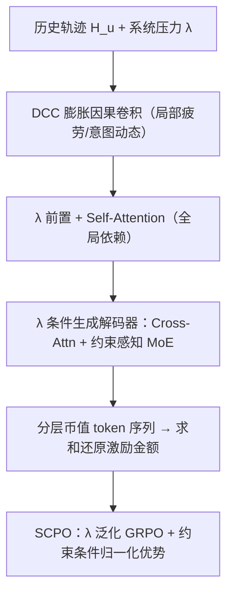
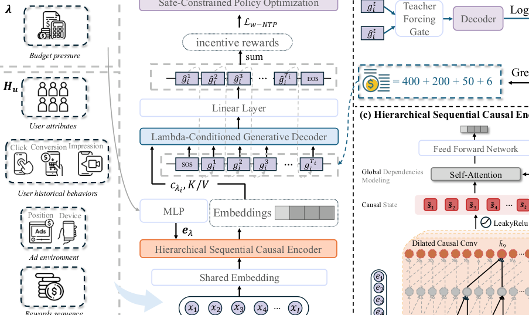
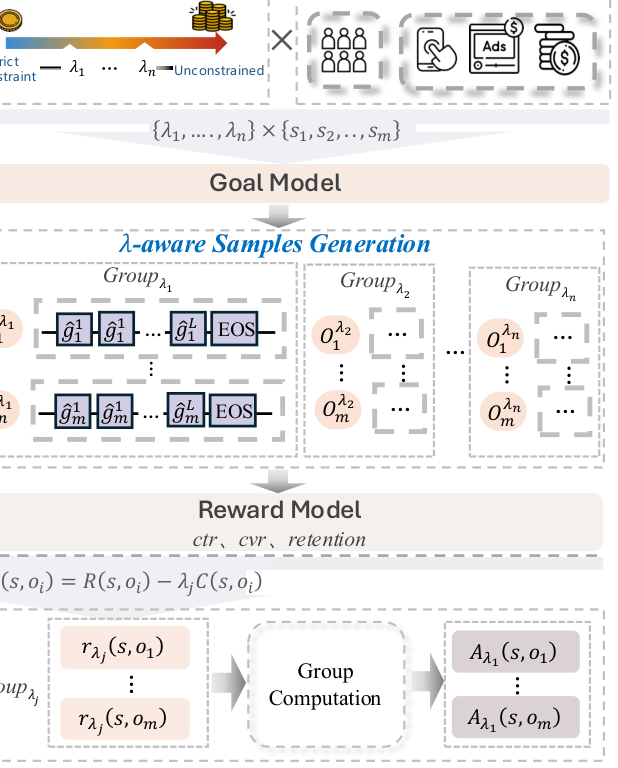

# Generative Optimization for Incentivized Advertising with Global Level Constraints (全局约束下激励广告的生成式优化)

- **会议/期刊**: KDD 2026 (ACM SIGKDD, Jeju Island)
- **作者与机构**: Gege Chen, Ning Luo, Hao Jiang, Da Li, Wenzheng Shu, Teng Sha, Yanxiang Zeng, Wenxin Tai, Fan Zhou, Xialong Liu（快手科技 + 电子科技大学）
- **推荐链路定位**: 端到端生成式（广告激励决策层，替代 predict-then-optimize 两阶段）
- **研究方向**: 强化学习与动态探索推荐 / 生成式推荐与离散语义 ID
- **论文原文**: [https://arxiv.org/abs/2608.04421v1](https://arxiv.org/abs/2608.04421v1)
- **开源代码**: 暂未开源

## TL;DR (1分钟核心速览)

激励广告要在**全局 ROI 硬约束**下决定"发多少金币"，痛点有三：uplift 两阶段对预测误差敏感、离线 RL 的马尔可夫假设被高频交互打破（疲劳是长程非马尔可夫的）、标准 Transformer 的全局注意力稀释了"疲劳突变"这类局部关键信号。GOAL 把连续激励额离散成**分层单调币值词表**自回归生成，用 DCC+Attention 分层因果编码器抓局部动力学，再把拉格朗日乘子 $\lambda$作为条件注入 MoE 解码器，配合 **SCPO** 一次训练覆盖整条 ROI 谱。IA 工业数据集上 REV 0.32（+18.52%）、RVR 12.24%（相对降 18.40%），线上 4 周 A/B 中 ROI +2.184%、收入 +2.559%（$p=0.03$）。

## Background & Motivation (背景与核心矛盾)

- **主流范式**: 工业界主流是 uplift/因果推断估增量再解背包问题（两阶段），或把激励分配建成 CMDP 用离线 RL（CAL/TREBI）加对偶乘子求解。
- **前人局限**: ① 两阶段对第一阶段预测误差极敏感，且目标短视，忽略疲劳/饱和带来的长期衰减；② 离线 RL 严格依赖马尔可夫性，而高频激励下用户疲劳是累积的隐状态，且策略常因分布漂移过度保守；③ 生成式方法虽表达力强，但点式回归头在 1–3000 金币的宽值域 + 重尾分布下被高频低额样本淹没。
- **核心洞察 (Key Insight)**: 决策关键信号（疲劳突增、意图漂移）在长历史中**高度局部化**，全局 self-attention 会将其平均掉；同时 ROI 是"全局分数约束"（$\sum r_i/\sum c_i \ge \tau$），跨时间耦合决策，无法逐点施加。
- **本文切入点**: 用 Dilated Causal Conv 先做密集局部因果建模、再做全局注意力；把约束压力 $\lambda$ 变成一个**可采样的条件变量**而非固定超参，从而"训练一次，推理时旋钮调约束"。

## Method (核心方法设计)

### 1. 整体框架 (Overall Architecture)

输入是长度 $L$的滑窗复合事件序列（状态特征 + 已发激励）以及系统压力标量$\lambda$；分层编码器先以膨胀因果卷积提取局部因果态$\tilde{\boldsymbol{S}}$，前置$\lambda$嵌入后经 self-attention 得全局表征$\boldsymbol{H}_{enc}$；解码器注入$\boldsymbol{c}_\lambda$作为 cross-attention 的 K/V 与 MoE 门控条件，逐 token 生成激励序列并用贪心/教师强制解码，求和还原为金币数；训练分三段：加权 NTP 监督微调 → 奖励模型（多目标 P-Score）→ SCPO 约束对齐，推理时用二分搜索校准$\lambda^*$。

<figure class="paper-figure" markdown="span">
  <figcaption>图2：GOAL的整体架构。(1) 分层因果编码器：协同DCC与自注意力，以同时捕获高频局部动态和全局时间依赖。(2) 𝜆条件生成解码器：用MoE替换标准FFN，使专家能够感知不同水平的𝜆诱导约束压力。(3) 优化：通过加权NTP目标L𝑊−𝑁𝑇𝑃进行优化。</figcaption>
</figure>

### 2. 关键设计拆解 (Key Designs)

1. **分层单调币值词表（Incentive Vocabulary）**：痛点是一步回归在宽值域重尾分布下失衡。做法：按动态分位数 $\hat{a}_j \leftarrow \hat{a}_j - o_i$反复剥离当前$q$分位残差生成唯一 token，再用贪心分解$a_i=\phi(\boldsymbol{g}_i)=\sum_{k=1}^{T_i}\phi(g_i^k)$强制**单调性**$\phi(g_i^1)\ge\phi(g_i^2)\ge\cdots$，前序 token 编码量级、后序 token 编码精度，等价于 coarse-to-fine 的数值定位，序列长度天然极短。

2. **分层因果编码 + $\lambda$条件 MoE 解码**：DCC 用$\boldsymbol{h}_t^{(l)}=\sum_{i=0}^{k_c-1} f(i)\cdot\boldsymbol{h}_{t-d_c i}^{(l-1)}$保证严格因果并扩大感受野；解码器把标准 FFN 换成 MoE，以$\boldsymbol{r}=\mathrm{Softmax}(\boldsymbol{W}_g\cdot[\boldsymbol{z};\boldsymbol{c}_\lambda])$做 Top-$k$路由，专家权重随$\lambda$连续变化（实测$\lambda{=}0$时 Expert0 占 0.91，$\lambda{=}3$时 Expert3 占 0.94），即"约束压力→策略档位"被结构化进专家分工。损失按物理量级加权：$\mathcal{L}_{W\text{-}NTP}=-\frac{1}{N}\sum_i\sum_t \omega_t\log P_\theta(\hat{g}_i^t\mid\boldsymbol{H}_{enc},\hat{g}_i^{<t})$，其中$\omega_t=\log_{10}\big(v(g_i^t)+1\big)+\delta$，使高位 token 的错误惩罚与真实金额同尺度。

3. **SCPO 与对偶解耦**：先用 $\lambda=\frac{\lambda'\tau}{1+\lambda'}$把分数约束线性化，得到$\max_\pi\sum_i(r_i-\lambda c_i)$，故$\lambda\in[0,\tau]$天然覆盖"无约束→最严"整段；再把$\lambda$提为随机变量采样，得通用目标$\mathcal{J}_{Gen}(\theta)=\mathbb{E}_{\lambda\sim P(\Lambda)}\mathbb{E}_{\tau\sim\pi_\theta(\cdot\mid\lambda)}\big[\sum_t r_\lambda(s_t,a_t)\big]$，$r_\lambda=R(s,o_i)-\lambda C(s,o_i)$。关键在于**约束条件归一化**优势$A(s,o_i)=\frac{r_{\lambda_j}(s,o_i)-\mu_{\lambda_j}}{\sigma_{\lambda_j}+\epsilon}$，只在与同$\lambda_j$的$m$条候选内比较，避免高$\lambda$组因整体奖励被压低而被误判为"差策略"；最终$\mathcal{L}_{SCPO}$为 PPO 裁剪 + KL 正则。训练负采样：无需负样本，组内$m$条 rollout 互为对照；推理开销为一次自回归（$T_i$通常数 token）+ 周期性的$\lambda^*$二分校准（约$\log|\Lambda|$ 次 rollout）。

<figure class="paper-figure" markdown="span">
  <figcaption>图3：安全约束策略优化（SCPO）的工作流程。</figcaption>
</figure>

## Experimental Setup & Evaluation Protocol (实验设置与评估协议)

- **数据集与预处理**:

| 数据集 | #Users | #Items | #Interactions | 稀疏度/密度 | 特征/场景说明 |
| :--- | :---: | :---: | :---: | :---: | :--- |
| IA（工业真实） | ~130k DAU | N/A（非排序任务） | 1.84M 日激励曝光事件 | 8 天日志（11/05–11/12） | 短视频平台金币激励全链路日志，含位置/设备/用户属性/广告环境 |
| Synthetic IA | 10k 轨迹 | N/A | 10k × $T{=}100$步 | — | 疲劳仿真：$f_{t+1}=\rho f_t+\eta a_t$，$p_t=\sigma(\alpha a_t-\beta f_t)$，$K{=}10$，$\alpha{=}0.8,\beta{=}1.2,\rho{=}0.9,\eta{=}0.5$ |

- **数据划分与防穿越**: IA 采用**全局时间戳切分**——前 6 天训练、最后 1 天测试（严格未来留出，无随机泄漏）；合成集用混合行为策略（贪心/随机/固定中等额）采样 10k 轨迹做离线数据集，保证动作覆盖。
- **排名评测协议**: 本文**非排序任务**，不涉及 Full-Ranking / Sampled Ranking；评测为离线策略评估（OPE）三项业务指标：REV（人均收入，USD）、ROI $=\sum r/\sum c$、以及作者新提出的 **RVR（ROI Violation Rate）**——滑动窗口内 ROI 低于目标$\tau$ 的窗口占比（越低越好），这是对"硬约束是否被守住"的直接度量。线上以 4 周 A/B（实验组 65% 随机用户）验证。
- **对比基线与超参设置**: 5 个 SOTA：生成式 DT、安全生成式 CDT、无约束离线 RL IQL、约束 RL CAL/TREBI；主表固定 $\lambda=0.5$，消融固定$\tau=3.0$，$\lambda$候选集$\Lambda=\{0,0.5,\dots,3.0\}$（7 档），报告均值±标准差，线上指标$p=0.03$。

## Key Experimental Results (实验关键数据)

### 1. 主实验对比 (Main Results)

| Method | IA: REV↑ | IA: ROI↑ | IA: RVR↓ | Synth: REV↑ | Synth: ROI↑ | Synth: RVR↓ |
| :--- | :---: | :---: | :---: | :---: | :---: | :---: |
| DT (2021) | 0.27 | 4.74 | 18.23% | 0.19 | 3.64 | 13.51% |
| CDT (2023) | 0.22 | 4.60 | 15.00% | 0.36 | 4.12 | 10.24% |
| IQL (2022) | 0.25 | 3.68 | 24.69% | 0.15 | 3.59 | 18.05% |
| CAL (2019) | 0.19 | 3.70 | 21.82% | 0.12 | 3.61 | 14.49% |
| TREBI (2023) | 0.19 | 3.92 | 20.21% | 0.09 | 3.72 | 14.21% |
| **GOAL (Ours)** | **0.32** | **4.93** | **12.24%** | 0.29 | **4.23** | **9.20%** |
| Improv. | +18.52% | +4.01% | +18.40% | – | +2.40% | +9.86% |

线上 A/B（4 周，65% 流量）：**ROI +2.184%**、**收入 +2.559%**。驻留时长与 DAU 无显著负向变化。

### 2. 消融实验 (Ablation Study)（IA，$\tau=3.0$）

| 变体 | REV↑ | ROI↑ | RVR↓ |
| :--- | :---: | :---: | :---: |
| w/o SCPO（仅 SFT） | 0.27±0.01 | 4.57±0.04 | 15.64% |
| w/o DCC（纯 self-attn） | 0.25±0.01 | 4.91±0.05 | 12.29% |
| SCPO w/o $\lambda$-gen（固定$\lambda$） | 0.25±0.03 | 4.89±0.02 | 14.12% |
| w/o Tokenizer（标量回归头） | 0.29±0.02 | 4.89±0.03 | 13.85% |
| **GOAL** | **0.32±0.01** | **4.93±0.02** | **12.24%** |

### 3. 关键实验发现 (Key Findings)

1. **约束对齐与表征能力解耦**：去掉 SCPO 后 REV 0.32→0.27、RVR 12.24%→15.64%（相对恶化 28%），而去掉 DCC 后 RVR 几乎不变（12.29%）但 REV 掉到 0.25——说明 ROI 守得住主要靠 SCPO 的策略对齐，收益增量才靠 DCC 捕捉局部疲劳信号，两个模块职责不重叠。
2. **分层 tokenizer 是高额样本的唯一有效解**：换成标量回归头后 REV 掉 9.4%（0.32→0.29）、RVR 升至 13.85%，印证 1–3000 金币的重尾区间里点式回归被低频低额样本压制，而分层单调分解能在极短序列内定位高位量级。
3. **$\lambda$泛化换来"免重训"的自由度，但需警惕保守塌缩**：固定$\lambda$的变体取得最低 REV（0.25）与最高 RVR 之一（14.12%），说明单点对偶解无法覆盖业务方随时变动的$\tau$；而线上 2.184% ROI 提升在 4 周内保持稳定（$p=0.03$），证明离线$\lambda$-谱训练出来的策略边界可迁移到真实流。

## Highlights & Limitations (亮点、对比与审稿批判)

- **与代表作对比 (vs. Prior Work)**: 相对 CDT（安全生成式），GOAL 把约束从"cost-to-go 条件"升级为**对偶乘子条件 + 约束组内优势归一化**，从"条件生成"走向"策略流形学习"；相对 CAL/TREBI（约束 RL），它摆脱了马尔可夫假设与逐点约束施加，用因果卷积显式建模疲劳累积；相对 DT/IQL，避免了仅优化未约束标量回报导致 ROI 失控（IQL RVR 高达 24.69%）。
- **可迁移亮点**: ① $\omega_t=\log_{10}(v(g_t)+1)+\delta$这种**按物理量级加权的 token 损失**可直接搬到出价、补贴、预算分配等一切数值生成任务；② "约束乘子作为 MoE 门控条件 + 同$\lambda$ 组内归一化"是把任意全局 KPI 约束做成单模型可调旋钮的通用配方。
- **审稿级局限批判**: ① 证据面偏窄——真实数据仅来自单一平台 8 天日志，且 REV 绝对值量级极小（0.32 USD、标准差 ±0.01），18.5% 提升未给多次随机种子的置信区间；② 合成环境的疲劳机制是指定 sigmoid + 线性累积的人为设定，用它论证"非马尔可夫建模更优"有循环论证风险；③ 推理侧引入 $\lambda^*$ 二分校准需在 calibration set 上反复 rollout，且币值词表按数据分位数构建，跨 campaign/跨地区需重建词表，工程迁移成本未量化。

## Rating (四维评分)

- **方法创新性 (Novelty)**: ⭐⭐⭐⭐ （"激励金额=分层单调 token 序列 + $\lambda$ 条件 MoE + 约束组内优势归一化"三件套组合新颖，但对偶解耦与 GRPO 本体是成熟组件的巧妙拼装，缺理论收敛性分析）
- **评估协议与实验扎实度 (Protocol & Experiments)**: ⭐⭐⭐⭐ （时间戳切分严谨、提出 RVR 直击约束违约、含 4 周线上 A/B 与 $p$ 值，但真实数据集单一、合成环境人为设定、缺多 seed 方差）
- **写作与数学规范度 (Clarity & Rigor)**: ⭐⭐⭐⭐ （对偶推导与 $\lambda\in[0,\tau]$ 边界有命题与证明支撑，MoE/加权 NTP 符号清晰；附录算法与正文有少量记号不一致，部分超参选择缺敏感性分析）
- **工业落地与复现价值 (Industrial & Practical Value)**: ⭐⭐⭐⭐ （快手真实系统上线且收益统计显著，端到端替代两阶段流水线价值高；但代码未开源、词表与 $\lambda$ 校准依赖私有数据，复现门槛偏高）

