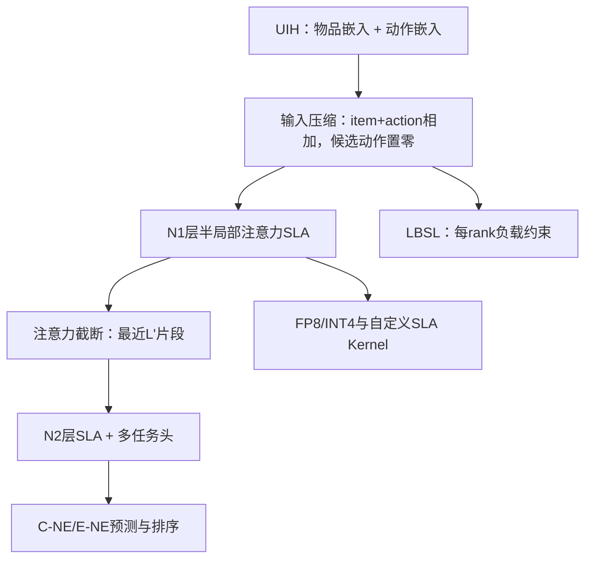

# Bending the Scaling Law Curve in Large-Scale Recommendation Systems (弯折大规模推荐系统中的扩展律曲线)

- **会议/期刊**: KDD 2026
- **作者与机构**: Qin Ding、Kevin Course、Linjian Ma、Jianhui Sun、Ruochen Liu、Zhao Zhu、Chunxing Yin、Wei Li、Dai Li、Yu Shi、Xuan Cao、Ze Yang、Han Li、Xing Liu、Bi Xue、Hongwei Li、Rui Jian、Daisy Shi He、Jing Qian、Matt Ma、Qunshu Zhang、Rui Li；Meta Recommendation Systems
- **推荐链路定位**: 精排/排序（长序列编码器）
- **研究方向**: 序列与会话推荐 / 工业架构与系统
- **论文原文**: [论文原文链接](https://arxiv.org/abs/2602.16986v2)
- **开源代码**: 暂未开源

## TL;DR (1分钟核心速览)

针对超长用户行为序列中全自注意力二次复杂度与跨注意力表达受限的矛盾，ULTRA-HSTU以物品-动作合并、半局部稀疏注意力和注意力截断做模型-系统协同设计；在工业6B样本时间切分与KuaiRand上，训练/推理扩展效率分别提升5.3×/21.4×，在线消费指标提升4.11%–8.2%。

## Background & Motivation (背景与核心矛盾)

- **主流范式**: 工业推荐从人工特征交叉转向HSTU等序列transducer，依靠更长用户历史、更密注意力计算和更深堆叠获得scaling law收益。
- **前人局限**: HSTU全自注意力为$O(L^2)$，当$L$达到$10^3$–$10^5$时训练与亚秒级推理均难部署；STCA等改用cross-attention或仅2–4层浅层结构降复杂度，但候选query丢失全历史self-attention表达，深度堆叠在9层后趋于饱和。
- **核心洞察**: 作者在同等FLOP下发现self-attention仍优于cross-attention，且增加层数与序列长度持续提升效果；瓶颈不在于注意力范式，而在于系统效率与拓扑设计。
- **本文切入点**: 不替换self-attention，而是压缩输入、设计线性稀疏mask、截断深层序列，并配套FP8/INT4与自定义kernel把扩展曲线“弯折”。

## Method (核心方法设计)

### 1. 整体框架 (Overall Architecture)

ULTRA-HSTU以用户交互历史（UIH）的物品与动作嵌入为输入，先将物品-动作对合并为单条序列，候选位置动作置零；随后堆叠$N_1$层半局部注意力SLA，再在最近$L'$片段上堆叠$N_2$层，形成注意力截断；系统侧用LBSL平衡分布式训练负载，并以FP8 GEMM、INT4嵌入量化和定制SLA kernel支撑超长序列训练与推理。多任务头输出消费、互动等概率并排序。

### 2. 关键设计拆解 (Key Designs)

1. **物品-动作合并与异构动作编码**：原始HSTU交错存放item/action，排序阶段序列长度翻倍；本文令$x_{i,j}=I_{i,j}+a_{i,j}$，候选位置$a_{i,j}=\mathbf{0}$，序列减半、注意力计算约降4×，并融合显式/隐式动作与上下文特征，避免候选动作泄漏。LBSL再以每rank计算负载约束做随机长度采样，训练吞吐提升15%。
2. **半局部注意力SLA**：全因果mask的$O(L^2)$是超长序列主瓶颈；SLA同时保留局部窗口$K_1$与全局最新窗口$K_2$，mask为$M_{i,j}=1$当$L-K_1\le i+j\le L$或$j\le K_2$且$j\le L-i$，否则为0，复杂度降为$O((K_1+K_2)L)$。推荐场景中最新长周期行为比局部滑窗更关键，故$K_2$不可省。
3. **动态拓扑与系统协同**：深层全序列注意力成本为$O(DL)$；注意力截断先跑$N_1$层全序列，再仅对最近$L'$片段跑$N_2$层，MoT则把消费/互动序列分开编码并按价值分配算力。系统侧将主要GEMM转FP8、嵌入通信量化到INT4，并实现适配HSTU SiLU注意力与非标准mask的SLA kernel。

**训练目标、负采样与推理效率**：训练采用日志曝光样本的多任务交叉熵$\mathcal{L}=-\sum_k[y_k\log\hat{y}_k+(1-y_k)\log(1-\hat{y}_k)]$；论文未显式引入负采样，评估以NE为主。推理用截断后的最近片段与定制kernel，官方报告相对HSTU推理扩展效率21.4×、训练5.3×。

## Experimental Setup & Evaluation Protocol (实验设置与评估协议)

- **数据集与预处理**:

| 数据集 | #Users | #Items | #Interactions | 稀疏度/密度 | 特征/场景说明 |
| :--- | :---: | :---: | :---: | :---: | :--- |
| 工业集 | 未披露 | 未披露 | 6B+样本 | 未披露 | 超长UIH，序列长度3,072–16,384 |
| KuaiRand | 未披露 | 未披露 | 未披露 | 未披露 | 公开短视频基准，短序列长度256 |

- **数据划分与防穿越**: 工业集采用全局时间顺序切分，前85%训练、后15%评估；KuaiRand沿用公开基准设定。工业集明确按时间切分以避免未来信息泄漏。
- **排名评测协议**: 非标准Full-Ranking/Sampled Ranking，主指标为归一化交叉熵NE（C-NE消费、E-NE互动，越低越好），辅以训练/推理FLOP；工业集为日志曝光多任务分类评估，未报告全库排序AUC。
- **对比基线与超参**: 短序列DIN、SASRecs；长序列HSTU、STCA；另含内部优化Transformer。嵌入维度$d=512$，层数6–18，序列长度3,072/8,192/16,384；内部经验认为ΔNE 0.03%–0.05%已显著。

## Key Experimental Results (实验关键数据)

### 1. 主实验对比 (Main Results)

| 模型 | 工业集ΔC-NE↓ | 工业集ΔE-NE↓ | KuaiRand NE↓ | KuaiRand推理TFLOP↓ |
| :--- | :---: | :---: | :---: | :---: |
| **ULTRA-HSTU** | **0.00%** | **0.00%** | **0.8626** | **166.41** |
| HSTU | +0.43% | +0.04% | 0.8676 | 198.80 |
| STCA | +0.94% | +0.74% | 0.8689 | 208.75 |
| Transformer | +0.57% | +0.59% | 0.8688 | 267.46 |
| DIN | +1.41% | +1.91% | 0.8685 | 168.36 |
| SASRecs | +1.12% | +1.28% | 0.8804 | 176.51 |
| **Improv. vs HSTU** | **0.43 pp** | **0.04 pp** | **0.58%** | **16.3%** |

### 2. 消融实验 (Ablation Study)

| 消融/变体 | 关键设置 | 质量与效率结果 |
| :--- | :--- | :--- |
| 去item-action交错 | item+action相加，候选动作置0 | 序列长度↓50%；训练FLOP↓32.5%、推理↓63.5%；异构动作编码再获0.45% C-NE |
| LBSL | 每rank负载约束 | 512卡world size训练吞吐+15% |
| SLA | 全注意力 vs 半局部 | 训练缩放2.7×、推理5.1×；$K_1=0$时ΔC-NE +0.03%，$K_2=0$时+0.35% |
| 注意力截断AT | 3层全序列+6层最近片段 vs 6层HSTU | C-NE持平、E-NE更优；训练FLOP省3%、推理省38%；推理缩放1.8× |
| MoT | 消费/互动序列分离 | vs 16k HSTU：ΔE-NE -0.30%，推理FLOP↓69%、训练↓45%，C-NE +0.05% |

### 3. 关键实验发现 (Key Findings)

1. **self-attention必须保留**：12层self-attention相对3层带来ΔC-NE -0.46%、ΔE-NE -0.65%，而cross-attention仅-0.14%/-0.17%且9层后饱和，说明用cross-attention换线性复杂度会牺牲深度扩展收益。
2. **SLA的全局窗口是推荐特化关键**：去掉$K_2$回归0.35% C-NE，远大于去掉$K_1$的0.03%；配合AT，3+6层在推理FLOP省38%下保持C-NE并改善E-NE，长序列推理缩放再提升3.4×。
3. **工业规模收益显著**：18层、16k序列部署后，在线C指标+4.11%、E指标最高+8.2%、Topline+0.217%；KuaiRand短序列NE 0.8626仍优于HSTU 0.8676（相对0.58%）。

## Highlights & Limitations (亮点、对比与审稿批判)

- **与代表作对比 (vs. Prior Work)**: 相较HSTU，本文不牺牲self-attention，而以输入压缩、SLA与AT降低有效成本；相较STCA/Douyin路线，避免cross-attention的pre-attention投影开销与深度饱和；相较DIN/SASRec，面向10k级UIH与工业A/B而非短序列离线指标。
- **可迁移亮点**: LBSL的“按rank负载约束采样”可迁移到任意变长序列分布式训练；FP8 GEMM+INT4嵌入量化与SLA mask kernel可复用到其他长序列推荐编码器。
- **审稿级局限批判**: 工业6B数据与kernel栈未开源，复现门槛高；离线仅报NE，未给Full-Ranking/采样排序协议与校准指标，排序公平性证据不足；SLA窗口$K_1/K_2$、AT层数与片段长度对场景敏感，线上收益可能混有系统优化与模型结构贡献。

## Rating (四维评分)

- **方法创新性 (Novelty)**: ⭐⭐⭐⭐ （SLA与AT并非全新注意力原语，但“输入压缩+稀疏mask+拓扑截断+系统kernel”的协同设计完整，scaling实证强）
- **评估协议与实验扎实度 (Protocol & Experiments)**: ⭐⭐⭐ （有工业6B数据、KuaiRand与30天A/B，但私有数据、NE单一指标、无标准全库排序协议，复现受限）
- **写作与数学规范度 (Clarity & Rigor)**: ⭐⭐⭐⭐ （SLA mask、复杂度与消融公式清晰；系统细节大量下沉附录，部分超参未在主文展开）
- **工业落地与复现价值 (Industrial & Practical Value)**: ⭐⭐⭐⭐⭐ （18层/16k序列在十亿用户级平台部署，训练/推理扩展与在线指标均有量级收益；但无开源代码，工程复现成本高）

