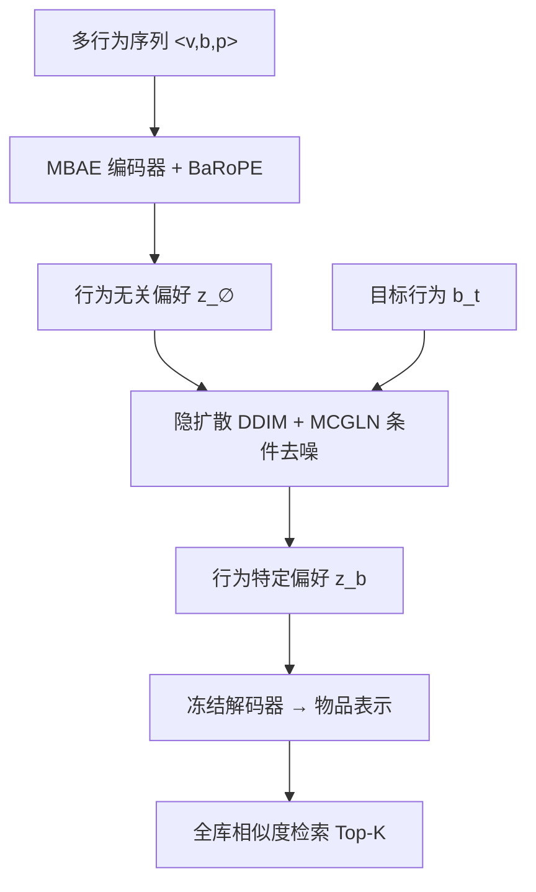
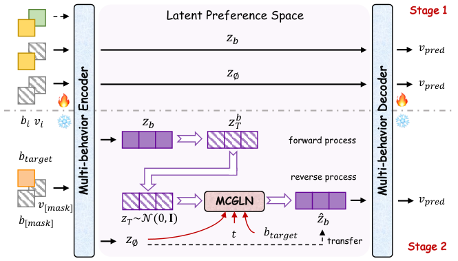

# From Agnostic to Specific: Latent Preference Diffusion for Multi-Behavior Sequential Recommendation (从行为无关到行为特定：多行为序列推荐的潜在偏好扩散)

- **会议/期刊**: KDD 2026 (ACM SIGKDD)
- **作者与机构**: Ruochen Yang, Xiaodong Li, Jiawei Sheng, Tingwen Liu 等（中科院信工所 / UCAS；快手科技）
- **推荐链路定位**: 端到端生成式召回/排序（隐空间生成 + 全库相似度检索）
- **研究方向**: 序列与会话推荐 / 生成式推荐与离散语义 ID（扩散生成）
- **论文原文**: [https://arxiv.org/abs/2602.23132v1](https://arxiv.org/abs/2602.23132v1)
- **开源代码**: [https://github.com/OrchidViolet/FatsMB](https://github.com/OrchidViolet/FatsMB)

## TL;DR (1分钟核心速览)

多行为序列推荐（MBSR）的判别式范式把推荐当作独立分类任务，受候选集限制、无法建模「低熵行为 $\to$高熵物品」的不确定性，且忽略驱动交互的行为无关潜在偏好。作者提出 FatsMB：先用带 BaRoPE 的多行为自编码器（MBAE，无 KL 惩罚）建统一偏好隐空间，再用经 MCGLN 条件去噪的 DDIM 隐扩散把行为无关表示$z_\varnothing$迁移为行为特定表示$z_b$，解码后在完整物品空间做相似度检索。在 Yelp/Retail/IJCAI 上免负采样全库排序，Recall@10 最高 +20.56%、NDCG@10 最高 +27.21%。

## Background & Motivation (背景与核心矛盾)

- **主流范式**: 融合式（MBGCN/MB-GMN 多行为图聚合）与映射式（MB-STR、PBAT、MISSL、M-GPT 从辅助行为向固定目标行为单向迁移），近期转向 behavior-specific 多目标输出。
- **前人局限**: ① 判别式打分把推荐压成 user-item 对上的条件概率判定，因果方向与「由行为意图推物品」相反，预测被候选集与历史拟合束缚，难产多样性；② 只看行为序列本身会形成感知偏差——用户反复购买运动装备，其真实潜在动机可能是对某位球星的追随，行为特定表示学到的只是行为表层。
- **核心洞察 (Key Insight)**: 信息论层面存在**物品-行为非对称确定性**：$H(B)\approx0.57\sim1.25$bit 而$H(I)\approx9.66\sim12.17$bit，且互信息$I(I,B)$ 极小（Yelp 0.0971）。即「给定物品预测行为」几乎确定，而「给定行为还原物品」高度不确定，判别式难以刻画此熵差。
- **本文切入点**: 借隐扩散模型的低维平滑隐空间与引导生成能力，把 MBSR 重构为「偏好迁移生成」问题：行为无关偏好作为迁移主体，目标行为作为条件引导。

## Method (核心方法设计)

### 1. 整体框架 (Overall Architecture)

三阶段闭环：阶段一以 Cloze 任务预训练 MBAE（BaRoPE 增强 Transformer 编码 + MLP 解码），把多行为序列压入统一隐空间，并对被掩物品的位置可掩/不掩行为类型，分别得到行为特定 $z_b$与行为无关$z_\varnothing$；阶段二冻结 MBAE，在同一隐空间内训练以$(z_\varnothing, b)$为条件的扩散去噪器完成$\varnothing\to b_t$的偏好迁移；阶段三冻结扩散模型、解冻解码器并改用 next-item 预测微调，弥合生成与解码之间的空间偏置。推理时从高斯噪声出发$T$步去噪得$z_b$，解码为物品表示后在全库做相似度检索。

<figure class="paper-figure" markdown="span">
  <figcaption>图2：我们模型的整体框架。阶段1训练MBAE以构建用于统一偏好的潜在空间。阶段2基于DM在潜在空间中实现从行为无关到行为特定的迁移。</figcaption>
</figure>

### 2. 关键设计拆解 (Key Designs)

1. **Behavior-aware RoPE (BaRoPE)**：绝对位置编码无法刻画多行为序列的位置敏感性，标准 RoPE 又无法注入行为。作者利用前文的非对称确定性——物品确定时行为几乎随之确定，故行为信息不污染同位置物品信息——把行为与位置近似解耦为乘性变换：$f'(q,a,m)=h(a)f(q,m)$、$f'(k,b,n)=h(b)f(k,n)$，其中$f(q,m)=qe^{im\theta}$、$h(\cdot)$为 MLP；注意力分数中只作用于$Q,K$，从而同时保留相对位置与行为上下文，注意力图呈现更大相关性区域并能聚焦同一物品的跨行为演化（`31_fav`$\leftrightarrow$`31_pv`）。

2. **Multi-Condition Guided Layer Norm (MCGLN)**：以往把多条件拼接后统一喂网络，语义被抹平。MCGLN 采取分离引导：$z_\varnothing$与$z_t$拼接过 MLP 作为贯穿全程的主条件，$ \hat{z}_t=z_t+\alpha_s\,\mathrm{MLP}(\mathrm{LN}(\mathrm{Concat}(z_t+z_\varnothing))\gamma_s+\beta_s)$；目标行为$b_t$作为 **MoE 硬路由**决定私有专家（CGC 结构，共享专家 + 行为私有专家）以解耦多任务冲突，$z_{t-1}=\hat{z}_t+\alpha_t\,\mathrm{MoE}(\mathrm{LN}(\hat{z}_t)\gamma_t+\beta_t,b_t)$；时间步$e_t$与行为表示$e_{b_t}$相加经 MLP 生成$(\alpha,\beta,\gamma)$调制参数。$b_t=\varnothing$（无分类器引导）时退化为仅用共享专家。

3. **训练目标、负采样与推理效率**：$\mathcal{L}_{MBAE}=\mathbb{E}[\log q_\psi(v_{[mask]}|z_b)]$；扩散项$\mathcal{L}_{LDM}=\mathbb{E}\|\epsilon-\epsilon_\theta(z_t,t,z_\varnothing,b)\|^2$，训练时以$p=0.2$丢弃行为条件，推理用$\epsilon^*_\theta=(1+\omega)\epsilon_\theta(z_t,t,z_\varnothing,b)-\omega\epsilon_\theta(z_t,t,z_\varnothing,\varnothing)$平衡准确与多样。**完全不做负采样**，靠生成物品向量 + 全库相似度检索。时间开销$O(L^2d+(1+T/\Delta t)Ld^2)$，实验取$T=200,\Delta t=20$（即 10 步有效去噪），空间开销与 SOTA 基线同量级。

## Experimental Setup & Evaluation Protocol (实验设置与评估协议)

| 数据集 | #Users | #Items | #Interactions | 密度 | 行为类型 |
| :--- | :---: | :---: | :---: | :---: | :--- |
| Yelp | 19,800 | 22,734 | 1.4×10⁶ | 3.1e-3 | tip / dislike / neutral / like |
| Retail (Taobao) | 147,894 | 99,037 | 7.6×10⁶ | 5.2e-4 | click / fav / cart / buy |
| IJCAI | 423,423 | 874,328 | 3.6×10⁷ | 9.7e-5 | click / fav / cart / buy |

- **数据划分与防穿越**: 沿用 MBSR 常规预处理，每用户**最后一条交互作测试、其余作训练**（类似 Leave-One-Out 的序列切分）；与基线不同之处在于测试集**不指定固定目标行为**，包含多种行为的目标物品。
- **排名评测协议**: 无偏 **Full-Ranking**（全库未交互物品排序，明确"不构造负采样候选集"），指标 Recall@{10,20}、NDCG@{10,20}；训练侧亦无负采样（生成式解码）。
- **对比基线与超参**: 单行为序列（BERT4Rec, DiffuRec）、多行为非序列（MBGCN, MB-GMN）、多行为序列（MB-STR, PBAT, MISSL, M-GPT）；$d=64$、$L=50$、编码器 2 层 Transformer、去噪器 2 层 MCGLN、AdamW lr=$2e-3$、dropout 0.1、V100 32G。

## Key Experimental Results (实验关键数据)

### 1. 主实验对比 (Main Results)

| 模型 | Yelp R@10 | Yelp N@10 | Yelp N@20 | Retail R@10 | Retail N@10 | IJCAI R@10 | IJCAI N@10 |
| :--- | :---: | :---: | :---: | :---: | :---: | :---: | :---: |
| BERT4Rec | 0.0501 | 0.0245 | 0.0331 | 0.1414 | 0.0811 | 0.2386 | 0.1473 |
| DiffuRec | 0.0526 | 0.0280 | 0.0362 | 0.1476 | 0.0860 | 0.2811 | 0.1702 |
| MBGCN | 0.0497 | 0.0229 | 0.0323 | 0.1398 | 0.0801 | 0.2274 | 0.1401 |
| MB-GMN | 0.0517 | 0.0257 | 0.0343 | 0.1434 | 0.0829 | 0.2408 | 0.1488 |
| MB-STR | 0.0545 | 0.0275 | 0.0372 | 0.1532 | 0.0887 | 0.2904 | 0.1999 |
| MISSL | 0.0541 | 0.0283 | 0.0376 | 0.1485 | 0.0854 | 0.2786 | 0.1792 |
| M-GPT | 0.0528 | 0.0250 | 0.0346 | 0.1593 | 0.0908 | 0.2847 | 0.1826 |
| **FatsMB** | **0.0657** | **0.0360** | **0.0454** | **0.1860** | **0.1103** | **0.3305** | **0.2160** |
| Improv.% | +20.56% | +27.21% | +20.74% | +16.76% | +21.48% | +13.81% | +8.05% |

### 2. 消融实验 (Ablation Study)

| 变体 | Yelp R@20 / N@20 | Retail R@20 / N@20 | IJCAI R@20 / N@20 |
| :--- | :---: | :---: | :---: |
| MBAE w/ APE | 0.0936 / 0.0381 | 0.2183 / 0.1103 | 0.3701 / 0.2105 |
| MBAE w/ RoPE | 0.0981 / 0.0430 | 0.2252 / 0.1170 | 0.3712 / 0.2096 |
| MBAE w/ **BaRoPE** | **0.1003 / 0.0438** | **0.2280 / 0.1189** | **0.3880 / 0.2227** |
| FatsMB w/ MLP-cond | 0.0980 / 0.0432 | 0.2279 / 0.1197 | 0.3798 / 0.2211 |
| FatsMB w/ AdaLN | 0.1019 / 0.0447 | 0.2286 / 0.1195 | 0.3857 / 0.2253 |
| **FatsMB (MCGLN)** | **0.1034 / 0.0454** | **0.2342 / 0.1223** | **0.3981 / 0.2331** |

### 3. 关键实验发现 (Key Findings)

1. **BaRoPE 是隐空间的性能上限抓手**：相对 APE，Yelp R@20 由 0.0936 升至 0.1003（+7.2%）；即使对比标准 RoPE 仍稳定增益（IJCAI R@20 +4.5%），说明"行为乘性调制 + 相对位置"比单纯绝对位置更能刻画跨行为因果链。
2. **朴素条件融合会反噬**：Yelp 上 `w/ MLP-cond` 的 R@20=0.0980 甚至低于预训练 MBAE 的 0.1003，说明条件粗暴拼接会在去噪中破坏隐空间；MCGLN 的分离调制则带来 +3.0%（Yelp）与 +2.8%（Retail）的一致性回升，验证 MoE 硬路由解耦多行为冲突的必要性。
3. **迁移能力带来稀疏鲁棒性**：在 Yelp 对 `like` 行为做 omission 实验时，轻微缺失（0.2）几乎不影响 FatsMB，而 MB-STR 明显下降；omission=1.0 的零样本设置下基线近乎崩溃，FatsMB 仍保有可用 Recall@20，说明 $z_\varnothing$ 承载了跨行为的可迁移先验，而非仅拟合目标行为分布。

## Highlights & Limitations (亮点、对比与审稿批判)

- **与代表作对比**: 相比 MB-STR / MISSL 的"行为单向映射 + 判别式打分"，本文改为隐空间生成式迁移，既摆脱候选集约束又显式建模熵差；相比 DiffuRec / DreamRec 在物品/序列**原始空间**扩散，本文把扩散搬到 AE 压缩的偏好隐空间（LDM 思路），并首次将隐扩散用于 MBSR；相比 M-GPT 的自回归生成，本文用 DDIM 条件生成并引入 CFG，可控性更强。
- **可迁移亮点**: ① 行为感知的乘性位置编码（$h(a)f(q,m)$）可直接移植到任意多行为/多场景 Transformer 排序器，代价极低；② "预训练 AE → 冻结 AE 训扩散 → 解冻解码器微调"的三阶段解耦训练范式，可为其他隐空间生成式推荐提供工程模板。
- **审稿级局限批判**: ① 推理需 10 步级迭代去噪，工业级毫秒响应场景部署成本明显高于单次前向的 MB-STR，论文只给复杂度量级而未给实测 QPS 延迟对齐；② 论文以"多样性"为核心卖点却只报告 Recall/NDCG 等准确率指标，缺少覆盖率/新颖度/熵等多样性度量（图 1 的动机未被定量证实）；③ 去掉 KL 正则的 AE 隐空间虽利于重构，但分布平滑性缺乏保证，可能对未见行为组合的生成稳定性不利；④ 三阶段训练引入的扩散-解码器空间偏置仅靠微调弥合，超参 $\omega$ 在不同数据集最优值不一致（图 8e），跨域迁移需重新调参。

## Rating (四维评分)

- **方法创新性 (Novelty)**: ⭐⭐⭐⭐ （首次将隐扩散 + CFG 引入 MBSR，BaRoPE 的非对称确定性解耦推导有新意，但 LDM/AdaLN/MoE 组件本身均为成熟拼装）
- **评估协议与实验扎实度 (Protocol & Experiments)**: ⭐⭐⭐⭐ （免负采样全库排序 + 三数据集 + 7 个 SOTA 基线，消融与少样本/零样本分析完整；缺多样性指标与显著性检验）
- **写作与数学规范度 (Clarity & Rigor)**: ⭐⭐⭐⭐ （BaRoPE 与 MCGLN 公式链条清晰，附复杂度分析与附录推导；部分符号 $b$/$b_t$、$\alpha_s$/$\alpha_t$ 复用易混淆）
- **工业落地与复现价值 (Industrial & Practical Value)**: ⭐⭐⭐⭐ （代码已开源、空间复杂度与基线同量级；但多步去噪推理延迟与三阶段训练成本是线上部署的主要门槛）

