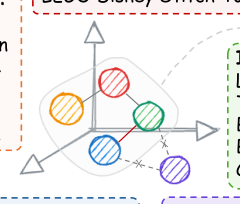
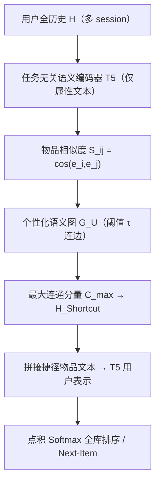
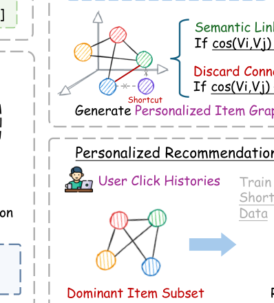

# LISRec: Modeling User Preferences with Learned Item Shortcuts for Sequential Recommendation (基于学习物品捷径的序列推荐用户偏好建模)

- **会议/期刊**: KDD 2026
- **作者与机构**: Haidong Xin, Zhenghao Liu, Sen Mei, Yukun Yan, Shi Yu, Shuo Wang, Zulong Chen, Yu Gu, Ge Yu, Chenyan Xiong；东北大学、清华大学、阿里巴巴、CMU
- **推荐链路定位**: 召回 / Next-Item 全库排序
- **研究方向**: 序列与会话推荐 / 自监督对比学习与交互去噪
- **论文原文**: [论文原文链接](https://arxiv.org/abs/2505.22130v2)
- **开源代码**: [开源代码仓库链接](https://github.com/NEUIR/LISRec)

## TL;DR (1分钟核心速览)

针对序列推荐历史中临时点击稀释真实偏好的痛点，LISRec 用任务无关文本语义学习物品相似度，为每个用户构建个性化语义图并取最大连通分量作为“语义捷径”，显式剔除离群交互后再训练推荐主干。在 Amazon Beauty/Sports/Toys 与 Yelp 上采用全库排序，较 TASTE 最高提升约 14.5% R@20，且可插拔到 Bert4Rec 等主干。

## Background & Motivation (背景与核心矛盾)

- **主流范式**: ID-based 序列模型（SASRec/Bert4Rec）与文本增强模型（TASTE/HLLM）通常把用户全部历史等权编码，默认每次点击都反映偏好。
- **前人局限**: ①损失重加权/对比学习式去噪多为隐式降权，无法显式删除离群交互，可解释性弱；②DSAN/HSD 等显式过滤依赖稀疏 ID 表征，难以利用物品文本语义，在冷物品或短历史上不稳定。
- **核心洞察 (Key Insight)**: 稳定偏好对应的物品在语义空间往往形成高相似度簇；偶然点击则与多数历史物品相似度低，在阈值图中表现为孤立点。
- **本文切入点**: 先学习任务无关物品语义，再为每个用户构图，以最大语义连通子集作为偏好捷径，替代原始噪声历史。

<figure class="paper-figure" markdown="span">
  <figcaption>图 1：我们的 LISRec 方法示意图。LISRec 构建个性化语义交互图并提取表示主导项目子集的捷径，这些子集为偏好建模提供去噪的用户表示。</figcaption>
</figure>

## Method (核心方法设计)

### 1. 整体框架 (Overall Architecture)

LISRec 分两阶段：先用仅含属性文本、去除 ID 的物品描述做指令式 next-item 预训练，得到可跨数据集迁移的物品语义空间；再对每个用户的全历史物品按余弦相似度与阈值 $\tau$构图，取最大连通分量作为语义捷径$\mathcal{H}_{\text{Shortcut}}$；最后将捷径物品文本拼接后送入 T5 得到去噪用户表示，与候选物品表示点积做全库 softmax 排序。图 2 给出完整架构。

<figure class="paper-figure" markdown="span">
  <figcaption>图 2：LISRec 的模型架构。</figcaption>
</figure>

### 2. 关键设计拆解 (Key Designs)

1. **任务无关语义物品编码（去 ID 化）**：ID 表征受稀疏共现限制，跨域泛化差。本文用属性模板 $\tilde{X}(v)=\text{Attr}_1:v(\text{Attr}_1)\ldots$去除物品 ID，仅保留文本属性，并以指令式 NIP 目标训练 T5，得到$\boldsymbol{e}_v=\mathrm{T5}(\tilde{X}(v))$。这样相似度由语义而非热度/ID 共现决定，离群点击更易暴露。

2. **个性化语义图与最大连通分量捷径**：对用户历史中任意物品对计算 $S_{ij}=\cos(\boldsymbol{e}_{v_i},\boldsymbol{e}_{v_j})$，仅当$e_{ij}=\mathbb{I}[S_{ij}\ge\tau]$时连边；再取最大连通分量$C_{\max}=\arg\max_{C_i}|V(C_i)|$，定义$\mathcal{H}_{\text{Shortcut}}=\{v_j\in\mathcal{H}\mid v_j\in V(C_{\max})\}$。与所有簇都低相似的噪声物品无法进入主连通分量，从而被显式剔除；同时保留语义一致的主导偏好子集。

3. **训练目标、负采样与推理效率**：语义编码器与推荐模块均用 next-item 交叉熵 $\mathcal{L}=-\log P(v_t|\mathcal{H}_S)$，其中$P(v|\mathcal{H}_S)=\mathrm{softmax}_v(\boldsymbol{e}_{\mathcal{H}_S}^{\top}\boldsymbol{e}_v)$；训练采用 in-batch negatives，无额外 hard negative。$M_{\text{Filter}}$用多数据集指令预训练，$M_{\text{Rec}}$用捷径历史微调；推理时构图排除最后一项防穿越，阈值默认$\tau=0.7$，需对每用户历史做$O(n^2)$ 相似度与连通分量计算。

## Experimental Setup & Evaluation Protocol (实验设置与评估协议)

- **数据集与预处理**: 采用 Amazon Beauty/Sports/Toys 与 Yelp，沿用 TASTE 常用 5-core 版本；正文将详细统计置于附录 A.2。下表按该版本列示，精确值以原文附录为准。

| 数据集 | #Users | #Items | #Interactions | 稀疏度/密度 | 特征/场景说明 |
| :--- | :---: | :---: | :---: | :---: | :--- |
| Amazon Beauty | 22,363 | 12,101 | 198,502 | ≈99.927% / 0.073% | 美妆，属性文本丰富 |
| Amazon Sports | 35,598 | 18,357 | 296,337 | ≈99.955% / 0.045% | 运动户外，文本属性 |
| Amazon Toys | 19,412 | 11,924 | 167,597 | ≈99.928% / 0.072% | 玩具，属性文本 |
| Yelp | 30,431 | 20,033 | 316,354 | ≈99.948% / 0.052% | 本地生活/POI，类别与地址文本 |

- **数据划分与防穿越 (Splitting Strategy)**: 沿用 TASTE 的 `Leave-One-Out` 协议，最后一项为测试、倒数第二项为验证；构图时排除最后交互，避免测试标签泄漏。
- **排名评测协议 (Ranking Protocol)**: 采用无偏 `Full-Ranking`（全库未交互物品排序），报告 Recall@10/20 与 NDCG@10/20；训练用 in-batch negatives，评估未采用采样负例。
- **对比基线与超参设置**: 基线覆盖 ID-based（GRU4Rec、Bert4Rec、SASRec、S3Rec、NOVA、ICAI-SR、DIF-SR）、文本（CoWPiRec、DWSRec、HLLM、TASTE）与去噪（DSAN、HSD、DCRec）。T5-base 初始化，$M_{\text{Filter}}$学习率 1e-4、batch 32；$M_{\text{Rec}}$学习率 1e-4、batch 8、warm-up 0.1；$\tau=0.7$；显著性用 permutation test，$P<0.05$。

## Key Experimental Results (实验关键数据)

### 1. 主实验对比 (Main Results)

下表从原文表 1 抽取 5 个代表性基线，保留 R@10 与 N@20；LISRec 以 TASTE 为主干。`Δ` 为相对该行最优基线。

| 数据集 | 指标 | SASRec | DIF-SR | DWSRec | HLLM | TASTE | LISRec | Δ vs 最优基线 |
| :--- | :---: | :---: | :---: | :---: | :---: | :---: | :---: | :---: |
| Beauty | R@10 | 0.0828 | 0.0908 | 0.0989 | 0.0887 | 0.1030 | **0.1249** | +21.3% |
| Beauty | N@20 | 0.0464 | 0.0541 | 0.0597 | 0.0588 | 0.0649 | **0.0772** | +18.9% |
| Sports | R@10 | 0.0526 | 0.0556 | 0.0629 | 0.0555 | 0.0633 | **0.0721** | +13.9% |
| Sports | N@20 | 0.0295 | 0.0325 | 0.0396 | 0.0360 | 0.0421 | **0.0463** | +10.0% |
| Toys | R@10 | 0.0831 | 0.1013 | 0.0967 | 0.0928 | 0.1232 | **0.1304** | +5.8% |
| Toys | N@20 | 0.0460 | 0.0597 | 0.0585 | 0.0616 | 0.0780 | **0.0786** | +0.8% |
| Yelp | R@10 | 0.0650 | 0.0698 | 0.0702 | 0.0659 | 0.0738 | **0.0749** | +1.5% |
| Yelp | N@20 | 0.0471 | 0.0496 | 0.0482 | 0.0504 | 0.0502 | **0.0509** | +1.0% |

### 2. 消融实验 (Ablation Study)

原文表 3 的消融：所有变体均以 Bert4Rec 或 TASTE 主干对照，下表为 R@20 / N@20 成对结果。

| 变体 | Beauty | Sports | Toys | Yelp |
| :--- | :---: | :---: | :---: | :---: |
| LISRec (Zero-Shot) | 0.1631/0.0697 | 0.1014/0.0420 | 0.1797/0.0786 | 0.1158/0.0504 |
| w/o $M_{\text{Filter}}$ | 0.1550/0.0649 | 0.0964/0.0421 | 0.1789/0.0780 | 0.1156/0.0502 |
| w/o $M_{\text{Rec}}$ Training | 0.1655/0.0727 | 0.1047/0.0433 | 0.1836/0.0796 | 0.1165/0.0504 |
| w/o $M_{\text{Filter}}$ Training | 0.1761/0.0762 | 0.1073/0.0457 | 0.1879/0.0802 | 0.1169/0.0507 |
| LISRec | **0.1774/0.0772** | **0.1082/0.0496** | **0.1896/0.0826** | **0.1173/0.0509** |

### 3. 关键实验发现 (Key Findings)

- **语义捷径是主要增益源**：Beauty 上移除 $M_{\text{Filter}}$ 后 R@20 从 0.1774 降至 0.1550（−12.6%），N@20 从 0.0772 降至 0.0649（−15.9%）；Sports R@20 0.1082→0.0964（−10.9%）。显式剔除离群交互比单纯换主干更关键。
- **$M_{\text{Filter}}$ 的多数据集任务无关预训练有效但增益温和**：Beauty 上 Zero-Shot 为 0.1631，完整模型 0.1774；表 4 中 Vanilla T5 过滤为 0.1761、TASTE 过滤为 0.1767，均低于完整 0.1774，说明“去 ID + 多数据集平衡预训练”带来稳定小增益。
- **可插拔去噪在 ID 主干上同样成立，但存在域差异**：Bert4Rec 主干下 Beauty R@20 0.0904 vs DCRec 0.0869（+4.0%），Sports +5.2%，Toys +4.7%，Yelp +2.5%，平均约 +4.7%；Yelp 增益最小，说明 POI 类别多样、即时点击更复杂时，单一语义连通性过滤更受限。

## Highlights & Limitations (亮点、对比与审稿批判)

- **与代表作对比 (vs. Prior Work)**: TASTE/HLLM 对全历史等权编码，无法显式删噪；DCRec 用对比学习隐式降权且绑定特定主干；DSAN/HSD 显式过滤但依赖 ID 共现。LISRec 首次用文本语义图最大连通分量做“前置显式过滤器”，可插拔到 ID/文本主干。
- **可迁移亮点**: ①去 ID 的任务无关物品编码可用于跨域冷物品语义对齐；②“阈值图 + 最大连通分量”可作为任意序列推荐器的后处理去噪模块，无需改主干结构。
- **审稿级局限批判**: ①$\tau$敏感，原文最佳多在 0.5–0.6，默认 0.7 非最优；最大连通分量可能丢弃真实的少数兴趣，多兴趣用户存在欠建模风险；②T5 编码与每用户$O(n^2)$ 构图增加推理开销，短历史/冷启动时图可靠性不足；③仅离线四个数据集，缺少线上 A/B 与延迟统计。

## Rating (四维评分)

- **方法创新性 (Novelty)**: ⭐⭐⭐⭐ （用语义图最大连通分量做显式交互去噪，角度清晰，但本质是规则化子集选择，理论分析有限）
- **评估协议与实验扎实度 (Protocol & Experiments)**: ⭐⭐⭐⭐ （四个数据集、全库排序、显著性检验与多组消融较完整，但缺线上与效率实验）
- **写作与数学规范度 (Clarity & Rigor)**: ⭐⭐⭐⭐ （流程与公式简洁，附录承载统计；复杂度与阈值选择分析略简）
- **工业落地与复现价值 (Industrial & Practical Value)**: ⭐⭐⭐ （开源可复现、可插拔，但 T5 编码与逐用户构图带来在线成本，需工程优化）

