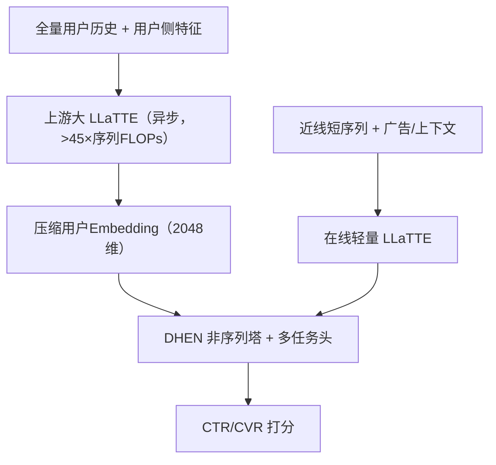

# LLaTTE: Scaling Laws for Multi-Stage Sequence Modeling in Large-Scale Ads Recommendation (大规模广告推荐中多阶段序列建模的缩放定律)

- **会议/期刊**: KDD 2026
- **作者与机构**: Lee Xiong、Zhirong Chen、Rahul Mayuranath 等，Meta AI
- **推荐链路定位**: 精排（在线轻量序列精排 + 异步上游用户建模）
- **研究方向**: 序列与会话推荐 / CTR-CVR 预估与特征交叉
- **论文原文**: [论文原文链接](https://arxiv.org/abs/2601.20083v1)
- **开源代码**: 暂未开源

## TL;DR (1分钟核心速览)

LLaTTE 针对工业广告推荐中“序列模型受在线延迟约束、深度/长上下文难以扩展”的痛点，提出可独立扩展的 Target-Aware MLA 序列模块与异步两阶段架构，并系统验证推荐序列建模同样服从幂律缩放。生产 A/B 上实现约 0.25% NE 降低、Facebook Feed/Reels 转化提升 4.3%。

## Background & Motivation (背景与核心矛盾)

- **主流范式**: 工业系统以 FM/DHEN 类模型处理海量稀疏 ID 与稠密特征，再叠加浅层序列模块；纯序列架构则倾向将序列与非序列特征紧耦合。
- **前人局限**: 一是深序列模型的计算需求与毫秒级、万亿请求级在线延迟直接冲突；二是现有工作多单独考察深度或长度，忽略宽度瓶颈、语义特征丰富度及跨阶段信息瓶颈。
- **核心洞察 (Key Insight)**: 推荐系统的缩放曲线并非只由参数量决定；高质量语义内容特征是使深度与长上下文“值得扩展”的前置条件，可显著弯曲缩放斜率。
- **本文切入点**: 用模块化 LLaTTE 解耦序列与非序列计算，再以“在线短序列精排 + 异步长序列用户模型”把重计算移出请求路径。

## Method (核心方法设计)

### 1. 整体框架 (Overall Architecture)

输入包括用户行为序列 $\mathbf{S}_u$、候选广告/上下文、稀疏 ID 与稠密语义特征。序列模块把候选或用户查询编码为 query token，与历史 token 拼接后经$L$ 层 MLA Transformer 与金字塔式旧 token 裁剪，输出定长摘要；DHEN 非序列塔融合摘要与静态特征，最后由 CTR/CVR 多头输出。上游异步模型仅用用户侧特征、以更长历史和更大容量生成 2048 维用户 embedding 并写入特征库；在线精排读取缓存 embedding，同时用轻量 LLaTTE 处理近线短序列与广告上下文。

### 2. 关键设计拆解 (Key Designs)

1. **Target-Aware MLA 序列模块**：传统序列塔难以在长上下文下独立扩容，且与 FM 塔耦合限制部署弹性。LLaTTE 将序列输入扩展为 $\mathbf{X}_{in}=[\mathbf{S}_u;\mathbf{Q}]$，其中$\mathbf{Q}$ 在线阶段含广告候选、上游阶段仅含用户上下文；再用 MLA 压缩 KV 表示、用金字塔裁剪降低深层旧 token 计算。其有效性在于同一架构可跨离线/在线阶段复用，同时把 90% 以上 FLOPs 集中在可扩展的序列模块。
2. **异步两阶段与可迁移性度量**：在线延迟不允许直接放大模型，本文将大模型置于由高价值事件（主要为转化）触发的异步服务，在线仅做一次 embedding 查询。定义迁移率 $\tau=\Delta NE_{down}/\Delta NE_{up}$，用以衡量上游表征经过固定带宽瓶颈后还能保留多少排序收益。实验显示$\tau\approx50\%$，说明高层意图信号对压缩与异步滞后具有鲁棒性。
3. **内容感知缩放律与训练目标**：将序列计算预算 $C$与 NE 增益建模为$\Delta NE(C)=-\alpha\log_{10}C+\beta$，不同扩展轴的$\alpha$ 不同：序列长度 0.265、深度 0.200、宽度 0.133、无内容特征仅 0.082。训练采用加权多任务 BCE，无学术场景负采样；推理时上游约 92 GFLOPS/sample，在线模型仅保留短历史与浅层 LLaTTE，以缓存读取换取容量扩展。

## Experimental Setup & Evaluation Protocol (实验设置与评估协议)

- **数据集与预处理**: 论文使用 Meta 生产广告流量，未公开用户/物品统计；训练集为按生产分布采样的 300 亿样本，序列长度覆盖 200–5000，训练 229K steps，128 张 H100。

| 数据集 | #Users | #Items | #Interactions | 稀疏度/密度 | 特征/场景说明 |
| :--- | :---: | :---: | :---: | :---: | :--- |
| Meta Production Ads | 未披露 | 未披露 | 300 亿训练样本 | 极稀疏 ID + 稠密语义 | Facebook Feed/Reels 广告，CTR/CVR 多任务 |

- **数据划分与防穿越**: 论文未披露用户级或全局时间戳切分细节，仅说明按生产流量分布采样训练；上线评估采用大规模 A/B，非公开学术划分。
- **排名评测协议**: 非 `Full-Ranking` 学术协议，采用工业 `Normalized Entropy (NE)` 相对生产基线评估，NE 降低 0.02% 即视为显著并具收入影响。
- **对比基线与超参设置**: 原文未给出公开 SOTA 基线，主要对比强生产基线、深度/宽度/长度配置、ID-only 与内容增强、上游/下游配置；网格为 $L\in\{1,2,4,8\}$、$d\in\{128,256,512,1024\}$、$T\in\{200,400,800,1600\}$，部分至 5000。

## Key Experimental Results (实验关键数据)

### 1. 主实验对比 (Main Results)

原文无公开 SOTA 表；下表汇总最具代表性的容量分配、内容增强与跨阶段结果（NE 相对基线，负值更优）。

| 配置 | L | d | 序列设置 | ΔNE↓ | 相对基线提升 |
| :--- | :---: | :---: | :--- | :---: | :---: |
| Production Baseline | - | - | 生产浅层序列 | 0.00% | - |
| Deep-Narrow | 8 | 128 | T=400 | -0.10% | 0.10% |
| Balanced | 4 | 256 | T=400 | -0.14% | 0.14% |
| **Deep-Balanced** | **8** | **256** | **T=400** | **-0.17%** | **0.17%** |
| Wide-Shallow | 2 | 1024 | T=400 | -0.08% | 0.08% |
| ID-only 4L | 4 | 256 | 仅稀疏 ID | -0.01% | 0.01% |
| Content 4L | 4 | 256 | 稀疏 ID+语义 | -0.118% | 0.118% |
| Upstream Seq-heavy | 3 | 512 | T=1000，上游 | -0.14% | 下游 -0.07%，$\tau\approx50\%$ |

### 2. 消融实验 (Ablation Study)

| 消融项 | 对比设置 | ΔNE 变化 | 结论 |
| :--- | :--- | :---: | :--- |
| w/o 内容语义（4L） | ID-only vs 内容增强 | -0.01% vs -0.118% | 移除语义后增益缩小约 0.108pp |
| w/o 宽度保障 | d=128 vs d=256，L=8 | -0.10% vs -0.17% | 窄模型深度扩展受限 |
| 纯浏览序列 | 1000 views vs 500/500 | +0.15% vs 0.00% | 低信号事件过多，显著退化 |
| 纯转化序列 | 1000 conv vs 500/500 | +0.105% vs 0.00% | 高价值但时间稀疏，覆盖不足 |
| 上游 Seq-heavy vs Model-heavy | T=1000 vs T=460，同算力 | 下游均 -0.07% | 总算力决定迁移收益 |

### 3. 关键实验发现 (Key Findings)

- **语义特征是缩放“倍增器”而非附加项**：4 层 ID-only 仅 -0.01%，同深度内容增强达 -0.118%，说明无内容时新增容量主要被用于记忆 ID 模式，深度扩展斜率被压低。
- **宽度是深度扩展的前置容量阈值**：d=128、L=8 仅 -0.10%，而 d=256、L=8 达 -0.17%；但 L=2、d=1024 仅 -0.08%，过度堆宽计算效率低。
- **两阶段迁移在工业瓶颈下仍高效**：Seq-heavy 与 Model-heavy 上游分别 -0.14%/-0.13%，下游均 -0.07%，$\tau$ 约 50%–53%；线上组合取得 0.25% NE 降低与 4.3% 转化提升。

## Highlights & Limitations (亮点、对比与审稿批判)

- **与代表作对比 (vs. Prior Work)**: HSTU/OneTrans 倾向纯序列紧耦合，InterFormer 在每层交织序列与非序列计算，均不利于独立扩展与在线/离线拆分；LLaTTE 以模块化解耦 + 异步上游模型实现同一架构跨阶段缩放。相较 TransAct 类多阶段系统，本文进一步给出显式幂律斜率与迁移率 $\tau$，并部署 >45× 序列 FLOPs 的上游模型。
- **可迁移亮点**: 将“语义内容质量”作为缩放曲线的乘子纳入容量规划；用 $\tau$ 评估异步表征对在线精排的真实转化率，可指导上游算力预算分配。
- **审稿级局限批判**: 全部实验基于 Meta 私有流量，无公开数据与标准 SOTA 复现；异步 embedding 存在滞后与 2048 维固定瓶颈，长序列还带来日志物化与存储成本，论文未充分量化这些工程代价及跨场景泛化性。

## Rating (四维评分)

- **方法创新性 (Novelty)**: ⭐⭐⭐⭐ （模块化 LLaTTE 与异步两阶段结合，首次系统建立推荐多阶段架构的缩放律与迁移率）
- **评估协议与实验扎实度 (Protocol & Experiments)**: ⭐⭐⭐ （工业 A/B 与大规模消融扎实，但缺公开数据集、标准 Full-Ranking 基线和切分细节）
- **写作与数学规范度 (Clarity & Rigor)**: ⭐⭐⭐⭐ （缩放公式、$\alpha$斜率与$\tau$ 定义清晰，工程约束交代充分）
- **工业落地与复现价值 (Industrial & Practical Value)**: ⭐⭐⭐⭐⭐ （Meta 最大用户模型部署，0.25% NE/4.3% 转化提升，近乎零在线延迟增量，极具工业参考价值）

