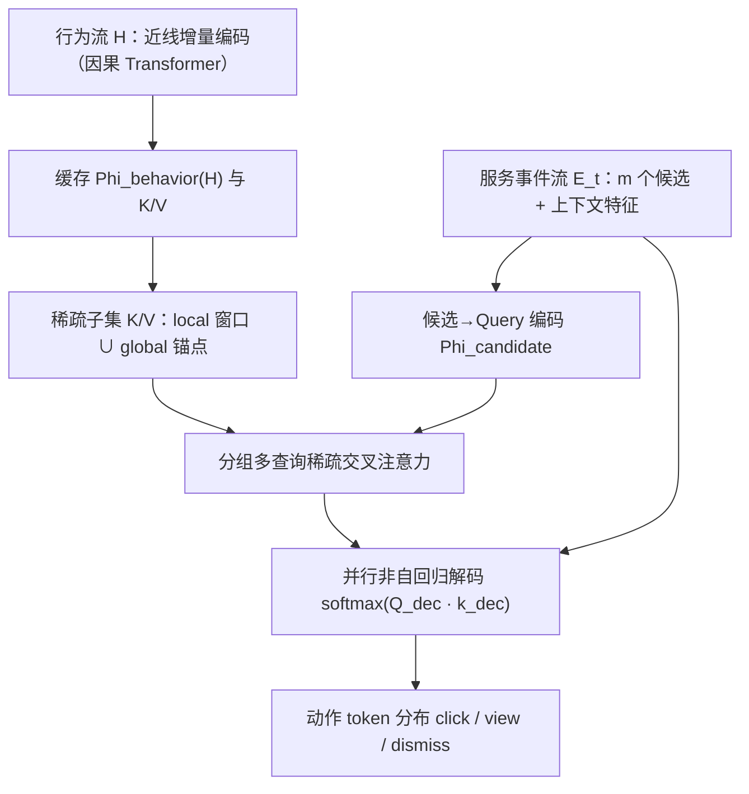
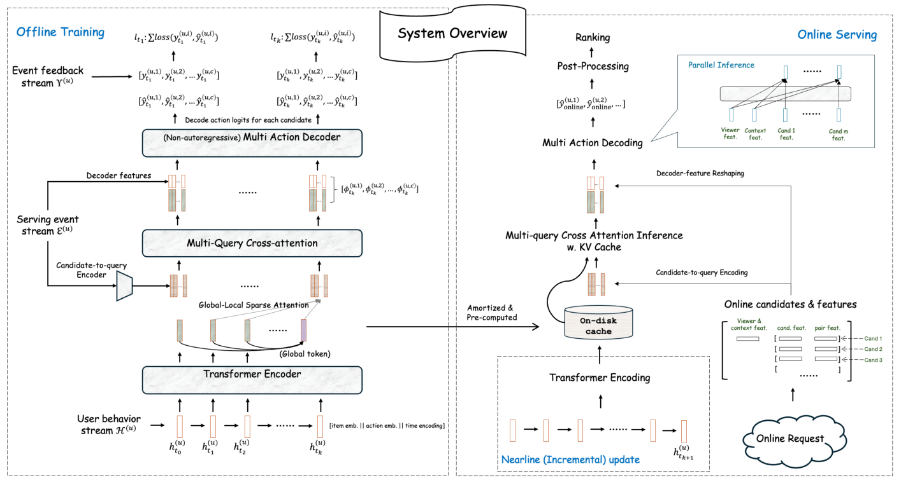
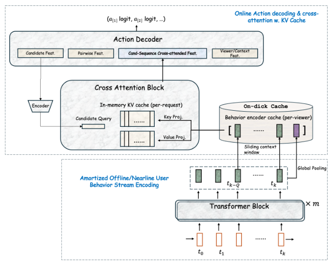

# TransX: Scaling Transformer-based Recommendation via Behavioral and Serving Stream Crossings (通过行为流与服务流交叉扩展 Transformer 推荐)

- **会议/期刊**: KDD 2026 (ACM SIGKDD V.2)
- **作者与机构**: Da Xu, Liyan Fang, Divya Venugopalan, Sunny Hsu, Xukai Wang, Rishav Roy Chowdhury, Cindy Liang, Nishant Satya Lakshmikanth（LinkedIn）
- **推荐链路定位**: 精排 / 端到端序列转导（可扩展至召回+精排统一）
- **研究方向**: 序列与会话推荐 / 生成式推荐、工业架构
- **论文原文**: [https://arxiv.org/abs/2607.28940v1](https://arxiv.org/abs/2607.28940v1)
- **开源代码**: 暂未开源

## TL;DR (1分钟核心速览)

工业界“单体 token 流”式生成推荐把用户长期行为与系统实时曝光压成一条序列，既混淆二者因果角色，又迫使每个候选请求重编码整段行为前缀，服务成本爆炸。TransX 将其重构为**双流序列到序列动作转导**：行为流单独用因果 Transformer 近线编码并缓存，候选侧以分组多查询稀疏交叉注意力（最近 $L_{\text{local}}$ 窗口 + 全局池化锚点）即时“交叉”，再用 query–key softmax 头**并行非自回归**解码动作 token。在 LinkedIn 180 天行为窗的时序切分数据集上，AUC 0.862 / gAUC 0.648 超越 TransAct、GRM，离线算力相当但**在线算力仅约 20%**；线上 A/B 取得 CTR +6.0%、CVR +4.4%，p99 延迟降低最多 83%。

## Background & Motivation (背景与核心矛盾)

- **主流范式**: 一路是以 DIN/BST/TransAct 为代表的序列精排，用注意力把近期行为压成定长向量再与稀疏特征交叉；另一路是 GRM/OneRec/MTGR 式生成推荐，把所有异构信号序列化进一个单体 token 流做 next-action 预测。
- **前人局限**: (1) **语义混淆**——用户自发行为（搜索、主页浏览）与系统投放的候选列表（serving slate）服从完全不同的生成过程与时间语义，被强行拍平到同一序列后模型无法区分“谁因谁果”；(2) **算力冗余**——单体化拉长序列并对每个请求重复编码完整行为前缀，序列越长延迟越不可控。
- **核心洞察**: 推荐本质是**对偶流过程**，用户响应 = 长期行为轨迹与当期投放列表的交叉结果；因此昂贵的行为编码应被摊销到近线，在线只做轻量的“交叉 + 解码”。
- **本文切入点**: 用编码器–解码器的不对称结构显式解耦两流，把交叉注意力当作“行为×候选”的算子，并让 K/V 可缓存、动作可并行解码。

## Method (核心方法设计)

### 1. 整体框架 (Overall Architecture)

输入分为三流：服务事件流 $\mathcal{E}^{(u)}_t=\{c^{(u,j)}_t,x^{(u,j)}_t\}_{j=1}^{m_t}$、反馈/动作流$\mathcal{Y}^{(u)}_t$与用户行为流$\mathcal{H}^{(u)}=\{h^{(u)}_{\tilde t}\}$（注意$\tilde t$与事件时间$t$并不对齐）。行为流经因果自注意力的 Transformer 编码器$\Phi_{\text{behavior}}$得到上下文表示（离线/近线一次左到右前向即可、前缀可切片复用）；服务事件中的$m$个候选经 MLP 编码为 query，对行为表示中“局部窗口 + 全局锚点”组成的稀疏子集做分组多查询交叉注意力；最后由共享动作词表 query 对各候选的交叉表示并行打分，输出每个候选在$\{$click, view, dismiss$\}$上的分布。训练为单遍 seq2seq，推理靠近线缓存 + KV cache 把在线成本与行为长度$L$ 解耦。

<figure class="paper-figure" markdown="span">
  <figcaption>图1：TransX 的端到端系统概览，展示离线训练与在线服务的统一设计。左：每个用户仅进行一次前向–反向传播的离线序列到序列训练。右：在线服务时，候选查询通过分组多查询交叉注意力关注缓存的用户行为表示，随后进行并行（摊销）非自回归动作解码。</figcaption>
</figure>

### 2. 关键设计拆解 (Key Designs)

1. **分组多查询稀疏交叉注意力（Stream Crossing）**：直接从行为序列端到端建模会让候选与全历史做 $O(mL)$注意力，既慢又噪声大。作者让同一 event 内$m$个候选**共享** K/V、仅保留候选专属 Q，并把注意力限制在$I_t=I_{t,\text{local}}\cup I_{t,\text{global}}$（最近$L_{\text{local}}$ 个 token + attention-pooling 得到的长期偏好锚点）：
$$\text{Attn}=\text{softmax}\!\left(\frac{QK_{I}^{\top}}{\sqrt{d_h}}\right)V_{I},\quad Q=\Phi_{c,t}W_Q,\ K=\Phi_{b,t}W_K,\ V=\Phi_{b,t}W_V$$
直觉是“短期意图靠近邻、长期偏好靠锚点”，稀疏化后在线复杂度降为 $O(mL_{\text{local}})$而非$O(mL)$，且 K/V 天然可缓存。

2. **query–key softmax 并行动作解码（Calibration-aware Decoder）**：常规做法让候选表示直接过 MLP 出 logit，跨候选、跨任务 logit 尺度不可控，工业场景校准性差。TransX 解耦“表示”与“动作概率”：维护可学习动作嵌入 $Q_{\text{dec}}\in\mathbb{R}^{k\times d}$，把交叉表示与事件特征经$f_{\text{dec}}$ 映射为 key，
$$p\big(y^{(u,c)}_t \mid \mathcal{E}^{(u)}_t,\mathcal{H}^{(u)}_{<t}\big)=\text{softmax}\big(Q_{\text{dec}}\,k^{(u,c)}_{\text{dec}}\big)$$
所有动作共享同一归一化，概率跨候选可比，且 $m$ 个候选**一次并行解码**（事件间也不自回归），避免逐 token 生成的长尾延迟。

3. **训练目标、摊销与推理效率**：损失对用户全序列的事件与候选一次性累加，$\mathcal{L}^{(u)}=\sum_{t=1}^{T_u}\sum_{c=1}^{m_t}\ell\big(y^{(u,c)}_t,\hat y^{(u,c)}_t\big)$，配合因果掩码令行为前缀一次前向可复用，训练复杂度由$O(TL^2d)$降为$O(L^2d+T)$，实测每 epoch 训练时间约降 50%。负样本沿用工业下采样（训练集 1:1 降采样 no-action，验证/测试保留真实分布）。推理侧行为表示近线 bf16 量化落盘、增量刷新，请求内 KV cache 使“多打分一个候选”的边际成本近似常数，p99 与$L$ 无关。

<figure class="paper-figure" markdown="span">
  <figcaption>图2：采用模型–基础设施协同设计的 TransX 在线推理流水线概览。用户行为流在离线/近线编码，按用户缓存，并在近线增量更新。服务时仅执行轻量级事件级计算：候选查询通过带共享键–值缓存的分组多查询交叉注意力，关注缓存的局部–全局行为表示子集，随后由并行非自回归动作解码器处理。</figcaption>
</figure>

## Experimental Setup & Evaluation Protocol (实验设置与评估协议)

- **数据集与预处理**: LinkedIn 最大社交推荐场景的真实日志（日级亿级交互），行为窗 180 天；正动作率约 3%，训练集对 no-action 做 1:1 下采样用于拟合，验证/测试**不做**下采样。

| 数据集 | #Users | #Items | #Interactions | 稀疏度/密度 | 特征/场景说明 |
| :--- | :---: | :---: | :---: | :---: | :--- |
| LinkedIn Social RecSys | 未披露（亿级） | 未披露 | 180 天全量曝光/反馈日志 | 正动作率 ≈ 3% | 三流特征：行为流 $\mathcal{H}$、事件流$\mathcal{E}$（$m_t$候选 + 上下文）、动作流$\mathcal{Y}$ |

- **数据划分与防穿越 (Splitting Strategy)**: 按**全局时间戳时序切分** train/valid/test，严格保证 $t$之前的行为才可用于预测$t$ 时事件，前缀切片天然防穿越。
- **排名评测协议 (Ranking Protocol)**: 本文任务被收敛为**逐候选二分类 CTR 估计**（$y\in\{0,1\}$），报告 AUC / AUPR / gAUC（先按用户算 AUC 再等权平均，抵消重度用户主导）；**非** Full-Ranking 也非采样排序，因此不报告 Recall@K/NDCG@K。所有模型以“每候选打分 MFLOPs”对齐算力预算（含离线/在线两列）。
- **对比基线与超参设置**: LiDLRM$_{prod}$（线上生产 DLRM）、LiDLRM$_{large}$（放大到与 TransX 等算力）、SASRec、TransAct$_{concat}$/TransAct$_{append}$、GRM（Meta GRM 风格单体流）。TransX 行为编码器为 2 层因果 Transformer + 相对位置编码，$L_{\text{local}}=10$，全局 token 用 attention pooling；结果取 5 次独立运行均值。

## Key Experimental Results (实验关键数据)

### 1. 主实验对比 (Main Results)

| 模型 | AUC | AUPR | gAUC | MFLOPs（离线/在线，×10²） |
| :--- | :---: | :---: | :---: | :---: |
| LiDLRM$_{prod}$ | 0.846 | 0.257 | 0.636 | 0.8 / 0.8 |
| LiDLRM$_{large}$ | 0.852 | 0.264 | 0.641 | 3.9 / 3.9 |
| SASRec | 0.851 | 0.260 | 0.641 | 3.5 / 3.5 |
| TransAct$_{concat}$ | 0.853 | 0.262 | 0.629 | 3.6 / 3.6 |
| TransAct$_{append}$ | 0.860 | 0.271 | 0.644 | 4.0 / 4.0 |
| GRM (monolithic) | 0.858 | 0.269 | 0.645 | 4.1 / 4.1 |
| **TransX** | **0.862** | **0.273** | **0.648** | 3.8 / **0.6** |
| **Improv.** | +0.23% | +0.74% | +0.47% | 在线算力 −85% |

线上 A/B（50%–50% 分流，5 周稳定）：CTR **+6.0%**、CVR **+4.4%**、DAU +0.26%、主页 Feed 浏览 +0.08%（均 $p<10^{-4}$）。分段结果：高活 +6.6% / 中活 +5.5% / 低活 +1.8% / 冷启动中性；长历史(p50=163) +6.2% > 中(67) +6.0% > 短(13) +5.5% > 无历史 0.0%。服务端 p99（仅模型推理，$n=500$）：摊销编码 86ms → 叠加 KV cache 58ms；相对基线整体 p99 降幅随候选数从 −58%($n{=}300$) 增至 −83%($n{=}500$)。

### 2. 消融实验 (Ablation Study)

| 变体 | AUC | AUPR | gAUC | 在线 MFLOPs |
| :--- | :---: | :---: | :---: | :---: |
| TransX（完整） | 0.862 | 0.273 | 0.648 | 0.6 |
| w/o cross-attn（拼接近邻行为） | −13.4% | −10.6% | −7.3% | 0.4 |
| w/o encoder（裸交叉注意力） | −28.3% | −22.5% | −15.8% | 0.7 |
| w/o sparse attn（全注意力） | +4.5% | +3.6% | +2.1% | 2.2 |

### 3. 关键实验发现 (Key Findings)

1. **增益来自结构而非参数**：在 3.8 MFLOPs（在线仅 0.6）下 AUC 0.862 超过 4.0–4.1 MFLOPs 的 TransAct$_{append}$(0.860) 与 GRM(0.858)，说明“双流解耦 + 交叉”比继续堆单体流容量更划算；把 LiDLRM 放大到同等算力($_{large}$)也只有 0.852。
2. **序列编码与显式交叉缺一不可**：去掉编码器堆叠损失最惨（−28.3% AUC），去掉交叉注意力次之（−13.4%），二者互补；而换回全注意力仅换回 +4.5% AUC 却让在线算力涨到 2.2（约 3.7×），稀疏局部+全局锚点的精度–成本折点清晰。
3. **收益随行为长度单调放大、冷启动无损**：线上长历史组 +6.2% 高于短历史 +5.5%，冷启动组中性（≈0），说明模型确实在“读懂长行为”而非全局噪声拟合；同时 KV cache 使 $n{=}500$的 p99 从 86ms 降到 58ms，验证在线成本对$L$ 不敏感。

## Highlights & Limitations (亮点、对比与审稿批判)

- **与代表作对比 (vs. Prior Work)**: 相对 TransAct（把近期行为编码后与事件特征 concat/append，行为与候选仍无候选级细粒度交互）、GRM（单体 token 流做 next-action 生成，序列长、需逐请求重编码）、SIM/InterFormer（靠检索或定制交叉扩长历史但仍在 DLRM 范式内），TransX 的本质差异是把“行为编码”与“事件级交叉解码”在**训练范式与部署路径上同时拆开**，从而同时拿到精度与算力两个 Pareto 方向。
- **可迁移亮点**: (1) 把用户长历史表示做成**近线可增量更新的 bf16 KV 缓存**，任何“长序列 + 多候选”精排模型都能直接套用；(2) 用**共享动作词表 query + 候选 key 的 softmax** 取代逐候选 sigmoid/MLP 打分，可改善跨候选、跨任务校准。
- **审稿级局限批判**: (1) 为与基线公平对比，实验把任务退化为**二分类 click**，多动作词表（view/dismiss/connect）与多任务联合收益未被定量验证；(2) 证据几乎全部来自单一平台（LinkedIn 社交推荐），无公开代码与可复现数据，且离线只用 AUC/AUPR/gAUC、未做 Full-Ranking 或列表级指标，对“排序质量”的结论有外部效度风险；(3) 近线缓存必然引入 stale 表示，文中只称对“延迟刷新鲁棒”，未给出刷新频率、$L_{\text{local}}$、全局锚点池化方式的敏感度曲线。

## Rating (四维评分)

- **方法创新性 (Novelty)**: ⭐⭐⭐⭐ （双流解耦 + 分组多查询稀疏交叉 + 校准式并行动作解码，工程直觉强、理论新意中等）
- **评估协议与实验扎实度 (Protocol & Experiments)**: ⭐⭐⭐⭐ （离线 5 次均值 + 算力对齐 + 完整消融 + 5 周线上 A/B 与分段分析，但缺列表级指标与多平台复现）
- **写作与数学规范度 (Clarity & Rigor)**: ⭐⭐⭐⭐ （符号体系与复杂度推导清晰，$f_{\text{dec}}$ 等关键细节被下放附录略减自洽性）
- **工业落地与复现价值 (Industrial & Practical Value)**: ⭐⭐⭐⭐⭐ （在线算力 −80%、p99 降幅最高 83%、CTR +6.0%，模型–基础设施协同设计是可复用的落地范式，唯代码未开源）

