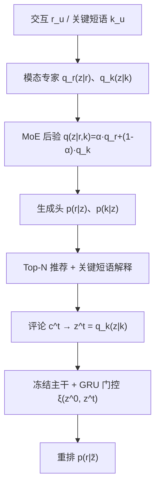
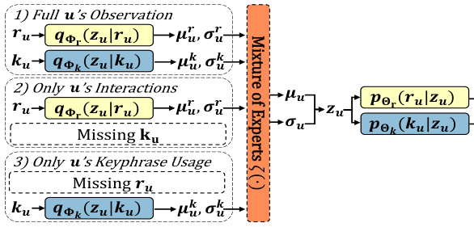

# Fast Multi-Step Critiquing for VAE-based Recommender Systems (面向 VAE 推荐系统的快速多步评论式交互)

- **会议/期刊**: RecSys 2021
- **作者与机构**: Diego Antognini, Boi Faltings（École Polytechnique Fédérale de Lausanne, EPFL）
- **推荐链路定位**: 精排/重排（会话内多轮评论迭代重排，端到端生成推荐+解释）
- **研究方向**: 对话推荐与智能体仿真 / 多模态推荐
- **论文原文**: [https://arxiv.org/abs/2105.00774v2](https://arxiv.org/abs/2105.00774v2)
- **开源代码**: [DeepCritiquingForVAEBasedRecSys](https://github.com/k9luo/DeepCritiquingForVAEBasedRecSys)

## TL;DR (1分钟核心速览)

现有「推荐+解释+评论」联合模型陷入三目标 trade-off，而 LLC 类方法每轮对话都要在线解线性规划、推理慢且无法上 GPU。本文提出 M&Ms-VAE：把用户交互 $\boldsymbol{r}_u$与关键短语$\boldsymbol{k}_u$视作共享隐变量$\boldsymbol{z}_u$ 下条件独立的两个模态，用均匀权重专家混合 (MoE) 拼联合后验，并以「联合 + 两个单模态」三段 ELBO 弱监督训练；评论阶段冻结主干、用 GRU 门控融合初始偏好与评论隐向量，再用合成数据自监督 max-margin 训练一次。在 4 个数据集（60/20/20 划分、Top-N 全库排序 + 300 候选会话仿真）上三任务同时最优，评论处理比 LLC 最快快 25.6×。

## Background & Motivation (背景与核心矛盾)

- **主流范式**: 关键短语 (keyphrase) 解释 + 多步 critiquing。代表工作 CE-VAE 用 VAE 联合建模 $\boldsymbol{r}_u,\boldsymbol{k}_u$，再额外学一条 inverse feedback loop 把评论映射回隐空间；LLC-Score/LLC-Rank 则在 PLRec 上把关键短语共嵌入，每轮用线性规划求偏好向量与评论向量的凸组合权重。
- **前人局限 1（trade-off）**: CE-VAE 的双向映射互相扰动——Beer 上其解释 NDCG@20 达 0.5916（最优级），推荐 NDCG 却仅 0.1215，低于纯 VAE-CF 的 0.1275；关键短语越多崩塌越重（Yelp 234 个 KP，CE-VAE 推荐 NDCG 仅 0.0533，远低于 VAE-CF 0.0801）。
- **前人局限 2（推理昂贵）**: LLC 每轮评论都需解一次带 max-margin 约束的线性规划（限 top-100 物品），CPU 单轮数十毫秒量级且不可 GPU 并行；而 UAC/BAC 的简单均值融合在十轮迭代后偏好向量漂移，成功率明显落后。
- **核心洞察 (Key Insight)**: 用户的「评论」本质上不是新目标，而是与交互、关键短语同源的另一模态观测。若假设三者条件独立于同一 $\boldsymbol{z}_u$，则 critique 可直接复用关键短语的推断网络，无需双向映射，也无需在线优化。
- **本文切入点**: 条件独立生成模型 + MoE 后验 + 弱监督 → 单模态推断即可工作 → 评论只做一次前向编码，融合交给一个旁路训练的轻量重排器。

## Method (核心方法设计)

### 1. 整体框架 (Overall Architecture)

模型假设生成过程 $p_\Theta(\boldsymbol{r}_u,\boldsymbol{k}_u,\boldsymbol{z}_u)=p(\boldsymbol{z}_u)p_{\Theta_r}(\boldsymbol{r}_u|\boldsymbol{z}_u)p_{\Theta_k}(\boldsymbol{k}_u|\boldsymbol{z}_u)$，条件独立使缺失模态可直接在边缘似然中忽略。训练时每个 minibatch 同时优化联合 ELBO 与两个单模态 ELBO，从而让$q_{\Phi_r}$、$q_{\Phi_k}$各自成为合法边缘后验。推理分两阶段：先只用历史交互$\boldsymbol{r}_u$经$q_{\Phi_r}$得到$\hat{\boldsymbol{r}}_u^0$；对话中第$t$轮评论$\boldsymbol{c}_u^t$经$q_{\Phi_k}$编码为$\boldsymbol{z}_u^t$，由冻结主干的融合模块$\xi(\cdot)$与$\boldsymbol{z}_u^0$混合成$\tilde{\boldsymbol{z}}_u^t$，再由同一生成头输出重排结果。

<figure class="paper-figure" markdown="span">
  <figcaption>图2. 所提出的M&amp;Ms-VAE架构与训练方案。每次传递时，利用专家混合，使用联合推断网络𝑞Φ(𝒛𝑢|𝒓𝑢, 𝒌𝑢)或分别使用单个网络（𝑞Φ𝑟(𝒛𝑢|𝒓𝑢)或𝑞Φ𝑘(𝒛𝑢|𝒌𝑢)）推断参数𝝁𝑢和𝝈𝑢。最终梯度基于各𝐸𝐿𝐵𝑂(·)项之和计算。</figcaption>
</figure>

### 2. 关键设计拆解 (Key Designs)

1. **均匀权重专家混合后验 (MoE Posterior)**：直接学联合后验必须两模态同时在场，无法做跨模态生成。本文将联合变分后验分解为单模态专家之混合：
$\;q_\Phi(\boldsymbol{z}_u|\boldsymbol{r}_u,\boldsymbol{k}_u)=\alpha\,q_{\Phi_r}(\boldsymbol{z}_u|\boldsymbol{r}_u)+(1-\alpha)\,q_{\Phi_k}(\boldsymbol{z}_u|\boldsymbol{k}_u),\;\alpha\in\{\tfrac12,1,0\}$即两模态皆观测取$\alpha=1/2$、仅$\boldsymbol{r}_u$取 1、仅$\boldsymbol{k}_u$取 0。权重刻意固定而不学习：若让$\alpha$ 可学，会重新校准两个专家的精度、损害泛化；均匀权重则显式保证两模态贡献对等。

2. **弱监督三段式训练目标 (Weak Supervision)**：只优化联合 ELBO 时单模态推断网络从未被单独训练，缺模态即失效。为此在每次前向中累加三项：
$\mathcal{L}=\sum_u\big[\underbrace{\text{ELBO}(\boldsymbol{r}_u,\boldsymbol{k}_u)}_{\text{联合}}+\underbrace{\text{ELBO}(\boldsymbol{r}_u)}_{q_{\Phi_r}\text{ 独立}}+\underbrace{\text{ELBO}(\boldsymbol{k}_u)}_{q_{\Phi_k}\text{ 独立}}\big]$每项为重构项减$\beta\,D_{\mathrm{KL}}$。物理直觉：这把「完整观测 / 只有交互 / 只有关键短语」三种数据同时当作训练样本，等价于人为制造弱监督，从而在推理期任意模态子集都能得到一致表征——这正是评论能被$q_{\Phi_k}$ 单独编码的前提。

3. **自监督门控融合与重排损失**：均值/线性规划融合分别败于「随轮次漂移」与「在线优化昂贵」。本文冻结 M&Ms-VAE 权重，仅训练 $\xi(\cdot)$（两层 GRU 门控，$\tilde{\boldsymbol{z}}_u^t=(1-u)\odot n+u\odot h$形式对$\boldsymbol{z}_u^0,\boldsymbol{z}_u^t$做门控插值）。训练数据由验证集合成：对每个正样本物品随机采一个与其关键短语不一致的$\boldsymbol{c}$，得到受影响集合$I_c^+$与未受影响$I_c^-$，用双向 max-margin 目标
$\mathcal{L}(\cdot)=\sum_{i^+\in I_c^+}\max\{0,h-(\hat{r}^0_{u,i^+}-\hat{r}^1_{u,i^+})\}+\sum_{i^-\in I_c^-}\max\{0,h-(\hat{r}^1_{u,i^-}-\hat{r}^0_{u,i^-})\}$即评论后应压低被评论物品、抬高未受影响物品。$\xi$ 训练不足 5 分钟，推理期每轮评论只需一次前向，完全并行化（GPU 友好）。

**训练与推理开销**：Adam + AMSGrad，学习率 $5\times10^{-5}$，$\beta$ 线性退火至 1，推断/生成网络为两层 tanh MLP + dropout；训练负采样沿用 VAE-CF 的隐式反馈设置，重排阶段负样本由合成采样与打分对比隐式构造（无需显式负采样率）。

## Experimental Setup & Evaluation Protocol (实验设置与评估协议)

- **数据集与预处理**: 四个 >10 万条评论的真实数据集，按阈值二值化为隐式反馈（Beer $>4$、Yelp/Hotel$>4.5$、其余$>3.5$），关键短语由评论语料频次挖掘（沿用 CE-VAE/CE-VNCF 流程）：

| 数据集 | #Users | #Items | #Interactions | 稀疏度/密度 | 特征/场景说明 |
| :--- | :---: | :---: | :---: | :---: | :--- |
| Beer | 6,370 | 3,669 | 263,244 | 1.13% | 75 KPs，KP 覆盖率 99.3%，平均 1,216 KP/用户 |
| CDs&Vinyl | 6,060 | 4,395 | 152,783 | 0.57% | 40 KPs，覆盖率仅 74.6%（模态缺失最重） |
| Yelp | 9,801 | 4,706 | 140,496 | 0.30% | 234 KPs，KP 维度最高、最稀疏 |
| Hotel | 7,044 | 4,874 | 143,612 | 0.42% | 141 KPs，覆盖率 99.99%，平均 17.4 KP/评论 |

- **数据划分与防穿越 (Splitting Strategy)**: `比例划分` 60%/20%/20%（train/val/test）；融合模块 $\xi$ 只用验证集合成数据训练，测试集不参与任何调参。
- **排名评测协议 (Ranking Protocol)**: 推荐与解释指标为无偏 `Full-Ranking`（全库未交互物品排序）；多步评论采用 `Sampled Ranking`（每个用户-目标物品对采样 299 个未见物品 + 1 个目标 = 300 候选），以 Success Rate@N 与 Session Length（上限 10 轮）衡量，评论选择模拟 Random / Pop / Diff 三种风格。
- **对比基线与超参设置**: 推荐对比 POP、AutoRec、BPR、CDAE、PureSVD、PLRec、NCE-PLRec、VAE-CF、CE-VNCF、CE-VAE；评论对比 UAC、BAC、CE-VNCF、CE-VAE、LLC-Score、LLC-Rank。隐层维度 $H$、$\beta$ 等逐数据集在验证集 NDCG 上做 ≤100 次搜索；未报告显著性检验，仅说明 95% 置信区间小于第四位小数（故省略误差棒）。

## Key Experimental Results (实验关键数据)

### 1. 主实验对比 (Main Results)

| 模型 | Beer NDCG | Beer MAP@10 | CDs NDCG | CDs MAP@10 | Yelp NDCG | Yelp MAP@10 | Hotel NDCG |
| :--- | :---: | :---: | :---: | :---: | :---: | :---: | :---: |
| BPR | 0.1214 | 0.0597 | 0.1516 | 0.0639 | 0.0609 | 0.0156 | 0.0623 |
| PureSVD | 0.1052 | 0.0473 | 0.1551 | 0.0565 | 0.0825 | 0.0249 | 0.0541 |
| PLRec | 0.1113 | 0.0599 | 0.1626 | 0.0777 | 0.0703 | 0.0189 | 0.0664 |
| NCE-PLRec | 0.1151 | 0.0594 | 0.1739 | 0.0678 | 0.0739 | 0.0200 | 0.0684 |
| VAE-CF | 0.1275 | 0.0594 | 0.1699 | 0.0554 | 0.0801 | 0.0216 | 0.0755 |
| CE-VNCF | 0.1099 | 0.0512 | 0.1524 | 0.0662 | 0.0693 | 0.0167 | 0.0575 |
| CE-VAE | 0.1215 | 0.0618 | 0.1532 | 0.0711 | 0.0533 | 0.0132 | 0.0538 |
| **M&Ms-VAE** | **0.1307** | **0.0650** | **0.1765** | **0.0784** | **0.0909** | **0.0261** | **0.0804** |
| Improv. vs 最优基线 | +2.5% | +5.2% | +1.5% | +0.9% | +10.2% | +4.8% | +6.5% |

解释任务上 M&Ms-VAE 亦最优：CDs Recall@20 达 **0.8894**（CE-VAE 0.8757）、MAP@20 **0.4700**（CE-VAE 0.4575），相对 CE-VNCF 平均约 2.5×（MAP/Precision 约 3.5×）。

### 2. 消融实验 (Ablation Study)

| 消融/变体 | 推荐 NDCG (Beer) | 解释 NDCG@20 (Beer) | 多步评论表现 | 结论 |
| :--- | :---: | :---: | :--- | :--- |
| 完整 M&Ms-VAE | **0.1307** | **0.5960** | 12 组设定中 10 组优于 LLC | 三任务同时不劣 |
| 仅联合 ELBO（去掉两个单模态项） | — | — | 无法编码 critique | 单模态推断不成立，设计必需 |
| 推理仅 $\boldsymbol{r}_u$（$q_{\Phi_r}$） | 最优 | 0.5960 | — | 推荐主导路径 |
| 推理仅 $\boldsymbol{k}_u$（$q_{\Phi_k}$） | 显著下降，仍 >POP/AutoRec/CDAE（2/4 数据集） | 与联合推断持平 | — | 解释信息几乎全在$\boldsymbol{k}$ 模态 |
| 推理联合（$q_\Phi$） | 次优（逼近仅$\boldsymbol{r}_u$） | 持平 | — | 缺失模态可安全忽略 |
| 融合 $\xi$ → UAC / BAC 均值 | — | — | 普遍逊于 LLC 与本文 | 均值融合随轮次漂移 |
| 融合 $\xi$ → LLC-Score/Rank | — | — | 少数设定略胜 | 每轮解 LP，慢 25.6× |
| 90% 部分观测训练 | 保留 >70% 全量性能 | 几乎无损 | — | 弱监督有效 |

### 3. 关键实验发现 (Key Findings)

- **去掉 inverse feedback loop 才是消除 trade-off 的关键**：CE-VAE 在 Yelp 上推荐 NDCG 仅 0.0533（VAE-CF 0.0801，相对暴跌 33%），M&Ms-VAE 以单向 MoE 共享后验回升至 0.0909（+70% vs CE-VAE），同时解释精度还提升约 2%——证明双向映射引入的噪声而非任务本身冲突。
- **模态贡献高度不对称**：仅用 $\boldsymbol{k}_u$推断时解释性能与联合推断持平，但推荐明显掉档；反过来仅用$\boldsymbol{r}_u$ 即拿下最佳推荐（0.1307），说明「解释由关键短语承载、推荐由交互承载」，MoE 均匀权重正好让二者互不干扰。
- **速度来自把在线优化换成离线学习**：单轮评论较 LLC 快约 7.5–9.2×（CPU）与最高 25.6×（GPU），1,000 用户 ×10 轮整场仿真快约 3.1×（CPU）/5.3×（GPU）；代价只是一次 <5 分钟的 $\xi$ 训练。

## Highlights & Limitations (亮点、对比与审稿批判)

- **与代表作对比 (vs. Prior Work)**: 相比 CE-VAE（联合 VAE + 双向 inverse loop，解释强但推荐/多步评论弱），本文用条件独立单向生成取代双向映射，把三目标从「零和」变「正和」；相比 LLC-Score/LLC-Rank（每轮解线性规划求凸组合），本文用一个离线自监督门控网络替代在线优化，精度不降而延迟降一个量级；相比 UAC/BAC（均值融合），门控融合能在十轮迭代中抑制偏好漂移。
- **可迁移亮点**: (1)「单模态专家 + 均匀 MoE 后验 + 分段 ELBO」是把缺失模态鲁棒性做进 VAE 的通用配方，可直接用于只有评论无交互的冷启动用户；(2)「用验证集合成 critique 负样本 + pairwise margin 训练轻量重排器」可泛化到任何需要在推理期做条件化重排的场景（如属性过滤、约束推荐），避免在线求解。
- **审稿级局限批判**: (1) Hotel 上 Pop/Diff 评论风格的会话长度反而变长——$\xi$ 只在「随机单步 critique」上训练，用户行为分布偏移即退化，泛化性被高估；(2) 关键短语由频次挖掘产生，粒度粗且依赖 >10 万条评论语料，CDs&Vinyl 的 KP 覆盖率仅 74.6%，弱监督在实际稀疏场景下可能退化为单模态；(3) 未做显著性检验，评论评估仅 300 候选采样而非全库，Success Rate 的绝对难度被系统性低估。

## Rating (四维评分)

- **方法创新性 (Novelty)**: ⭐⭐⭐⭐ （把 critiquing 重构为多模态弱监督生成问题，MoE 后验与自监督门控融合两个设计均有明确因果动机，虽非全新理论但有清晰视角转换）
- **评估协议与实验扎实度 (Protocol & Experiments)**: ⭐⭐⭐⭐ （4 个数据集 × 推荐/解释/评论三任务 × 三种用户评论风格 + 耗时基准，覆盖完整；扣分在无显著性检验、评论评估仅 300 候选采样）
- **写作与数学规范度 (Clarity & Rigor)**: ⭐⭐⭐⭐ （ELBO 分段推导与融合公式书写规范、图 1–3 与算法 1 配合清楚；混合权重固定 vs 可学的取舍仅给直觉未给证明）
- **工业落地与复现价值 (Industrial & Practical Value)**: ⭐⭐⭐⭐⭐ （开源、GPU 友好、单轮评论延迟降 25.6×、融合模块训练 <5 分钟，几乎无额外线上成本，可直接挂接现有多模态召回/重排链路）

