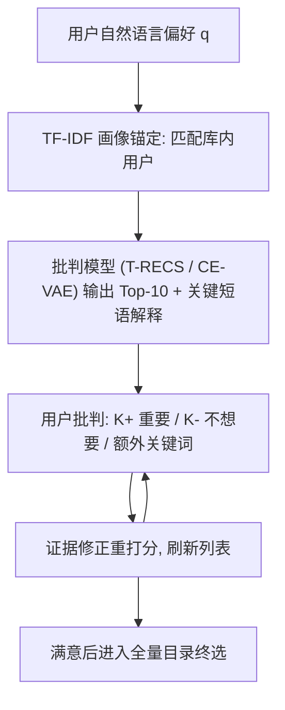

# Multi-Step Critiquing User Interface for Recommender Systems (面向推荐系统的多步批判式交互界面)

- **会议/期刊**: RecSys 2021 (Demo/System Track, 5 pages)
- **作者与机构**: Diana Petrescu, Diego Antognini, Boi Faltings (École Polytechnique Fédérale de Lausanne, EPFL)
- **推荐链路定位**: 重排 / 交互式会话重排（在线 Demo 系统，非离线排序模型）
- **研究方向**: 对话推荐与智能体仿真 / 大语言模型推荐（自然语言理由生成）
- **论文原文**: [https://arxiv.org/abs/2107.06416v2](https://arxiv.org/abs/2107.06416v2)
- **开源代码**: 暂未开源（在线系统 Demo: https://lia.epfl.ch/critiquing/）

## TL;DR (1分钟核心速览)

本文针对"多步批判式推荐算法十余年来只在离线模拟用户下被评估、缺少真实可操作载体"这一空白，提出四套模型无关的 Web 界面（Int. A/B/C/D），把关键短语解释、个性化自然语言理由与逐项批判交互统一到酒店决策场景。系统基于 HotelRec（5000 万条评论、90 个自动挖掘 keyphrase）与 T-RECS / CE-VAE 两套批判模型，可实时在 25–45 家候选酒店上重打分。本文为 Demo 论文，未报告定量主实验，其贡献是用真实使用暴露解释粒度、生成理由同质化与关键词语义模糊三类失效模式。

## Background & Motivation (背景与核心矛盾)

- **主流范式**: 多步批判式推荐把推荐视为多轮对话，用户在系统给出的属性/关键短语上做"喜欢—不喜欢"批判，模型据此增量更新排序；T-RECS、CE-VAE 等已在离线模拟中证明优于单步批判。
- **前人局限**: ① 过去十年的批判式推荐评估几乎全部依赖**模拟用户**（按固定规则施打批判），从未验证真人是否愿意、以及如何批判；② 各算法的解释粒度差异巨大（全局共享 vs. 用户-物品对级），却无统一界面对照，失效模式无法被观察。
- **核心洞察 (Key Insight)**: 解释不只是"说明"，而是**交互入口**——只有当解释既可点击（actionable keyphrase）又能说明"为何推荐这家"（个性化理由）时，用户才知道该批判什么、以及批判后结果为何改变。
- **本文切入点**: 不发明新模型，而做**模型无关的系统层抽象**，用四套界面把离线算法放进真实决策流程，并反向指出算法层待解问题。

## Method (核心方法设计)

### 1. 整体框架 (Overall Architecture)

系统采用"输入—锚定—批判回路—终选"的闭环：用户先用自然语言描述理想酒店，系统用 TF-IDF 把该描述匹配到库内最相似的真实用户画像作为初始画像（解决神经模型无法处理新访客 ID 的冷启动），随后模型输出 Top-10 酒店及关键短语解释；用户在解释上执行批判（标记"不想要/很重要"或搜索额外关键词），系统即时重打分并刷新列表，循环直至用户满意，最后进入全量目录做最终选择。推荐模型与批判机制均以插件形式接入，因此换域只需替换数据集与 keyphrase 词表。

### 2. 关键设计拆解 (Key Designs)

1. **TF-IDF 画像锚定（把冷启动转成文本检索）**: 神经批判模型以用户 ID 嵌入为条件，新访客无向量即无法启动。本文对查询 $q$与库内用户评论$R_u$分别做 TF-IDF 向量化并取余弦最近邻：$\hat{u}=\arg\max_{u\in\mathcal{U}}\cos\big(\mathrm{tfidf}(q),\mathrm{tfidf}(R_u)\big)$，以$\hat{u}$ 的画像作为初始条件。直觉上这用"可解释的检索式代理画像"换取了模型无关性，代价是初始画像受库内用户覆盖度限制。
2. **双粒度解释与批判抽象**: CE-VAE 只给全局共享的 6 个关键词，用户仅能整体否定；T-RECS 给出用户-物品对级关键词，可逐项施加正/负反馈。系统把批判抽象为集合 $K^{+}$（重要）与$K^{-}$（不想要），以解释性证据对排序分做可加修正：$\hat{s}(u,i)=s_\theta(u,i)+\lambda\!\!\sum_{k\in K^{+}}\!p_\theta(k\mid u,i)-\lambda\!\!\sum_{k\in K^{-}}\!p_\theta(k\mid u,i)$。此式无需重训模型，仅把"关键词条件概率"当作可编辑的证据向量，使每轮批判都能局部、可追溯地改变排序。
3. **生成式理由与推理开销**: Interface D 用 T-RECS 的生成模块，在关键词条件下生成用户相关理由以替代抓取的通用描述。整条链路不训练新参数、不引入负采样，每次批判后只需对单个目的地的 25–45 个候选重打分并重新生成理由，单次交互可实时完成；瓶颈在生成质量而非算力。

（注：本文不提出新损失函数，亦不改动训练目标与负采样策略，直接复用 T-RECS / CE-VAE 预训练权重。）

## Experimental Setup & Evaluation Protocol (实验设置与评估协议)

- **数据集与预处理**: 使用 HotelRec（TripAdvisor 评论）与人工筛选的目的地子集，无 5-core 过滤，属在线 Demo 场景。

| 数据集/资源 | 规模 | 关键短语 | 候选规模 | 说明 |
| :--- | :---: | :---: | :---: | :--- |
| HotelRec (TripAdvisor) | 5,000 万条评论 | 90 个自动挖掘 keyphrase | — | 预处理细节沿用 [2,3,13] |
| 目的地子集 | 4 个目的地 | 同 90 个 keyphrase | 每地 25–45 家酒店 | 首屏展示 Top-10 |

- **数据划分与防穿越 (Splitting Strategy)**: **无离线划分**。本文是交互式系统 Demo，评估发生在真实会话中，不存在训练/测试切分、也不存在时间戳穿越问题（预训练模型直接复用）。
- **排名评测协议 (Ranking Protocol)**: **在线交互式展示 + 人工终选**，非 Full-Ranking 亦非 Sampled Ranking；首屏固定返回 Top-10 供批判，用户在批判结束后可浏览全量目录做最终选择，构成"界面是否帮助决策"的间接度量。
- **对比基线与超参设置**: 以模仿主流酒店平台的 Interface A（静态关键词筛选，6 组人工类别）为参照点；实验组为 Interface B（CE-VAE，全局共享关键词）、C（T-RECS，细粒度关键词）、D（T-RECS + 生成式理由）。超参 $\lambda$、嵌入维度$d$ 及显著性检验均未报告。

## Key Experimental Results (实验关键数据)

### 1. 主实验对比 (Main Results)

本文无定量主实验表，以下为四套界面的功能对照（即论文的核心"结果"）：

| 界面 | 底层模型 | 解释粒度 | 批判操作 | 自然语言理由 | 信息补充 |
| :--- | :--- | :--- | :--- | :--- | :--- |
| Int. A (参照) | 无（静态筛选） | 90 关键词分 6 组 | 过滤，无模型更新 | 无 | 抓取描述 |
| Int. B | CE-VAE | 全局共享 Top-6 关键词 | 整体否定；可批判描述中高亮词 | 无 | 抓取描述 + 高亮 |
| Int. C | T-RECS | 用户-物品对级关键词 | 逐项标记"重要/不想要" + 搜索额外关键词 | 无 | 抓取描述 + 高亮 |
| Int. D | T-RECS + NLG | 用户-物品对级关键词 | 同 C | **个性化生成理由** | 替代抓取描述 |

### 2. 消融实验 (Ablation Study)

以"功能退化"形式呈现的组件级对照：

| 变体 | 相对完整系统的改动 | 定性后果 |
| :--- | :--- | :--- |
| w/o 细粒度关键词 (= Int. B) | 解释降为全局共享 | 单轮仅能表达一次整体否定，多步批判退化为"重启一次" |
| w/o 生成式理由 (= Int. C) | 用抓取描述替代生成理由 | 理由与用户画像无关，用户难以判断"为何是这家" |
| w/o 描述内高亮 | 关键词与描述解耦 | 用户无法在描述语境中定位可批判对象 |
| w/o 关键词搜索 | 仅能批判模型预测词 | 用户的隐性偏好若未被模型提及则无法表达 |

### 3. 关键实验发现 (Key Findings)

1. **解释粒度直接决定批判表达力**：Interface B 只暴露 6 个全局关键词，用户每轮只能做一次"全局否定"，多步批判的信息增益无法累积；而 C/D 的物品级关键词让每轮反馈都能在上下文内局部生效，说明"多步"的有效性前提是解释必须绑定到具体物品。
2. **生成式理由同质化反而削弱决策效率**：作者观察到排名最靠前物品的理由含大量重复句片段，候选之间的文本差异被抹平，用户更难区分优劣——即"理由越自然流畅"不等于"解释越有辨别力"，需要在生成端引入多样性或对比式表述约束。
3. **关键词语义模糊是主要失效源**：在 90 个自动挖掘的 keyphrase 中，存在型词（如 pool）可被明确批判，程度型词（如 breakfast）用户无法预判"批判 breakfast"的含义（绝大多数酒店都提供早餐），导致批判行为语义漂移；n-gram 或后处理过滤只能部分缓解。

## Highlights & Limitations (亮点、对比与审稿批判)

- **与代表作对比 (vs. Prior Work)**: 相比 T-RECS / CE-VAE 的离线模拟评估，本文首次给出真人可操作的批判闭环；相比传统可解释推荐（LIME/SHAP 类后验解释），本文的解释是**可编辑的一等公民**而非事后归因；相比既有酒店平台的关键词筛选（Int. A），本文引入了逐轮模型更新的批判回路。
- **可迁移亮点**: ① "TF-IDF 画像锚定"这一技巧可无痛迁移到任何以用户 ID 嵌入为条件、但面临匿名会话冷启动的会话推荐/对话推荐系统；② 把批判抽象为 $K^{+}/K^{-}$ 证据修正项，可在不重训模型的前提下为任意精排模型加装"可编辑解释层"。
- **审稿级局限批判**: ① **评估严重缺位**——全文无定量指标、无用户研究（无 SUS、无任务完成率、无批判轮数统计），"界面有用"仅有作者定性断言，作为 RecSys 论文其证据强度不足；② **系统规模与延迟未披露**——未给出 90 关键词×50M 评论下的匹配与重打分时延、也未讨论生成的幻觉风险，且生成模块与推荐模型同源（T-RECS），无法排除解释与排序共享偏差导致的"自我印证"。

## Rating (四维评分)

- **方法创新性 (Novelty)**: ⭐⭐⭐ （无新算法与新损失，但"解释即可编辑证据 + 画像锚定"的系统抽象具有清晰的问题定义价值）
- **评估协议与实验扎实度 (Protocol & Experiments)**: ⭐⭐ （缺乏任何定量指标与真人用户研究，无划分、无基线数值、无显著性检验）
- **写作与数学规范度 (Clarity & Rigor)**: ⭐⭐⭐⭐ （四界面差异与交互流程图表述清楚，批判机制形式化简洁，但公式推导与复杂度分析基本缺位）
- **工业落地与复现价值 (Industrial & Practical Value)**: ⭐⭐⭐ （公开在线 Demo 且模型无关便于接入，但无开源代码、无延迟/吞吐数据，距离生产可用尚有距离）

