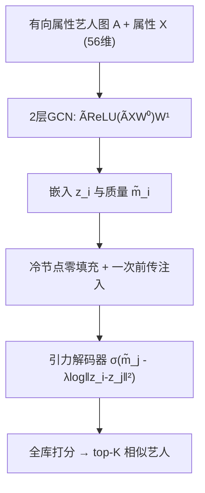

# Cold Start Similar Artists Ranking with Gravity-Inspired Graph Autoencoders (基于引力启发图自编码器的冷启动相似艺人排序)

- **会议/期刊**: RecSys 2021 (15th ACM Conference on Recommender Systems)
- **作者与机构**: Guillaume Salha-Galvan, Romain Hennequin, Benjamin Chapus, Viet-Anh Tran (Deezer Research)；Michalis Vazirgiannis (LIX, École Polytechnique)
- **推荐链路定位**: 召回（相似艺人 / "Fans Also Like" 相关推荐位）
- **研究方向**: 冷启动与长尾推荐 / 图神经网络推荐
- **论文原文**: [arXiv:2108.01053](https://arxiv.org/abs/2108.01053v1)
- **开源代码**: [deezer/similar_artists_ranking](https://github.com/deezer/similar_artists_ranking)（同时公开 Deezer 工业图数据）

## TL;DR (1分钟核心速览)

新艺人上线首日没有任何收听/点赞数据，基于共现的"相似艺人"列表无从计算，只能等其"变热"。本文把该问题建模为**有向属性艺人图上的链接预测**：用 2 层 GCN 编码器学习节点嵌入与"质量"，再用引力启发解码器 $\sigma(\tilde{m}_j-\lambda\log\lVert \mathbf{z}_i-\mathbf{z}_j\rVert_2^2)$ 为非孤立冷节点排序。在 Deezer 24,270 位艺人、全库排序协议下，NDCG@200 达 41.42%，较最强基线相对提升 **21.1%**。

## Background & Motivation (背景与核心矛盾)

- **主流范式**: 工业界用艺人共现/互信息、协同过滤或 learning-to-rank 计算相似度矩阵 $S$，为每位艺人取 top-$k$ 邻居填充"Fans Also Like"。
- **前人局限**: ① 冷艺人无任何 usage 数据，$S$中对应行/列全空，功能被直接下线；② 即便有 56 维内容侧信息，纯内容$K$-NN 或"嵌入 + 映射"（SVD+DNN、DropoutNet）方法丢掉了艺人之间的有向结构信号。
- **核心洞察 (Key Insight)**: "相似艺人"天然是一个**有向加权属性图**——Bob Marley 会出现在小雷鬼乐队的 top-20 里，反之则不成立；因此非对称性必须由解码器显式建模，而非用内积/欧氏距离这类对称度量。
- **本文切入点**: 冷节点在图中是"孤立但有属性"的新节点，用一次 GCN 前传即可注入既有嵌入空间，再由引力式解码器完成打分排序。

## Method (核心方法设计)

### 1. 整体框架 (Overall Architecture)

对 $n$位暖艺人的有向图取稀疏邻接矩阵$A$（$A_{ij}=S_{ij}$当$j$属于$i$的 top-$k$=20 邻居，否则为 0）、属性矩阵$X\in\mathbb{R}^{n\times 56}$。2 层 GCN 输出$n\times(d+1)$矩阵$\tilde{Z}$：前$d$维为嵌入$\mathbf{z}_i$，最后一维为可学习"质量"$\tilde{m}_i$。训练时以加权交叉熵（AE）或 ELBO（VAE）重构$A$。推理时把$m$个冷节点以零行/零列 + 属性向量拼入图，**权重矩阵维度与节点数无关**，故只需一次前传即得冷节点嵌入与质量，再用引力解码器对全库节点打分取 top-$K$。

### 2. 关键设计拆解 (Key Designs)

1. **有向属性图上的"孤立冷节点"注入**：前人（DEAL）只做无向图且不针对排序。本文把冷艺人建模为 $A'$中全零行列、$X'$ 中有属性的新节点，直接复用已训练权重前传；GCN 的邻域平均使孤立节点不会被邻居信息污染，纯粹由其内容属性决定位置，天然适配"上线即预测"。
2. **引力启发解码器（核心增量）**：内积/距离解码器强制 $\hat{A}_{ij}=\hat{A}_{ji}$，与有向图矛盾。借牛顿第二定律$a_{i\to j}=Gm_j/r^2$，把质量赋予目标节点，取对数并加 sigmoid 与可调系数$\lambda$：
$$\hat{A}_{ij}=\sigma\big(\tilde{m}_j-\lambda\log\lVert \mathbf{z}_i-\mathbf{z}_j\rVert_2^2\big)$$
物理直觉：$\tilde{m}_j$是"影响力项"（越中心越容易被指向），距离是"邻近项"（音乐风格越近越相关）；两项不对称使$i\to j$与$j\to i$得分不同，$\lambda$ 可显式调节流行度/多样性权衡。
3. **训练目标、负采样与推理开销**：全批量训练，逐元素加权交叉熵覆盖**全部 $n^2$对**（非负采样），因此没有采样偏差；复杂度$O(dn^2)$，代码另提供 FastGAE 子图近似。冷节点注入仅一次前传（边数线性），top-$k$检索$O(ndk)$，工程上可直接上线。

<figure class="paper-figure" markdown="span">
  ![图2. 由引力启发图 AE 得到的部分音乐艺术家可视化。节点按质量 ˜𝑚𝑖 缩放，节点间隔基于嵌入中的距离，采用多维缩放并参考\[15\]。红色节点对应牙买加雷鬼艺术家，出现在同一邻域。](../../../../assets/papers/2108.01053v1/figure_2.png)<figcaption>图2. 由引力启发图 AE 得到的部分音乐艺术家可视化。节点按质量 ˜𝑚𝑖 缩放，节点间隔基于嵌入中的距离，采用多维缩放并参考[15]。红色节点对应牙买加雷鬼艺术家，出现在同一邻域。</figcaption>
</figure>

## Experimental Setup & Evaluation Protocol (实验设置与评估协议)

- **数据集与预处理**: Deezer 生产系统快照，含完整边权与 56 维属性（32 维流派 SVD 嵌入 + 20 维国别 one-hot + 4 维 valence/arousal 情绪均值与方差）；边权由艺人共现互信息类分数归一化到 $[0,1]$，每位艺人保留 top-20 出边。

| 数据集 | #Users | #Items | #Interactions | 稀疏度/密度 | 特征/场景说明 |
| :--- | :---: | :---: | :---: | :---: | :--- |
| Deezer artist graph | 百万级（未公开） | 24,270 | 24,270×20 有向边 | 出度恒为 20，$A_{ij}\neq A_{ji}$| 32 维流派 + 20 维国别 + 4 维情绪，$f=56$，$d=32$ |

- **数据划分与防穿越 (Splitting Strategy)**: **冷启动划分**——按艺人 80%/10%/10% 划分为训练（暖）/验证/测试；验证与测试艺人的全部出边被 mask，仅保留属性向量，作为孤立节点注入，其真实 top-20 边与权重为 ground-truth。
- **排名评测协议 (Ranking Protocol)**: **Full-Ranking（全库未交互排序）**——对全部 24,270 个节点计算 $\hat{A}_{ij}$后取 top-$K$，不做负采样；报告 Recall@K、MAP@K、NDCG@K（$K\in\{20,100,200\}$），指标均值与标准差基于 20 次随机初始化。
- **对比基线与超参设置**: 流行度类（Popularity / by country、In-degree / by country）、内容类（$K$-NN、$K$-NN+Popularity/In-degree）、映射类（SVD+DNN、DropoutNet、STAR-GCN）、图类（Graph AE/VAE、Source-Target Graph AE/VAE、DEAL）。所有嵌入$d=32$（另测 64/128），GCN 隐层 64 维、300 epoch、Adam、lr=0.05、无 dropout、$\lambda=5$，超参按验证集 NDCG@20 调优。

## Key Experimental Results (实验关键数据)

### 1. 主实验对比 (Main Results)

| 方法 ($d$=32) | Recall@20 | Recall@100 | Recall@200 | NDCG@20 | NDCG@100 | NDCG@200 |
| :--- | :---: | :---: | :---: | :---: | :---: | :---: |
| Popularity by country | 2.76 | 12.38 | 18.98 | 2.14 | 6.41 | 8.76 |
| $K$-NN + In-degree | 7.49 | 17.29 | 18.76 | 7.41 | 12.48 | 13.14 |
| SVD + DNN | 6.42 | 21.83 | 35.01 | 6.05 | 12.91 | 17.89 |
| STAR-GCN | 10.03 | 31.45 | 43.92 | 10.07 | 21.17 | 25.99 |
| DropoutNet | 12.96 | 37.59 | 49.93 | 13.12 | 25.61 | 30.52 |
| DEAL | 12.80 | 37.98 | 50.75 | 12.78 | 25.70 | 30.69 |
| Graph AE | 7.30 | 25.92 | 40.37 | 6.32 | 15.54 | 20.94 |
| Source-Target Graph VAE (最强基线) | 13.52 | 42.68 | 59.51 | 13.60 | 27.81 | 34.19 |
| **Gravity Graph AE (本文)** | **18.33** | **52.26** | **67.85** | **18.64** | **35.77** | **41.42** |
| Gravity Graph VAE | 16.59 | 49.51 | 65.70 | 16.74 | 33.34 | 39.29 |
| **Improv. (vs. 最强基线)** | **+35.6%** | **+22.4%** | **+14.0%** | **+37.1%** | **+28.6%** | **+21.1%** |

### 2. 消融实验 (Ablation Study)

| 变体 | 关键设置 | NDCG@200 | 说明 |
| :--- | :--- | :---: | :--- |
| Gravity AE（完整） | 全 56 维属性，$\lambda=5$ | **41.42** | 本文默认配置 |
| 调低邻近权重 | $\lambda=1$ | 35.91 | 退化至接近 Source-Target VAE |
| 调高邻近权重 | $\lambda=20$ | 40.31 | 过度压制质量项 |
| 质量固定 | $\tilde{m}_i$ 换成 PageRank 分数 | 下降 >6 点 | 联合学习嵌入与质量最优 |
| 仅部分属性 | 仅 genres / 仅 countries / 仅 moods | 均低于 41.42（图 3） | genres 信息量最大；三者合并最好 |
| 确定性 vs. 概率 | Gravity VAE vs. AE | 39.29 vs. 41.42 | 与标准图模型结论相反 |

### 3. 关键实验发现 (Key Findings)

1. **非对称解码是收益主因，而非图结构本身**：同样用 2 层 GCN 处理属性与结构，对称内积解码的 Graph AE 只有 NDCG@200=20.94，改用 source-target 拆分升到 34.19，再换引力解码器到 41.42——说明"方向性建模 + 质量项"贡献了绝大部分增益，DEAL 虽强（30.69）仍落后 10 点以上。
2. **质量不等于流行度**：$\tilde{m}_i$ 与流行度排名、PageRank、介数中心性的 Pearson 相关仅 0.21/0.27/0.11，属于"局部影响力"；巴西 pagode 歌手 Thiaguinho 流行度在 100 名开外却比 top-5 的 Ariana Grande 质量更大，因为其指向来源高度集中于同一垂类——这正是引力机制捕捉到的社群结构，而非全局热度。
3. **$\lambda$提供了可调的流行度/多样性旋钮**：$\lambda=5$时 NDCG@200 最优；$\lambda\to0$时推荐的 top-20 艺人流行度排名显著前移（图 4），$\lambda$ 增大则长尾内容被更多曝光，为工业界的公平性/曝光均衡诉求提供了零成本调节手段。

## Highlights & Limitations (亮点、对比与审稿批判)

- **与代表作对比 (vs. Prior Work)**: 相较 DropoutNet（dropout 模拟冷启动）与 STAR-GCN（二部图重建），本文直接利用**艺人-艺人有向图**而非 user-item 二部图，避免了冷节点在二部图中完全无边可重建的窘境；相较 DEAL（无向图上的归纳式对齐），本文首次把"方向 + 权重 + 排序"三者统一进解码器。
- **可迁移亮点**: ① "零填充 + 单次前传"注入孤立新节点，可直接迁移到新视频/新商品/新 POI 的冷启动召回；② 用质量项与距离项的加权差替代内积，可作为通用非对称召回打分头，顺带提供可控的流行度去偏手段。
- **审稿级局限批判**: ① 假设相似度分数随时间固定、每节点恒为 $k$=20 条边，无法刻画偏好漂移与长尾艺人出度应更小的现实；② 训练需重构$O(dn^2)$ 的全对距离，24K 节点尚可，百万级商品目录需依赖 FastGAE 近似，且线上效果未做 A/B 验证（论文自陈为未来工作）。

## Rating (四维评分)

- **方法创新性 (Novelty)**: ⭐⭐⭐⭐ （首次把引力启发图 AE/VAE 迁移到推荐排序，质量-距离非对称解码器有清晰物理直觉与 $\lambda$ 可解释性，但核心架构沿用作者前作）
- **评估协议与实验扎实度 (Protocol & Experiments)**: ⭐⭐⭐⭐⭐ （真实 Deezer 工业图 + 严格冷启动划分 + 全库排序无采样偏差 + 20 次随机种子报标准差 + 11 个覆盖四类范式的基线）
- **写作与数学规范度 (Clarity & Rigor)**: ⭐⭐⭐⭐ （解码公式、GCN 前传与复杂度分析推导干净，但 ELBO 细节引外部文献，部分工业分数计算因保密省略）
- **工业落地与复现价值 (Industrial & Practical Value)**: ⭐⭐⭐⭐⭐ （开源代码与工业图数据双释放，冷节点注入仅一次前传、top-$k$检索$O(ndk)$，直接可上线相关推荐位）

