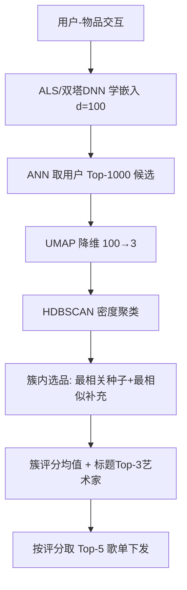
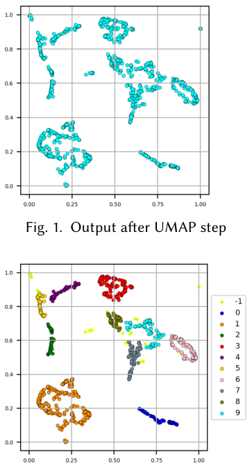

# Automatic Collection Creation and Recommendation (个性化集合自动构建与推荐)

- **会议/期刊**: RecSys 2021（arXiv:2105.01004v1）
- **作者与机构**: Sanidhya Singal, Piyush Singh, Manjeet Dahiya（Airtel Digital, India）
- **推荐链路定位**: 重排 / 列表级组织（把 top-N 单品重构成 N 个主题集合下发）
- **研究方向**: 协同过滤与双塔召回
- **论文原文**: [https://arxiv.org/abs/2105.01004v1](https://arxiv.org/abs/2105.01004v1)
- **开源代码**: 暂未开源

## TL;DR (1分钟核心速览)

常规推荐输出互不相关的 top-N 单品，跨主题跳变导致消费体验割裂。本文不在模型层面改造，而是**复用现成 ALS/双塔 DNN 学到的用户-物品嵌入**：每用户先 ANN 取 Top-1000 物品，用 UMAP 将 100 维嵌入压到 3 维，再用 HDBSCAN 密度聚类自动切出任意形状、变密度的主题簇，簇内以"最相关种子 + 最相似补充"启发式选 30 首，簇评分取均值、标题取 Top-3 艺术家。在 43M 用户 / 5.1M 曲目的真实音乐流上做**无偏线下指标 + 线上 A/B**，推荐驱动消费由 2.94 首/日升至 6.83 首/日（**2.3x**），同等坑位曝光内容量由 15 首提升到 150 首。

## Background & Motivation (背景与核心矛盾)

- **主流范式**: 物品推荐系统（MF/神经协同过滤）输出 top-N 单品，用户在同一次会话中被动接受风格混杂的列表。
- **前人局限**: ① 音乐/短视频等领域**缺乏全面标签**，电商与电影靠 category/genre 过滤即可造集合的做法直接失效；② 已有 collection 工作多为概念论述（Hansen & Golbeck）或 Netflix 式"给定已有集合预测其评分"，**不解决集合本身的自动生成**；③ 半自动方案依赖种子曲或时长/价格约束，需人工介入。
- **核心洞察 (Key Insight)**: 协同嵌入同时编码了**用户-物品相关性**（点积打分）与**物品-物品相似性**（欧氏邻近）两种语义，因此"按用户相关性召回 → 在嵌入空间聚类 → 簇即主题集合"可在**不引入新标签、不新增训练**的前提下成立。
- **本文切入点**: 把集合生成彻底建模为"在用户 Top-N 候选嵌入上做降维 + 密度聚类"的无监督后处理问题。

## Method (核心方法设计)

### 1. 整体框架 (Overall Architecture)

两阶段闭环：**表征学习阶段**先用 ALS 或双塔 DNN（用户塔 100 维、物品塔 110 维含艺术家/语言/发行年元数据再投到 100 维）在交互数据上训练，只取嵌入、不复用其在线服务；**集合生成阶段**逐用户 ANN 近似检索 Top-1000 候选 → UMAP 降维 → HDBSCAN 聚类 → 簇内选品 → 簇级评分/命名单 → 按簇评分回排取前 $N$ 个集合下发。全程无需标注、无梯度回传，推理开销集中在一次 ANN 检索与轻量降维聚类。

### 2. 关键设计拆解 (Key Designs)

1. **UMAP 非线性降维（生成集合数 +80% 的关键）**: 100 维协同嵌入在欧氏空间高度稀疏，直接密度聚类易受维数灾难淹没。本文不做建模改动，而是把候选嵌入降到 3 维后再聚类，实验发现**无降维时每用户仅 2.5 个集合，UMAP 后升至 4.5 个**，且非线性（UMAP/t-SNE）显著优于线性 PCA（3.2 个、簇内噪声 10.3%）。直觉：低维流形保留了主题级拓扑却抹平了高维细碎波动，使"主题"成为可被距离阈值捕获的致密团。

2. **HDBSCAN 变密度密度聚类（簇形任意、无需指定 $K$）**: k-means 只能捕捉凸簇且需预设簇数，主题簇的实际形状往往是变密度长尾团。HDBSCAN 在 UMAP 输出上自动给出簇标签并以 `-1` 标记噪声点（图 2 即该步输出，标签 0–9 为有效主题），无需调$K$ 且天然完成异常剔除。

<figure class="paper-figure" markdown="span">
  <figcaption>图2. HDBSCAN步骤后的输出。标签0-9为有效簇，-1表示噪声点。</figcaption>
</figure>

3. **簇内代表性与相关性联合选品 + 集合级聚合**: 单靠"取簇内打分最高 30 首"会让集合内部漂移；本文用两级启发式——先取簇内最相关种子 $i^{\star} = \arg\max_{i\in G_{u,k}} r_{u,i}$，再按与种子相似度补满其余 29 首：
$\mathcal{S}_{u,k} = \{i^{\star}\} \cup \operatorname{TopK}_{i\in G_{u,k}\setminus\{i^{\star}\}}\cos(\boldsymbol{i}_{\text{Emb}},\boldsymbol{i}^{\star}_{\text{Emb}})$。
集合评分取成员打分均值 $R_{u,k}=\frac{1}{|\mathcal{S}_{u,k}|}\sum_{i\in\mathcal{S}_{u,k}}r_{u,i}$，标题取簇内 Top-3 高频艺术家（同时传达"是歌单/语言/流派"三重语义）。因无监督、无对比损失，本文**不存在训练目标与负采样**，全部为纯推理式后处理。

## Experimental Setup & Evaluation Protocol (实验设置与评估协议)

- **数据集与预处理**: 真实音乐流媒体全量数据训练表征，线下消融取随机 10k 用户。

| 数据集 | #Users | #Items | #Interactions | 稀疏度/密度 | 特征/场景说明 |
| :--- | :---: | :---: | :---: | :---: | :--- |
| 音乐流媒体 | 43M | 5.1M | 3.8B | ~1.7e-5 | 10 国际 + 31 地区语言；元数据含艺术家/语言/发行年 |

- **数据划分与防穿越 (Splitting Strategy)**: 采用**全局历史交互切分**（用历史消费训练表征，线下指标在 10k 随机用户上离线评估，线上 A/B 另设随机等分双用户群），未使用 Leave-One-Out。
- **排名评测协议 (Ranking Protocol)**: 线下以**无偏 Full-Ranking 全库 ANN 检索**取 Top-1000 候选构建集合，指标含集合数/语言噪声/簇内噪声/标题重叠/艺术家熟悉度/平均排名；线上以 A/B 对比推荐驱动消费、推荐占比与 CTR。
- **对比基线与超参设置**: 表征提供者 ALS（CF）与双塔 DNN 两档；降维对比 None/UMAP/PCA/t-SNE；聚类对比 k-means/Spectral/DBSCAN/HDBSCAN；嵌入维度 $d=100$，最终 UMAP(`n_neighbors=15, n_components=3, min_dist=0.0`)、HDBSCAN(`min_samples=8, min_cluster_size=30`)。

## Key Experimental Results (实验关键数据)

### 1. 主实验对比 (Main Results)

线下管线各组件横向对比（10k 用户；↓越小越好，↑越大越好，加粗为该方向最优）：

| 配置 (表征/降维/聚类) | #集合/用户↑ | 语言噪声↓ | 簇内噪声↓ | 标题重叠↓ | 艺术家熟悉度↑ | 平均排名↓ |
| :--- | :---: | :---: | :---: | :---: | :---: | :---: |
| ALS / None / HDBSCAN | 2.5 | 4.9% | 4.1% | 0.0% | 55.9% | 208.4 |
| ALS / PCA / HDBSCAN | 3.2 | 5.1% | 10.3% | 1.5% | 58.2% | 197.2 |
| ALS / t-SNE / HDBSCAN | 4.3 | 3.6% | 8.2% | 8.3% | 60.7% | 175.6 |
| ALS / UMAP / k-means | **4.8** | 2.9% | 6.3% | 12.7% | 61.6% | 174.0 |
| ALS / UMAP / Spectral | 4.5 | 3.3% | 5.3% | 9.4% | 61.3% | 173.8 |
| ALS / UMAP / DBSCAN | 4.6 | **2.3%** | 3.5% | 8.7% | 61.6% | 174.1 |
| **ALS / UMAP / HDBSCAN（本文）** | 4.5 | 2.7% | 4.2% | 7.7% | **61.8%** | **173.7** |
| DNN / UMAP / HDBSCAN | 4.1 | 3.6% | **1.5%** | **3.9%** | 60.5% | 184.8 |

线上 A/B（首页同坑位，A=15 首单品，B=5 个歌单×30 首）：

| 指标 | 单品推荐 (A) | 集合推荐 (B) | 变化 |
| :--- | :---: | :---: | :---: |
| 推荐驱动消费 (首/日) | 2.94 | **6.83** | **+132% (2.3x)** |
| 推荐来源占总消费比 | 16.7% | **36.5%** | +19.8pt |
| 实体点击率 CTR | **18.9%** | 15.2% | −3.7pt |
| 总消费 (含其他入口) | — | — | 仅 +0.07 首/日 |

### 2. 消融实验 (Ablation Study)

| 消融项 | #集合/用户 | 簇内噪声 | 平均排名 | 结论 |
| :--- | :---: | :---: | :---: | :--- |
| w/o 降维 (None) | 2.5 | 4.1% | 208.4 | 集合数骤降 44% |
| w/o 非线性 (→PCA) | 3.2 | 10.3% | 197.2 | 聚类退化为球形假设 |
| w/o 密度聚类 (→k-means) | 4.8 | 6.3% | 174.0 | 噪声与标题重叠升高 |
| w/o 元数据 (ALS→DNN) | 4.1 | 1.5% | 184.8 | 簇纯度更好但排名变差 |

### 3. 关键实验发现 (Key Findings)

1. **降维是"能造出多少集合"的瓶颈**：从 None→UMAP 使集合数由 2.5 涨至 4.5（+80%）、平均排名由 208.4 降至 173.7，说明高维稀疏直接聚类几乎无法形成可分主题团；而线性 PCA 即使降维也只到 3.2（+28%），验证主题结构本质是**非线性流形**。
2. **密度聚类换来的是"纯度"而非"数量"**：k-means 集合数最高（4.8），但簇内噪声 6.3%、标题重叠 12.7% 均劣于 HDBSCAN（4.2%/7.7%）与 DBSCAN（3.5%/8.7%），说明无需预设 $K$ 的变密度划分更能守住"集合内同主题"这一核心约束。
3. **集合化几乎不增加总时长却大幅提升推荐依赖度**：消费从 2.94→6.83 首/日（2.3x），但总消费仅 +0.07 首/日，即增量**几乎全部来自用户库/专辑/编辑位向推荐位的迁移**；同时 CTR 反降 3.7pt，因 B 组只展示 5 个实体（vs 15 个），却以 150 首曝光量实现更高总消费，坑位 ROI 显著提升。

## Highlights & Limitations (亮点、对比与审稿批判)

- **与代表作对比 (vs. Prior Work)**: 相比 Netflix 集合推荐（需**给定已有集合**、只预测集合与集合内物品评分），本文进一步解决**集合本身的自动生成**；相比种子曲/约束式半自动歌单（依赖人工种子、item-item 相似度），本文**零人工输入**且同时输出集合评分与命名；相比 Top2Vec/ClusterExplorer 的纯聚类主题发现，本文引入**用户维度**做成个性化集合而非全局主题。
- **可迁移亮点**: ① "复用现成双塔嵌入 + UMAP(3 维) + HDBSCAN" 是无标签领域快速搭建主题集合的通用低成本配方，可直接迁移到短视频合集、UGC 专题、非标商品组合；② "最相关种子 + 与种子最相似补全"的两级选品启发式，为集合内既要相关又要一致提供了无需训练的解。
- **审稿级局限批判**: ① **缺乏 ground truth 与有监督评价**，指标（语言噪声、标题重叠）为领域定制且作者自承"仅为粗粒度"，集合质量高度依赖人工抽检，缺乏 NDCG/recall 一类可复现排序指标；② **无学习式表征与端到端优化**，标题仅取 Top-3 艺术家、簇评分为简单均值，未对"集合内部一致性"建模，且 UMAP/HDBSCAN 超参在每个实验中单独调优，跨域迁移的超参稳定性存疑；③ 未与神经歌单生成（如 seq2seq playlist continuation）等强基线比较，2.3x 增益亦可能部分来自展示形态（5 实体 vs 15 实体）而非集合本身质量。

## Rating (四维评分)

- **方法创新性 (Novelty)**: ⭐⭐⭐ （把集合推荐重构为"协同嵌入上的无监督降维聚类"思路清爽且工程务实，但 UMAP+HDBSCAN 组合本身在主题建模领域已有先例，理论增量有限）
- **评估协议与实验扎实度 (Protocol & Experiments)**: ⭐⭐⭐ （拥有 43M 用户量级真实线上 A/B 与完整组件横评，但线下无 ground truth、指标偏定制、缺强基线对比）
- **写作与数学规范度 (Clarity & Rigor)**: ⭐⭐⭐⭐ （算法伪代码、管线与启发式定义清晰可复现，公式少但符号一致；复杂度与超参敏感性分析略简）
- **工业落地与复现价值 (Industrial & Practical Value)**: ⭐⭐⭐⭐ （不改线上模型、不新增训练数据，靠后处理即可把坑位曝光从 15 首扩到 150 首并带来 2.3x 消费，落地性价比极高；代码未开源扣分）

