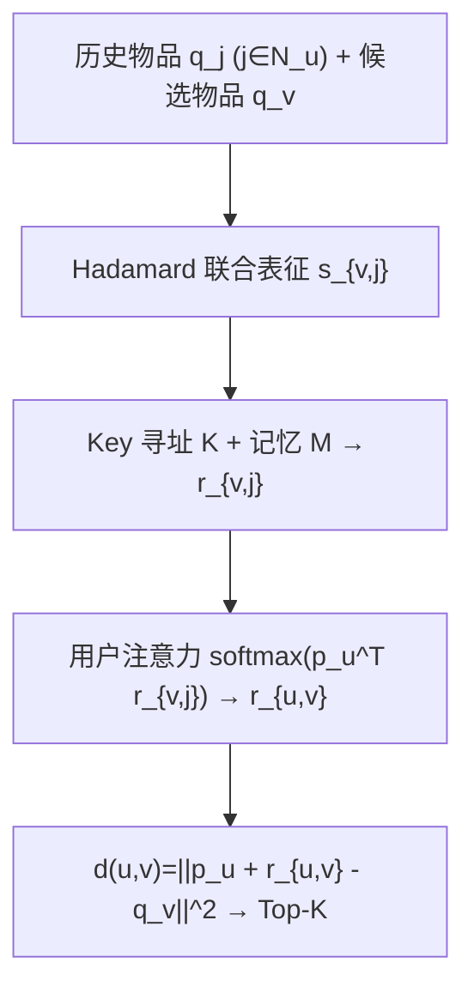

# Hierarchical Latent Relation Modeling for Collaborative Metric Learning (协同度量学习的分层潜在关系建模)

- **会议/期刊**: RecSys 2021 (15th ACM Conference on Recommender Systems)
- **作者与机构**: Viet-Anh Tran, Guillaume Salha-Galvan, Romain Hennequin, Manuel Moussallam (Deezer Research & LIX, École Polytechnique)
- **推荐链路定位**: 召回（度量空间向量检索）
- **研究方向**: 协同过滤与双塔召回 / 度量学习
- **论文原文**: [https://arxiv.org/abs/2108.04655v1](https://arxiv.org/abs/2108.04655v1)
- **开源代码**: [https://github.com/deezer/recsys21-hlr](https://github.com/deezer/recsys21-hlr)

## TL;DR (1分钟核心速览)

标准 CML 给每个用户一个固定向量，三角不等式使其无法同时靠近风格迥异的物品（兴趣异质性失效），而既有扩展要么只建模 user-item 翻译向量（LRML/TransCF）、要么只建模 item-item 关系（AdaCML），二者互斥。本文提出 HLR/HLR++：先用 key-value 记忆网络从用户历史物品对中抽出 item-item 潜在关系 $r_{v,j}$，再用用户注意力加权聚合成 user-item 关系$r_{u,v}$，以$\lVert \boldsymbol{p}_u + r_{u,v} - \boldsymbol{q}_v \rVert_2^2$ 替代原始欧氏距离并改造三元组损失。在 MovieLens/Echonest/Yelp 上 MAP、NDCG、Recall@10 全面超 AdaCML 约 7%–20%，但在极稀疏 Amazon 上退化。

## Background & Motivation (背景与核心矛盾)

- **主流范式**: CML 用欧氏距离替代内积，凭三元组 hinge loss 学度量空间；后续衍生出两类关系建模路线——LRML/TransCF 学 user-item 翻译向量 $r_{u,v}$，AdaCML（基于 FISM）学 item-item 关系。
- **前人局限**: ① CML 单向量受三角不等式约束，无法刻画"同一用户同时喜欢金属与古典"的多峰兴趣；② LRML/TransCF 逐对建模，参数量大易过拟合且不共享协同信息；AdaCML 只关注候选物品与历史物品的关系，忽略用户侧异质性。
- **核心洞察 (Key Insight)**: 两类关系是互补而非替代的——作者假设存在**层级结构**，user-item 关系建立在 item-item 关系之上（用户对新物品的判断主要源于该物品与其历史交互物品的关系）。
- **本文切入点**: 用记忆网络 + 双层注意力把这一层级假设显式写进 CML 的距离函数。

## Method (核心方法设计)

### 1. 整体框架 (Overall Architecture)

对候选物品 $v$与用户历史$N_u$中每个物品$j$，先在低维空间用 Hadamard 积构造联合表征并检索记忆库，得到 item-item 关系$r_{v,j}$；再以用户向量$\boldsymbol{p}_u$为 query 对$\{r_{v,j}\}_{j\in N_u}$做注意力聚合，得自适应翻译向量$r_{u,v}$；最终把用户向量平移到$\boldsymbol{p}_u + r_{u,v}$，与$\boldsymbol{q}_v$ 求平方欧氏距离排序。HLR++ 额外加一个对称的物品注意力模块，从"共同出现在同一用户上下文中的物品"反向构造 item-item 关系并相加。训练端沿用 CML 三元组 hinge loss，单负样本随机采样。

### 2. 关键设计拆解 (Key Designs)

1. **记忆式 item-item 关系抽取（Key-Value Memory）**：解决"候选物品与历史物品关系事先不可知"的问题。用 $s_{v_1,v_2}=\boldsymbol{q}_{v_1}\odot\boldsymbol{q}_{v_2}$抽取交互表征，与$N$个关系原型 key$k_i$内积得注意力$w_{i,v_1,v_2}=s_{v_1,v_2}^{\top}k_i$，softmax 后加权记忆向量：

$$r_{v_1,v_2}=\sum_{i=1}^{N}w_{i,v_1,v_2}\,\boldsymbol{m}_i$$

直觉上 $K$是"关系类型基"，$M$是这些类型的语义内容；只有$N$ 组共享参数，比 LRML 逐对生成更省参、更抗过拟合。

2. **层级用户注意力聚合（Hierarchical User-Item Relation）**：把逐对关系压成一次用户级关系，避免 user-item 参数爆炸：

$$r_{u,v}=\sum_{j\in N_u}\alpha(u,v,j)\,r_{v,j},\qquad \alpha(u,v,j)=\frac{\exp(\boldsymbol{p}_u^{\top}r_{v,j})}{\sum_{h\in N_u}\exp(\boldsymbol{p}_u^{\top}r_{v,h})}$$

物理直觉：$\alpha$度量"历史物品$j$与候选$v$的关系"在多大程度上解释该用户的品味；HLR++ 再对称地以物品为 query 聚合其历史用户，得$r_{u,v}=r^{I}_{u,v}+r^{U}_{u,v}$，捕捉"跑步时听某几首歌"这类上下文共现。

3. **训练目标、负采样与推理开销**：目标函数改造为平移距离版三元组损失

$$\mathcal{L}=\sum_{(u,v,v^-)\in\mathcal{T}}\big[\lVert\boldsymbol{p}_u+r_{u,v}-\boldsymbol{q}_v\rVert_2^2-\lVert\boldsymbol{p}_u+r_{u,v^-}-\boldsymbol{q}_{v^-}\rVert_2^2+m\big]_+$$

负采样为**Uniform 单负样本**（每正样本随机配 1 个未交互物品），Adam、$d=100$、batch 1000、最多 100 epoch。推理时对每个$(u,v)$ 需跑一次记忆寻址与注意力，开销与 AdaCML 同级（作者报告运行时间相当），高于纯 CML 的 O(1) 距离计算。

## Experimental Setup & Evaluation Protocol (实验设置与评估协议)

- **数据集与预处理**: 四个真实数据集均做递归 $k$-core 过滤（MovieLens/Echonest/Amazon 取$k=10$，Yelp 取$k=5$），显式评分二值化（$\ge 4$为正；Echonest 播放次数$\ge 6$ 为正）。

| 数据集 | #Users | #Items | #Interactions | 密度 | 每用户交互中位数 |
| :--- | :---: | :---: | :---: | :---: | :--- |
| MovieLens | 129,757 | 11,508 | 9,911,879 | 0.664% | 98 |
| Echonest | 131,495 | 39,874 | 2,476,013 | 0.047% | 24 |
| Yelp | 82,166 | 71,949 | 2,077,093 | 0.035% | 23 |
| Amazon (book) | 109,730 | 96,421 | 1,405,671 | 0.030% | 16 |

- **数据划分与防穿越 (Splitting Strategy)**: **比例划分**——每用户交互随机 80%/10%/10% 分训练/验证/测试，按验证集 loss 挑最优 epoch，无时间戳切分，存在轻度未来信息泄漏风险。
- **排名评测协议 (Ranking Protocol)**: `Full-Ranking` 语义（对全部未交互物品排序取 Top-10），报告 Precision/Recall/NDCG/MAP/MRR@10 及推荐物品**中位流行度**；结果为 5 次独立运行的均值 ± 标准差。
- **对比基线与超参设置**: 基线含 MF-ALS、CML、LRML、TransCF、AdaCML 共 5 个代表模型；$d=100$，网格搜索 lr$\in\{2,5,7.5,10\}\times10^{-4}$、记忆切片$N\in\{5,10,20,50\}$、margin$m\in\{0.2,0.5,0.75,1.0\}$。

## Key Experimental Results (实验关键数据)

### 1. 主实验对比 (Main Results)

| 数据集 | 指标@10 | MF-ALS | CML | LRML | TransCF | AdaCML | HLR | HLR++ | Improv. |
| :--- | :--- | :---: | :---: | :---: | :---: | :---: | :---: | :---: | :---: |
| MovieLens | MAP | 8.41 | 7.82 | 9.40 | 2.94 | 10.62 | 10.97 | **11.36** | +6.97% |
| | NDCG | 20.05 | 18.29 | 20.28 | 8.36 | 23.47 | 24.31 | **25.07** | +6.82% |
| | Recall | 13.98 | 13.22 | 13.53 | 6.04 | 16.96 | 17.63 | **18.26** | +7.66% |
| Echonest | MAP | 1.62 | 1.97 | 1.95 | 1.82 | 2.72 | 3.04 | **3.28** | +20.59% |
| | NDCG | 7.12 | 8.85 | 8.60 | 7.90 | 11.78 | 13.13 | **13.88** | +17.83% |
| | Recall | 8.48 | 11.29 | 10.74 | 9.81 | 14.89 | 16.59 | **16.98** | +14.04% |
| Yelp | MAP | 0.44 | 0.52 | 0.54 | 0.15 | 0.57 | **0.63** | **0.63** | +10.53% |
| | NDCG | 2.57 | 2.37 | 2.45 | 0.97 | 2.58 | **2.83** | **2.83** | +9.69% |
| | Recall | **3.64** | 2.89 | 2.90 | 1.53 | 3.13 | 3.35 | 3.35 | −7.97% |
| Amazon | MAP | 0.98 | 1.12 | 1.06 | 0.57 | **1.33** | 1.11 | 1.03 | −16.54% |
| | NDCG | 3.84 | 4.72 | 4.45 | 2.61 | **5.49** | 4.59 | 4.39 | −20.04% |
| | Recall | 4.11 | 5.47 | 5.09 | 3.21 | **6.32** | 5.26 | 5.13 | −16.77% |

（Popularity 中位数：MovieLens 上 MF-ALS 高达 4771.6，CML 1244.8，HLR 仅 827.8；Amazon 上 HLR++ 47.6 vs MF-ALS 222.7。）

### 2. 消融实验 (Ablation Study)

论文未设传统 `w/o` 消融，而以等价结构变体互相比较（下表为 MAP/NDCG@10，MovieLens / Echonest）：

| 结构变体 | 建模关系 | ML MAP | ML NDCG | Echo MAP | Echo NDCG |
| :--- | :--- | :---: | :---: | :---: | :---: |
| CML | 无关系（基线） | 7.82 | 18.29 | 1.97 | 8.85 |
| LRML | 仅 user-item | 9.40 | 20.28 | 1.95 | 8.60 |
| TransCF | 仅 user-item（邻域） | 2.94 | 8.36 | 1.82 | 7.90 |
| AdaCML | 仅 item-item | 10.62 | 23.47 | 2.72 | 11.78 |
| HLR | 层级 item→user-item | 10.97 | 24.31 | 3.04 | 13.13 |
| HLR++ | 双向（+ item 注意力） | **11.36** | **25.07** | **3.28** | **13.88** |

### 3. 关键实验发现 (Key Findings)

1. **关系建模的收益随稀疏度单调衰减**：最稠密的 MovieLens 上关系模型较无关系 CML 提升 MAP $+35.8\%$（7.82→10.62，AdaCML），Echonest 亦然；但到密度 0.030% 的 Amazon，LRML/TransCF/HLR/HLR++ 全部不如 CML，仅 AdaCML 幸存（MAP 1.33 vs CML 1.12）——说明记忆式关系在高稀疏下引入噪声与过拟合。
2. **item-item 关系比 user-item 关系更有价值**：AdaCML 在四个数据集上全部优于 LRML 与 TransCF（MovieLens MAP 10.62 vs 9.40 vs 2.94），验证了"用户对新物品判断依赖其历史物品"的假设；TransCF 的邻域式逐对翻译在此任务上近乎崩溃，提示其向量乘积关系生成方式不适配隐式反馈。
3. **HLR++ 的额外物品注意力只在"上下文敏感"域有效**：MovieLens（Recall 17.63→18.26）与 Echonest（NDCG 13.13→13.88）稳定增益，而 Yelp/Amazon 上毫无提升（0.63/0.63、1.11/1.03）；同时 HLR 系在 MovieLens/Echonest 上推荐流行度（827.8、33.0）显著低于 MF-ALS（4771.6、511.7），即精度与去流行度偏置可兼得。

## Highlights & Limitations (亮点、对比与审稿批判)

- **与代表作对比 (vs. Prior Work)**: 相较 LRML 的"逐对生成关系向量"，HLR 用共享的 key-value 记忆库把参数量从 $O(|S|\cdot d)$降到$O(N\cdot d)$；相较 AdaCML 的 FISM 式无参数加性表征，HLR 引入用户侧注意力使其能表达兴趣异质性；相较 TransCF 的邻域平均，本文的注意力权重是端到端可学的。
- **可迁移亮点**: ① "关系原型的 Key-Value 记忆 + 分层注意力"可平移到序列推荐中做 next-item 与历史行为的软对齐；② 用推荐中位流行度作为去偏辅助指标，与精度并列汇报，值得在召回评测中推广。
- **审稿级局限批判**: ① 划分采用每用户随机 80/10/10 而非全局时间戳切分，同一用户的未来交互可能进入训练，指标存在乐观偏差；② 推理需对每个候选物品执行记忆寻址与注意力聚合，全库打分时延远高于 CML 的纯距离计算，论文只给了"与 AdaCML 相当"的定性说明，缺少 QPS 量化；③ $N$ 与 margin、学习率三重网格搜索但未报告敏感度曲线，稀疏场景的最优配置稳健性存疑。

## Rating (四维评分)

- **方法创新性 (Novelty)**: ⭐⭐⭐⭐ （把 KG 翻译机制与 key-value 记忆注意力组装成显式层级关系模型，思路清晰但组件均为已有积木的重组，理论分析止于三角不等式的定性讨论）
- **评估协议与实验扎实度 (Protocol & Experiments)**: ⭐⭐⭐⭐ （四数据集 + 5 次运行 ± 标准差 + 流行度指标，覆盖稠密到极稀疏的良好梯度；扣分在于随机比例划分缺少时间切分与显著性检验）
- **写作与数学规范度 (Clarity & Rigor)**: ⭐⭐⭐⭐ （公式链路 item-item → user-item → 距离 → 损失完整自洽；但缺复杂度分析与关系向量 $r_{v,j}$在$N_u$ 很大时的聚合开销讨论）
- **工业落地与复现价值 (Industrial & Practical Value)**: ⭐⭐⭐⭐ （Deezer 工业作者、代码开源、超参全公开且训练开销与 AdaCML 持平；但全库召回的打分成本与稀疏域退化限制了直接上线）

