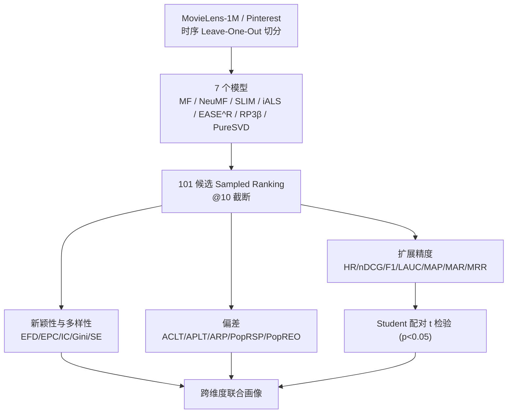

# Reenvisioning Collaborative Filtering vs Matrix Factorization (重审神经协同过滤与矩阵分解之争)

- **会议/期刊**: ACM RecSys 2021 (9 pages, preprint arXiv:2107.13472)
- **作者与机构**: Vito Walter Anelli, Tommaso Di Noia, Claudio Pomo (Politecnico di Bari) & Alejandro Bellogín (UAM)
- **推荐链路定位**: 召回（隐式反馈 Top-N 排序模型评测）
- **研究方向**: 协同过滤与双塔召回 / 去偏公平与可信评测
- **论文原文**: [arXiv:2107.13472v1](https://arxiv.org/abs/2107.13472v1)
- **开源代码**: [sisinflab/Reenvisioning-the-comparison...](https://github.com/sisinflab/Reenvisioning-the-comparison-between-Neural-Collaborative-Filtering-and-Matrix-Factorization)

## TL;DR (1分钟核心速览)

NeuMF 与 MF 的"神经网络是否必要"之争此前只比拼精度，且缺少统计检验与互补维度审视。本文在三篇既有工作的基础上完整复现 NeuMF/MF/ SLIM/iALS/EASE$^R$/RP3β/PureSVD 七模型，在 MovieLens-1M 与 Pinterest 的 101 候选采样排序协议下，扩展出 7 项精度指标、Student 配对$t$ 检验、5 项新颖性/多样性指标与 5 项偏差指标。结论：MF 在 HR@10 上较 NeuMF 相对提升 5.15%(ML-1M)/2.23%(Pinterest) 且在长尾上同样领先，但 NeuMF 的物品覆盖率与列表多样性更好。

## Background & Motivation (背景与核心矛盾)

- **主流范式**: 以 BPR-MF、SLIM、iALS 为代表的线性/相似度模型长期是 Top-N 召回主力；NCF 系（GMF/MLP/NeuMF）以 MLP 学习用户-物品亲和度，被宣称能突破 MF 的线性表达瓶颈。
- **前人局限一**: Dacrema 等与 Rendle 等的对比仅在 HR/nDCG 单一精度维度展开，未报告 novelty、diversity、coverage 与偏差，而这些正是工业召回评估的核心关切。
- **前人局限二**: 跨论文"抄表"式对比缺乏统一复现与显著性检验，个别结果（如 NeuMF）不可复现，无法判断模型差距是否超出随机初始化带来的波动。
- **核心洞察 (Key Insight)**: 若 MF 在线性打分下就已逼近甚至超过 MLP 相似度学习，那么"非线性建模收益"可能被严重高估，其真实价值或许体现在覆盖率/多样性的非精度维度上。
- **本文切入点**: 以 Elliot 统一框架 + 外部模型适配完整复现，在保持原实验条件前提下横向铺开多维度评测与统计检验。

## Method (核心方法设计)

### 1. 整体框架 (Overall Architecture)

本文不提出新模型，而是构建一套**可复现的多维评测协议**：以 Elliot 为统一 benchmark，将 MF、NeuMF 及 5 个竞争基线以外部模型形式接入以贴合原始实现；沿用 He 等发布的 MovieLens-1M / Pinterest 时序 Leave-One-Out 划分与 101 候选短名单，先在 HR@10/nDCG@10 上复现三篇原文（逐格比较 $\Delta$偏差量级需低于$10^{-2}$），再在同一批推荐列表上并行计算扩展精度、新颖性/多样性、偏差三组指标，最后用 Student 配对$t$ 检验判定模型间差异是否显著，从而形成"同一列表、多维画像"的联合结论。

### 2. 关键设计拆解 (Key Designs)

1. **相似度算子的三档对照（隔离"非线性"这一变量）**：痛点在于既往对比混杂了嵌入维度、预训练、损失函数等干扰项；本文将打分函数严格区分为点积 $\phi_{dot}(p,q)=b_g+b_p+b_q+\sum_{f=1}^{d}p_f q_f$、MLP 变换$\psi_{MLP}(p,q)=\Phi([p,q])$与 NeuMF 复合$\psi_{NeuMF}(p,q)=\psi_{MLP}(p,q)+\psi_{GMF}(p',q')$，其余条件全部对齐。直觉上，若$\Phi$ 学到的仍是近似线性映射，则增益必然退化到方差层面。

2. **多维评估矩阵与偏差分组定义**：痛点在于精度指标高度相关、无法刻画"推荐生态"；本文在 EFD/EPC（长尾曝光）、IC/Gini/SE（覆盖率与列表多样性）之外，将偏差按物品流行度二分（前 20% 为热门组），构造 PopRSP（统计均等）与 PopREO（机会均等）两项排名级偏差指标，把"流行度偏置"转化为可分组的概率差问题。

3. **训练目标、负采样与统计检验**：所有模型沿用各自原文损失（MF/NeuMF 为 BPR 式成对损失，SLIM/iALS/EASE$^R$为各自闭式或加权回归解），负采样策略与超参完全取自原文附加材料，模型选择指标统一为 HR@10（与原文一致，避免二次调优引入偏差）；显著性判定使用逐用户配对的 Student$t$检验，$p<0.05$视为显著，从而把"$\Delta$只有$10^{-3}$ 量级"的结果区分为真实差距与噪声。

## Experimental Setup & Evaluation Protocol (实验设置与评估协议)

- **数据集与预处理**: 沿用 NCF 官方发布的切分版本，MovieLens-1M 已二值化为隐式反馈。

| 数据集 | #Users | #Items | #Interactions | 稀疏度/密度 | 特征/场景说明 |
| :--- | :---: | :---: | :---: | :---: | :--- |
| MovieLens-1M | 6,040 | 3,706 | 1,000,209 | 密度 ≈ 4.47% | 电影评分二值化，隐式反馈 |
| Pinterest | 55,187 | 9,916 | 1,463,556 | 密度 ≈ 0.27% | 图像 Pinterest 隐式交互，极稀疏 |

- **数据划分与防穿越 (Splitting Strategy)**: `Leave-One-Out`（时间序），每个用户最后一条交互作为测试正样本，其余为训练集，严格无未来信息泄露。
- **排名评测协议 (Ranking Protocol)**: `Sampled Ranking`，每用户 101 候选（1 个测试正样本 + 100 个从未交互物品中均匀采样负样本），指标截断 @10。**注意**：该协议已被 Krichene & Rendle 指出对 MF 类模型存在乐观偏差，但本文为保持复现一致性未作改动。
- **对比基线与超参设置**: 基线覆盖线性/相似度（SLIM、iALS、EASE$^R$、RP3β、PureSVD）、非个性化（MostPop）与神经（NeuMF）三类；训练超参直接采用 Dacrema 等附加材料中的最优配置，嵌入维度$d\in\{8,16,24,32,48,64,96,192\}$分档扫描；显著性检验标准为配对$t$检验$p<0.05$。

## Key Experimental Results (实验关键数据)

### 1. 主实验对比 (Main Results)

表 1：精度复现（@10，粗体为最优，下划线为次优；重训结果与原文 $\Delta$均低于$10^{-2}$，复现成立）

| Method | ML-1M nDCG | ML-1M HR | Pinterest nDCG | Pinterest HR |
| :--- | :---: | :---: | :---: | :---: |
| MostPop | 0.2542 | 0.4535 | 0.1410 | 0.2743 |
| PureSVD | 0.4299 | 0.6926 | 0.5233 | 0.8261 |
| NeuMF | 0.4211 | 0.6952 | 0.5480 | 0.8704 |
| RP3β | 0.4011 | 0.6758 | 0.5685 | 0.8796 |
| iALS | 0.4385 | 0.7123 | 0.5587 | 0.8766 |
| SLIM | 0.4480 | 0.7164 | 0.5615 | 0.8696 |
| EASE$^R$ | 0.4494 | 0.7192 | 0.5605 | 0.8684 |
| **MF** | **0.4545** | **0.7310** | **0.5776** | **0.8898** |
| *Improv. (MF vs NeuMF)* | *+7.93%* | *+5.15%* | *+5.40%* | *+2.23%* |

表 2：扩展精度指标（@10）显示 MovieLens-1M 上排序结论发生翻转

| Method | ML-1M MAP | ML-1M MAR | ML-1M MRR | Pin MAP | Pin MRR |
| :--- | :---: | :---: | :---: | :---: | :---: |
| NeuMF | 0.1120 | 0.5106 | 0.3363 | 0.1487 | 0.4472 |
| MF | 0.1188 | 0.5383 | 0.3573 | **0.1584** | **0.4796** |
| SLIM | 0.1204 | 0.5372 | 0.3648 | 0.1535 | 0.4649 |
| EASE$^R$ | **0.1210** | **0.5420** | **0.3655** | 0.1532 | 0.4639 |
| RP3β | 0.1053 | 0.4853 | 0.3166 | 0.1554 | 0.4710 |

### 2. 消融实验 (Ablation Study)

原作无模块消融，本文的可控变量实验是 **NeuMF 嵌入维度敏感性 + 可复现性偏差**（表 3）：

| 因子数 (ML-1M/Pin) | ML nDCG | ML HR | Pin nDCG | Pin HR | Pin nDCG 原文 | $\Delta$ |
| :--- | :---: | :---: | :---: | :---: | :---: | :---: |
| 8 / 24 | 0.409 | 0.688 | 0.547 | 0.868 | 0.546 | +0.001 |
| 16 / 48 | 0.416 | 0.691 | 0.548 | 0.870 | 0.547 | +0.001 |
| 32 / 96 | 0.418 | 0.699 | 0.541 | 0.869 | 0.549 | −0.008 |
| 64 / 192 | 0.421 | 0.695 | 0.536 | 0.861 | 0.551 | −0.015 |

### 3. 关键实验发现 (Key Findings)

1. **MF 在长尾上同样领先，而非"用精度换长尾"**：MF 的 EFD/EPC（长尾曝光）在 ML-1M 上优于 NeuMF，而 NeuMF 的长尾新颖性仅优于 RP3β 与 MostPop——说明神经相似度学习并未带来更好的冷门物品发现能力，反而加剧了头部聚集。
2. **NeuMF 的唯一胜场是覆盖率与列表多样性**：ML-1M 上 NeuMF 取得最高 Item Coverage，Gini 多样性优于 MF（MF 在 ML-1M 上仅优于 EASE$^R$ 与 RP3β）；这意味着"个性化分散度"可作为选型时的反向权衡维度。
3. **统计检验收紧结论**：配对 $t$检验显示 MF 在 HR/nDCG 上对全部基线显著（$p<0.05$），但在 MAP/MRR 上 MF、SLIM、EASE$^R$ 三者差异不显著；同时 NeuMF 在 PopRSP/PopREO 上反而比 MF 偏差更小，而 iALS/SLIM 偏差表现最佳，且 NeuMF 在 Pinterest 上因子数增大时 nDCG 从 0.548 单调降至 0.536，暴露初始化不稳定性。

## Highlights & Limitations (亮点、对比与审稿批判)

- **与代表作对比**: 相较 He 等 (NCF, WWW'17) 的"MLP 优于点积"结论，本文通过严格复现证明该结论在同等调优下不成立；相较 Rendle 等 (RecSys'20) 仅有的点积 vs 学习相似度之争，本文把战场从单一精度扩展到长尾/多样性/偏差四维；相较 Dacrema 等 (RecSys'19) 的模型重评估，本文补上了统计显著性检验这一关键环节。
- **可迁移亮点**: (i) "同列表多指标画像 + 配对 $t$ 检验"的评测范式可直接迁移到任何召回模型 AB 对比；(ii) 以流行度二分构造 PopRSP/PopREO，为无敏感属性的推荐场景提供了可落地的偏差量化方案。
- **审稿级局限批判**: 其一，沿用 101 候选采样排序协议，已被证明会系统性高估 MF 类模型的 HR/nDCG，结论在 Full-Ranking 下是否稳健未知；其二，本研究仅覆盖两个数据集、且所有模型均以 HR@10 为选型目标，未讨论以多样性/公平性为目标优化时排名反转的可能，此外 NeuMF 在 Pinterest 大嵌入下的性能退化也暗示原实现存在随机初始化敏感问题。

## Rating (四维评分)

- **方法创新性 (Novelty)**: ⭐⭐⭐ （不提出新模型，但"多维画像 + 统计检验"的评测框架对领域认知纠偏有实质价值）
- **评估协议与实验扎实度 (Protocol & Experiments)**: ⭐⭐⭐⭐ （七模型全量复现、$\Delta$逐格对照、配对$t$ 检验严谨；扣分于沿用受质疑的 101 采样排序协议）
- **写作与数学规范度 (Clarity & Rigor)**: ⭐⭐⭐⭐ （三类打分函数公式对比清晰、指标定义与分组规则表述明确，但部分指标定义需回引原文）
- **工业落地与复现价值 (Industrial & Practical Value)**: ⭐⭐⭐⭐⭐ （代码全开源、基于 Elliot 的即插即用评测流程，可直接作为召回选型与偏差审计的基准工具箱）

