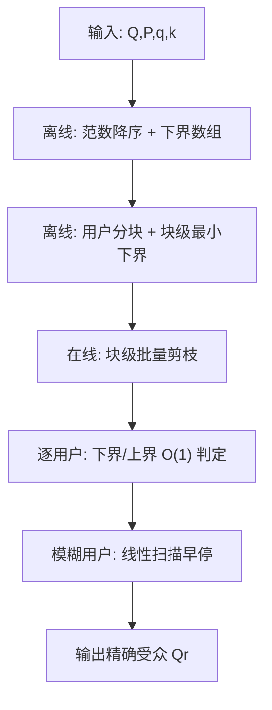
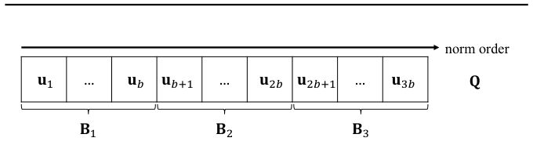

# Reverse Maximum Inner Product Search: How to efficiently find users who would like to buy my item? (反向最大内积搜索：如何高效找到想买我商品的用户？)

- **会议/期刊**: RecSys 2021
- **作者与机构**: Daichi Amagata (Osaka University, JST PRESTO)；Takahiro Hara (Osaka University)
- **推荐链路定位**: 召回 / 物品驱动的受众检索
- **研究方向**: 协同过滤与双塔召回
- **论文原文**: [https://arxiv.org/abs/2110.07131v1](https://arxiv.org/abs/2110.07131v1)
- **开源代码**: [https://github.com/amgt-d1/Simpfer](https://github.com/amgt-d1/Simpfer)

## TL;DR (1分钟核心速览)

本文定义反向 $k$-MIPS：给定目标物品向量$q$，找出所有把$q$排进其 top-$k$的用户。Simpfer 离线按范数排序用户/物品，构建每个用户 top-$k$内积下界数组与块级最小下界；在线用 Cauchy-Schwarz 上下界做$O(1)$ 批量剪枝，仅在模糊时线性扫描。四个 MF 数据集、全库精确判定协议下，较 LEMP/FEXIPRO 至少快两个数量级，且结果精确。

## Background & Motivation (背景与核心矛盾)

- **主流范式**: 双塔/MF 内积 top-$k$ 召回是 user-driven：给定用户找物品，工业界用 MIPS/ANN 做大规模检索。
- **前人局限**: 商家促销是 item-driven，需要反向查“谁可能买 $q$”；逐用户跑 MIPS 需$O(nmd)$，大量用户与$q$ 无关；树索引在高维退化，近似 MIPS 又会漏掉/误伤受众。
- **核心洞察 (Key Insight)**: 反向查询只需判断“$q$是否在$u$的 top-$k$中”这一 yes/no 决策，不必算出完整 top-$k$；且实际$k$很小，可预设$k_{\max}$。
- **本文切入点**: 用范数排序与预计算下界构造轻量索引，先块级批量剪枝，再逐向量 $O(1)$ 判定，最后才回退线性扫描。

## Method (核心方法设计)

### 1. 整体框架 (Overall Architecture)

Simpfer 是无监督精确算法：离线对 $Q,P$按范数降序，利用前$O(k_{\max})$个物品为每个用户构建 top-$k$内积下界数组，并按范数顺序把用户切成$O(\log n)$大小的块，块内维护逐列最小下界。在线给定$q$，先算$\|q\|$，对每个块用块级下界一次性判定整块是否可丢；未丢块内逐用户算$u_i\cdot q$，用“下界判 no、Cauchy 上界判 yes”，仍模糊才进入带阈值的线性扫描。全过程可多核按块并行，输出精确用户集合$Q_r$。

### 2. 关键设计拆解 (Key Designs)

1. **下界数组与范数排序（轻量紧下界）**：痛点是对任意 $q$都要快速知道$u_i$的第$k$高内积大概多大。Simpfer 将$P$按范数降序，取前$O(k_{\max})$个物品为每个$u_i$预计算第$j$高内积下界$L_i^j$，满足$L_i^k\le$真实第$k$高内积。若$u_i\cdot q\le L_i^k$，则$q$必不在$u_i$的 top-$k$中，$O(1)$ 返回 no。直觉是大范数物品更易产生大内积，少量物品即可得到紧下界。

2. **块级批量过滤（一次剪掉一组用户）**：逐用户判定仍太慢，Simpfer 按范数顺序把用户分块，块大小 $|Q(B)|=O(\log n)$，并令$L^j(B)=\min_{u_i\in Q(B)}L_i^j$。由 Cauchy-Schwarz，块内首向量范数给出整块上界；若$\|u_i\|\|q\|\le L^k(B)$，整块所有用户都返回 no，$O(1)$ 完成批量剪枝。这样把“逐向量过滤”提升为“块级过滤”，且不损失精确性。

<figure class="paper-figure" markdown="span">
  <figcaption>图1：块构建示例。</figcaption>
</figure>

3. **Yes 判定、线性扫描与推理复杂度**：若 $u_i\cdot q\ge \|u_i\|\|p_k\|$，由 Cauchy-Schwarz 可知$q$必进 top-$k$，直接 yes；否则进入线性扫描，利用$P$已按范数排序，维护中间第$k$高内积$\tau$：若$u_i\cdot q\ge\|u_i\|\|p_j\|$可提前 yes，若$\tau>u_i\cdot q$可提前 no。离线复杂度$O(n(d+\log n))$、空间$O(n)$；在线复杂度$O((1-\alpha)n m'd)$，$\alpha$为块剪枝率，实践中$m'=O(k)$。无训练损失、无负采样，推理精确。

## Experimental Setup & Evaluation Protocol (实验设置与评估协议)

- **数据集与预处理**: 原文用 MF 得到 50 维用户/物品向量；未报告交互数，故表中 #Interactions/稀疏度标为 N/A。

| 数据集 | #Users ($|Q|$) | #Items ($|P|$) | #Interactions | 稀疏度/密度 | 特征/场景说明 |
| :--- | :---: | :---: | :---: | :---: | :--- |
| MovieLens | 138,493 | 26,744 | N/A | N/A | 50维 MF 向量 |
| Netflix | 480,189 | 17,770 | N/A | N/A | 50维 MF 向量 |
| Amazon | 1,948,882 | 98,211 | N/A | N/A | 50维 MF 向量 |
| Yahoo! | 2,088,620 | 200,941 | N/A | N/A | 50维 MF 向量 |

- **数据划分与防穿越 (Splitting Strategy)**: 无训练/测试切分；从 $P$随机取 1,000 个向量作查询，离线索引仅用$Q,P$，无标签泄漏。
- **排名评测协议 (Ranking Protocol)**: 全库精确反向判定（非采样排序）；指标为 wall-clock 运行时间与内积计算次数 #ip，结果完全精确。
- **对比基线与超参设置**: LEMP（all-$k$-MIPS）与 FEXIPRO（SOTA exact$k$-MIPS）；$d=50$，$k_{\max}=25$，默认$k=10$；C++ -O3 + OpenMP；确定性算法，不做显著性检验。近似 MIPS 因不保证受众完整性被排除。

## Key Experimental Results (实验关键数据)

### 1. 主实验对比 (Main Results)

原文仅有两个精确 MIPS 基线（其他 exact 算法已被 LEMP/FEXIPRO 击败，近似算法不适用）。可核对的 Amazon $k=25$ 结果如下；其余数据集图2显示 Simpfer 至少快两个数量级，原文未给逐点表，故不臆造数值。

| 设置 | 方法 | 预处理 | 在线/总时间 | 相对加速 |
| :--- | :--- | :---: | :---: | :---: |
| Amazon, $k=25$ | FEXIPRO | — | 1206 s | 1× |
| Amazon, $k=25$ | Simpfer | 15.10 s | 0.16 s / 15.26 s | **79×** |

### 2. 消融实验 (Ablation Study)

$k=10$ 时移除块级过滤（w/o blocks）与完整 Simpfer 的运行时间对比：

| 数据集 | w/o blocks | Simpfer | 块过滤加速 |
| :--- | :---: | :---: | :---: |
| MovieLens | 22.0 ms | **10.3 ms** | 2.14× |
| Netflix | 100.8 ms | **58.6 ms** | 1.72× |
| Amazon | 446.2 ms | **117.6 ms** | 3.79× |
| Yahoo! | 1586.2 ms | **1481.2 ms** | 1.07× |

### 3. 关键实验发现 (Key Findings)

- **块过滤收益高度依赖范数分布**：Amazon 上块过滤带来 3.79× 加速，而 Yahoo! 仅 1.07×；后者大量用户范数大，块级下界难剪枝，说明索引效果由数据分布决定。
- **多核并行有效但不完美**：12 核下 Amazon 达 7.76×、MovieLens 5.84×，Yahoo! 仅 2.88×；块处理成本未知且负载难均分，Yahoo! 是 hard case。
- **预处理开销可控且可重建**：Yahoo! 预处理 15.55 s、Amazon 15.10 s；Amazon $k=25$时 Simpfer 预处理+在线共 15.26 s，远低于 FEXIPRO 的 1206 s；即使$k>k_{\max}$ 需重建也仍快。

## Highlights & Limitations (亮点、对比与审稿批判)

- **与代表作对比 (vs. Prior Work)**: LEMP 对每个用户跑 all-$k$-MIPS，FEXIPRO 用 SVD/整数近似收紧逐向量上界但过滤成本$\Omega(k)+O(d')$；Simpfer 把问题降为决策版，并用块级$O(1)$剪枝，精确性和速度同时占优。传统 reverse top-$k$ 假设低维欧氏空间，不适用于高维非度量内积。
- **可迁移亮点**: 范数排序 + 下界数组 + 块级最小下界，可迁移到 any exact top-$k$ 决策/受众扩展；按块并行天然适合多核召回服务。
- **审稿级局限批判**: 依赖 $k_{\max}$，$k>k_{\max}$ 需重建索引；仅评测运行时间与 #ip，缺少线上 A/B、推荐收益与长尾受众覆盖分析；块负载不均衡在 Yahoo! 上明显。

## Rating (四维评分)

- **方法创新性 (Novelty)**: ⭐⭐⭐⭐ （首次形式化 reverse $k$-MIPS，决策版+块级下界机制简单但理论清晰）
- **评估协议与实验扎实度 (Protocol & Experiments)**: ⭐⭐⭐⭐ （四真实数据集、精确全库判定、复杂度分析完整；但仅两个 exact 基线且缺推荐效果评估）
- **写作与数学规范度 (Clarity & Rigor)**: ⭐⭐⭐⭐ （引理与复杂度证明干净，符号稍密；图为实验主载体，逐点数值不足）
- **工业落地与复现价值 (Industrial & Practical Value)**: ⭐⭐⭐⭐ （开源 C++、单参数、可并行、精确召回；但需 $k_{\max}$ 预设与重建，线上收益待验证）

