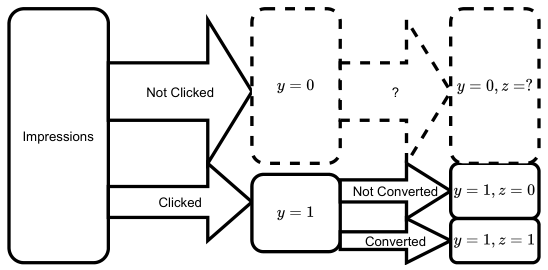
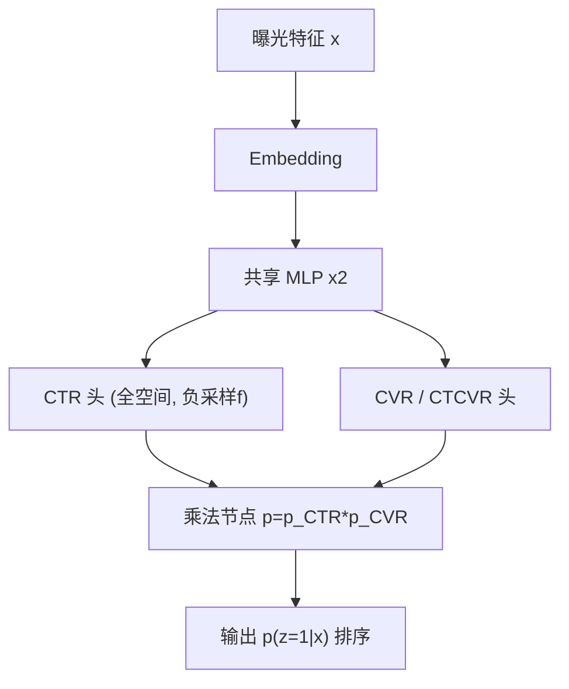

# An Analysis Of Entire Space Multi-Task Models For Post-Click Conversion Prediction (全空间多任务模型用于点击后转化预估的系统性分析)

- **会议/期刊**: RecSys 2021 (Late Breaking Results)
- **作者与机构**: Conor O'Brien, Kin Sum Liu, James Neufeld, Rafael Barreto, Jonathan J. Hunt (Twitter)
- **推荐链路定位**: 精排（CVR/CTR 双目标打分，用于广告排序与曝光价值估计）
- **研究方向**: CTR/CVR 预估与特征交叉 / 多任务学习与多目标精排
- **论文原文**: [https://arxiv.org/abs/2108.13475v1](https://arxiv.org/abs/2108.13475v1)
- **开源代码**: 暂未开源

## TL;DR (1分钟核心速览)

本文针对 CVR 预估的两大顽疾——点击样本稀疏（<1% 曝光有点击）与只在点击空间训练造成的样本选择偏差——对 ESMM 的「硬参数共享 / 全空间建模 / 点击加权 CVR」三要素做**逐要素消融**。在 Twitter+MoPub 超 5B 曝光、50M 点击的工业数据、按“前 14 天训练 / 第 15 天测试”的未来时间切分下，以校准敏感的交叉熵为指标：仅硬参数共享的 IPSP 反超完整 ESMM（+1.29% vs. +1.15%），纯全空间 ESP 反而掉 2%，说明增益**不具可加性**。

## Background & Motivation (背景与核心矛盾)

- **主流范式**: 广告系统用多任务网络同时估 $\hat p(y=1|x)$（CTR）与$\hat p(z=1|y=1,x)$（CVR），最终以$\hat p(z=1|x)=\hat p_{CTR}\cdot\hat p_{CVR}$ 排序。
- **前人局限**: 独立建模（IP）时 CVR 只吃点击样本，训练数据量比 CTR 少两个数量级；且推理要在**全体曝光空间**上估转化，但 $y=0$的曝光缺失反事实$p(z=1|y=0,x)$（图 1 虚线），造成系统性高估/偏差。ESMM 宣称用「共享参数 + 全空间 + 点击加权」同时治两病，却从未拆分过哪一味药真正起效。
- **核心洞察 (Key Insight)**: 数据偏差的本质不是"数据少"，而是全空间里 CVR 头**无法区分哪些样本的转化标签是"可观测"的**；因此全空间训练必须配一个相关性权重，否则 99% 的负样本噪声会淹没信号。
- **本文切入点**: 固定同一工业数据集与同等参数量预算，构造 6 个仅在三要素上取子集的模型，用统计检验量化各自贡献与可加性。

<figure class="paper-figure" markdown="span">
  <figcaption>图 1. 从曝光到点击（𝑦）再到转化（𝑧）的事件流。带有广告点击交互的曝光，𝑦= 1，相比无广告点击的曝光，𝑦= 0，稀疏得多。虚线表示实际中无法观测的条件似然：即导致数据偏差的缺失反事实。仅在被点击数据上训练、预测 𝑝(𝑧|𝑦= 1,𝑥) 的转化模型，当用于全体曝光空间上的转化推断时，会同时受到稀疏性和偏差的影响。</figcaption>
</figure>

## Method (核心方法设计)

### 1. 整体框架 (Overall Architecture)

模型输入为曝光级特征 $x$（广告位、用户请求、广告属性），经 embedding 后进入 2 层共享 MLP，再分叉为每头 2 层私有 MLP。CTR 头在全曝光空间（负样本下采样系数$f$并同倍上采样回校准）训练；CTCVR/CVR 关系通过两种方式约束：一是乘法节点$\hat p_{CTCVR}=\hat p_{CTR}\cdot\hat p_{CVR}$重连分支（ESMM/ESMM-NS，无额外可训练参数），二是各头独立输出（ESSP-Split）。推理时统一输出$\hat p(z=1|x)$ 用于排序。整个实验矩阵即"是否共享参数 × 是否全空间 × 是否加权 CVR"的 3 位开关组合（图 2）。

### 2. 关键设计拆解 (Key Designs)

1. **全空间重参数化 + 隐式点击加权（ESMM / ESMM-NS）**：把不可估的 $\hat p(z|y=1,x)$换成可在全曝光上监督的$\hat p_{CTCVR}$，
$$\mathcal{L}=\underbrace{\mathcal{L}_{CTR}(\hat p_{CTR},y)}_{\text{全空间}}+\underbrace{\mathcal{L}_{CTCVR}(\hat p_{CTR}\hat p_{CVR},z)}_{\text{全空间}},\quad \hat p_{CVR}^{\text{implicit}}=\hat p_{CTCVR}/\hat p_{CTR}$$
因 $\partial\mathcal{L}_{CTCVR}/\partial\hat p_{CVR}\propto \hat p_{CTR}$，等价于给每个曝光一个$w(x)=\hat p_{CTR}(x)$ 的软权重——点击倾向高者才被当作"准可观测"的 CVR 样本。这正是"全空间训练不崩"的物理原因，而非额外数据量。

2. **硬参数共享的迁移机制（IPSP / ESSP-Split）**：IPSP 保留 IP 的分解式损失（CVR 仍只在 $y=1$ 上算），仅让早期层共享；ESSP-Split 保留全空间双损失但去掉乘法耦合。前者验证"共享表征即隐式正则"，后者验证"耦合一致性"本身的价值。

3. **训练目标、负采样与推理开销**：CTR 负样本下采样 $f$并以权重$f$上采样以保校准；转化标签$z$ 一律不降采样。总损失为两任务交叉熵直接相加（无人工调权）。推理仍为一次前向 + 一次乘法，与单任务模型同阶，可无缝替换线上打分器。

## Experimental Setup & Evaluation Protocol (实验设置与评估协议)

- **数据集与预处理**: 2020 年中连续多日 Twitter 与 MoPub（站内 + 移动展示网盟）App Install 广告日志，含全量曝光、点击、安装事件：

| 数据集 | #Users | #Items | #Interactions | 稀疏度/密度 | 特征/场景说明 |
| :--- | :---: | :---: | :---: | :---: | :--- |
| Twitter Ads (私有) | 未披露 | 未披露（广告计划级） | >5B 曝光 / >50M 点击 / 数百万转化 | 点击率 <1%，转化率更低 2 个量级 | 移动 App 安装广告，站内 + MoPub 网盟（含 in-game） |

- **数据划分与防穿越 (Splitting Strategy)**: 全局时间戳切分——用前 $N=14$ 天训练、第 15 天测试，严格 past→future；训练内样本打乱以近似 i.i.d.。另测了不重训、向前推多天的时序漂移鲁棒性，未发现模型间差异。
- **排名评测协议 (Ranking Protocol)**: 非采样排序，直接在留出日**全曝光**上评估；主指标为需校准的交叉熵（报告相对 IP 的百分比增益与 SEM），PR-AUC 见附录；负样本按系数 $f$ 下采样并等倍加权以保证概率校准。
- **对比基线与超参设置**: 6 个自建变体（IP/ESP/ESSP-Split/ESMM-NS/ESMM/IPSP），均为 2 共享层 + 每头 2 层、参数量对齐；每个模型 ≥10 次重复运行，双侧 t 检验 $p<0.01$；人工调参预算对齐，加深加宽无收益。

## Key Experimental Results (实验关键数据)

### 1. 主实验对比 (Main Results)

指标为相对 IP 基线均值的交叉熵增益（越高越好，>0 表示优于 IP）：

| 模型 | 共享参数 | 全空间训练 | 点击加权 CVR | 相对增益 | SEM | 显著优于 ($p<0.01$) |
| :--- | :---: | :---: | :---: | :---: | :---: | :--- |
| **IPSP** | ✓ | ✗ | ✗ | **+1.29%** | 0.0435 | IP, ESP |
| ESMM | ✓ | ✓ | ✓ | +1.15% | 0.0628 | IP, ESP |
| ESMM-NS | ✗ | ✓ | ✓ | +0.94% | 0.0932 | ESP |
| ESSP-Split | ✓ | ✓ | ✗ | +0.31% | 0.0731 | ESP |
| IP (baseline) | ✗ | ✗ | ✗ | 0.00% (1.0000) | — | ESP |
| ESP | ✗ | ✓ | ✗（无 CTR 辅助） | **-1.98%** | 0.0510 | — |

### 2. 消融实验 (Ablation Study)

以完整 ESMM 为锚点做「扣件」式消融（$\Delta$ 为其相对该变体的交叉熵差）：

| 变体 | 被移除的要素 | 相对 IP | 相对 ESMM |
| :--- | :--- | :---: | :---: |
| ESMM | — | +1.15% | — |
| w/o Shared Params → ESMM-NS | 硬参数共享 | +0.94% | −0.21pp |
| w/o Consistent Coupling → ESSP-Split | 乘法耦合（保持共享+全空间） | +0.31% | −0.84pp |
| w/o Entire Space → IPSP | 全空间 + 加权（保留共享） | +1.29% | **+0.14pp** |
| w/o CTR 辅助 → ESP | 辅助任务与共享参数 | −1.98% | −3.13pp |

### 3. 关键实验发现 (Key Findings)

1. **全空间是把双刃剑**：ESP 单头在全空间直接学 $\hat p(z,y|x)$反而比 IP 低 1.98%，说明在 <1% 点击的极端信噪比下，"多拿 100 倍数据"若无相关性加权就是纯噪声注入；而 ESMM-NS 仅靠$\hat p_{CTR}$ 加权就把结果从 −1.98% 拉到 +0.94%，一次性回收约 2.9 个百分点，直接量化了数据偏差的严重程度。
2. **增益不可加、甚至互相蚕食**：共享参数（IPSP +1.29%）与全空间加权（ESMM-NS +0.94%）各自都能拿到与完整 ESMM（+1.15%）同量级的效果，合并后并未叠加；ESMM 相对 IPSP 差异在该样本量下不显著。即"ESMM 优越性"主要来自硬参数共享这一经典 MTL 机制，而非全空间建模的额外收益。
3. **稳定性代价**：ESMM 是唯一对超参明显敏感、跨运行方差最大的模型（SEM 0.0628 vs. IPSP 0.0435），而耦合分支的 ESSP-Split 仅 +0.31%，说明"乘法一致性约束"本身贡献有限，却引入了额外的训练交互复杂度；工程上 IPSP 是性价比更高的选择。

## Highlights & Limitations (亮点、对比与审稿批判)

- **与代表作对比 (vs. Prior Work)**: 相比 ESMM（Ma et al., SIGIR'18）只给出"三要素打包有效"的整体结论，本文首次在同一工业数据上把三要素拆开，证明其增益来源可被更简单的 IPSP 替代；相比 ESMM 原始实现只在 embedding 层共享，本文把共享扩展到早期 MLP 层并做了参数量对齐，使对比更公平。
- **可迁移亮点**: (1) 在条件依赖的多事件建模（点击→加购→购买、曝光→播放→完播）中，可先用"仅共享主干 + 各头独立损失"作为默认最省事基线，再决定是否值得上全空间重参数化；(2) 用"去掉辅助任务后指标跌幅"来量化辅助任务的数据偏差严重度，是一种低成本诊断手段。
- **审稿级局限批判**: (1) 数据完全私有且仅单平台单任务（App Install），未给用户/物品规模、未给置信区间外的方差分析，结论的普适性无法被外部复现验证，本质是工业经验报告而非可复现基准；(2) 只报交叉熵（强调校准）而未给 AUC/PR-AUC 主表（置于附录），对以排序为核心指标的推荐场景说服力打折；且各模型参数量并未严格一致（IP 与 ESMM-NS 因双塔 embedding 参数接近翻倍），IPSP 的优势中可能混入容量差异。

## Rating (四维评分)

- **方法创新性 (Novelty)**: ⭐⭐ （无新模型，价值在于对 ESMM 的"去魅式"消融与偏差严重度的定量刻画）
- **评估协议与实验扎实度 (Protocol & Experiments)**: ⭐⭐⭐⭐ （5B 级工业数据、严格未来时间切分、≥10 次重复 + $p<0.01$ 检验，但单平台单任务、无公开数据）
- **写作与数学规范度 (Clarity & Rigor)**: ⭐⭐⭐⭐ （三要素开关表格化表达清晰，公式极简；对 ESMM 加权机制的梯度解释略欠形式化）
- **工业落地与复现价值 (Industrial & Practical Value)**: ⭐⭐⭐⭐ （结论直接可落地：IPSP 更简单更稳；但无开源代码，复现需自建同构数据）

