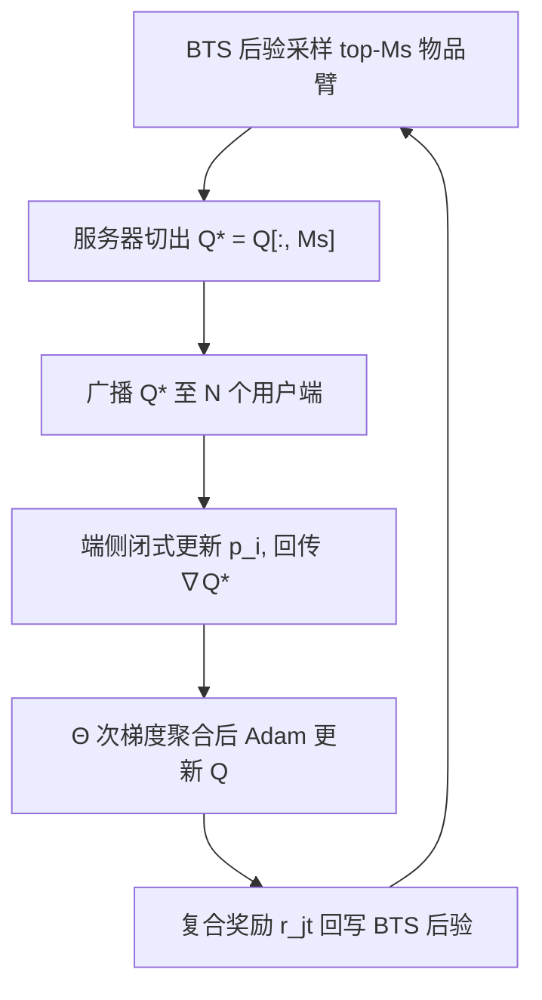
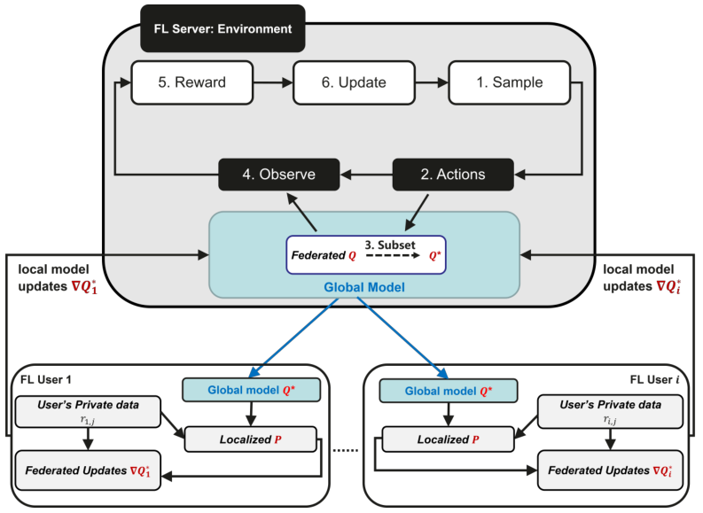
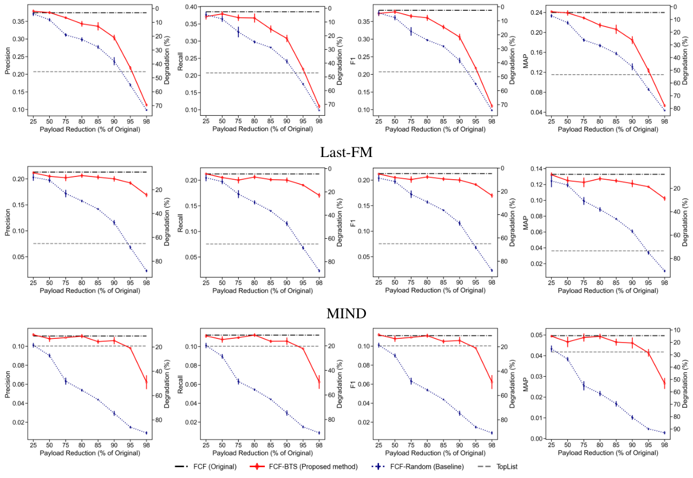

# A Payload Optimization Method for Federated Recommender Systems (联邦推荐系统载荷优化方法)

- **会议/期刊**: RecSys 2021
- **作者与机构**: Farwa K. Khan、Zareen Alamgir（NUCES 拉合尔）；Adrian Flanagan、Kuan E. Tan、Muhammad Ammad-ud-din（华为芬兰 Helsinki Research Center）
- **推荐链路定位**: 召回（联邦矩阵分解的训练/通信环节，直接决定物品塔侧通信量）
- **研究方向**: 去偏公平、可信隐私与工业架构 / 强化学习与动态探索推荐
- **论文原文**: [https://arxiv.org/abs/2107.13078v1](https://arxiv.org/abs/2107.13078v1)
- **开源代码**: 暂未开源

## TL;DR (1分钟核心速览)

联邦协同过滤（FCF）的物品因子矩阵 $\mathbf{Q}\in\mathbb{R}^{K\times M}$每轮全量下发，载荷随物品数线性膨胀（100 万物品约 160 MB），是生产级 FRS 的硬性瓶颈。本文提出 FCF-BTS：在服务器端用高斯先验的贝叶斯 Thompson Sampling 从$M$个物品中采样$M_s$个"臂"，只传输对应行构成的$\mathbf{Q}^*$，并以一个融合"梯度瞬时变化 + 指数衰减梯度余弦相似"的复合奖励驱动采样。在 Last-FM/MIND 高稀疏数据上，削减 90% 载荷仅损失 4.4%–8.8% 的 Precision/Recall/MAP，相对随机选物品基线提升 72%–352%。

## Background & Motivation (背景与核心矛盾)

- **主流范式**: FCF 把用户因子 $\mathbf{P}$留在端侧用闭式解更新，物品因子$\mathbf{Q}$由服务器聚合各端上传的$\nabla\mathbf{Q}$后用 Adam 更新，每轮上下行均为$K\times M$ 矩阵。
- **前人局限**: ① 通信压缩研究（稀疏化、量化、Golomb 编码、客户端子采样）都针对"参数稠密/客户端数量"，从未利用"载荷规模 = 物品数"这一推荐系统特有结构；② 唯一接近的 Qin & Liu 分层框架需把用户-物品交互集中到服务器排序候选集，违背联邦隐私前提，直接不可比。
- **核心洞察 (Key Insight)**: 载荷膨胀的根源是**长尾物品的因子行几乎不变却每轮都要传**——若只传输本轮真正会显著更新的物品行，理论上可无损压缩。
- **本文切入点**: 把"选哪些物品行"建模为在线多臂赌博机（每轮从 $M$臂中 top-$M_s$ 采样），奖励只用聚合后的梯度统计量，服务器无需知道用户身份，端侧零改动。

## Method (核心方法设计)

### 1. 整体框架 (Overall Architecture)

每轮 FL 迭代 $t$：BTS 依据各物品后验$\mathcal{N}(\hat\mu_{j\theta},1/\hat\tau_{j\theta})$采样并按期望奖励取 top-$M_s$物品 → 服务器切片出$\mathbf{Q}^*_t\in\mathbb{R}^{K\times M_s}$广播给全部$N$个用户 → 用户照常计算并回传$\nabla_j\mathbf{Q}^*_t$（$j\le M_s$）→ 服务器在累计梯度更新数达阈值$\Theta$时更新$\mathbf{Q}$、计算奖励$r_{jt}$ 并回写 BTS 后验。整个优化完全在服务器侧，用户设备与推荐流水线无需任何改动，即插即用。

<figure class="paper-figure" markdown="span">
  <figcaption>图1：本研究为联邦推荐系统（FRS）提出的负载优化方法。负载优化在 FL 服务器上通过多臂老虎机方案执行。1. 老虎机模型从概率分布中采样一组物品。2. 老虎机通过选择特定的一组物品来采取某个动作。3. FL 服务器根据老虎机模型建议的物品选择全局模型 Q 的一部分。选出的 Q* 被传输给所有用户。通过 ∇Q* 的梯度进行的更新在每个用户设备上计算，并传输到 FL 服务器</figcaption>
</figure>

### 2. 关键设计拆解 (Key Designs)

1. **高斯先验 BTS 物品选择器（解决"无名用户下如何选物品"）**: 因服务器拿不到用户身份，无法按用户群推物品，故把每个物品视为一臂，奖励建模为 $p(R_j\mid\mu_j,1)\sim\mathcal{N}(\mu_j,1)$、先验$\mathcal{N}(\mu_\theta,1/\tau_\theta)$，共轭更新得$\hat\mu_{j\theta}=\frac{\tau_\theta\mu_\theta+n_j Z_t(a_{jt})}{\tau_\theta+n_j}$、$\hat\tau_{j\theta}=\tau_\theta+n_j\tau$。按后验采样值排序取 top-$M_s$天然平衡探索（$n_j$ 小 → 方差大 → 易被采）与利用，避免随机选行导致热门物品因子长期得不到更新。

2. **面向 FRS 的复合奖励函数（解决"梯度噪声下如何判定物品重要性"）**: 单看梯度模长会被异步、非 IID 的稀疏更新误导。本文以 $\gamma^t$ 调度两类信号：

$$r_{jt}=(1-\gamma^{t})\cos\_sim(\upsilon_{jt},\nabla_j\mathbf{Q}^{*}_{t})+\gamma^{t}\sum_{k=1}^{K}\left|\nabla_j\mathbf{Q}_{t-1}-\nabla_j\mathbf{Q}^{*}_{t}\right|$$

其中 $\upsilon_{jt}=\beta_2\upsilon_{j,t-1}+(1-\beta_2)(\nabla_j\mathbf{Q}^{*}_{t})^{2}$为 ADAM 式梯度二阶矩。直觉：训练初期$\gamma^t$接近 1，奖励由梯度**瞬时绝对变化**主导，优先探查快速收敛中的物品；后期$\gamma^t\to0$，奖励转为衰减梯度与当前梯度的**方向一致性**，锁定稳定收敛的物品。$\gamma=0/1$ 即退化为纯长期/纯短期信号两种极端。

3. **训练目标、负采样与推理开销**: 端侧仍最小化加权平方损失 $J=\sum_i\sum_j c_{ij}(x_{ij}-\mathbf{p}_i^T\mathbf{q}_j)^2+\lambda(\|\mathbf{p}_i\|^2+\|\mathbf{q}_j\|^2)$，$c_{ij}=1+\alpha x_{ij}$，隐式反馈**不做负采样**（$x_{ij}=0$仅作低置信负例）；用户因子用闭式解$\mathbf{p}_i^*=(\mathbf{Q}\mathbf{C}_i\mathbf{Q}^T+\lambda\mathbf{I})^{-1}\mathbf{Q}\mathbf{C}_i\mathbf{x}_i$在端侧独立求解，服务器只做$\mathbf{Q}\leftarrow\mathbf{Q}-\eta\sum_{i=1}^{\Theta}\nabla^i_{\mathbf{Q}}$的 Adam 聚合。端侧计算量随$M_s$**同比下降**，服务器侧仅增加一次$O(M\cdot M_s)$ 采样排序；作者坦承 regret 上界尚未给出（现有 BTS 界随臂数线性增长，不适用百万级物品空间）。

## Experimental Setup & Evaluation Protocol (实验设置与评估协议)

- **数据集与预处理**: 三个公开数据集，全部二值化为隐式反馈（MovieLens 评分/Last-FM 收听数一律置 1，MIND 天然点击；丢弃时间戳）：

| 数据集 | #Users | #Items | #Interactions | 稀疏度 | 特征/场景说明 |
| :--- | :---: | :---: | :---: | :---: | :--- |
| MovieLens-1M | 6,040 | 3,064 | 914,676 | 96.05% | 电影评分，物品数最少、最稠密 |
| Last-FM | 1,892 | 17,632 | 92,834 | 99.78% | 音乐艺人收听，物品数最多 |
| MIND (small) | 16,026 | 6,923 | 163,137 | 99.89% | 新闻点击，用户数最多、最稀疏 |

- **数据划分与防穿越 (Splitting Strategy)**: 每用户随机 80%/20% 划分训练/测试集，重复 **3 轮模型重建**取均值±标准差；因丢弃时间戳，**并非**全局时间戳切分，存在轻度未来信息泄漏风险。
- **排名评测协议 (Ranking Protocol)**: 未使用采样负例，沿用 FCF 全物品打分后取 Top-100 候选、报告 Top-10 的 Precision / Recall / F1 / MAP；所有指标按"各用户测试集理论上界"归一化后再聚合，以消除数据集间量纲差异。异步更新下服务器只收到部分用户指标，第 1000 轮取前 10 次全局指标的均值。
- **对比基线与超参设置**: FCF (Original) 作上界（全量载荷）、FCF-Random 作主基线（随机选行）、TopList 作热门物品启发式；FCF 超参沿用原论文最优值 $K=25$、$\lambda=1$、$\alpha=4$、Adam$(\beta_1,\beta_2,\eta,\epsilon)=(0.1,0.99,0.01,10^{-8})$；BTS 先验$(\mu_\theta,\tau_\theta)=(0,10000)$、奖励正则$\gamma=0.999$；聚合阈值$\Theta=100/100/500$（对应三个数据集）。**未做显著性检验**。

## Key Experimental Results (实验关键数据)

### 1. 主实验对比 (Main Results)

统一在 **90% 载荷削减**（仅传 10% 物品行）口径下的主结果：

| 数据集 | 方法 | Precision | Recall | F1 | MAP |
| :--- | :--- | :---: | :---: | :---: | :---: |
| MovieLens-1M | FCF (Original, 上界) | **0.3744** | **0.3855** | **0.3817** | **0.2400** |
| | **FCF-BTS** | 0.3041 | 0.3076 | 0.3058 | 0.1846 |
| | FCF-Random | 0.2370 | 0.2411 | 0.2394 | 0.1311 |
| | TopList | 0.2075 | 0.2076 | 0.2076 | 0.1154 |
| | BTS vs Random (Impr.%) | +28.30 | +27.57 | +27.74 | +40.75 |
| | BTS vs TopList (Impr.%) | +46.53 | +48.19 | +47.32 | +59.99 |
| Last-FM | FCF (Original, 上界) | **0.2131** | **0.2124** | **0.2127** | **0.1328** |
| | **FCF-BTS** | 0.2001 | 0.2003 | 0.2001 | 0.1211 |
| | FCF-Random | 0.1159 | 0.1153 | 0.1156 | 0.0609 |
| | TopList | 0.0755 | 0.0755 | 0.0755 | 0.0363 |
| | BTS vs Random (Impr.%) | +72.64 | +73.60 | +73.10 | +98.85 |
| | BTS vs TopList (Impr.%) | +164.88 | +165.14 | +164.93 | +233.44 |
| MIND | FCF (Original, 上界) | **0.1108** | **0.1121** | **0.1110** | **0.0496** |
| | **FCF-BTS** | 0.1059 | 0.1057 | 0.1059 | 0.0461 |
| | FCF-Random | 0.0294 | 0.0296 | 0.0294 | 0.0102 |
| | TopList | 0.1002 | 0.1003 | 0.1003 | 0.0418 |
| | BTS vs Random (Impr.%) | +260.06 | +256.10 | +259.32 | +352.46 |
| | BTS vs TopList (Impr.%) | +5.67 | +5.32 | +5.58 | +10.39 |

<figure class="paper-figure" markdown="span">
  <figcaption>图2：负载削减对推荐性能下降（精度损失）的影响。X 轴表示相对于原始模型的负载削减百分比。Y 轴（左侧）表示指标值，右侧显示相对于原始模型性能的下降百分比。每个点表示三轮模型重建的平均测试集推荐性能，误差棒表示围绕均值的标准差。所提出的 FCF-BTS 始终优于 FCF-Random（基线），并展现出显著的性能</figcaption>
</figure>

### 2. 消融实验 (Ablation Study)

原文无独立消融表，以下按"组件替换"口径将 90% 载荷档位的各变体重排为主实验的归因对照（数值同表 1，精度损失为相对 FCF 上界的 `Diff%`）：

| 变体（消融项） | MovieLens P / MAP | Last-FM P / MAP | MIND P / MAP | 结论 |
| :--- | :---: | :---: | :---: | :--- |
| FCF-BTS（完整） | 0.3041 / 0.1846 | 0.2001 / 0.1211 | 0.1059 / 0.0461 | 全量最优近似 |
| w/o BTS 选择器（→ FCF-Random） | 0.2370 / 0.1311 | 0.1159 / 0.0609 | 0.0294 / 0.0102 | 掉幅最大，MIND 近乎崩塌 |
| w/o 模型驱动奖励（→ TopList 热门） | 0.2075 / 0.1154 | 0.0755 / 0.0363 | 0.1002 / 0.0418 | 稀疏集严重劣化 |
| 精度损失 Diff%（BTS vs 上界） | 18.77 / 23.06 | 6.12 / 8.80 | 4.43 / 7.10 | 稀疏集逼近无损 |
| 收敛迭代数（至最优） | ~200–250 | ~400–450 | ~400–450 | 稀疏集多耗 200 轮 |

### 3. 关键实验发现 (Key Findings)

1. **收益与数据稀疏度强正相关**：MIND（99.89%）上 BTS 相对随机选行提升 Precision +260.06%、MAP +352.46%，而稠密的 MovieLens（96.05%）仅 +28.30%/+40.75%；原因在于稠密集几乎所有物品行每轮都需更新，随机选行尚能"误打误撞"覆盖，稀疏集则必须靠奖励信号定位少数活跃物品。
2. **90% 是"性价比拐点"而非极限**：Last-FM/MIND 上 90% 削减仅损失 4.4%–8.8% 精度且收敛曲线与全量 FCF 重合；继续压到 98% 载荷（2% 物品）时 BTS 在 Last-FM 仍显著优于 TopList，MovieLens/MIND 在 5% 物品时与 TopList 持平——说明长尾物品因子确实可被长期"跳过"。
3. **TopList 是强但脆弱的对手**：MIND 上 TopList（0.1002）几乎追平 BTS（0.1059），因其物品池小、头部效应极强；但在 Last-FM 上 TopList 的 MAP 仅 0.0363，被 BTS 拉开 233%——热门启发式无法跨数据集泛化，而 BTS 的奖励无需调参即可自适应。

## Highlights & Limitations (亮点、对比与审稿批判)

- **与代表作对比 (vs. Prior Work)**: 相比 Qin & Liu 的分层候选集框架（需集中收集用户交互、端侧定制），本文在标准 FCF 隐私设定下仅用聚合梯度即可完成选择，端侧零改动；相比 FL 通用压缩（量化/稀疏化/Golomb 编码，压缩的是"参数精度"），本文压缩的是"参数维度"，二者正交且可叠加（先选行再量化）。
- **可迁移亮点**: ① 用"梯度二阶矩与当前梯度的余弦一致性 + 梯度绝对变化"的 $\gamma^t$调度作为物品活跃度代理，可直接迁移到增量召回索引的更新频率控制、 embedding 表的低频行冻结（embedding table row-freezing）；② 把"传哪些参数"当作 top-$M$多臂选择问题，适用于任何$\text{参数量}\propto\text{物品数}$ 的端云协同系统。
- **审稿级局限批判**: ① **评估薄弱**：仅 3 轮重建、无显著性检验、无时间切分（随机 80/20 有穿越风险），且基线只有 Random/TopList 两个"稻草人"，未与 FedFast、量化/稀疏化压缩做正面对比，无法判断 4%–8% 损失是否已是最优；② **理论缺口**：作者自认无法给出 regret/收敛界，$\gamma$、$\tau_\theta$、$M_s$的敏感性未做扫描，BTS 后验在非 IID 异步更新下的有效性缺乏保证；③ **场景局限**：仅在$M\le 1.8$万的矩阵分解上验证，百万物品时 top-$M_s$排序与后验维护开销（$O(M)$ 内存）本身就是新的服务器瓶颈，深度 FRS 上的可行性仅为作者口头展望。

## Rating (四维评分)

- **方法创新性 (Novelty)**: ⭐⭐⭐⭐ （首次把 FRS 载荷问题形式化为物品级 top-$M$ 老虎机，复合奖励的"先探索后稳定"调度有清晰物理直觉）
- **评估协议与实验扎实度 (Protocol & Experiments)**: ⭐⭐⭐ （三数据集 + 95% 置信误差棒尚可，但随机划分、无显著性检验、基线过弱、无标准消融表）
- **写作与数学规范度 (Clarity & Rigor)**: ⭐⭐⭐⭐ （BTS 共轭推导与奖励设计交代清楚，算法伪码完整；但 $\upsilon_{jt}$ 公式分母疑似笔误、regret 分析缺位）
- **工业落地与复现价值 (Industrial & Practical Value)**: ⭐⭐⭐⭐ （服务器侧单点改动、端侧零侵入、载荷与端侧算力同比下降，对端云协同推荐有直接工程价值，可惜未开源）

