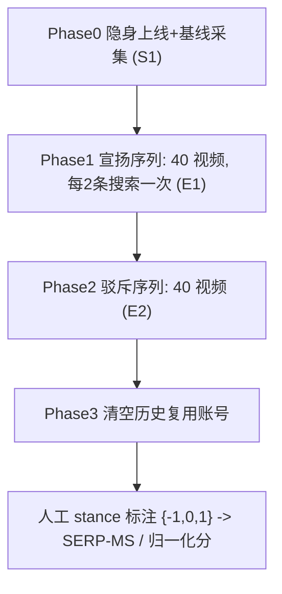

# An Audit of Misinformation Filter Bubbles on YouTube: Bubble Bursting and Recent Behavior Changes (YouTube 错误信息过滤气泡审计：气泡消解与近期行为变化)

- **会议/期刊**: RecSys 2021（Fifteenth ACM Conference on Recommender Systems）
- **作者与机构**: Matus Tomlein, Branislav Pecher, Jakub Simko, Ivan Srba 等 10 人，均属 Kempelen Institute of Intelligent Technologies（斯洛伐克）/ slovak.AI
- **推荐链路定位**: 端到端（搜索排序 + 下一项推荐 + 首页推荐的黑盒审计）
- **研究方向**: 去偏公平、可信隐私与工业架构 / 对话推荐与智能体仿真
- **论文原文**: [https://arxiv.org/abs/2203.13769v1](https://arxiv.org/abs/2203.13769v1)
- **开源代码**: [https://github.com/kinit-sk/yaudit-recsys-2021](https://github.com/kinit-sk/yaudit-recsys-2021)

## TL;DR (1分钟核心速览)

本文是首个研究"错误信息过滤气泡如何**消解（bubble bursting）**"的 YouTube 黑盒审计。作者用 5 个阴谋论主题各跑 10 次预编程 sockpuppet 代理（共 50 次运行、观看 3951 个视频、执行 10075 次查询），先喂 40 条"宣扬"视频制造气泡，再喂 40 条"辟谣"视频尝试爆破，结果按 SERP-MS 与归一化分（$\langle-1,1\rangle$，越接近$-1$越健康）量化。核心结论有三：搜索端**根本不形成**气泡；推荐端气泡生成显著（归一化分$-0.07\to0.01$），但爆破在 4/5 主题上有效（$0.01\to-0.27$，$p=1.8\text{e-}9$）；与 Hussein 等人 2019 年的对照复现显示，YouTube 的政策承诺未带来可检出的整体改善，反疫苗主题甚至显著恶化。

## Background & Motivation (背景与核心矛盾)

- **主流范式**: 该领域依赖"平台审计"（audit）——用 sockpuppet 机器人以受控方式模拟用户行为，记录平台响应并人工标注，以分离"算法偏置"与"用户认知偏置"的混杂影响。
- **前人局限**: Hussein 等人 (2019) 与 Papadamou 等人只研究了气泡的**生成**方向，即连续观看阴谋论视频如何使推荐同质化；没有任何工作量化**反向过程**——用户需要付出多少、多久、何种观看行为才能走出气泡。同时，平台的自我评估报告缺乏独立验证渠道。
- **核心洞察 (Key Insight)**: 若"辟谣内容（debunking）"作为一种隐式反馈可以施加反向梯度，那么气泡应当是可逆的；但可逆性可能因阴谋论叙事的内容生态（COVID-19、新发布歌曲、单一激进频道）而高度异质。
- **本文切入点**: 把"辟谣视频序列"当作一次反向的隐式反馈干预，在严格对齐 Hussein 方法学的条件下同时测量"气泡生成"与"气泡爆破"，从而兼顾**因果干预**与**跨时间可比性**两个目标。

## Method (核心方法设计)

### 1. 整体框架 (Overall Architecture)

审计以"一个代理 = 一个隐身上网、装广告拦截插件、登录固定 YouTube 账号的浏览器"为原子单元。每个主题跑 10 个并行代理以对冲平台推荐噪声（预实验测得同配置下约 70% 推荐重叠）。单次运行历经四阶段：Phase 0 采集中性基线 S1（首页 + 5 条查询的搜索结果）；Phase 1 依次"观看"40 条宣扬视频，每 30 分钟/条、每看 2 条触发一次搜索，形成 E1；Phase 2 以同样节奏观看 40 条辟谣视频，形成 E2；Phase 3 通过 Google My Activity 清空历史以复用账号（作者先做小规模验证确认无残留 carry-over）。全流程采集三类界面：视频页侧栏 20 条推荐、首页推荐、搜索结果页。

### 2. 关键设计拆解 (Key Designs)

1. **SERP-MS：位置加权的中立性指标**：普通"错误信息比例"无法惩罚"高排位的有害内容"，本文沿用并复用该指标，将 stance 标注值 $x_i\in\{-1,0,1\}$与排名$r$ 做线性折扣加权：

$$\text{SERP-MS}=\frac{\sum_{r=1}^{n} x_{i}\cdot(n-r+1)}{n(n+1)/2}$$

分母即 $1+2+\dots+n$，故得分天然落在$[-1,1]$ 且可跨不同长度结果页比较。直觉上，一条宣扬视频排第 1 位比排第 10 位对气泡深度的贡献大 10 倍，该式正是把"气泡深度"定义为"排位加权的立场均值"。对无序、较短的推荐列表则用无权的平均归一化分。

2. **双向干预协议 + 三点对照设计（S1/E1/E2）**：这是本文相对前作最核心的方法学增量。仅比较"起点 vs 终点"会混淆生成与爆破两个力，故作者把一次运行切成三段快照，并用三组假设绑定三组两两检验：H2.0 检验 S1→E1（若生成存在，指标应恶化）；H2.1 检验 E1→E2（若爆破成功，指标应改善）；H2.2 检验 S1→E2（净效果是否优于从零开始的冷态用户）。同时，为与 Hussein 2019 可比，作者复用了同一套 5 个主题、同一编码方案、同一等待时长、同批种子视频来源（按 YouTube 搜索 > 搜索引擎 > 频道引用 > 推荐的降序优先级补充种子，单频道最多取 3 条以抑制单源偏置）。

3. **标注体系与统计检验**：作者把 stance 编码从 Hussein 的 $\{-1,0,1\}$扩到$-1\sim10$，新增"嘲讽类（mock）"（码 9/10，计入辟谣）、"无关主题错误信息"（码 2/3/4）与"视频已删除"（码 8）。先对 Hussein 公开种子视频重标注做校准：作者间 Cohen's$\kappa=0.815$，与原文一致性$\kappa=0.688$；正式标注采用单人标注 + 边缘案例交叉复核。由于指标分布非正态且样本量不等，全部采用双侧 Mann-Whitney$U$检验，多主题比较时施加 Bonferroni 校正（$\alpha=0.05/5=0.01$）。代理的混淆变量被显式钳制：地理定位 N. Virginia（对齐原文）、生日 1990-06-06、性别"不愿透露"、姓名由美国最常见姓氏与中性名随机组合。

## Experimental Setup & Evaluation Protocol (实验设置与评估协议)

- **数据集与预处理**: 本研究的"数据集"即审计配置与采集规模。主题与种子来自 Hussein 等人的公开数据并经重标注扩充：

| 主题 | 种子（宣扬/辟谣） | 查询数 | 运行次数 | 场景说明 |
| :--- | :---: | :---: | :---: | :--- |
| 9/11 阴谋论 | 40 / 40 | 5 | 10 | 当局知情/定向爆破说 |
| 登月造假 | 40 / 40 | 5 | 10 | NASA 摄影棚拍摄说 |
| 化学尾迹 (Chemtrails) | 40 / 40 | 5 | 10 | 飞机尾迹投毒说 |
| 地平说 | 40 / 40 | 5 | 10 | 地球球体造假说 |
| 反疫苗 | 40 / 40 | 5 | 10 | 疫苗致自闭症说 |

采集总量：3951 次观看、78763 条侧栏推荐（8526 唯一）、10075 次查询、201404 条搜索结果（942 唯一）、3990 次首页访问、116479 条首页视频（9977 唯一）；去重后 17405 个视频来自 6342 个频道。标注覆盖 2914 个唯一视频、255844 次出现（244 宣扬 / 628 辟谣含嘲讽 / 184 中立 / 1829 无关 / 29 未知）。

- **数据划分与防穿越 (Splitting Strategy)**: 无传统训练/测试划分。等价于**时间阶段切分**：同一次运行内按 S1 / E1 / E2 三个时点快照对比；跨研究则按"2019 年中（Hussein）vs 2021 年 3 月"做时间纵向切分，且仅比较两研究都执行过的**同一批查询**以控制检索词差异。
- **排名评测协议 (Ranking Protocol)**: 采用 `Full-List Annotation`——对**全部**采集到的搜索结果（每查询 top-10）与**部分**侧栏推荐（每阶段首/末 2 条种子视频的推荐，每主题 6 组）做全量人工标注；首页推荐因数量最大、异构性最强且代理间重叠极少而被显式排除。这构成一种"无采样偏置但对推荐端覆盖面有限"的混合协议。
- **对比基线与超参设置**: 主基线是 Hussein et al. (2019) 的同一实验（跨时间对照）；过程超参经预实验确定：$n_{prom}=n_{deb}=40$（因气泡在 20–30 条后才稳定出现）、$t_{watch}=30$min（85% 种子视频时长$\le 30$min）、$t_{wait}=20$min（依据文献中约 11 分钟的搜索结果 carry-over 窗口）、每 2 条视频做一次搜索、每主题 5 条查询。显著性一律$p<0.01$（Bonferroni 后）。

## Key Experimental Results (实验关键数据)

### 1. 主实验对比：与 Hussein 2019 (RQ1 / H1.1)

| 主题 | SERP-MS 2019 | SERP-MS 2021 | 推荐归一化 2019 | 推荐归一化 2021 | 判定 |
| :--- | :---: | :---: | :---: | :---: | :--- |
| 9/11 | -0.16 | -0.06 | 0.14 | 0.26 | 均 n.s.d.（宣扬视频 18%→27%）|
| 化学尾迹 | -0.20 | **-0.47** | 0.05 | 0.03 | 均 n.s.d.（搜索宣扬占比 45%→12%）|
| 地平说 | -0.58 | -0.41 | -0.16 | -0.15 | 均 n.s.d.（2 条查询因新内容恶化）|
| 登月 | -0.60 | -0.59 | -0.08 | **-0.32** | 推荐显著改善 $p=8\text{e-}6$ |
| 反疫苗 | -0.80 | -0.63 | -0.28 | 0.00 | 两者均显著恶化 $p<1.3\text{e-}8$ |
| **全体** | -0.46 | -0.42 | -0.07 | -0.04 | 均 n.s.d.（$U=45781.5$）|

### 2. 阶段归因：气泡生成与爆破 (RQ2 / H2.0–H2.2)

| 主题 | SERP-MS S1/E1/E2 | 推荐归一化 S1/E1/E2 | S1→E1 生成 | E1→E2 爆破 | S1→E2 净效果 |
| :--- | :---: | :---: | :--- | :--- | :--- |
| 9/11 | -0.07 / -0.06 / -0.11 | 0.10 / 0.42 / 0.07 | 推荐恶化 $p=2.6\text{e-}5$| 改善$p=2.9\text{e-}6$ | 回到起点（n.s.d.）|
| 化学尾迹 | -0.45 / -0.47 / -0.49 | 0.00 / 0.05 / -0.15 | n.s.d. | 改善 $p=6\text{e-}4$| 优于起点$p=2\text{e-}4$ |
| 地平说 | -0.27 / -0.41 / -0.45 | -0.17 / -0.06 / -0.47 | 搜索即改善 $p=4\text{e-}4$| 改善$p=1.8\text{e-}6$ | 两端均优于起点 |
| 登月 | -0.57 / -0.57 / -0.59 | -0.20 / -0.40 / -0.42 | n.s.d. | n.s.d. | 仅搜索改善 $p=0.007$ |
| 反疫苗 | -0.60 / -0.63 / -0.68 | -0.10 / 0.04 / -0.37 | 推荐恶化 $p=8\text{e-}4$| 改善$p=2.5\text{e-}6$| 优于起点$p=2\text{e-}4$ |
| **全体** | -0.39 / -0.42 / -0.46 | -0.07 / 0.01 / -0.27 | 搜索反而改善 $p=0.028$；推荐恶化$p=0.0397$| 搜索 n.s.d.；推荐改善$p=1.8\text{e-}9$| 搜索$p=2\text{e-}4$；推荐$p=2.9\text{e-}7$ |

### 3. 关键实验发现 (Key Findings)

1. **气泡只存在于推荐端，不存在于搜索端。** 全体 SERP-MS 在"宣扬阶段"结束时不仅没恶化，反而从 $-0.39$显著改善到$-0.42$（$p=0.028$），5 个主题中只有地平说显著变化；同一时间窗推荐归一化分却从$-0.07$恶化到$0.01$（$p=0.0397$）。这说明 YouTube 的检索排序对这种"多看几条阴谋论视频"的弱隐式信号不敏感，而协同过滤式的下一项推荐高度敏感——审计结论必须按**界面通道**分别陈述，不能一概而论。
2. **爆破有效但幅度与机制因主题而异，且 4/5 主题可"超额恢复"。** 推荐端 E1→E2 的整体改善为 $0.01\to-0.27$（$p=1.8\text{e-}9$），除登月外全部显著；机制上分为两型——9/11 是靠**压制宣扬**（43%→13%），反疫苗与地平说、化学尾迹是靠**抬升辟谣**（反疫苗辟谣占比 9%→37%，宣扬归零）。9/11 恰好回到与冷态起点无差别的状态（n.s.d.），即"能脱身但无红利"，说明爆破上限受该主题训练数据饱和度制约。
3. **政策承诺未获数据支持，且恶化可归因于外生内容生态。** H1.1 全线落空：整体 SERP-MS（$-0.46\to-0.42$）与推荐归一化（$-0.07\to-0.04$）差异均不显著；反疫苗主题则**双向显著恶化**（搜索$p=1.3\text{e-}9$、推荐$p=1.6\text{e-}9$，up-next 辟谣占比 77%→19%），9/11 也应然变差。作者明确指出这些变化主要来自**外生因素**：化学尾迹受到 Lana Del Rey 同名歌曲干扰，反疫苗受 COVID-19 内容洪流影响，地平说受单一激进频道活跃度上升影响——这直接论证了"内生算法改动"与"外生内容漂移"在无连续审计时无法分离。

## Highlights & Limitations (亮点、对比与审稿批判)

- **与代表作对比 (vs. Prior Work)**: 相比 Hussein et al. (2019) 只测"生成"、Papadamou et al. 只做"主题内比例统计"、Spinelli et al. 只追踪"推荐链漂移"，本文首次引入**反向干预（debunking sequence）**与 S1/E1/E2 三段式因果对照，把"气泡是否可逆"变成可检验的假设集合；同时通过同种子、同编码、同查询复现，将横向"平台间比较"升级为纵向"同平台跨 20 个月比较"。相对 Ribeiro et al. 的路径分析法，本文的立场标注粒度更细（含嘲讽类与无关主题错误信息）。
- **可迁移亮点**: 其一，**按界面通道解耦报告**——同一干预在搜索与推荐上的效应方向可以相反，任何审计（含 LLM 推荐系统）都应分通道建模；其二，**carry-over 窗口校准 + 历史重置复用账号**的组合，使大规模并行 sockpuppet 审计的账号成本从 Hussein 的 150 个降到常数级，且经小规模验证确认无残留个性化。
- **审稿级局限批判**: 其一，**标注覆盖不对称且样本偏小**——仅标注 2914/17405 个唯一视频（首页推荐全被排除），推荐端只取每阶段首末 2 条种子的推荐，且为单标注员制（仅边缘案例复核），存在选择偏置与标注噪声，而 E1→E2 的强结论恰恰建立在推荐端；其二，**干预强度与主题集受限导致外推性弱**——仅 5 个选题（无 QAnon、无直接 COVID-19 阴谋论）、仅"观看"一种隐式反馈（未建模点赞/订阅/点击/负反馈），且 40 条辟谣视频是"饱和式"干预，真实用户极难复制该强度，因此"气泡可爆破"的结论更接近**可达上界**而非可行建议。

## Rating (四维评分)

- **方法创新性 (Novelty)**: ⭐⭐⭐⭐ （首提 bubble bursting 反向干预与 S1/E1/E2 三点因果对照，方法学增量清晰，但核心指标 SERP-MS 沿用原文，理论建模偏薄）
- **评估协议与实验扎实度 (Protocol & Experiments)**: ⭐⭐⭐⭐ （50 次运行、10 万级查询、Bonferroni 校正与预实验调参均规范，但推荐端标注覆盖有限、单标注员制与 5 主题规模削弱了统计外推力）
- **写作与数学规范度 (Clarity & Rigor)**: ⭐⭐⭐⭐ （指标定义、假设编号与阶段截图逻辑清楚，30 页正文详实；标注码表略显繁复，个别统计量在正文与表中呈现不齐）
- **工业落地与复现价值 (Industrial & Practical Value)**: ⭐⭐⭐⭐⭐ （代码与数据全量开源，代理框架可直接迁移到任何可被观测的推荐/检索平台，为持续自动化审计提供了成本可控的工程范式）

