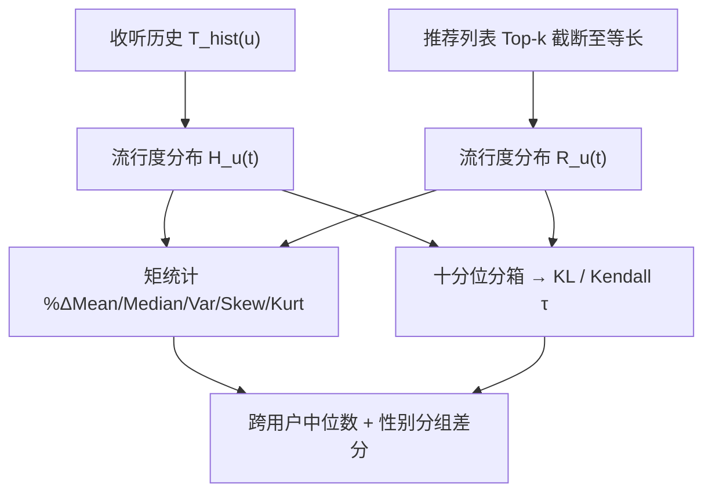
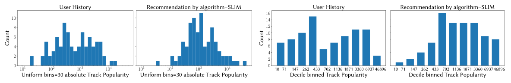

# Analyzing Item Popularity Bias of Music Recommender Systems: Are Different Genders Equally Affected? (音乐推荐系统的物品流行度偏置分析：不同性别受影响程度相同吗？)

- **会议/期刊**: RecSys 2021 (Short Paper / LBR)
- **作者与机构**: Oleg Lesota, Alessandro B. Melchiorre, Navid Rekabsaz, Stefan Brandl, Dominik Kowald, Elisabeth Lex, Markus Schedl (JKU Linz / LIT / Know-Center / TU Graz)
- **推荐链路定位**: 召回（CF 推荐算法输出的列表级偏置诊断）
- **研究方向**: 去偏公平、可信隐私与工业架构 / 协同过滤
- **论文原文**: [https://arxiv.org/abs/2108.06973v1](https://arxiv.org/abs/2108.06973v1)
- **开源代码**: 暂未开源

## TL;DR (1分钟核心速览)

本文指出既有流行度偏置研究只用「均值差」这一统计量、且忽略用户群体差异两大缺陷，提出用中位数、方差/偏度/峰度等矩统计量，以及**整分布相似度**（KL 散度、Kendall's $\tau$ 分箱秩相关）共 7 个指标刻画「用户收听历史 vs. 推荐列表」的流行度分布偏移。在 LFM-2b 标准化子集（19,972 用户 / 99,831 曲目 / 1,990 万条收听事件）上，于用户级 60-20-20 五折划分、NDCG@10 效用评估下考察 7 种算法，发现女性用户在 5 个 CF 模型中有 4 个被施加更强的流行度放大，且「偏置更低的算法（ItemKNN, KL=0.175）未必效用更差（NDCG=0.301）」——直接挑战"去偏必损精度"的假设。

## Background & Motivation (背景与核心矛盾)

- **主流范式**: 流行度偏置（popularity bias）研究几乎都采用 $\Delta$GAP 或「历史与推荐列表的均值/中位数之差」这类群体级、单点统计量来量化偏置。
- **前人局限 1**: 均值对音乐收听数据中的长尾离群值极不鲁棒——一条极端热门曲目即可主导整条列表的统计结果，无法区分"整体上移"与"形状畸变"。
- **前人局限 2**: 偏置分析一律无视用户属性（性别、年龄、文化背景），因而无法回答"同一算法是否对不同群体施加不等强度偏置"这一公平性问题；Kowald 等发现 $\Delta$GAP 在"小众/主流"用户间无差异，暗示群体级指标抹平了个体差异。
- **核心洞察 (Key Insight)**: 定义"无算法偏置"的理想状态为：对每个用户 $u_i$，推荐列表的流行度分布与收听历史分布**完全一致**；因此偏置应被建模为**逐用户的分布差异**，而非全局均值差。
- **本文切入点**: 引入一组覆盖"位置（中心）+ 尺度 + 形状 + 整体相似度"的七指标族，并按性别分组做逐用户偏置分解。

## Method (核心方法设计)

### 1. 整体框架 (Overall Architecture)

先以全局播放次数定义曲目流行度 $P(t)=\sum_{u_i\in U} PC(t,u_i)$，据此为每个用户构造收听历史分布$H_{u_i}(t)$与推荐列表分布$R_{u_i}(t)$；为保证可比性，**截断推荐列表使其长度等于该用户历史长度**（$|T_{top\_rec}(u_i)|=|T_{hist}(u_i)|$），消除列表长度混淆。随后对两分布施加两类度量：一类是逐用户的矩统计量相对变化$\%\Delta M$，另一类是先将流行度按**全集累积流行度十分位分箱**再计算的 KL 散度与 Kendall's$\tau$；所有指标最终取**跨用户中位数**聚合，并按 F/M 分组报告相对全体（All）的偏移量$\Delta Female/\Delta Male$。

<figure class="paper-figure" markdown="span">
  <figcaption>图 1. (a) 展示了同一用户在收听历史（左）和推荐列表（右）上流行度的等宽分箱分布（仅用于可视化）。x 轴为等宽分箱后的流行度，y 轴为落入各箱的分布中曲目数。(b) 展示了按整个集合中的流行度分布对相同分布进行分箱的结果。该分箱用于 𝐾𝐿 和 Kendall 的 𝜏 计算。</figcaption>
</figure>

### 2. 关键设计拆解 (Key Designs)

1. **相对矩差 $\%\Delta M$（把"偏置"从绝对值改为逐用户相对量）**：痛点是原有用绝对均值差跨用户不可比（重度/轻度用户量纲不同）。核心算子对$M\in\{Mean, Median, Variance, Skew, Kurtosis\}$ 计算
$\%\Delta M_{u_i}=\frac{M(R_{u_i}(t))-M(H_{u_i}(t))}{M(H_{u_i}(t))}\cdot 100$，
再取中位数聚合。物理直觉：$\%\Delta Median>0$表示推荐更热；$\%\Delta Var>0$表示流行度取值更分散（因热门曲目稀疏铺展在宽流行度区间）；$\%\Delta Skew>0$ 表示右尾更重、更多条目落在低流行度侧。用**中位数二次聚合**正是为压制长尾离群用户。
2. **基于分箱的整分布相似度（KL + Kendall's $\tau$）**：痛点是矩统计量只描述低阶特征，无法反映"某流行度档位的条目数是否被系统性搬移"。做法是按全集累积流行度十分位分箱（每箱约占全集总流行度 10%，最热箱仅 161 首、7k–47k 播放量），得归一化$\hat H_{u_i}(b),\hat R_{u_i}(b)$，再算
$KL_{u_i}(\hat H\|\hat R)=\sum_{b_j\in B}\hat H_{u_i}(b_j)\log\frac{\hat H_{u_i}(b_j)}{\hat R_{u_i}(b_j)}$，$KT_{u_i}=\frac{C-D}{C+D}$。
两者互补：KL 对"某档推荐数少于历史数"高度敏感（计数偏移），$\tau$只看十箱计数的**秩一致性**（形状/排序相关性），$\tau\to1$ 表示形状匹配。分箱而非原始值，可让指标聚焦档位间迁移而非微小噪声。
3. **评估与统计口径**：不含可训练参数，无损失函数；核心"训练"仅复用 Melchiorre 等的统一超参以保证算法间可比。聚合一律取中位数，性别结论以 $\Delta$ 相对全体报告，避免少数群体被总体均值淹没。

## Experimental Setup & Evaluation Protocol (实验设置与评估协议)

- **数据集与预处理**: LFM-2b-DemoBias（Last.fm 收听日志）。

| 数据集 | #Users | #Items | #Interactions | 稀疏度/密度 | 特征/场景说明 |
| :--- | :---: | :---: | :---: | :---: | :--- |
| LFM-2b All | 19,972 | 99,831 | 19,906,272 | 密度 ≈ 0.998% | 音乐收听；平均 142 曲/人、997 LE/人 |
| F(emale) | 4,415 | 70,980 | 3,397,310 | 密度 ≈ 1.08% | 101±121 曲/人、769±1,158 LE/人 |
| M(ale) | 15,557 | 99,810 | 16,508,962 | 密度 ≈ 1.03% | 153±182 曲/人、1,061±1,664 LE/人 |

  过滤：播放次数 $PC>1$、双侧 `5-core`（曲目与用户各需 ≥5 交互）、仅取近 5 年事件、二值化交互；再从 160 万曲目中**均匀随机采样 100k 首**以抵消热门度抽样偏差。男性贡献约 80% 收听事件（严重类别不平衡）。
- **数据划分与防穿越 (Splitting Strategy)**: **用户级比例划分** 60/20/20 划分用户群 + 5 折轮换（round-robin）交叉验证；训练集用户及其全部交互用于训练，测试用户随机取 80% 交互作输入、20% 作评估目标。
- **排名评测协议 (Ranking Protocol)**: NDCG@10，沿 Multi-VAE 惯例对全体候选打分排序并剔除训练已交互项（等效 Full-Ranking，未做负采样）；偏置指标为逐用户计算后取中位数，无显著性检验报告。
- **对比基线与超参设置**: 7 个算法——RAND、POP（非个性化基线）、ItemKNN、SLIM（邻域）、ALS（MF）、BPR（ pairwise MF）、VAE（变分自编码器）；超参沿用 Melchiorre 等的统一配置，未做逐模型调优。

## Key Experimental Results (实验关键数据)

### 1. 主实验对比 (Main Results)

| Alg. | %ΔMedian | %ΔVar. | KL | Kendall's $\tau$ | NDCG@10 |
| :--- | :---: | :---: | :---: | :---: | :---: |
| RAND | −87.2 | −99.5 | 3.904 | 0.165 | 0.000 |
| POP | 975.2 | 487.0 | 6.023 | 0.057 | 0.045 |
| ALS | 316.6 | 72.6 | 4.368 | 0.046 | 0.184 |
| BPR | **−3.7** | −87.4 | 1.202 | 0.268 | 0.129 |
| ItemKNN | 4.6 | 5.7 | **0.175** | **0.423** | 0.301 |
| SLIM | 99.8 | 56.0 | 0.424 | 0.189 | **0.365** |
| VAE | 736.3 | 351.0 | 4.823 | −0.028 | 0.191 |

（表中为跨用户中位数；%ΔMedian 最优以绝对值最小标粗，KL 越低、$\tau$ 越高越"分布保真"。）

### 2. 消融实验 (Ablation Study)

本文为分析型短文，无模块消融；等价的**性别分组分解**（相对 All 的偏移量 $\Delta$）如下：

| Alg. | %ΔMedian $\Delta$F /$\Delta$M | KL$\Delta$F /$\Delta$M | Kendall$\tau$ $\Delta$F /$\Delta$M | NDCG@10$\Delta$F /$\Delta$M |
| :--- | :---: | :---: | :---: | :---: |
| ALS | **+27.4** / −6.6 | +0.467 / −0.121 | +0.110 / −0.023 | −0.017 / +0.005 |
| BPR | **+7.7** / −1.9 | +0.476 / −0.110 | −0.043 / +0.010 | −0.011 / +0.003 |
| ItemKNN | **+5.8** / −1.3 | +0.128 / −0.020 | −0.037 / +0.008 | −0.042 / +0.012 |
| VAE | **+56.4** / −20.4 | +0.633 / −0.161 | +0.146 / −0.042 | −0.020 / +0.006 |
| SLIM | −13.1 / +3.9 | +0.217 / −0.029 | +0.052 / −0.012 | −0.048 / +0.014 |
| POP | +282.1 / −115.8 | +1.626 / −0.380 | −0.033 / +0.016 | +0.003 / −0.001 |

### 3. 关键实验发现 (Key Findings)

1. **去偏不必牺牲效用**：ItemKNN 同时取得最低 KL（0.175）与最高 Kendall's $\tau$（0.423），NDCG@10 仍达 0.301，仅比最强 SLIM（0.365）低约 0.064；反之 BPR 分布最保真（%ΔMedian = −3.7, KL = 1.202）却是非基线模型中效用最差者（0.129）。可见"偏置-效用"并非帕累托对立，无参数邻域方法天然对数据热门度不敏感。
2. **矩统计量与整分布指标给出不同结论，必须并用**：POP 的 %ΔMean = 432.5 但 %ΔMedian = 975.2，BPR 的 %ΔMean = −49.0 而 %ΔMedian 仅 −3.7，说明单一均值会被热门曲目长尾拖动至方向性误判；RAND 的 KL 高达 3.904（分布严重不匹配）却仍有 $\tau$= 0.165 的正秩相关，印证 KL（计数偏移）与$\tau$（形状一致性）捕捉的是互补维度。
3. **女性用户被系统性施加更强偏置**：VAE 组 $+\Delta56.4$、ALS$+27.4$、BPR$+7.7$、ItemKNN$+5.8$ 的中位流行度增量均显著高于男性（对应 −20.4/−6.6/−1.9/−1.3），5 个 CF 模型中 4 个呈此趋势；唯一反例是 SLIM（−13.1），其学到的 item-item 回归权重把女性用户推向相对更冷门的曲目。同时女性用户 %ΔVar 普遍更低，即推荐在流行度上"更热门但更不多样"。

## Highlights & Limitations (亮点、对比与审稿批判)

- **与代表作对比 (vs. Prior Work)**: 相较 Abdollahpouri / Kowald 等的 $\Delta$GAP（群体级、单一均值型、与用户属性解耦），本文把偏置下沉到**逐用户分布 + 中位数聚合**，并首次把偏置研究与性别公平性串联；相较 Boratto 等的尾部处理指标，本文的十档分箱 KL/$\tau$ 额外刻画了"跨档位搬移"与"形状相关性"两类此前未被区分的信息。
- **可迁移亮点**: ①「截断推荐列表至与历史等长」是任何 list-vs-profile 分布对比任务的必备去混淆操作，可直接用于电商/短视频的曝光分布审计；②「按全集累积流行度十分位分箱」比等宽分箱更稳健（避免最热箱被少数曲目垄断），是分布级偏置度量的低成本通用技巧。
- **审稿级局限批判**: ①**因果与混淆未处理**：性别标签取自 Last.fm 自填资料，女性用户人均历史仅 101 曲（男性 153 曲），组间流行度差异可能源自活跃度/主流度而非算法歧视，缺少对活跃度、主流度（mainstreaminess）的分层控制或匹配实验；②**评估规模与显著性薄弱**：100k 曲目为均匀抽样（非真实全库），NDCG 未做配对显著性检验，偏置指标仅报中位数而无置信区间，且 RAND/POP 的极端数值（%ΔMedian = 975.2）主导了图表观感；③**无缓解方法**：论文止于诊断，未提出任何去偏算子（作者亦在结论中承认未来拟用对抗训练/损失正则）。

## Rating (四维评分)

- **方法创新性 (Novelty)**: ⭐⭐⭐ （七指标族 + 性别分组是度量层面的有效增量，但本质为分析框架，无新算法或理论证明）
- **评估协议与实验扎实度 (Protocol & Experiments)**: ⭐⭐⭐ （用户级 5 折交叉验证与统一超参值得肯定，但缺显著性检验、缺活跃度混淆控制、曲目为子采样）
- **写作与数学规范度 (Clarity & Rigor)**: ⭐⭐⭐⭐ （七个指标的定义、正负号语义与互补性解释清晰，分箱动机交代到位；$\tau$ 的 C/D 定义略显示例化）
- **工业落地与复现价值 (Industrial & Practical Value)**: ⭐⭐ （指标可直接嵌入线上偏置监控看板，但无开源代码、无去偏方案，落地止步于审计环节）

