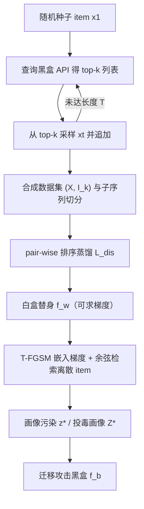
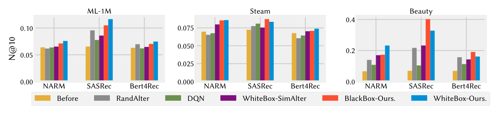

# Black-Box Attacks on Sequential Recommenders via Data-Free Model Extraction (基于无数据模型窃取的序列推荐黑盒攻击)

- **会议/期刊**: RecSys 2021
- **作者与机构**: Zhenrui Yue, Zhankui He, Huimin Zeng, Julian McAuley（TUM / UCSD）
- **推荐链路定位**: 召回（序列 next-item 召回）→ 攻击面覆盖训练期（投毒）与推理期（画像污染）
- **研究方向**: 去偏公平、可信隐私与工业架构 / 序列与会话推荐
- **论文原文**: [https://arxiv.org/abs/2109.01165v1](https://arxiv.org/abs/2109.01165v1)
- **开源代码**: [https://github.com/Yueeeeeeee/RecSys-Extraction-Attack](https://github.com/Yueeeeeeee/RecSys-Extraction-Attack)

## TL;DR (1分钟核心速览)

本文首次把**模型窃取（model extraction）**引入序列推荐：在「无训练数据、权重未知、仅返回 top-100 排序列表、查询预算有限」的黑盒设定下，利用序列推荐自身的**自回归预测范式**反复把模型输出采样回灌，合成近似真实分布的伪序列；再用面向**排序列表而非概率**的 pair-wise 蒸馏损失训练同构白盒替身，最后以 T-FGSM 嵌入梯度 + 余弦检索在离散 item 空间生成对抗样本，迁移为画像污染与数据投毒。ML-1M 上白盒与黑盒的 top-10 一致率 Agr@10 达 0.747，画像污染把头部 item 的 N@10 从 0.202 推至 0.987。

## Background & Motivation (背景与核心矛盾)

- **主流范式**: 序列推荐以 GRU4Rec/NARM（RNN+Attention）、SASRec（单向 TRM，自回归）、BERT4Rec（双向 TRM，掩码自编码）为代表；而攻击研究多集中在 MF 上的对抗样本或启发式 shilling 攻击。
- **前人局限**: ①多数推荐攻击（如 LOKI、矩阵分解投毒）**假设攻击者掌握受害模型完整训练集**，在隐式反馈（点击/浏览）场景几乎不可得；②图像/NLP 的无数据窃取（KnockoffNets/MAZE/DaST/THIEVES）依赖连续输入、GAN 生成器或语义相似的替代语料，而 item 空间是**离散 ID**、API 只返回**排序**而非概率，且序列依赖无法用随机词串模拟；③LOKI 需对深网求 Hessian，对 RNN/Transformer 不可行。
- **核心洞察 (Key Insight)**: 序列推荐器本身就是一个「next-item 自回归生成器」，**模型即数据分布模拟器**——把上一轮推荐结果采样回灌，即可用极少 API 查询采样出与真实训练分布同构的合成序列（图 4a 显示自回归序列的频次-排名密度曲线明显比随机序列更贴近真实分布）。
- **本文切入点**: 两阶段破局——先「无数据蒸馏」得到可求梯度的白盒替身，再把白盒上的对抗攻击**迁移**到黑盒，全程不碰原始数据。

## Method (核心方法设计)

### 1. 整体框架 (Overall Architecture)

攻击者从随机种子 item 出发反复调用黑盒 API：得到 top-$k$列表后以非递增概率采样一个 item 追加到序列尾部，再以新前缀查询，直至达到最大长度$T$，同时保留每步的 top-$k$排序作为标签，得到合成数据集$(X, \hat{\mathcal{I}}_k)$。随后用 pair-wise 排序蒸馏损失训练同构（或异构）白盒替身$f_w$。最后在白盒上做梯度引导的离散 item 搜索，生成注入后缀$\boldsymbol{z}^*$（画像污染，无需重训）或伪用户画像$\mathcal{Z}^*$（数据投毒，需重训受害者），迁移攻击黑盒$f_b$。

### 2. 关键设计拆解 (Key Designs)

1. **自回归合成数据生成（Autoregressive Generation）**：痛点在于随机序列丢失了 step 间依赖，蒸馏出的替身只能学到「末次点击」相关关系（Recall 尚可但 Agr@K 很差）。核心算子为 $\boldsymbol{x}^{(i)}_{auto}[t] = \mathrm{sampler}(f_b(\boldsymbol{x}^{(i)}_{auto}[:t-1]))$：把模型上一步输出当作下一步输入，形成「模型-数据」闭环。直觉上，既然受害模型是自回归训练的，其输出分布即在近似训练分布，采样（而非贪心取 top-1）还能保证多样性与「像真人」从而降低被检测风险。
2. **面向排序列表的 pair-wise 蒸馏损失**：痛点在于 API 只给 top-$k$排名、不给 logits，传统 KD 的 soft label 不可用。作者取白盒对黑盒 top-$k$的分数$\hat{\boldsymbol{S}}^{k}_{w}$与$k$个均匀负样本分数$\hat{\boldsymbol{S}}^{k}_{neg}$，构造双项 margin 排序损失$\mathcal{L}_{dis}$（式 4）：第一项约束正样本之间的**相对次序**与黑盒一致，第二项惩罚「负样本压过正样本」，使白盒能复现同一 top-$k$ 邻域。
3. **梯度引导的离散对抗样本生成**：痛点在于 item 是离散 ID，图像上的 FGSM 不可直接用。做法是把注入位初始化为目标 item $t$，在嵌入层反传交叉熵得$\nabla = \nabla_{\tilde{\boldsymbol{z}}} \mathcal{L}_{ce}(f_{w,m}(\tilde{\boldsymbol{z}}), t)$，沿$\tilde{\boldsymbol{z}}' = \tilde{\boldsymbol{z}} - \epsilon\,\mathrm{sign}(\nabla)$扰动后在 item 嵌入库中做**余弦检索**，画像污染取 top-$n$最相似候选、投毒则取最**不**相似候选填入$[\text{target}, z_2, \text{target}, z_4, \dots]$ 的 co-visitation 交替模式，从而制造「看似无关却必然导向 target」的伪画像。

**训练目标、负采样与推理开销**：总目标即 $\mathcal{L}_{dis}=\frac{1}{k-1}\sum_{i=1}^{k-1}\max(0,\hat{S}^{k}_{w}[i{+}1]-\hat{S}^{k}_{w}[i]+\lambda_1)+\frac{1}{k}\sum_{i=1}^{k}\max(0,\hat{S}^{k}_{neg}[i]-\hat{S}^{k}_{w}[i]+\lambda_2)$，负样本为**均匀采样**（免 hard negative 挖掘）。每个合成序列贡献$T{-}1$条前缀-标签对；预算以「一条输入序列 = 一次查询」计，主实验固定$B=5000$，无需访问概率、梯度或模型权重。查询开销随预算线性增长，Table 6 显示 Agr@10 在千级预算内快速饱和，之后边际收益极小。

## Experimental Setup & Evaluation Protocol (实验设置与评估协议)

- **数据集与预处理**: 由显式评分二值化为隐式反馈（沿用 BERT4Rec 预处理），未额外做 $k$-core 过滤（Beauty 另有$k{\in}\{5..8\}$-core 稠密化实验）：

| 数据集 | #Users | #Items | Avg. len | Max. len | 稀疏度 | 特征/场景说明 |
| :--- | :---: | :---: | :---: | :---: | :---: | :--- |
| ML-1M | 6,040 | 3,416 | 166 | 2,277 | 95.16% | 稠密电影评分，长序列 |
| Steam | 334,542 | 13,046 | 13 | 2,045 | 99.90% | 游戏购买，中等稀疏 |
| Beauty | 40,226 | 54,542 | 9 | 293 | 99.98% | 亚马逊美妆，极稀疏短序列 |

- **数据划分与防穿越**: 沿用 SASRec/BERT4Rec 的 `Leave-Last-Two-Out`（倒数第二项验证、最后一项测试，其余训练），黑盒受害者与白盒替身均按此训练；白盒仅用合成数据，从未接触真实训练集。
- **排名评测协议**: `Sampled Ranking`——每个用户 1 正 + **100 个均匀采样负样本**共 101 候选排序，报告 NDCG@10 / Recall@10（等价 HR@10）；另定义一致率 $\mathrm{Agr@}K = |B_{topK} \cap W_{topK}|/K$ 度量黑盒与白盒输出重合度。**注意：全文未使用 Full-Ranking 全库排序**。
- **对比基线与超参设置**: 受害者/替身覆盖 NARM、SASRec、BERT4Rec 三类架构（RNN 自回归 / TRM 自回归 / TRM 自编码）；攻击端基线为 RandAlter（随机交替）、DQN（RNN 强化学习式注入）、WhiteBox-SimAlter（相似 item 交替）与 BlackBox-Ours（直接对黑盒做同款攻击，作为迁移上界）。Adam，lr $10^{-3}$，batch 128，weight decay 0.01，序列长度 `{200, 50, 50}`；$\lambda_1,\lambda_2$按数据集取 `{(0.75,1.5),(0.5,1.0),(0.5,0.5)}`；$\epsilon=1.0$、候选数$n=10$；注入 item 数 `{10,2,2}`，投毒伪用户数 `{60,3345,402}`（约真实用户 1%）。未报告显著性检验。

## Key Experimental Results (实验关键数据)

### 1. 主实验对比 (Main Results)

同架构、预算 $B=5000$ 的提取效果（Random = 随机序列生成，Auto = 自回归生成；Agr@10 列加粗为最优）：

| 数据集 | 黑盒模型 | 黑盒 N@10 | 黑盒 R@10 | Random Agr@10 | Auto N@10 | Auto R@10 | Auto Agr@1 | Auto Agr@10 |
| :--- | :--- | :---: | :---: | :---: | :---: | :---: | :---: | :---: |
| ML-1M | NARM | 0.625 | 0.820 | 0.605 | 0.615 | 0.812 | 0.571 | **0.747** |
| ML-1M | SASRec | 0.625 | 0.817 | 0.516 | 0.602 | 0.802 | 0.454 | **0.662** |
| ML-1M | BERT4Rec | 0.602 | 0.806 | 0.488 | 0.571 | 0.791 | 0.339 | **0.593** |
| Steam | NARM | 0.628 | 0.848 | 0.642 | 0.601 | 0.806 | 0.743 | **0.722** |
| Steam | SASRec | 0.627 | 0.850 | 0.556 | 0.593 | 0.805 | 0.668 | **0.702** |
| Steam | BERT4Rec | 0.622 | 0.846 | 0.490 | 0.585 | 0.793 | 0.708 | **0.667** |
| Beauty | NARM | 0.356 | 0.518 | 0.511 | 0.272 | 0.380 | 0.344 | **0.425** |
| Beauty | SASRec | 0.344 | 0.494 | 0.213 | 0.347 | 0.505 | 0.343 | **0.357** |
| Beauty | BERT4Rec | 0.349 | 0.515 | 0.043 | 0.300 | 0.454 | 0.178 | **0.291** |

下游攻击（`N@10`，仅列头部/尾部 item）：画像污染无重训、投毒需重训一次：

| 数据集/模型 | 污染 Head (before → ours) | 污染 Tail (before → ours) | 投毒 Head (before → ours) | 投毒 Tail (before → ours) |
| :--- | :---: | :---: | :---: | :---: |
| ML-1M NARM | 0.202 → **0.987** | 0.005 → **0.701** | 0.202 → 0.205 | 0.005 → **0.016** |
| ML-1M SASRec | 0.217 → **0.981** | 0.008 → **0.760** | 0.217 → **0.351** | 0.008 → **0.032** |
| ML-1M BERT4Rec | 0.201 → **0.968** | 0.009 → **0.760** | 0.201 → 0.213 | 0.009 → **0.017** |
| Steam NARM | 0.313 → **0.850** | 0.000 → 0.017 | 0.313 → 0.347 | 0.000 → 0.004 |
| Beauty SASRec | 0.246 → **0.825** | 0.009 → **0.557** | 0.246 → 0.477 | 0.009 → **0.235** |
| Beauty NARM | 0.261 → **0.650** | 0.002 → 0.001 | 0.261 → 0.425 | 0.002 → **0.086** |

### 2. 消融实验 (Ablation Study)

以三模型平均 Agr@10（同架构）为主指标，另附关键因子扫描：

| 配置 | ML-1M | Steam | Beauty | 说明 |
| :--- | :---: | :---: | :---: | :--- |
| Full（自回归 + 同架构，$B{=}5000$） | **0.667** | **0.697** | **0.358** | 完整框架 |
| w/o 自回归生成（Random） | 0.536 | 0.563 | 0.256 | 掉 13.1 / 13.4 / 10.2 pt |
| w/o 同架构（BERT4Rec 白盒 → SASRec 黑盒） | 0.596 | 0.597 | 0.126 | 自编码↔自回归范式错配对 Beauty 致命 |
| 预算 $B$: 1000 → 5000 | ↑ 快速 | ↑ 快速 | ↑ 缓慢 | 千级后边际收益递减（Table 6） |
| Beauty 加稠密（8-core，SASRec） | — | — | 0.791（5-core 为 0.651） | 密度↑ ⇒ 提取质量↑ |
| 攻击上界 BlackBox-Ours（无迁移损失） | ≈ | ≈ | ≈ | 投毒场景与 WhiteBox-Ours 接近 |

### 3. 关键实验发现 (Key Findings)

1. **「排序性能」不足以衡量窃取成功**：九组设置中白盒 R@10 平均达黑盒的 94.54%，看起来几乎无损；但 Agr@10 只有 0.452（Random）→0.574（Auto）——说明仅靠 N@10/R@10 会严重高估窃取质量，一致率才是核心度量。且稀疏的 Beauty 上 Random 的 Agr@10 反而高于 Auto（NARM 0.511 vs 0.425），暴露出自回归生成对数据密度的依赖。
2. **迁移效率随稀疏度断崖式衰减**：画像污染中白盒攻击达到黑盒攻击效果的比例为 ML-1M 94.8% → Steam 66.2% → Beauty 55.6%；Beauty-NARM 尾部 item 甚至从 0.002 只提到 0.001，即「提取不到位，攻击就无效」，二者是串联瓶颈。
3. **画像污染与数据投毒的强弱项完全反转**：污染能把握手级 item 的 N@10 从 0.20 量级推到 0.98、尾部从 0.005 推到 0.70（ML-1M），是「个体流量劫持」；投毒对头部仅 +30.8%，但对 middle 超 +300%、tail 超 +1000%，是「长尾扶持」的更强手段，且 DQN 在投毒下甚至出现性能劣化。

<figure class="paper-figure" markdown="span">
  <figcaption>图 6. 不同方法设置下数据投毒攻击的性能比较。与画像污染不同，我们不选择单个物品作为目标，而是使用目标群体作为</figcaption>
</figure>

## Highlights & Limitations (亮点、对比与审稿批判)

- **与代表作对比 (vs. Prior Work)**: 相比 **LOKI**（需完整训练集 + 需 Hessian，对深网不可行），本文在 data-free 设定下用查询即可攻击 RNN/TRM；相比 **KnockoffNets/MAZE/DaST**（依赖连续输入与 GAN 生成器），本文用「模型自回归回灌」替代生成器，天然适配离散 item；相比 **THIEVES**（依赖 WikiText 类语义近似语料），本文指出推荐域无此类替代集，随机 item 序列效果有限。
- **可迁移亮点**: ①「用受害者模型自身采样合成数据」可直接迁移到跨域/冷启动下的**教师-学生蒸馏预热**与隐私受限的模型迁移；② `Agr@K` 可作为模型抄袭检测、模型指纹与影子模型质量评估的通用指标；③ 嵌入梯度 + 余弦检索的离散 item 搜索范式可复用于列表重排的对抗鲁棒性压力测试。
- **审稿级局限批判**: ①评测全程使用 **1+100 采样排序**而非 Full-Ranking，采样负样本中的热门 item 比例偏低，Agr@K 与攻击增益可能被系统性高估；②画像污染依赖「可向目标用户日志注入 item」（malware 假设），且投毒的交替 co-visitation 画像虽有噪声控制，工业风控仍易识别；③完全缺失防御实验（差分隐私、异常检测、鲁棒训练），也未讨论查询预算下的检测-规避博弈与显著性检验。

## Rating (四维评分)

- **方法创新性 (Novelty)**: ⭐⭐⭐⭐ （首次把无数据模型窃取引入序列推荐，「自回归回灌 = 免费数据生成器」的洞察简洁且机制自洽，但蒸馏损失与 FGSM 本身均为成熟组件的组合）
- **评估协议与实验扎实度 (Protocol & Experiments)**: ⭐⭐⭐ （三数据集×三架构×跨架构矩阵 + 稀疏度/预算扫描较全面，但仅采样排序、无 Full-Ranking、无显著性检验，且攻击基线仅 4 个）
- **写作与数学规范度 (Clarity & Rigor)**: ⭐⭐⭐⭐ （威胁模型四要素、两阶段目标函数与两个算法伪代码定义清晰，公式与符号交代完整；复杂度/查询成本分析略显单薄）
- **工业落地与复现价值 (Industrial & Practical Value)**: ⭐⭐⭐ （代码与数据开源、配置表详尽，直接给出排序 API 的真实风险面与 Agr 审计指标；但攻击脚本双刃剑、缺防御侧结论，生产部署价值主要体现为红队评估）

