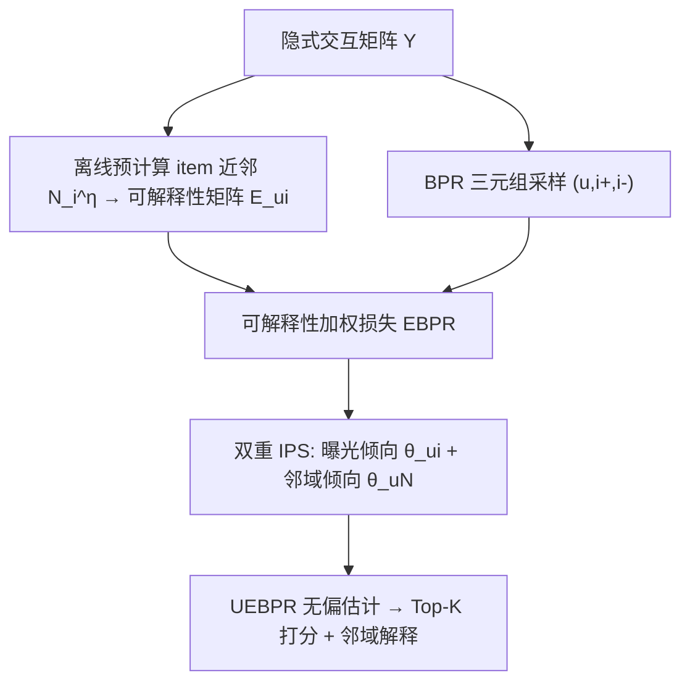

# Debiased Explainable Pairwise Ranking from Implicit Feedback (基于隐式反馈的去偏可解释成对排序)

- **会议/期刊**: RecSys 2021 (Fifteenth ACM Conference on Recommender Systems)
- **作者与机构**: Khalil Damak, Sami Khenissi, Olfa Nasraoui (University of Louisville, Knowledge Discovery & Web Mining Lab)
- **推荐链路定位**: 精排（pairwise 排序损失层）
- **研究方向**: 去偏公平与可信推荐 / 协同过滤
- **论文原文**: [https://arxiv.org/abs/2107.14768v1](https://arxiv.org/abs/2107.14768v1)
- **开源代码**: [https://github.com/KhalilDMK/EBPR](https://github.com/KhalilDMK/EBPR)

## TL;DR (1分钟核心速览)

BPR 只关心“正 > 负”，既不解释推荐理由，又因 MNAR 数据而系统性压制冷门物品。本文提出 EBPR：用 item 余弦邻域命中率构造可解释性矩阵 $E_{ui}$，以$E_{ui^+}(1-E_{ui^-})$作为三元组损失权重；进而证明该加权会**额外引入曝光偏差**，并用“邻域曝光倾向”$\theta_{uN_i^\eta}$ 做二次 IPS 修正得到 UEBPR。在 LOO + 100 负采样协议下，EBPR 于 ml-100k/yahoo-r3 的 NDCG@10 与 MEP@10 同时提升（yahoo-r3 NDCG +6.2%，WMEP +13.4%），UBEPR/UEBPR 在 yahoo-r3 无偏测试集上 MAP@5 提升约 1.1%。

## Background & Motivation (背景与核心矛盾)

- **主流范式**: BPR 以 MF 内积差 $f_\Omega(u,i^+,i^-)$配 Sigmoid 做 pairwise 排序，是隐式反馈 top-N 的 SOTA 基线：$\mathcal{L}_{BPR}=-\frac{1}{|D|}\sum_D \log\sigma(f_\Omega(u,i^+,i^-))$。
- **前人局限 1（可解释性）**: BPR 把任意 (正, 负) 对比一视同仁，无论这对样本是否“讲得通”；后验解释方法（影响函数、注意力、文本/图像理由）需要额外内容特征，且存在解释模型与预测模型不一致的保真度风险。
- **前人局限 2（曝光偏差）**: BPR 默认 MCAR，把所有未交互物品当负例；真实场景是 MNAR——用户只是**没被曝光**，于是长尾物品被反复判负、越推越少。
- **核心洞察 (Key Insight)**: 邻域可解释性本身完全由交互矩阵算出，天然与 BPR 同源可直接进损失；但 $E_{ui}$依赖同一个交互随机变量$Y_{ui}$，因此“可解释性加权”会**放大**曝光偏差，必须再除一个邻域曝光倾向才能无偏。
- **本文切入点**: 先设计可解释性加权损失 EBPR，再证明并消除其附加偏差，得到 UEBPR。

## Method (核心方法设计)

### 1. 整体框架 (Overall Architecture)

离线阶段用 item 交互向量的余弦相似度取每个物品 top-$\eta$近邻$N_i^{\eta}$（默认$\eta=20$），统计用户已交互近邻占比得到可解释性矩阵$E$；在线训练阶段采样$(u,i^+,i^-)$三元组，先按$E_{ui^+}(1-E_{ui^-})$做可解释性加权（EBPR），再按用户-物品曝光倾向$\theta_{ui}$与邻域曝光倾向$\theta_{uN_i^\eta}$做双重 IPS 加权（UEBPR），最终对$f_\Omega$ 排序输出 top-K 与“因为你喜欢过相似物品”的 item-based 理由。整条链路只依赖交互矩阵，不引入任何元数据。

### 2. 关键设计拆解 (Key Designs)

1. **可解释性加权 EBPR**：痛点是把“可解释的正例/不可解释的负例”和任意对比同等对待。做法是把损失权重乘进样本贡献，使梯度幅度正比于该因子（式 4）：

$$\mathcal{L}_{EBPR}=-\frac{1}{|D|}\sum_{(u,i^+,i^-)}E_{ui^{+}}\big(1-E_{ui^{-}}\big)\log\sigma\big(f_\Omega(u,i^+,i^-)\big),\quad E_{ui}=\frac{|N_i^{\eta}\cap I_u^{+}|}{\eta}$$

物理直觉：若正例毫无解释性、或负例完全可解释，权重归零、该样本不贡献梯度——模型只在“理由成立”的对比上学习，因此既学到 explainable preference，也自动要求推荐列表头部物品具备更高解释度。

2. **附加偏差量化与 UEBPR 无偏估计**：理想 EBPR 应以真实相关度 $\gamma_{ui}$以及理想解释矩阵$E^{ideal}_{ui}=P(R_{uj}=1\mid j\in N_i^\eta)$定义。本文证明“部分去偏”的 pUEBPR（仅 IPS 修正$Y/\theta$、保留$E$）与理想损失之间存在非零差$\mathbb{E}[\mathcal{L}_{pUEBPR}]-\mathcal{L}_{EBPR}^{ideal}\neq 0$，根源是$E_{ui}$仍含曝光项。修正办法是把$E$也除以邻域曝光倾向$\theta_{uN_i^{\eta}}=\frac{1}{\eta}\sum_{l\in N_i^{\eta}}\hat\theta_{ul}$：

$$\mathcal{L}_{UEBPR}=-\frac{1}{|U||I|^2}\sum_{u,i^+,i^-}\frac{Y_{ui^{+}}}{\theta_{ui^{+}}}\Big(1-\frac{Y_{ui^{-}}}{\theta_{ui^{-}}}\Big)\frac{E_{ui^{+}}}{\theta_{uN^{\eta}_{i^{+}}}}\Big(1-\frac{E_{ui^{-}}}{\theta_{uN^{\eta}_{i^{-}}}}\Big)\log\sigma(f_\Omega(\cdot))$$

只需假设“给定邻域后曝光与相关度条件独立”（远弱于全局独立），即可证 $\mathbb{E}[\mathcal{L}_{UEBPR}]=\mathcal{L}^{ideal}_{EBPR}$。倾向按相对流行度平方根估计：$\hat\theta_{ui}=\sqrt{\sum_j Y_{ji}/\max_{l}\sum_j Y_{jl}}$。注意与流行度去偏不同：加权项用**物品局部邻域**而非物品自身来估计倾向，因而更细粒度，也会把“邻域本身很热门”的物品一并降权。

3. **训练目标、负采样与推理开销**：EBPR 训练复杂度与 BPR 同为 $O(|D|K)$，$E$ 只在预处理阶段算一次（稀疏结构 + LSH 可加速），推理零额外开销；负采样为每轮每正例均匀采 1 个负例，**免负采样**版本不适用（损失需要显式负例对比）。

## Experimental Setup & Evaluation Protocol (实验设置与评估协议)

- **数据集与预处理**：评分/播放次数 > 0 一律二值化为正交互；lastfm-2k 过滤交互数 < 10 的用户（其余两集本身满足每用户 ≥10）。

| 数据集 | #Users | #Items | #Interactions | 稀疏度/密度 | 特征/场景说明 |
| :--- | :---: | :---: | :---: | :---: | :--- |
| ml-100k | 943 | 1,682 | 100,000 | 稀疏度 93.6% | 电影评分二值化 |
| yahoo-r3 | 15,400 | 1,000 | 311,704 | 稀疏度 97.9% | 歌曲播放数，另含 5,400 用户随机抽样无偏测试集 |
| lastfm-2k | 1,874 | 17,612 | 92,780 | 稀疏度 99.7% | 艺术家收听，极稀疏 |

- **数据划分与防穿越**：`Leave-One-Out`（每用户最新交互为测试正例），训练集再切出“最后一条 + 100 负例”作验证集调参；构建解释矩阵时**隐藏全部测试交互**，评测时用全量交互重建 $E$，避免测试集泄漏。
- **排名评测协议**：`Sampled Ranking`，测试正例对比 100 个随机采样负例（与验证负例不重叠）；K=10（无偏测试集用 K=5，因每人仅 10 首）。指标 NDCG@K、HR@K、MEP@K、加权 WMEP@K，另用 EFD（新颖度）、Avg_Pop、Div（列表内平均成对余弦相似度，越低越好）。
- **对比基线/变体与超参**：BPR、UBPR（纯去偏）为基线，EBPR、pUEBPR、UEBPR 为递进变体；潜因子 $K\in\{5,10,20,50,100\}$，batch$\in\{50,100,500\}$，L2$\in\{0,10^{-5},10^{-3}\}$，$\eta$固定 20 做公平解释性比较，另单独扫描$\eta$；结果取 5 次重复均值，Tukey test 判显著性（$p<0.05$）。

## Key Experimental Results (实验关键数据)

### 1. 主实验对比 (Main Results)

K=10，5 次重复均值，`*` 表示显著优于次优（$p<0.05$）：

| 数据集 | 模型 | NDCG@10 | HR@10 | MEP@10 | WMEP@10 |
| :--- | :--- | :---: | :---: | :---: | :---: |
| ml-100k | BPR | 0.3807* | 0.6625 | 0.9182* | 0.3467* |
| ml-100k | UBPR | 0.3676 | 0.6401 | 0.9063 | 0.3342 |
| ml-100k | **EBPR** | **0.3821*** | 0.6568* | **0.9314** | **0.3645*** |
| ml-100k | pUEBPR | 0.3648 | 0.6356* | 0.9282* | 0.3595* |
| ml-100k | UEBPR | 0.3542 | 0.6204 | 0.8986 | 0.3332 |
| yahoo-r3 | BPR | 0.3315* | 0.5466 | 0.8910* | 0.1594* |
| yahoo-r3 | UBPR | 0.3203 | 0.5422 | 0.8815 | 0.1562 |
| yahoo-r3 | **EBPR** | **0.3521** (+6.2%) | **0.5674** | **0.9461** (+6.2%) | **0.1808** (+13.4%) |
| yahoo-r3 | pUEBPR | 0.3494* | 0.5662* | 0.9394* | 0.1778* |
| yahoo-r3 | UEBPR | 0.3421* | 0.5565* | 0.9234* | 0.1710* |
| lastfm-2k | **BPR** | **0.7260*** | **0.9086*** | 0.2142 | 0.0452 |
| lastfm-2k | UBPR | 0.6613* | 0.8340* | 0.2338 | 0.0468* |
| lastfm-2k | EBPR | 0.6309 | 0.7876 | **0.2629*** (+22.7%) | **0.0485*** |
| lastfm-2k | pUEBPR | 0.5938 | 0.7556 | 0.2456* | 0.0471* |
| lastfm-2k | UEBPR | 0.5567 | 0.7284 | 0.2349* | 0.0461 |

### 2. 消融实验 (Ablation Study)

本文以“逐组件叠加”代替传统删模块消融；另附无偏测试集与流行度去偏两组补充评估：

| 配置 | 可解释性加权 | 曝光IPS | ml-100k NDCG | ml-100k WMEP | yahoo-r3 NDCG |
| :--- | :---: | :---: | :---: | :---: | :---: |
| BPR | ✗ | ✗ | 0.3807 | 0.3467 | 0.3315 |
| EBPR | ✓ | ✗ | **0.3821** | **0.3645** | **0.3521** |
| UBPR | ✗ | ✓ | 0.3676 | 0.3342 | 0.3203 |
| pUEBPR | ✓ | 部分 | 0.3648 | 0.3595 | 0.3494 |
| UEBPR | ✓ | 完整（含邻域） | 0.3542 | 0.3332 | 0.3421 |

**yahoo-r3 无偏测试集（随机抽 10 首歌，无曝光偏置）**：NDCG@5 — BPR 0.6140 / UBPR 0.6152 / EBPR 0.6178 / **pUEBPR 0.6187** / UEBPR 0.6180；MAP@5 — 0.4710 / 0.4727 / 0.4752 / **0.4764**（+1.1%）/ 0.4756。

**流行度去偏（K=10，EFD 越高越好）**：UEBPR 在 ml-100k 上 EFD 1.4699（BPR 1.2029，+22.2%），Avg_Pop 0.4127（BPR 0.4739，−12.9%）；lastfm-2k EFD 3.3843 vs. BPR 2.7714（+22.1%），Avg_Pop 0.1478 vs. 0.2000。

### 3. 关键实验发现 (Key Findings)

1. **可解释性与精度不互斥，反而正相关**：从 BPR 到 EBPR 在两个中等稀疏数据集上同时涨 NDCG 与 MEP/WMEP（yahoo-r3 WMEP 0.1594→0.1808），说明邻域加权事实上起到了**局部、细粒度的倾向估计**作用，构成一种“内生的流行度去偏”机制。
2. **交互型指标无法度量去偏收益，必须看无偏测试集**：EBPR→pUEBPR→UEBPR 在所有训练集 LOO 指标上单调下降（ml-100k NDCG 0.3821→0.3542），但在 yahoo-r3 无偏测试集上 pUEBPR 反而最高（MAP@5 0.4764 vs. BPR 0.4710），证明排序指标被评测侧的曝光偏差污染了。
3. **极稀疏是致命失效点**：lastfm-2k 平均可解释性仅 0.0041，比 ml-100k（0.1043）低一个数量级，权重接近 0 导致梯度消失，EBPR 的 NDCG 从 BPR 的 0.7260 掉到 0.6309；图 1 显示稀疏度与平均可解释性近似线性负相关，过滤到 ml-100k 稀疏水平后解释性数值即可复原。另外 $\eta$需调：EBPR/pUEBPR 在$\eta=25$达最优、UEBPR 在$\eta=20$（图 2）。

## Highlights & Limitations (亮点、对比与审稿批判)

- **与代表作对比 (vs. Prior Work)**：相较于 EMF（Nasraoui 等）——同样用邻域可解释矩阵正则化，但只做 pointwise 评分重建且完全不处理偏差；相较于 UBPR（Saito 等 2020）——只做 IPS 去偏、不产生任何解释；本文首次把邻域可解释性嵌入 **pairwise** 排序并**证明其自带额外偏差**，给出闭式无偏修正项 $\theta_{uN_i^\eta}$，这是相对两者的本质增量。
- **可迁移亮点**：① “先加权、再对权重本身做 IPS” 的二阶段去偏范式可迁移到任意乘性重加权损失（如对比学习温度/难负例权重）；② 用邻域平均倾向替代物品自身倾向，是一种低成本、抗流行的局部去偏技巧，可直接插入 LightGCN 类模型的采样器。
- **审稿级局限批判**：① 实验只与 BPR/UBPR 自身体系对比，未纳入 EMF、IPS-CN、SNIPS 或图模型基线，SOTA 说服力受限；② $E$依赖固定$\eta$与余弦相似度，极稀疏下梯度消失问题仅被诊断、未被解决（无裁剪/温度平滑）；③ 倾向估计仍以流行度平方根近似，未与真实曝光日志校准，工业场景中$\theta$ 的准确性直接决定 UEBPR 是否真无偏。

## Rating (四维评分)

- **方法创新性 (Novelty)**: ⭐⭐⭐⭐ （首次把邻域可解释性引入 pairwise 排序，并证明“可解释性加权会新增曝光偏差”，UEBPR 的条件独立假设与无偏证明链条干净）
- **评估协议与实验扎实度 (Protocol & Experiments)**: ⭐⭐⭐⭐ （三数据集 + LOO/100 负采样 + Tukey 显著性 + yahoo-r3 无偏测试集 + 稀疏度与 $\eta$ 敏感性分析，惟缺与外部 SOTA 的横向对比）
- **写作与数学规范度 (Clarity & Rigor)**: ⭐⭐⭐⭐ （定义 1–7 层层递进，Proposition 1/2 与证明完整；但部分记号如 $\theta_{uN_i^\eta}$ 在正文与实现中分母处理不一致，需读者自行对齐）
- **工业落地与复现价值 (Industrial & Practical Value)**: ⭐⭐⭐⭐ （训练复杂度与 BPR 同阶、解释矩阵离线一次、推理零开销，代码全开源，适合作为排序层的“可解释+去偏”插件；落地需额外解决稀疏冷启与倾向估计校准）

