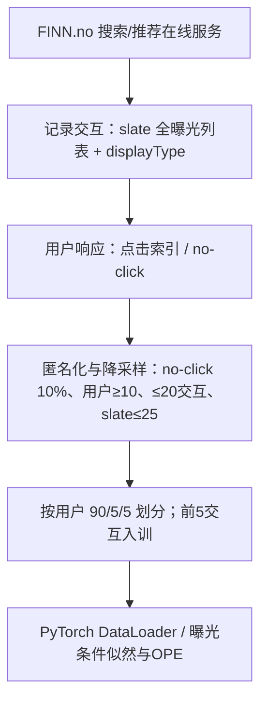
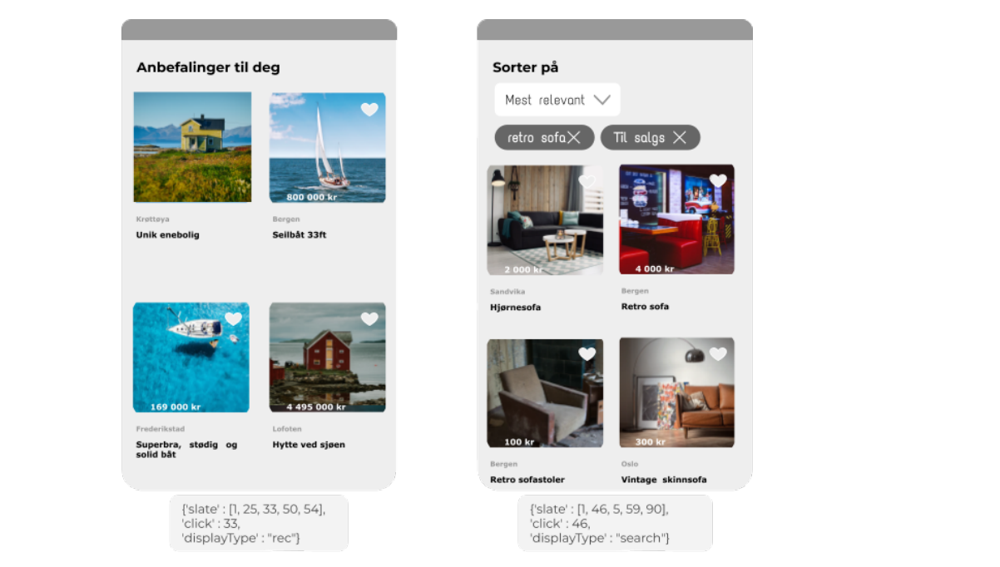

# FINN.no Slates Dataset: A new Sequential Dataset Logging Interactions, allViewed Items and Click Responses/No-Click for Recommender Systems Research（FINN.no Slates 数据集：记录交互、全部曝光条目与点击/未点击响应的新序列数据集）

- **会议/期刊**: RecSys 2021
- **作者与机构**: Simen Eide（University of Oslo & FINN.no）、Arnoldo Frigessi、Helge Jenssen、David S. Leslie、Joakim Rishaug、Sofie Verrewaere；Oslo、FINN.no、Lancaster University、Schibsted ASA
- **推荐链路定位**: 重排/离线评估（曝光感知候选采样）
- **研究方向**: 去偏公平、可信隐私与工业架构 / 强化学习与动态探索推荐
- **论文原文**: [https://arxiv.org/abs/2111.03340v1](https://arxiv.org/abs/2111.03340v1)
- **开源代码**: [https://github.com/finn-no/recsys-slates-dataset](https://github.com/finn-no/recsys-slates-dataset)

## TL;DR (1分钟核心速览)

针对仅记录点击、默认全库曝光的日志造成均匀候选采样偏差与曝光反馈回路，本文发布 FINN.no 30 天、3750 万次交互、230 万用户、130 万物品的 slate 级序列数据集，逐轮记录展示列表、点击索引/no-click 及搜索/推荐来源，并提供按用户 90/5/5 划分与 DataLoader。原文不报模型提升，价值在支撑曝光条件似然与离线策略评估。

## Background & Motivation (背景与核心矛盾)

- **主流范式**: 序列推荐通常只消费点击正样本，并用全库均匀负采样构造训练对，隐含假设用户每轮暴露于整个物品库。
- **前人局限**: 缺少开放的大规模 slate 曝光日志，模型无法区分“未曝光”与“曝光但未点击”；均匀候选采样把未曝光物品误判为负例，进一步强化已曝光物品与反馈回路。
- **核心洞察 (Key Insight)**: 若记录每轮实际展示的 $\mathcal{S}_u$与 no-click，就可估计曝光条件点击概率$P(c_i=1\mid \mathcal{S}_u)$，并把 no-click 当作有效响应而非缺失数据。
- **本文切入点**: 发布真实市场 FINN.no 的 slate 级日志、290 个物品组、搜索/推荐来源与匿名化划分，供曝光感知建模与离线策略评估使用。

## Method (核心方法设计)

### 1. 整体框架 (Overall Architecture)

数据闭环为：在线搜索/推荐服务产生 slate $\to$记录全部浏览条目（非仅点击）$\to$记录点击索引或 no-click$\to$匿名化、降采样与截断$\to$按用户划分$\to$ PyTorch DataLoader。本文不定义推荐模型，而定义可被序列/排序模型消费的曝光日志 schema；训练时可在 slate 内做 softmax 并加入 no-click 类，推理时仍需全库召回/排序。

### 2. 关键设计拆解 (Key Designs)

1. **Slate 级曝光日志（记录“用户看见了什么”）**：前人日志常只有 $(u,i,c)$点击三元组，缺少反事实曝光集；本文每个交互记录$\mathcal{S}_u$与$r_u\in\mathcal{S}_u\cup\{\bot\}$，且$t_u\in\{\text{search},\text{recommend}\}$。这样点击可写成条件概率而非全库二分类，物理直觉是“用户只能在看到的条目里点击”。

<figure class="paper-figure" markdown="span">
  <figcaption>图1. FINN.no上展示的已记录列表示例截图。左侧为推荐列表，右侧为搜索查询得到的列表。两种情况下均向用户展示四个条目。下方还给出这些列表在数据集中记录方式的示例：“slate”为所浏览条目的列表，包含特殊条目“no click”（其索引为1）；“click”为被点击条目的索引；“displayType”编码其为搜索列表还是推荐列表。</figcaption>
</figure>

2. **曝光条件似然与候选采样偏差（把 no-click 纳入分母）**：uniform candidate sampling 的 $P(c_i=1)$隐含$e_i\equiv1$；但真实日志中$e_i=1$仅当$i\in\mathcal{S}_u$。数据集使下式可估：$P(c_i=1\mid\mathcal{S}_u)=\frac{\exp(s_{ui})}{\sum_{j\in\mathcal{S}_u}\exp(s_{uj})+\exp(s_{u\bot})}$。将 no-click 作为竞争类可校准曝光内概率；若做 OPE，还需日志策略概率，数据本身未给 propensity。

3. **用户级划分与匿名化（控制隐私与计算）**：$\mathcal{U}_{tr}:\mathcal{U}_{va}:\mathcal{U}_{te}=90:5:5$，且每个用户前 5 条交互强制入训；no-click 从原始 76.3% 降到 10% 原始量，用户至少 10 条、最多 20 条，slate 最多 25 条。这样保留用户冷启/短序列估计空间，但改变了 no-click 先验。原文不训练模型，故无损失/负采样/推理开销；后续模型可直接用 slate 内曝光 softmax + no-click，免全库均匀负采样，但全库召回仍依赖 ANN。

## Experimental Setup & Evaluation Protocol (实验设置与评估协议)

- **数据集与预处理**: 30 天 FINN.no 真实市场日志；no-click 先降采样至原始 10%，删除少于 10 条交互用户，超过 20 条仅保留前 20 条，slate 上限 25 条（影响约 5% slate；若点击条目被截掉则整条交互删除）。

| 数据集 | #Users | #Items | #Interactions | 稀疏度/密度 | 特征/场景说明 |
| :--- | :---: | :---: | :---: | :---: | :--- |
| FINN.no Slates | 2.3m | 1.3m | 37.5m | 极稀疏，按用户×物品估算约 $1.3\times10^{-5}$ | 290 物品组；30 天；人均 16.4 交互；slate 均长 10.1；no-click 24.4%；搜索 69.7%/推荐 30.3% |

- **数据划分与防穿越 (Splitting Strategy)**: 用户级 90/5/5 划分，非 Leave-One-Out、非全局时间戳切分；每个用户前 5 条交互强制入训，供用户参数估计。
- **排名评测协议 (Ranking Protocol)**: 原文无统一 Full-Ranking 或 Sampled Ranking 指标；数据支持 slate 级点击/no-click 预测、曝光条件排序与基于重要性的离线评估，但未提供标准 benchmark。
- **对比基线与超参设置**: 原文为数据集论文，未报告模型主实验、baseline、embedding 维度或显著性检验；代码提供 PyTorch DataLoader 与 split 实现。

## Key Experimental Results (实验关键数据)

### 1. 主实验对比 (Main Results)

原文未进行模型主实验，无 5–8 个 baseline、无指标数值与 `Improv.`。可量化主结果即表 1 数据集统计：37.5m 交互、2.3m 用户、1.3m 物品、290 组、no-click 24.4%、搜索 slate 69.7%。其“对比”价值在于相对广告展示/IR 数据集提供用户身份、足量交互与完整曝光 slate。

### 2. 消融实验 (Ablation Study)

原文无模型消融；表 2 为数据构建关键选择及其影响，属预处理分析而非组件消融。

| 数据构建选择 | 原文设定 | 影响/说明 |
| :--- | :--- | :--- |
| no-click 降采样 | 原始 76.3% $\to$ 10% 原始量；最终 24.4% | 防止 no-click 主导，但改变真实先验 |
| 用户过滤 | <10 交互删除 | 保证可建模序列，牺牲低活/新用户 |
| 交互截断 | >20 仅保留前 20 | 控制隐私与长度，截断长序列 |
| slate 截断 | 最多 25 条；点击被删则整条删 | 影响约 5% slate，可能轻微选择偏差 |

### 3. 关键实验发现 (Key Findings)

1. 最终 no-click 占 24.4%，原始占 76.3%：曝光未点击是主要响应信号，只保留点击会系统性丢弃近四分之一最终日志中的负反馈。
2. 搜索 slate 占 69.7%、推荐仅 30.3%：同一数据集混合两种曝光机制，模型若不分 `displayType` 会把搜索意图与推荐意图混为同分布。
3. 2.3m 用户对 1.3m 物品、人均 16.4 交互且过滤 <10、截断 >20：用户序列短、物品长尾重；用户级 90/5/5 + 前 5 入训可估用户参数，但不是严格时间切分，离线评估需防用户历史泄漏。

## Highlights & Limitations (亮点、对比与审稿批判)

- **与代表作对比 (vs. Prior Work)**: 相比广告展示/IR 数据集，本文提供可识别用户、足量序列交互与每轮完整 slate；相比合成仿真环境，本文是 FINN.no 真实市场日志，含搜索与推荐两种曝光机制。
- **可迁移亮点**: 可直接复用“slate 列表 + 点击索引/no-click + displayType”日志 schema；建模时用 slate 内 softmax 加 no-click 类替代全库均匀负采样，能缓解曝光偏差。
- **审稿级局限批判**: 出于隐私未给精确时间戳、搜索 query、物品描述与日志策略 propensity，导致 IPS/OPE 不能直接识别，只能做假设性评估；no-click 降采样至 10% 改变基础点击率，用户级非时间切分且测试用户前 5 条入训，存在用户历史泄漏风险。

## Rating (四维评分)

- **方法创新性 (Novelty)**: ⭐⭐⭐⭐ （首个大规模真实市场 slate 曝光数据集，数据贡献明确，但方法创新有限）
- **评估协议与实验扎实度 (Protocol & Experiments)**: ⭐⭐⭐ （统计、划分与 DataLoader 清楚，但无统一 benchmark、无显著性检验，且非时间切分）
- **写作与数学规范度 (Clarity & Rigor)**: ⭐⭐⭐⭐ （schema、统计与偏差讨论直观透明，形式化推导与 propensity 讨论略简）
- **工业落地与复现价值 (Industrial & Practical Value)**: ⭐⭐⭐⭐⭐ （真实工业日志 + 匿名化 + 可复现加载器，直接支撑曝光感知离线评估与去偏研究）

