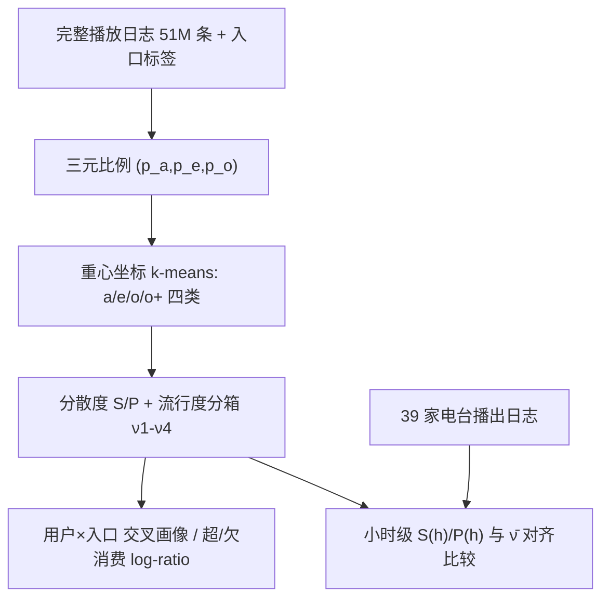

# Follow the Guides: Disentangling Human and Algorithmic Curation in Online Music Consumption (跟随引导：拆解在线音乐消费中的人为与算法策展)

- **会议/期刊**: RecSys 2021（15th ACM Conference on Recommender Systems）
- **作者与机构**: Quentin Villermet, Jérémie Poiroux, Manuel Moussallam, Thomas Louail, Camille Roth（Centre Marc Bloch / CNRS / Deezer Research）
- **推荐链路定位**: 平台级曝光入口审计（非模型链路，覆盖召回—编辑策展的全链路观测）
- **研究方向**: 去偏公平与工业架构（推荐多样性/过滤气泡的实证审计）
- **论文原文**: [arXiv:2109.03915v1](https://arxiv.org/abs/2109.03915v1)
- **开源代码**: 暂未开源（Deezer 内部匿名日志，含隐私协议限制）

## TL;DR (1分钟核心速览)

多样性研究多在聚合层面比较「有/无推荐」，忽略了用户对引导的**异质态度**与平台推荐的**异质来源**。本文用 Deezer 8,639 名付费用户 12 个月、约 5,100 万条完整播放日志，把入口三分为自然（organic）/算法（algorithmic）/编辑（editorial），在重心坐标上聚类出 a/e/o/o+ 四类用户，并在「分散度 $S/P$」与「艺人流行度分箱$\nu_1\!-\!\nu_4$」两轴上度量多样性。核心结论：**编辑入口系统性拉向流行艺人（均值分箱 2.23），算法入口拉向长尾（2.68），自然入口居中（2.49）**；且用户群内部呈"偏好入口=开发式重复、非偏好入口=探索"的分工，因此应称"过滤小生境（filter niches）"而非"过滤气泡"。

## Background & Motivation (背景与核心矛盾)

- **主流范式**: 现有实证多以「算法 vs 自然」二分法、在全体用户聚合层级比较曝光内容的多样性（品类分布、Top 艺人份额、语义嵌入空间扩散度）。
- **前人局限**: (i) 将"编辑策展"（人类策展人 playlist）并入算法或直接忽略，导致 Deezer/Spotify 上占据首页大量坑位的编辑位无法归因；(ii) 假设推荐对所有用户同效，而不同用户对引导的依赖度相差一个量级（本文中算法占比从 2% 到 58%）。
- **核心洞察 (Key Insight)**: 若把「用户类型」与「入口类型」两个因子分开看，编辑与算法对多样性的作用方向**相反**；把二者混在一起做聚合，正负效应相互抵消，才得出「推荐效应不明确」的摇摆结论。
- **本文切入点**: 不做新模型，而是建立一套可复用的度量管线——入口三分 + 用户聚类 + 双轴多样性 + 站外电台参照系，从而在"用户×入口"交叉格里读出效应。

## Method (核心方法设计)

### 1. 整体框架 (Overall Architecture)

对每条播放事件依据 Deezer 前端产品功能标注入口：搜索栏/收藏/自建歌单 → 自然；个性化自动流 "flow" → 算法；人工编辑歌单（即使被算法分发）→ 编辑。对每个用户得到三元比例 $(p_a,p_e,p_o)$，在单纯形上做$k$-means/Voronoi 划分得到四类用户；随后在**功能维度**（分散度$S/P$，反映重复/探索）与**语义维度**（艺人流行度分箱，反映主流/长尾）分别计算每类用户、每种入口的消费画像；最后用同期 39 家法国电台的播出日志作为"离线人类策展"参照，按小时粒度对齐比较。

### 2. 关键设计拆解 (Key Designs)

1. **入口三分与重心坐标用户分群**：前人只有算法/自然二分，本文补上"人类策展"这一被忽视的第三条腿，并用 $p_o = 1-(p_a+p_e)$把用户映射到单纯形；$k=4$已解释约 80% 方差，$k>4$ 增益有限，且其他聚类方法会退化为单一簇（密度沿自然顶点单调递增）。因此四类应理解为**坐标空间的等分箱**而非严格簇。物理直觉：入口比例本身就是"用户如何使用平台"的低维充分统计量。

2. **双轴多样性 + 等播放量流行度分箱**：分散度定义为 $\mathrm{disp}_u = S_u/P_u$（$S$为唯一曲目数），$1$表示每条只播一次、趋$0$表示高度重复。流行度不用嵌入空间距离（受标签噪声、多品类"多中心"干扰），而是按**全库播放量分箱且使每箱承载等量播放**$P/4$，于是$\nu_1$仅含 73 位顶流艺人、$\nu_4$含 166,869 位长尾艺人。由此可在无偏基线下定义用户对箱$b$ 的超/欠消费：

$$\delta_{u,b}=\log\frac{c_{u,b}/P_u}{1/4},\qquad \delta^{\text{mode}}_{u,b}=\log\frac{c^{m}_{u,b}/(p_m P_u)}{1/4}$$

   第二条式子在每个入口内部**局部归一化**，从而把"用户是谁"与"走了哪个入口"两个效应解耦。直觉：等播放量分箱让"均匀随机听歌"成为干净的零假设，$\delta=0$ 即无偏。

3. **训练目标/推理开销**：本文无训练损失、无负采样、无在线推理；全部为离线统计量，可一次性批处理，工程成本极低（相对平台线上服务可忽略）。真正的"成本"在于入口标签的产品侧埋点质量与站外数据的曲目匹配率（电台曲目匹配 Deezer 库约 83%，未匹配者丢弃，会高估电台流行度）。

## Experimental Setup & Evaluation Protocol (实验设置与评估协议)

- **数据集与预处理**: 丢弃时长 < 30s 的事件（视作 skip）；仅保留 2018-12-31 前注册、2019-01 活跃的法国付费订阅者，规避免费用户行为差异。

| 数据集 | #Users | #Items(Artists) | #Interactions(Plays) | 密度/规模 | 特征/场景说明 |
| :--- | :---: | :---: | :---: | :---: | :--- |
| Deezer 全量日志 | 8,639 | 164,955 | ≈51,000,000 | 人均 5,900 次/年（≈16/日） | 含入口标签（自然/算法/编辑）、时长、曲目-艺人映射 |
| 电台播出日志 | 39 家电台 | 匹配率 83% | 全年逐曲目播出记录 | — | 含 2019 法国 audience Top-15 全国台与专业台/网络台 |

- **数据划分与防穿越 (Splitting Strategy)**: 无 train/test 划分；采用**全量 12 个月观测窗口**（2019 全年）+ **小时级时间分箱**（每用户/每电台 24 组 $P(h),S(h),\bar\nu(h)$）做时序对齐，避免日间节目编排造成的混淆。
- **排名评测协议 (Ranking Protocol)**: 不适用 NDCG/HR——本研究不做 Top-N 排序评测；等价的无偏参照是**等播放量流行度分箱下的均匀零假设**（每箱期望占比 1/4），所有偏离以 log-ratio 报告，因而不存在采样负样本带来的流行度偏置。
- **对比基线与超参设置**: 由于是测量研究，无模型基线；对照组为 (i) 四类用户互比、(ii) 三种入口互比（图 5 上下两栏）、(iii) **15 家代表性电台**作为站外人类策展参照（表 3、图 6）。聚类超参 $k=4$；分箱数固定为 4（按播放量等分）。

## Key Experimental Results (实验关键数据)

### 1. 主实验对比 (Main Results)

用户类构成与各入口占比（表 1，行为类中心点占比）：

| 用户类 | #Users (占比) | 自然 $p_o$| 算法$p_a$| 编辑$p_e$| 平均分散度$\langle S/P\rangle$|$\nu_1$占比 |$\nu_4$ 占比 |
| :--- | :---: | :---: | :---: | :---: | :---: | :---: | :---: |
| a（偏算法） | 989 (11%) | 36% | **58%** | 6% | 0.39 | 17% | 27% |
| e（偏编辑） | 655 (8%) | 55% | 7% | **38%** | **0.41** | **29%** | 19% |
| o（偏自然） | 1,614 (19%) | 70% | 23% | 7% | 0.38 | 22% | 27% |
| o+（极自然） | 5,381 (62%) | **94%** | 2% | 4% | 0.28 | 29% | 25% |
| 参照：FIP（电台） | — | — | — | — | **0.60** | 2% | **71%** |
| 参照：Radio Meuh | — | — | — | — | 0.23 | 0% | **82%** |
| 参照：RFM | — | — | — | — | 0.10 | 7% | 30% |
| 参照：Fun Radio | — | — | — | — | 0.04 | 18% | 8% |
| 参照：NRJ | — | — | — | — | **0.03** | **41%** | 7% |

各入口的平均流行度分箱（全播放均值为 2.50）：**算法 2.68 > 自然 2.49 > 编辑 2.23**；入口在四箱上的份额（表 2）：算法在 $\nu_1$仅 9%、在$\nu_2/\nu_3$达 16%/18%；编辑在$\nu_1$达 8% 且随流行度单调递减（$\nu_4$ 仅 5%）。

### 2. 消融/稳健性检验 (Robustness & Sensitivity)

| 设计选择 | 变更 | 结果 | 结论 |
| :--- | :--- | :--- | :--- |
| 分箱方式 | 等艺人数量 vs **等播放量** | 等播放量使零假设期望占比恒为 1/4 | 避免顶流箱曲目少导致的机械性低分散 |
| 聚类数 $k$|$k=4$vs$k>4$/ 其他算法 |$k=4$ 解释 ≈80% 方差；其他方法退化为单簇 | 四类为坐标"分箱"而非真簇，稳健但非唯一解 |
| 电台对齐 | 全年聚合 vs **小时级** | 小时级揭示节目编排造成的 $\bar\nu$ 波动 | 时间分箱是必要控制 |
| 站外匹配 | 丢弃未匹配曲目 | 约 17% 电台曲目丢失 → 高估电台流行度 | 结论对电台"更主流"是保守估计 |
| 分散度-流行度耦合 | 控制曲库规模 | 顶流箱仅 18,425 首 vs 长尾箱 1,161,257 首 | 部分耦合是机械性的，需谨慎解读 |

### 3. 关键实验发现 (Key Findings)

1. **两类推荐方向相反，且互相抵消**：编辑入口平均分箱 2.23 显著低于算法 2.68，e 类用户 $\nu_1$ 消费占比 29% 而 a 类仅 17%；说明编辑策展承担了"主流电台"角色，算法承担长尾发现角色——聚合统计把二者混算，正是既有文献结论互相矛盾的根源。
2. **"偏好入口=开发、其余入口=探索"的分工普遍存在**：每类用户在其主导入口内分散度最低（最重复），在非主导入口内最高；但跨类看，只要用了推荐（a/e/o），$\langle S/P\rangle$ 为 0.38–0.41，而纯自然 o+ 仅 0.28，且 e 类在消费更流行内容（本应更低分散）下仍取得最高分散度 0.41，构成"推荐促进探索"的强证据。
3. **平台并未比电台更"主流"，但更"不重复"**：NRJ/Fun Radio 分散度仅 0.03–0.04、$\nu_1$占比高达 41%，而 FIP/Radio Meuh 的$\nu_4$占比 71%–82% 却分散度中等；$S/P$与$\nu_4$占比的 Spearman$\rho=0.827$ 表明"曲目多样"与"长尾倾向"强耦合，用户群整体落在电台流行度中位数附近、但分散度更高，故应称"过滤小生境"。

## Highlights & Limitations (亮点、对比与审稿批判)

- **与代表作对比 (vs. Prior Work)**: 相较 [3]（Spotify，算法降低多样性）与 [9]（HITS，推荐提升多样性）的对立结论，本文指出差异可归因于**入口混合比例与用户构成不同**而非平台差异；相较仅二分算法/自然的工作，本文给出第三条腿（编辑）并首次与站外电台节目单对齐，提供了跨平台可比的"人类策展"基准线。
- **可迁移亮点**: (i) "入口归因 + 重心坐标聚类 + 入口内局部归一化 log-ratio"这套三件套可直接移植到短视频、新闻、电商的曝光来源审计；(ii) 以**等播放量分箱**构造均匀零假设、用 $\delta$ 度量超/欠消费，比 Top-K 艺人份额更抗曲库规模偏置，适合做上线前的多样性监控指标。
- **审稿级局限批判**: (i) **纯观测、无因果识别**：用户选择入口本身内生（"鸡生蛋"问题作者亦承认），无法排除自选择——重度探索者本就更多点推荐位；(ii) **样本与外部效度**：仅法国付费订阅者一年，付费墙与地域文化会削弱泛化，且未分析曲目在入口间的**转移轨迹**（先编辑发现、后自然复听），而这恰是判断长期影响的关键；(iii) 分散度受曲库规模与曲目时长机械影响，缺少对该混杂的显式校正模型。

## Rating (四维评分)

- **方法创新性 (Novelty)**: ⭐⭐⭐⭐ （提出入口三分 + 双轴多样性 + 站外电台参照的测量框架，概念增量清晰，但无模型/理论学习贡献）
- **评估协议与实验扎实度 (Protocol & Experiments)**: ⭐⭐⭐⭐ （8.6k 用户全年完整日志、等播放量无偏零假设、小时级对齐与 83% 匹配率披露都很扎实，缺因果识别与显著性检验）
- **写作与数学规范度 (Clarity & Rigor)**: ⭐⭐⭐⭐ （$S/P$、$\nu$、$\delta$ 符号统一且定义干净，三元图/箱线图可读性强；聚类仅作"分箱"使用的表述略显防御性）
- **工业落地与复现价值 (Industrial & Practical Value)**: ⭐⭐⭐ （指标管线低成本可直接上线做多样性监控，但依赖平台私有入口埋点与全量日志，数据不可复现，无开源代码）

