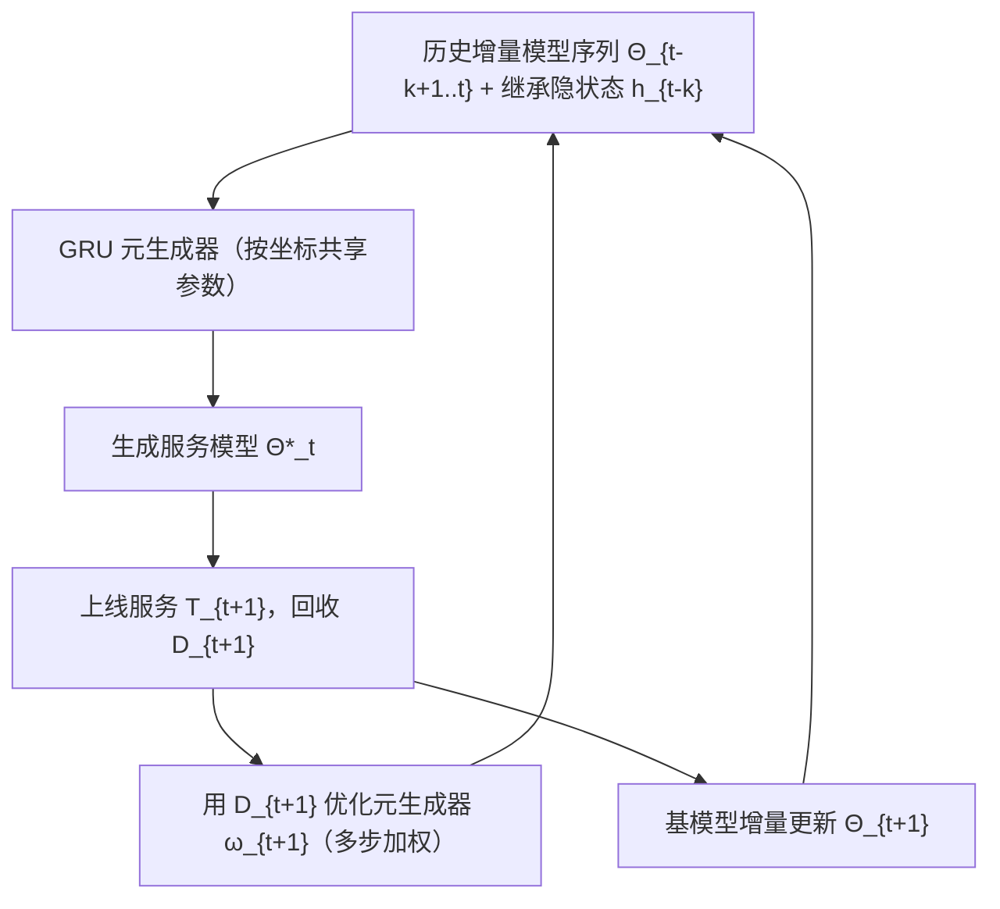

# Learning an Adaptive Meta Model-Generator for Incrementally Updating Recommender Systems (面向增量更新推荐系统的自适应元模型生成器)

- **会议/期刊**: RecSys 2021
- **作者与机构**: Danni Peng, Sinno Jialin Pan, Jie Zhang, Anxiang Zeng（南洋理工大学，阿里巴巴 AIR/JRI 合作）
- **推荐链路定位**: 精排（CTR 模型在线更新与部署）
- **研究方向**: 去偏公平、可信隐私与工业架构 / CTR 预估与特征交叉
- **论文原文**: [https://arxiv.org/abs/2111.04282v1](https://arxiv.org/abs/2111.04282v1)
- **开源代码**: [https://github.com/danni9594/ASMG](https://github.com/danni9594/ASMG)

## TL;DR (1分钟核心速览)

工业推荐每天用新数据增量更新模型以抓住兴趣漂移，但纯增量训练会灾难性遗忘长期知识；而基于回放/蒸馏的已有方法只能约束两周期间的知识传递，无法利用"模型演化序列"中的长期时序模式。本文提出 ASMG 框架：用 GRU 元生成器吃进一串历史增量模型 $\Theta_{1:t}$，生成直接服务下一周期的$\Theta^*_t$，并配套"截断序列+继承隐状态"与"多步并发加权训练"两项策略。在 31 周期切分的 Tmall/Sobazaar/MovieLens/Lazada（10 万用户工业集）上，AUC 相对纯增量提升 0.93%–1.38%，LogLoss 降低 0.65%–5.63%。

## Background & Motivation (背景与核心矛盾)

- **主流范式**: 以 Embedding&MLP 为代表的深度 CTR 模型，每个周期仅用当期数据 $D_t$从$\Theta_{t-1}$继续训练得到$\Theta_t$并直接上线（Incremental Update, IU）；或退化到滑动窗口批量更新（BU-$w$）。
- **前人局限**: ① 样本回放类（SPMF）靠重放历史样本维持记忆，但少量"信息样本"无法代表历史整体分布；② 模型类（IncCTR 知识蒸馏、SML 用 CNN 迁移模块融合前后模型）虽显式优化下一周期目标，但**只建模相邻两周期**，丢弃长期时序演化信息。
- **核心洞察 (Key Insight)**: 每个周期的增量模型本身即该周期数据分布的高密度摘要，"模型序列"比"样本序列"更能刻画趋势；而 CSI（Tmall 等）实验显示各测试周期性能波动剧烈，说明序列趋势动态变化，元生成器必须**自适应地持续更新**而非一次训好。
- **本文切入点**: 把模型更新重写为"以历史模型序列为输入的生成问题"，用带门控循环单元的元生成器抽取长期时序模式，并始终以**下一周期真实数据**作为元生成器的优化目标。

## Method (核心方法设计)

### 1. 整体框架 (Overall Architecture)

离线阶段先按常规增量方式得到 $\Theta_1,\dots,\Theta_t$序列；元生成器$\mathcal{M}_\omega$逐坐标（coordinate-wise）地对模型参数序列做循环编码，输出：$\Theta^*_t=\mathcal{M}_\omega(\Theta_{t-(k-1):t},h_{t-k})$。上线时部署$\Theta^*_t$服务$T_{t+1}$，收集$D_{t+1}$后并行做两件事：基模型照旧增量更新得$\Theta_{t+1}$；元生成器以$D_{t+1}$为监督信号更新$\omega_{t+1}$。离线先做$\tau$ 个周期 warm-up，线上继续跟踪最新趋势。

### 2. 关键设计拆解 (Key Designs)

1. **GRU 元生成器（把参数演化当时间序列建模）**：难点在于模型参数是 $n$维无序向量、且序列长度随时间线性增长。作者对每个标量参数$\theta\in\Theta_i$独立跑同一个共享 GRU：$r_i=\sigma(W_r[h_{i-1},\theta])$、$z_i=\sigma(W_z[h_{i-1},\theta])$、$h_i=(1-z_i)\odot h_{i-1}+z_i\odot\tilde{h}_i$，再线性读出$\theta^*=Wh_i+b$。直觉是门控机制可自动学习"保留多少旧周期信息、吸收多少新周期信息"，等价于可学习、非线性的模型融合权重；参数在$t$步间共享，参数量与序列长度无关。对稀疏 ID embedding 则**按维度分配生成器并在 ID 间共享**，空间复杂度从$\mathcal{O}(d_ed_{up}d^2)$降到$\mathcal{O}(d_ed^2)$，避免过拟合。
2. **截断序列 + 继承隐状态（效率与长期记忆兼得）**：全长序列计算量 $\mathcal{O}(tnd^2)$不可接受，但简单截断+零初始化$h_0$会丢弃早期模型。作者固定窗口$k$，训练$\mathcal{M}_{t+1}$时用最近$k$个模型$\Theta_{t-(k-1):t}$作输入，并把上一次训练得到的$h_{t-k}$作为初始隐状态继续滚：$\Theta^*_t=\mathcal{M}_\omega(\Theta_{t-(k-1):t},h_{t-k})$。这样$\Theta_{1:t-k}$ 被压缩进一个隐状态，形成"循环递推的记忆胶囊"。
3. **多步并发加权训练**：只优化末端输出 $\Theta^*_t$ 会让中间隐状态"跑偏"。作者同时对窗口内所有步做监督，并按线性衰减给近期数据更大权重（近期数据更新颖、更有信息量）：
$$\omega_{t+1}=\arg\min_{\omega}\sum_{i=t-(k-1)}^{t}\lambda_i\,\mathcal{L}\big(\mathcal{M}_\omega(\Theta_{t-(k-1):i},h_{t-k})\mid D_{i+1}\big),\quad \lambda_{t-(k-j)}=\frac{j}{\sum_{j'=1}^{k}j'}$$
该式让每个中间隐状态都必须"能生成服务其下一周期的模型"，起到状态正则作用。注意其与 BU 的本质区别：多周期数据只用于训练元生成器，基模型仍严格单期增量训练。

**训练目标与开销**：基模型与元生成器共用点式 log loss（每正样本随机配 1 个未观测负样本）；Adam，lr∈{1e-2,1e-3,1e-4}；推理侧仅需一次前向 GRU 读出，$k{=}3$ 时元生成器训练时间从 93.6 min 降至 13.8 min（约 6.5–7×）。

## Experimental Setup & Evaluation Protocol (实验设置与评估协议)

- **数据集与预处理**（均切 31 个周期；每用户取最近 30 条正反馈作序列特征）：

| 数据集 | #Users | #Items | #Interactions | 密度 | 特征/场景说明 |
| :--- | :---: | :---: | :---: | :---: | :--- |
| Tmall | 49,986 | 43,571 | 3,047,101 | 0.14% | 电商，31 天=31 周期，Top-50k 用户、item≥20 |
| Sobazaar | 17,126 | 24,785 | 842,660 | 0.20% | 移动电商，等样本量切 31 周期(≈4 天) |
| MovieLens-25M | 43,181 | 51,142 | 6,840,091 | 0.31% | 评分>3 为正，等量切分(≈2 月/周期) |
| Lazada (工业) | 10,000 | 43,878 | 6,659,828 | 1.52% | 曝光日志，点击为正，31 天=31 周期 |

- **数据划分与防穿越 (Splitting Strategy)**: 前 10 周期预训练 $\Theta_0$；后 20 周期按 **10/3/7 train/val/test** 划分，溢出至少 5 个周期做元生成器 warm-up（$k\leq 6$）；每个测试周期的模型只在其**下一周期**数据上评测，严格前向无穿越。
- **排名评测协议 (Ranking Protocol)**: 非采样排序，而是点式 CTR 评测——训练与测试均对每条正样本随机采 **1 个未交互/未点击样本（1:1）**，报告 AUC 与 LogLoss，7 个测试周期均值 ± 标准差（5 次运行）。
- **对比基线与超参**: IU、BU-3/5/7、SPMF（回放，reservoir 0.1–0.5）、IncCTR（蒸馏权重 0.1–0.5）、SML（CNN 滤波器 {2,5,8,10}）、SML-MF（换 MF 基座，仅作参考）、ASMG-Linear；序列长度 $k\in[1,6]$，GRU 隐层 {4,8,12,16}，batch 256/1024。

## Key Experimental Results (实验关键数据)

### 1. 主实验对比 (Main Results)

| Method | Tmall AUC↑ | Sobazaar AUC↑ | MovieLens AUC↑ | Lazada AUC↑ | Tmall LogLoss↓ | Lazada LogLoss↓ |
| :--- | :---: | :---: | :---: | :---: | :---: | :---: |
| IU (纯增量) | 0.8180 | 0.7998 | 0.7494 | 0.6381 | 0.5382 | 0.4327 |
| BU-5 (滑窗批量) | 0.8002 (-2.18%) | 0.7824 (-2.18%) | 0.7280 (-2.86%) | 0.6287 (-1.47%) | 0.5615 | 0.4361 |
| SPMF (回放) | 0.8187 (+0.09%) | 0.8007 (+0.11%) | 0.7511 (+0.23%) | 0.6381 (0.00%) | 0.5220 | 0.4327 |
| IncCTR (蒸馏) | 0.8190 (+0.12%) | 0.8009 (+0.14%) | 0.7502 (+0.11%) | 0.6388 (+0.11%) | 0.5344 | 0.4321 |
| SML (两期迁移, SOTA) | 0.8194 (+0.17%) | 0.8021 (+0.29%) | 0.7522 (+0.37%) | 0.6416 (+0.55%) | 0.5198 | 0.4309 |
| SML-MF (异基座) | 0.7628 | 0.7782 | 0.7242 | 0.6100 | 0.5822 | 0.4390 |
| ASMG-Linear | 0.8190 (+0.12%) | 0.8002 (+0.05%) | 0.7524 (+0.40%) | 0.6390 (+0.14%) | 0.5226 | 0.4314 |
| ASMG-GRU_single | 0.8241 (+0.75%) | 0.8055 (+0.71%) | 0.7539 (+0.60%) | 0.6439 (+0.91%) | 0.5154 | 0.4304 |
| **ASMG-GRU_multi** | **0.8289 (+1.33%)** | **0.8108 (+1.38%)** | **0.7564 (+0.93%)** | **0.6452 (+1.11%)** | **0.5079 (+5.63%)** | **0.4299 (+0.65%)** |

### 2. 消融实验 (Ablation Study)

| 变体 (Tmall / Sobazaar / MovieLens) | Tmall AUC | Tmall LogLoss | Sobazaar AUC | MovieLens AUC | 说明 |
| :--- | :---: | :---: | :---: | :---: | :--- |
| w/o 截断 (GRU_full, k 长至 20) | 0.8267 | 0.5108 | 0.8083 | 0.7565 | 全长序列，效率崩坏 |
| w/o 继承隐状态 (GRU_zero) | 0.8224 | 0.5162 | 0.8079 | 0.7550 | 每期零初始化 $h_0$ |
| w/o 加权 (GRU_unif, 均匀权重) | 0.8284 | 0.5102 | 0.8091 | 0.7563 | 无线性衰减权重 |
| w/o 多步并发 (GRU_single) | 0.8241 | 0.5154 | 0.8055 | 0.7539 | 只优化末端 |
| **ASMG-GRU_multi (完整)** | **0.8289** | **0.5079** | **0.8108** | **0.7564** | — |

| 训练耗时 (period 30, 分钟) | Tmall | Sobazaar | MovieLens | Lazada |
| :--- | :---: | :---: | :---: | :---: |
| GRU_full | 93.6 | 23.1 | 59.3 | 42.6 |
| GRU_multi (k=3) | 13.8 | 3.4 | 8.7 | 6.2 |

### 3. 关键实验发现 (Key Findings)

1. **"忘记"确实存在且批量更新更糟**：BU-5 相对 IU 在四数据集 AUC 全线下降 1.47%–2.86%，窗口越大越差，说明近期数据的新鲜度比样本量更关键——这正面支持"要在纯增量之上做知识补偿"而非回退到批量训练。
2. **长期序列建模是主要增益来源，且增益远超前人**：ASMG-GRU_multi 比两期迁移的 SML 再提升约 0.56%–1.09% AUC（Tmall 0.8289 vs 0.8194），而简单线性融合 ASMG-Linear 几乎无增益（+0.12%），证明收益来自 GRU 的非线性门控时序建模而非"多用几个历史模型"这一动作本身。
3. **截断+继承隐状态是效率与精度的双赢**：GRU_full 与 GRU_multi 精度相当（MovieLens 0.7565 vs 0.7564；Tmall 上前者甚至略低，说明过早模型已不相关），但训练时间相差 ~6.5–7×；而 GRU_zero 掉点最明显（Tmall AUC 0.8289→0.8224，LogLoss +0.0083），证实长程记忆被压缩在继承隐状态里。另外序列长度 $k\ge3$后趋稳、$k$过大反而下降；GRU 隐层 >4 即开始过拟合，最优区间为$k\in[3,5]$、隐层 4。

## Highlights & Limitations (亮点、对比与审稿批判)

- **与代表作对比 (vs. Prior Work)**: 相对 **SML**（CNN 两期迁移，只建模 $\Theta_{t-1}\to\Theta_t$），本文把输入扩成$k$期模型序列并用循环状态压缩更长历史；相对 **IncCTR**（蒸馏软约束，方向不可控），本文显式以$D_{t+1}$ 为监督优化生成器；相对 **SPMF**（回放样本），本文回放的是"分布摘要级"的模型而非样本。
- **可迁移亮点**: ① "按维度共享 + 按 ID 共享"的元生成器参数共享方案，可直接用于 embedding 表这类超大稀疏参数的时序建模；② 用"下一周期数据"作为元学习监督信号的自适应更新范式，可迁移到在线学习率/融合权重自适应调节、多场景模型融合等任务。
- **审稿级局限批判**: ① 评测为 1:1 负采样的点式 AUC/LogLoss，未做全库 Full-Ranking，头部偏差下的排序收益仍未验证，且收益幅度仅约 1% AUC；② 元生成器需为每个基模型参数维护一套 GRU 状态与额外前向，工业上会带来额外的显存与部署耦合成本，论文只报告了训练时间而未报告线上推理延迟与稳定性；③ 依赖离线 warm-up 与 10 周期预训练，冷启动/周期性重训场景下的鲁棒性未讨论。

## Rating (四维评分)

- **方法创新性 (Novelty)**: ⭐⭐⭐⭐ （首次把"模型演化序列"作为推荐增量更新的建模对象，GRU 门控融合+继承隐状态的设计自然且非平凡，但本质仍是元学习/Meta-RNN 思想在 RecSys 的迁移）
- **评估协议与实验扎实度 (Protocol & Experiments)**: ⭐⭐⭐⭐ （3 公开集+1 Lazada 工业集、31 周期前向切分、5 次运行带 std、消融与效率/敏感性分析齐全；扣分在仅 1:1 采样点式评测而非全库排序）
- **写作与数学规范度 (Clarity & Rigor)**: ⭐⭐⭐⭐ （问题定义与算法伪代码清晰，式 (6)(7) 的推导链条完整，复杂度分析与共享策略交代到位；GRU 单元公式属常规内容略显冗余）
- **工业落地与复现价值 (Industrial & Practical Value)**: ⭐⭐⭐⭐ （代码已开源、基座为通用 Embedding&MLP 模型即插即用、$k{=}3$ 时训练成本可控；但参数级元生成器的存储与线上耦合成本需额外评估）

