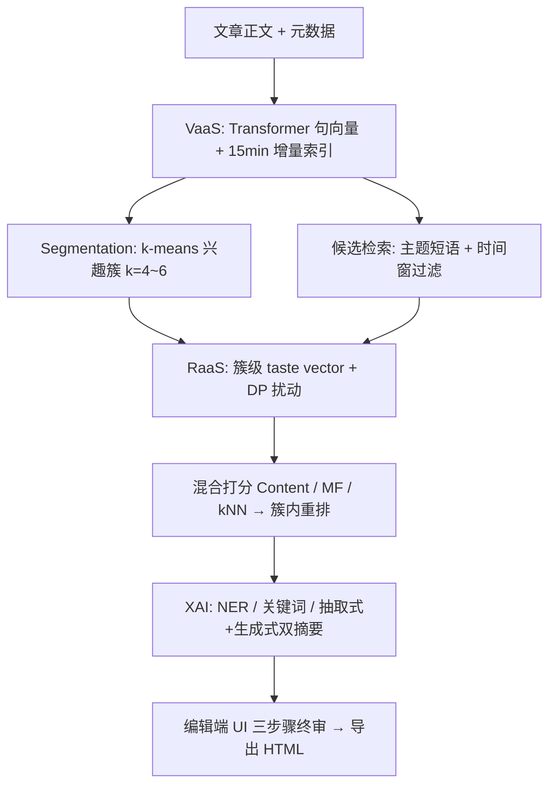

# NU:BRIEF -- A Privacy-aware Newsletter Personalization Engine for Publishers (面向出版商的隐私友好型通讯个性化引擎)

- **会议/期刊**: RecSys 2021 (Demo Track, 4 页短文)
- **作者与机构**: Ernesto Diaz-Aviles, Claudia Orellana-Rodriguez, Igor Brigadir, Reshma Narayanan Kutty（recsyslabs / University College Dublin）
- **推荐链路定位**: 召回（候选检索）+ 重排（簇内列表排序），端到端服务于编辑策展
- **研究方向**: 去偏公平、可信隐私与工业架构
- **论文原文**: [https://arxiv.org/abs/2109.03955v1](https://arxiv.org/abs/2109.03955v1)
- **开源代码**: 暂未开源（仅提供 demo 与解说视频链接）

## TL;DR (1分钟核心速览)

中小型出版商无力为多元读者维护多份通讯，只能"一份通稿发所有人"；同时监管压力使其不敢收集个人可识别信息。NU:BRIEF 用预训练 Transformer 句向量 + k-means 把内容与读者切成 4–6 个兴趣簇，用**簇级 taste vector（加差分隐私扰动）**代理匿名用户，叠加内容/MF/kNN 混合打分做簇内重排，人工编辑终审。为期半年的私测 A/B（43K 订阅者、135K 文档）显示：簇级个性化排序的打开率与 CTR 与全程人工策展**持平**，而单期策展耗时从 60 分钟降到 10 分钟（−80%），付费订阅转化上升。

## Background & Motivation (背景与核心矛盾)

- **主流范式**: 大型媒体（如 NYT 的 71 份通讯）以重人力方式为细分人群各办一份通讯；学术界则以完整用户画像驱动的神经新闻推荐为主流。
- **前人局限**: (i) 中小出版商与独立作者没有跨学科团队，无法承担"一人一报"的编辑成本；(ii) 现有神经推荐依赖长期、细粒度的个人画像与点击日志，与 GDPR 式合规审查、读者隐私意识直接冲突，"隐私合规"与"高质量个性化"被视为不可兼得。
- **核心洞察 (Key Insight)**: 出版商产出的**内容主题分布本身**就映射了其读者兴趣分布——因此可以从内容侧无监督地反推读者簇，用"簇"而非"人"作为推荐的最小代理实体，从而在不持有个人标识的前提下获得近似个性化的收益。
- **本文切入点**: 把个性化责任从"建模个体"转移到"建模兴趣簇 + 编辑在环终审"，并将差分隐私注入簇级偏好聚合，构建 private-by-default 的完整工业流水线。

## Method (核心方法设计)

### 1. 整体框架 (Overall Architecture)

系统由五个服务串联：**VaaS** 用预训练 Transformer 对文章正文与元数据编码为句向量，支持 15 分钟粒度的增量索引以维持缓存新鲜度；**Segmentation** 以该向量为输入做 k-means 聚类，产出 4–6 个兴趣簇；**Candidate Retrieval** 以搜索引擎按"编辑输入的主题短语 + 时间窗"召回候选集，把打分规模从全库压到数百篇；**RaaS** 聚合簇内历史交互为 taste vector 并施加差分隐私扰动，再用内容相似度、矩阵分解与 kNN 混合打分完成簇内重排；**XAI/NLP** 抽取实体、关键词并生成抽取式与生成式双摘要，交由编辑在 UI 三步骤（定主题→选时间窗→看分簇榜单）终审并导出 HTML。整条链路无需训练重型推荐模型，索引离线构建、在线仅做向量内积检索。

<figure class="paper-figure" markdown="span">
  <figcaption>图1：NU:BRIEF 流程概览。1</figcaption>
</figure>

### 2. 关键设计拆解 (Key Designs)

1. **兴趣簇作为匿名用户代理（Cohort-as-Pseudo-User）**：痛点是无个人画像可用。本文用文章向量 $\boldsymbol{v}_i$的 k-means 划分替代用户建模，$\min_{\{S_k\}}\sum_{k=1}^{K}\sum_{i\in S_k}\lVert \boldsymbol{v}_i-\boldsymbol{\mu}_k\rVert_2^2$，其中$K\in[4,6]$由 silhouette 系数叠加上编辑定性判断确定。直觉：内容主题的多峰分布即读者兴趣的多峰分布，簇中心$\boldsymbol{\mu}_k$ 是可公开、不可反推到个体的"人群口味锚点"。
2. **差分隐私的簇级 taste vector**：痛点是个体点击序列一旦留存即构成隐私负债。本文将簇 $g$的交互历史$H_g$聚合并加噪（原文仅述"data perturbation"，下式为其文字描述的形式化）：$\tilde{\boldsymbol{t}}_g=\frac{1}{|H_g|}\sum_{i\in H_g}\boldsymbol{q}_i+\boldsymbol{\eta},\ \boldsymbol{\eta}\sim\mathcal{N}(\mathbf{0},\sigma^2\mathbf{I})$，最终打分$s(g,i)=\cos(\tilde{\boldsymbol{t}}_g,\boldsymbol{q}_i)$。噪声在**簇级**注入，单条交互被群体聚合稀释，故隐私预算换取的精度损失远小于个体级扰动。
3. **训练目标、负采样与推理开销**：本文**无端到端训练目标、无负采样**——MF 隐因子沿用常规离线拟合，主排序器为无参数的余弦/内积运算；原文明确论证"简单嵌入模型在线上表现不逊于神经模型"，与近期复现结论一致。推理成本由候选检索前置决定，为 $O(|C_{\text{cand}}|\cdot d)$，$|C_{\text{cand}}|\ll|\mathcal{I}|$，并可全量缓存向量，工程上易于水平扩展。XAI 侧同时输出"隐私保护分析"（簇级行为统计），作为推荐技术的副产品反哺编辑选题。

## Experimental Setup & Evaluation Protocol (实验设置与评估协议)

- **数据集与预处理**: 本文为 Demo 论文，**不含公开离线基准**，评估完全基于 2021 年上半年私测出版商真实流量（覆盖科技、STEM、创投、本地新闻、食谱）：

| 数据源 | #Publishers | #Subscribers | #Documents | 兴趣簇 K | 处理粒度 |
| :--- | :---: | :---: | :---: | :---: | :--- |
| 私测出版商内容与通讯日志 | 若干中小型（未披露具体数） | >43K（合计） | 135K | 4–6 | 新文章每 15 min 增量索引 |

- **数据划分与防穿越 (Splitting Strategy)**: 无离线划分；采用**线上 A/B 测试**（NU:BRIEF 簇级排序 vs. 编辑全程手工策展），以通讯打开率、CTR、付费转化与策展耗时为观测指标。
- **排名评测协议 (Ranking Protocol)**: 属 `Sampled Ranking` 的变体——先在主题+时间窗约束下由搜索引擎召回候选子集，再在**候选集内做全序排列**，并非全库 Full-Ranking；因此绝对指标不可跨系统直接比较。
- **对比基线与超参设置**: 基线为 (i) 编辑全程人工策展、(ii) 一份通稿覆盖全部读者（one-size-fits-all）。向量维度 $d$ 与 MF 隐因子维度未披露；k 由 silhouette 与定性评估联合确定；**未报告显著性检验与置信区间**。

## Key Experimental Results (实验关键数据)

### 1. 主实验对比 (Main Results)

| 组别 | 排序来源 | 打开率 | CTR | 付费订阅转化 | 单期策展耗时 |
| :--- | :--- | :---: | :---: | :---: | :---: |
| One-size-fits-all | 无个性化（同一份通稿） | 原文未量化（描述为 suboptimal） | 同左 | 基准 | ≈ 0（但覆盖粗） |
| Human Curation (control) | 记者全程手工 | 基准 | 基准 | 基准 | 60 min |
| **NU:BRIEF (per-cohort)** | **簇级 taste vector + 混合打分** | **与人工持平（无显著劣化）** | **与人工持平** | **↑（随个性化选项提升）** | **10 min（−80%）** |
| Improv. | — | ≈ 0% | ≈ 0% | 正向（未披露幅度） | **−80%** |

### 2. 消融实验 (Ablation Study)

原文未做组件级离线消融，仅给出线上对照与定性判断；下表按"被移除组件 → 预期退化为哪种基线"整理，并标注证据强度：

| 移除/关闭的组件 | 退化为 | 原文报告的观测 | 证据强度 |
| :--- | :--- | :--- | :---: |
| 簇级个性化 (Segmentation + taste vector) | one-size-fits-all 通稿 | 明确表述为 suboptimal、非增长路径 | 定性 |
| 编辑终审 (Human-in-the-loop) | 纯自动排序直发 | 未测试，作者仍坚持保留人工环节 | 无 |
| 差分隐私扰动 (DP noise) | 无噪声聚合 taste vector | 未报告 $\sigma$ 与精度损失曲线 | 无 |
| 神经重排模型（对比简单嵌入） | Deep & Cross / Attention | 离线显示简单模型不逊于神经模型 | 定性 + 引用 |

### 3. 关键实验发现 (Key Findings)

- **自动化天花板已被触达但未被超越**：簇级个性化排序在打开率与 CTR 上与记者全程策展**统计上等价**，说明对通讯这类低频、主题驱动的场景，粗粒度人群代理足以替代个体级画像——这是本文最强的结论，也解释了为何作者拒绝堆叠神经模型。
- **真正的收益在供给侧成本**：策展耗时 60 min → 10 min（**−80%**），对无力负担跨学科编辑团队的中小出版商，这一项的边际价值高于 CTR 的千分位提升。
- **规模与隐私可并存**：135K 文档、43K 订阅者的真实负载下，仅靠向量缓存 + 15 分钟增量索引即可支撑全流程，说明"无个人画像的个性化"在工程上是可运行的，而非仅合规口号。

## Highlights & Limitations (亮点、对比与审稿批判)

- **与代表作对比 (vs. Prior Work)**: 与新闻推荐主流的**个体画像 + 深度序列模型**路线相反，本文明确降低模型复杂度（内容相似度 + MF + kNN）并把个性化粒度降到簇；与传统**联邦学习推荐**相比，本文并未做跨设备梯度聚合，仅用簇级聚合 + 差分隐私扰动达成"不收集 PII"，隐私保障强度弱于 FL 但部署成本低一个量级。
- **可迁移亮点**: (i) 以"内容主题聚类"反推匿名人群、用簇中心作可公开的口味锚点，可直接迁移到冷启动/匿名会话场景；(ii) 候选检索前置 + 缓存向量的两段式结构，是低延迟重排的通用范式。
- **审稿级局限批判**: (i) **评估严重不足**——无离线基准、无显著性检验、无绝对指标数值，"与人工持平"缺乏统计支撑，且候选人集内排序使结果不可跨系统比较；(ii) **关键词与实现不一致**：CCS 关键词标注 "Federated Learning"，正文却只有簇级 k-means + DP 扰动，无联邦聚合过程；同时 $\sigma$、隐私预算$\epsilon$ 与精度-隐私权衡曲线全部缺失，隐私主张难以被审计。此外 k 值需人工定性校准，跨出版商的可迁移性存疑。

## Rating (四维评分)

- **方法创新性 (Novelty)**: ⭐⭐⭐ （"簇作为匿名用户代理 + DP 簇级 taste vector"的组合思路在隐私约束下颇具巧思，但各组件本身均为成熟技术拼接，无理论或谱分析支撑）
- **评估协议与实验扎实度 (Protocol & Experiments)**: ⭐⭐ （仅有线上 A/B 的定性结论，无离线基准、无消融数值、无显著性检验，隐私预算与精度损失完全未披露）
- **写作与数学规范度 (Clarity & Rigor)**: ⭐⭐⭐ （系统流水线与编辑工作流描述清晰、工程细节可信，但全文几乎无公式与复杂度分析，隐私机制停留在名词层面）
- **工业落地与复现价值 (Industrial & Practical Value)**: ⭐⭐⭐⭐ （真实出版商私测、135K 文档负载、80% 人力节省与可导出 HTML 的闭环，对中小媒体是可直接照搬的参考架构；可惜未开源）

