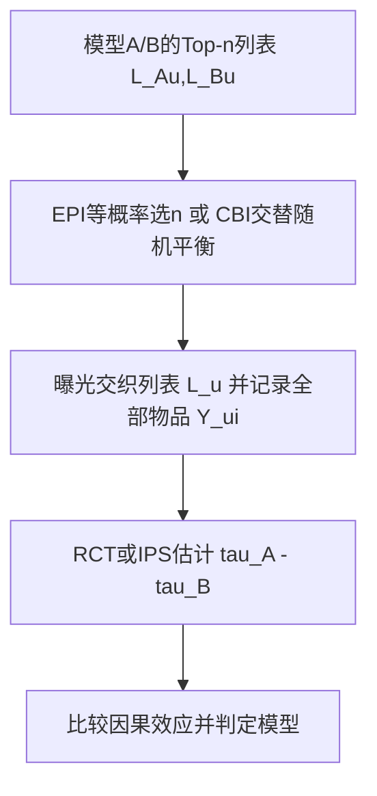

# Online Evaluation Methods for the Causal Effect of Recommendations (推荐因果效应的在线评估方法)

- **会议/期刊**: RecSys 2021
- **作者与机构**: Masahiro Sato，Independent Researcher, Japan
- **推荐链路定位**: 在线评估/实验平台（跨召回-排序模型比较）
- **研究方向**: 去偏公平、可信隐私与工业架构（因果去偏/在线评估）
- **论文原文**: [https://arxiv.org/abs/2107.06630v2](https://arxiv.org/abs/2107.06630v2)
- **开源代码**: [https://github.com/masatoh73/causal-interleaving](https://github.com/masatoh73/causal-interleaving)

## TL;DR (1分钟核心速览)

针对推荐因果效应在线评估中 A/B 测试需大量用户、仅看推荐列表又会把 $Y^{T}$误当因果效应的问题，本文提出首个因果 interleaving 框架：EPI 等概率选交织列表，CBI 平衡两模型列表并用 IPS 校正选择倾向。半合成 Dunnhumby/ML-1M 模拟（10,000 次、$n=10$、95% CI）表明 CBI-IPS 无偏，且达到同等错误判定率所需用户数比 AB-total 少约 30 倍。

## Background & Motivation (背景与核心矛盾)

- **主流范式**: 推荐模型比较通常依赖 A/B 测试；因果推荐侧则用 ULRMF、ULBPR、DLCE、CUBN 等离线优化/评估因果效应。
- **前人局限**: AB-total 虽可识别平均因果效应，但受用户自然行为波动影响，方差大、实验成本高；AB-list 只测推荐列表交互 $Y^{T}$，无法识别$\tau=Y^{T}-Y^{C}$。传统 interleaving 只测交织列表内 outcomes，缺少未推荐对照，且非随机选择会引入混杂偏差。
- **核心洞察**: 因果效应排序与 treated outcome 排序可能相反。表 1 中 BPR 的 $Y^{T}$最高（0.1869）但$\tau$最低（0.0295）；UBN 的$Y^{T}$为 0.308，$\tau$ 却为 -0.186。仅看列表 CTR/转化会选错模型。
- **本文切入点**: 将 interleaving 扩展为同时观测“列表内/列表外”物品 outcomes，并用等概率设计或 IPS 加权消除选择偏差。

## Method (核心方法设计)

### 1. 整体框架 (Overall Architecture)

对每个用户，由模型 A/B 各生成 top-$n$列表$L_{A,u},L_{B,u}$；EPI 从并集等概率选$n$个物品组成交织列表，CBI 交替从两列表随机选取未选物品以平衡来源。线上/模拟曝光后记录所有物品$Y_{ui}$：列表内为$Y^{T}_{ui}$，列表外为$Y^{C}_{ui}$。随后用 RCT 或 IPS 估计$\tau_A-\tau_B$，判定模型因果效应优劣。CBI 的倾向$p_{ui}$ 依赖物品是否在交集及并集大小，可预计算倾向表。

### 2. 关键设计拆解 (Key Designs)

1. **因果效应定义与 AB-total 分解**：痛点是观测交互 $Y_{ui}=Z_{ui}Y^{T}_{ui}+(1-Z_{ui})Y^{C}_{ui}$只能暴露一个潜在结果。本文用$\tau_{ui}=Y^{T}_{ui}-Y^{C}_{ui}$，并证明总交互除以推荐数可分解为$\hat{Y}^{\text{total}}_A=\hat{\tau}_A+\frac{1}{n|S_A|}\sum_{u\in S_A}\sum_{i\in\mathcal{I}}Y^{C}_{ui}$；右端 baseline 与模型无关，故 AB-total 可比较$\tau$。直觉是全库交互中的“自然发生”部分在模型间抵消。
2. **EPI/CBI 交织与 IPS 去偏**：EPI 以 $p=n/|L_{A,u}\cup L_{B,u}|$等概率选择，满足 RCT，估计为$(\hat{\tau}^{L_{A,u}})_{\text{RCT}}=\frac{1}{|L_{A,u}\cap L_u|}\sum_{i\in L_{A,u}\cap L_u}Y_{ui}-\frac{1}{|L_{A,u}\setminus L_u|}\sum_{i\in L_{A,u}\setminus L_u}Y_{ui}$。CBI 允许不等概率，但要求正性$0<p_{ui}<1$，用 IPS 校正：$(\hat{\tau}^{L_{A,u}})_{\text{IPS}}=\frac{1}{n}\sum_{i\in L_{A,u}}\left(\frac{Z_{ui}Y_{ui}}{p_{ui}}-\frac{(1-Z_{ui})Y_{ui}}{1-p_{ui}}\right)$。其无偏性来自$\mathbb{E}[Z_{ui}Y_{ui}/p_{ui}-(1-Z_{ui})Y_{ui}/(1-p_{ui})|X_{ui}]=\tau_{ui}$。平衡选择降低方差，IPS 消除交集重叠导致的混杂。
3. **训练目标、负采样与推理效率**：本文不新增推荐训练损失；被比较模型按原损失训练（BPR/ULBPR/CUBN 等），负采样沿用基线设置。在线推理需两模型各出 top-$n$，CBI 额外$n$ 次随机选择；IPS 权重可离线按交集/并集组合预计算。无需全量用户 A/B 分组，但需记录全部物品 outcomes。

## Experimental Setup & Evaluation Protocol (实验设置与评估协议)

- **数据集与预处理**: 采用半合成数据，需同时含 $Y^{T}_{ui}$与$Y^{C}_{ui}$ 以模拟任意曝光。原文未报告 Dunnhumby 精确统计；ML-1M 为标准版本。未额外执行 5-core 过滤，沿用 [28] 的因果模拟生成协议。

| 数据集 | #Users | #Items | #Interactions | 稀疏度/密度 | 特征/场景说明 |
| :--- | :---: | :---: | :---: | :---: | :--- |
| Dunnhumby-Original | 未报告 | 未报告 | 未报告 | 未报告 | 零售交易；半合成潜在结果 |
| MovieLens-1M | 约6,040 | 约3,706 | 约1.0M | 约4.5% | 电影评分；半合成潜在结果 |

- **数据划分与防穿越**: 训练/测试数据独立生成；训练集训练推荐模型，测试集模拟在线实验。不是 Leave-One-Out 或全局时间戳切分。
- **排名评测协议**: 非传统 Full-Ranking/Sampled Ranking。模型生成 $n=10$ 曝光列表，模拟所有物品 outcomes，评估估计量偏差、95% CI 与 false judgment ratio。
- **对比基线与超参设置**: 被比较模型含 CUBN-T/O、ULRMF、ULBPR、BPR、UBN；在线评估方法含 AB-total、AB-list、EPI-RCT、CBI-RCT、CBI-IPS。每场景重复 10,000 次；超参沿用 CP@10 辅助文件；正文未报告 embedding 维度 $d$。

## Key Experimental Results (实验关键数据)

### 1. 主实验对比 (Main Results)

表 1 为代表性估计结果（mean±std；Truth 为真实 $\tau_A-\tau_B$；加粗为无偏且低方差最优估计）。

| 评估方法 | DH: CUBN-T & BPR (Truth 0.0212) | DH: ULRMF & BPR (Truth 0.0052) | ML: CUBN-O & ULBPR (Truth 0.0512) | ML: ULBPR & UBN (Truth 0.4665) |
| :--- | :---: | :---: | :---: | :---: |
| AB-total | 0.0210±0.0399 | 0.0051±0.0397 | 0.0635±1.2102 | 0.4789±1.2052 |
| AB-list | -0.0510±0.0071 | -0.0471±0.0073 | 0.0550±0.0104 | -0.0226±0.0100 |
| EPI-RCT | 0.0212±0.0069 | 0.0053±0.0076 | 0.0512±0.0083 | 0.4666±0.0135 |
| CBI-RCT | 0.0429±0.0067 | 0.0188±0.0076 | 0.0444±0.0066 | 0.4667±0.0126 |
| **CBI-IPS** | **0.0213±0.0063** | **0.0051±0.0070** | **0.0512±0.0075** | **0.4667±0.0126** |

相对 AB-total，CBI-IPS 的 std 在 DH 场景由 0.0399 降至 0.0063（约 84.2% 降幅），在 ML 场景由 1.2052 降至 0.0126（约 99.0% 降幅）。原文图 1 显示 DH 中 AB-total 达到同等 false ratio 约需 30 倍用户；ML 中 AB-total 在实验用户范围内未达到同等 false ratio。

### 2. 消融实验 (Ablation Study)

| 变体 | 移除/改变 | 代表结果 (DH CUBN-T&BPR; ML CUBN-O&ULBPR) | 结论 |
| :--- | :--- | :---: | :--- |
| CBI-IPS | 完整 | 0.0213±0.0063; 0.0512±0.0075 | 接近 truth |
| CBI-RCT | 去掉 IPS | 0.0429±0.0067; 0.0444±0.0066 | 有偏 |
| EPI-RCT | 等概率替代 CBI+IPS | 0.0212±0.0069; 0.0512±0.0083 | 无偏但方差略大 |
| AB-list | 只测推荐列表 | -0.0510±0.0071; 0.0550±0.0104 | 估 $Y^{T}$非$\tau$ |
| AB-total | 全量 A/B | 0.0210±0.0399; 0.0635±1.2102 | 无偏但方差大 |

### 3. 关键实验发现 (Key Findings)

1. **选择偏差可被 IPS 修正**：DH 的 CUBN-T&BPR 中，CBI-RCT 估计 0.0429 约为 truth 0.0212 的两倍，IPS 后恢复至 0.0213；说明列表重叠导致的选择概率不均会显著夸大因果差异。无重叠且倾向恒定时 CBI-RCT 与 CBI-IPS 等价（ML ULBPR&UBN 均 0.4667 vs truth 0.4665）。
2. **“高 CTR/高转化”不等于“高因果效应”**：表 1 中 BPR 的 $Y^{T}$为 0.1869 最高，但$\tau$ 仅 0.0295；AB-list 对 ULBPR&UBN 估 -0.0226，而 truth 为 0.4665，证明只看列表交互会系统性选错模型。
3. **效率提升来自方差缩减而非均值偏移**：CBI-IPS/EPI-RCT 均值贴近 truth，但 std 比 AB-total 小 1–2 个数量级；CBI-IPS 又略优于 EPI-RCT（DH std 0.0063 vs 0.0069），因平衡两列表来源降低了估计方差。

## Highlights & Limitations (亮点、对比与审稿批判)

- **与代表作对比 (vs. Prior Work)**: 传统 interleaving（Balanced/Team Draft/Probabilistic）评估 ranking 与查询/偏好的相关性，不评估因果效应；AB-total 可识别因果但方差大；ULRMF/ULBPR/DLCE/CUBN 只做离线因果优化。本文首次把 interleaving 与 potential outcomes/IPS 结合，实现在线因果模型比较。
- **可迁移亮点**: 1）用 IPS 倾向表校正交织列表选择偏差，可迁移到重排/列表推荐在线评估；2）CBI 的交替平衡选择可降低估计方差；3）半合成 potential outcomes 模拟协议可复用于其他在线评估方法验证。
- **审稿级局限批判**: 1）仅半合成模拟、两数据集、列表长度 $n=10$，缺少真实线上 A/B 验证；2）CBI 需重复算法数值计算倾向，真实服务中曝光位置、自然行为与推荐策略的混杂未建模；3）仅比较两个模型，未扩展到 multileaving，IPS 在极端倾向下方差可能放大。

## Rating (四维评分)

- **方法创新性 (Novelty)**: ⭐⭐⭐⭐ （首个因果 interleaving 框架，核心是 interleaving 与 IPS 的巧妙组合，理论无偏性清晰但非全新因果估计器）
- **评估协议与实验扎实度 (Protocol & Experiments)**: ⭐⭐⭐⭐ （10,000 次模拟、95% CI、两数据集与多模型对比充分，但半合成缺少真实线上验证）
- **写作与数学规范度 (Clarity & Rigor)**: ⭐⭐⭐⭐ （潜在结果定义、AB-total 分解、IPS 无偏性证明与算法伪代码完整，符号略密集）
- **工业落地与复现价值 (Industrial & Practical Value)**: ⭐⭐⭐ （代码开源、可降低 A/B 用户需求，但线上部署需倾向计算与全物品 outcomes 记录，真实收益待验证）

