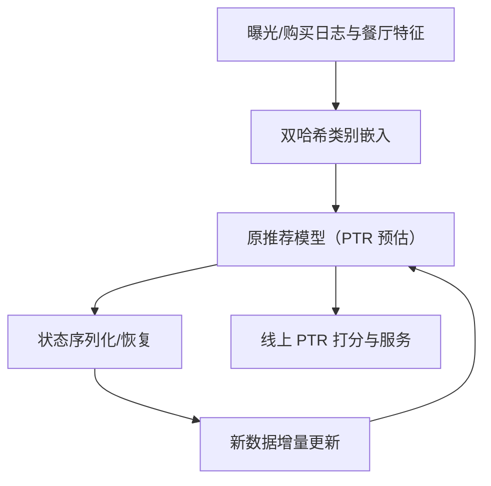

# Online Learning for Recommendations at Grubhub (Grubhub 推荐系统在线学习实践)

- **会议/期刊**: RecSys 2021 (Fifteenth ACM Conference on Recommender Systems)
- **作者与机构**: Alex Egg, Grubhub
- **推荐链路定位**: 精排/在线服务（推荐模型训练与更新链路）
- **研究方向**: 去偏公平、可信隐私与工业架构（工业在线学习）
- **论文原文**: [论文原文链接](https://arxiv.org/abs/2107.07106v1)
- **开源代码**: 暂未开源

## TL;DR (1分钟核心速览)

本文瞄准推荐模型在概念漂移下的快速退化与批量重训的冗余成本：不改模型结构，先用离线日志预训练，再以有状态增量更新在线微调，并用双哈希嵌入吸收新餐厅。Grubhub 线上 A/B 显示，日更相对不重训 PTR +20.3%，线上迁移带来约 +20% PTR 与 45× 成本下降；离线 80 天增量可恢复批量训练效果且收敛更快。

## Background & Motivation (背景与核心矛盾)

- **主流范式**: 周期性批量重训，常用固定长度滑动窗口；模型无状态，每轮在窗口内全量重算。
- **前人局限**: 概念漂移使模型快速退化，周更仅 +2.5% 而日更 +20.3%；滑动窗口重复计算旧数据，云计算成本高。
- **核心洞察 (Key Insight)**: 模型性能在训练后即开始衰减；保留训练状态、只在新数据上增量更新，可同时提升漂移响应与算力效率。
- **本文切入点**: 把重训视为迁移学习：离线预训练至收敛，线上有状态微调，辅以哈希嵌入处理非平稳餐厅目录。

## Method (核心方法设计)

### 1. 整体框架 (Overall Architecture)

输入为曝光/点击/购买日志及餐厅特征；类别特征先经双哈希映射到固定桶，避免全量词表重训；原推荐模型（以 PTR 为优化目标）在离线日志上预训练至收敛，线上仅用新日志做有状态增量更新。训练状态通过序列化/反序列化跨轮保留，离线模拟器按时间推进回测，确认收敛后释放线上微调；服务端用最新状态前向打分。

<figure class="paper-figure" markdown="span">
  ![图 1. 1a 使用 4 天滑动窗口和次日留出进行交叉验证的每日无状态更新示例。1b 带状态与自助采样的每日增量更新示例。注意，模型仅在新数据上更新，而非图 1a 中的滑动窗口。更新周期可为 1 天（如本例），也可短至 10 分钟（如 \[2\] 所示）。](../../../../assets/papers/2107.07106v1/figure_1.png)<figcaption>图 1. 1a 使用 4 天滑动窗口和次日留出进行交叉验证的每日无状态更新示例。1b 带状态与自助采样的每日增量更新示例。注意，模型仅在新数据上更新，而非图 1a 中的滑动窗口。更新周期可为 1 天（如本例），也可短至 10 分钟（如 [2] 所示）。</figcaption>
</figure>
*图 1：无状态滑动窗口批量重训（1a）与有状态增量更新（1b）的流程对比。*

### 2. 关键设计拆解 (Key Designs)

1. **状态化增量更新（Stateful Incremental Update）**：针对批量滑窗每轮重复计算旧数据，本文不改变网络结构，只保留并恢复模型状态，用新数据做一次增量优化：$\theta_{t+1}=\theta_t-\eta\nabla_\theta\mathcal{L}_{\mathrm{PTR}}(\theta_t;\mathcal{D}_t)$。其中$\mathcal{D}_t$ 仅含当日新日志。这样既让模型紧跟漂移，又把训练从“窗口全量重算”降为“新数据反传”，是 45× 成本收益的主因。

2. **双哈希类别嵌入（Double Hashing）**：餐厅目录实时增删，固定词表需全量重训且无法覆盖新类别。将类别 $x$映射为$h_i(x)=((a_i x+b_i)\boldsymbol{o}d p)\boldsymbol{o}d m$，用两个独立哈希$h_1,h_2$ 组成桶键；只有二者同时碰撞才冲突，碰撞率随桶数增加而收敛。实测 3M 桶约 7% 碰撞，可在不重训词表的情况下上线新餐厅；代价是不可逆映射，特征重要性解释变难。

3. **离线预训练—在线微调与回测**：线上从零收敛不可控，故先最小化离线目标 $\theta_0=\arg\min_\theta\mathcal{L}_{\mathrm{PTR}}(\theta;\mathcal{D}_{\mathrm{pre}})$，再用$\theta_t=\operatorname{Update}(\theta_{t-1};\mathcal{D}_t)$ 微调；离线模拟器按随机增量顺序回放日志做 off-policy 评估。总损失沿用原 PTR 二分类交叉熵，不新增负采样；推理只需前向，更新周期可日级至 10 分钟级。

## Experimental Setup & Evaluation Protocol (实验设置与评估协议)

- **数据集与预处理**: 原文不使用公开推荐基准，仅报告 Grubhub 内部生产日志；未披露用户数、交互量与过滤规则。

| 数据集 | #Users | #Items | #Interactions | 稀疏度/密度 | 特征/场景说明 |
| :--- | :---: | :---: | :---: | :---: | :--- |
| Grubhub 内部曝光-购买日志 | 未披露（百万级 diners） | 全球餐厅目录（0.5M–4M 哈希桶） | 未披露（30/80 天训练窗口） | 未披露 | 本地外卖推荐，线上主指标 PTR |

- **数据划分与防穿越 (Splitting Strategy)**: 离线交叉验证采用次日留出（next-day hold-out）；线上 A/B 按上线日期切分，属于全局时间戳切分。
- **排名评测协议 (Ranking Protocol)**: 生产 A/B 的 PTR 相对提升，非全库离线路排序；原文未报告采样负例协议。
- **对比基线与超参设置**: 对照更新策略为不重训、周更、日更、无状态滑窗、有状态增量与线上迁移；哈希桶从 0.5M 增至 4M，3M 时碰撞率约 7%；嵌入维度与显著性检验未披露。

## Key Experimental Results (实验关键数据)

### 1. 主实验对比 (Main Results)

原文无公开 SOTA 基线，以下为生产对照策略；Improv. 为相对基线 PTR 提升。

| 策略 | 训练状态/窗口 | 相对 PTR | 成本或结论 |
| :--- | :--- | :---: | :--- |
| 不重训（Baseline） | 无状态，固定模型 | 0.0 | 1× |
| 周更 | 无状态，每周重训 | +2.5% | 漂移响应不足 |
| 日更 | 无状态，每日重训 | **+20.3%** | 需高频更新 |
| 有状态增量（80 天） | 保留状态，仅新数据 | CV 恢复/超过 batch | 收敛快于批量 |
| 线上迁移（图 4） | 有状态在线微调 | **+20%** | **45× 成本下降** |

### 2. 消融实验 (Ablation Study)

| 消融/变体 | 关键变化 | 结果 |
| :--- | :--- | :--- |
| 无重训 vs 周更 vs 日更 | 更新频率 | 0.0 / +2.5% / +20.3% |
| 无状态滑窗 | 4 天窗口日更 | 重复算 3 天，理论 4× 节省 |
| 有状态增量 | 80 天仅新数据 | 恢复 batch，收敛更快、上限更高 |
| 哈希桶 0.5M→3M | 双哈希 | 碰撞率收敛至约 7% |
| 预训练+在线微调 | 离线→在线 | 缓解冷启动收敛与 off-policy 回测 |

### 3. 关键实验发现 (Key Findings)

1. 日更相对周更的 PTR 相对提升从 +2.5% 跳到 +20.3%，说明外卖场景的漂移以天计；仅靠周更几乎无法覆盖节假日/疫情等突变。
2. 有状态 80 天增量在交叉验证上恢复批量训练，且图 2 显示收敛更快、上限更高；滑动窗口 4 天可省 3 天重复计算，生产端累计达到 45× 成本下降。
3. 双哈希把全球餐厅压到 3M 桶仅约 7% 碰撞，使新餐厅无需全量重训即可获得嵌入；这解释了在线系统能在目录持续变化时保持可用，但碰撞与不可逆映射仍是精度/可解释性风险。

## Highlights & Limitations (亮点、对比与审稿批判)

- **与代表作对比 (vs. Prior Work)**: 与常规批量重训/滑动窗口相比，本文的增量不是换模型，而是换训练状态管理；与纯离线预训练相比，多了线上有状态微调和模拟器回测。
- **可迁移亮点**: 状态序列化、双哈希非平稳词表、离线 simulator 回测，可迁移到 POI/电商等目录高频变化场景。
- **审稿级局限批判**: 仅内部 A/B，无公开数据、无显著性检验；模型结构、损失、嵌入维度、负采样未披露，复现性弱。哈希碰撞约 7%，且不可逆；非平稳 embedding、收敛与 off-policy 评估仍只是工程缓解，未给理论保证，45× 成本收益也依赖原窗口重复度与云成本。

## Rating (四维评分)

- **方法创新性 (Novelty)**: ⭐⭐⭐ （工程范式迁移有启发，但非新模型/新理论）
- **评估协议与实验扎实度 (Protocol & Experiments)**: ⭐⭐⭐ （线上 A/B 有说服力，但缺公开基准、显著性检验与细节）
- **写作与数学规范度 (Clarity & Rigor)**: ⭐⭐⭐⭐ （短文人话清晰，工程流程交代完整，理论严谨度有限）
- **工业落地与复现价值 (Industrial & Practical Value)**: ⭐⭐⭐⭐⭐ （状态化增量+哈希嵌入可直接落地，45× 成本与 +20% PTR 价值明确）

