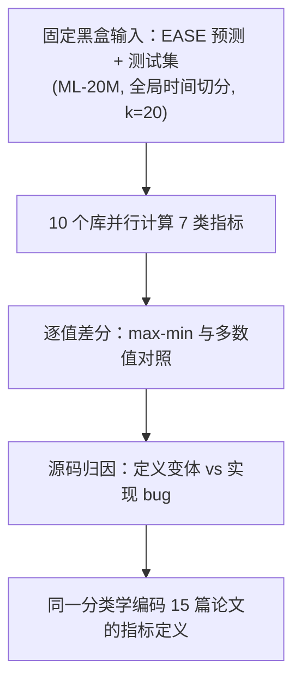

# Quality Metrics in Recommender Systems: Do We Calculate Metrics Consistently? (推荐系统质量指标：我们的计算一致吗？)

- **会议/期刊**: RecSys 2021 (Fifteenth ACM Conference on Recommender Systems)
- **作者与机构**: Yan-Martin Tamm, Rinchin Damdinov, Alexey Vasilev（Sber AI Lab, Moscow）
- **推荐链路定位**: 离线评测层（贯穿召回/精排的通用评估协议）
- **研究方向**: 去偏公平、可信与工业架构（评测可信度与可复现性）
- **论文原文**: [https://arxiv.org/abs/2206.12858v1](https://arxiv.org/abs/2206.12858v1)
- **开源代码**: [https://github.com/Darel13712/compare_metrics](https://github.com/Darel13712/compare_metrics)（主仓库 [microsoft/recommenders](https://github.com/microsoft/recommenders)）

## TL;DR (1分钟核心速览)

本文针对“同名指标≠同义指标”这一被长期忽视的评测噪声源：把**同一份推荐列表与同一份测试集**喂给 10 个主流 RecSys 库（RePlay / RecBole / Elliot / DaisyRec / OpenRec / MS Recommenders / NeuRec / Beta RecSys / DLRS Evaluation / rs_metrics），在 MovieLens-20M + EASE + 全局时间戳切分、截断 $k=20$ 的固定协议下做差分对照；同时对 15 篇代表性论文做定义档位编码。结论是仅 Precision/Recall 全体一致，MAP@20 取值横跨 0.003–0.073（24 倍差）、RocAuc 横跨 0.283–0.858，且 47% 的论文无法判定其指标定义。

## Background & Motivation (背景与核心矛盾)

- **主流范式**: 离线评测是模型选型的默认关口，社区已就“数据集过滤、划分方式、候选集构造（Full-Ranking vs 采样）、截断深度”等协议变量展开批判性讨论（DaisyRec、Beta RecSys、采样指标偏差等）。
- **前人局限**: 上述工作把“指标公式”当作已知常量，只批判数据侧选择；同时各库/论文对指标的口头定义（如“HR 衡量命中与否”）与代码实现长期脱钩，导致同名指标在不同实现中度量不同对象。
- **核心洞察 (Key Insight)**: 若把模型预测与测试集视为黑盒常量，则任何结果差异只能来自实现语义——因此指标实现本身可以被当作被测对象，用差分测试暴露其真实语义。
- **本文切入点**: 固定输入、遍历库、逐值归因，将“实现差异”归为**定义变体**与**代码 bug** 两类，再用同一分类学审计论文的文字定义。

## Method (核心方法设计)

### 1. 整体框架 (Overall Architecture)

作者构建了一条“单输入—多实现—值归因—论文审计”的评测审计流水线：先用闭式解的 EASE 在 MovieLens-20M 上生成一份固定的推荐列表与测试集，将其作为唯一输入分发给 10 个库的指标函数，收集同一指标的全部取值；对每个离群值回读源码，判定其属于“归一化项/相关性加权/截断位置不同”的定义变体，还是 cumsum 之类的实现错误；最后以四档编码（完整定义、正确引用、部分描述、错误/空引用）统计 15 篇论文的指标可判定性。

### 2. 关键设计拆解 (Key Designs)

1. **固定输入差分审计（把实现当被测对象）**：痛点是模型差异与实现差异混在一起无法归因；本文令预测与测试集恒定，则指标取值集合 $\{v_m^{(l)}\}_{l\in\mathcal{L}}$的离散度$\Delta_m=\max_l v_m^{(l)}-\min_l v_m^{(l)}$ 完全由实现语义决定。直觉上这是软件工程中的差分测试：无需知道“正确值”，只要发现分歧就说明至少一方语义偏离社区共识。
2. **AP@k 归一化项分类学（分歧的最大来源）**：AP 的传统定义是 PR 曲线下面积，但对长度 $k$的列表必须选一个平均项$x$：

$$AP@k(u)=\frac{1}{x}\sum_{i\in rec_k(u)}\mathbb{I}[i\in rel(u)]\,Precision@rank(u,i),\quad x\in\{k,\ |rel(u)|,\ \min(k,|rel(u)|)\}$$

若 $x=|rel(u)|$则$r<k$时指标无法达到 1（正确排序也被惩罚），若$x=k$则$r>k$时永不可达 1，故$x=\min(k,r)$ 在两种情形下都自洽——这一“可达上界”直觉正是 RecBole/RePlay 变体的合理性来源。
3. **NDCG 与 AUC 的语义分叉 + 训练/推理开销**：NDCG 分**加权版**（$2^{rating}-1$作增益，log 底数可为 2 或$e$）与**二值版**（增益取$\mathbb{I}[i\in rel]$），后者在库中更流行；AUC 则需回答两问（用全库排序还是 top-$k$；堆叠所有用户还是按用户平均），由此派生 SAUC、GAUC、GAUC@20、LAUC@20 四个变体，其中按用户平均更符合“用户看不到他人列表”的物理直觉。本文不涉及训练，审计开销仅为一次 EASE 闭式求解 + 各库指标函数调用，成本可忽略。

## Experimental Setup & Evaluation Protocol (实验设置与评估协议)

- **数据集与预处理**: MovieLens-20M；评分 $<4.5$ 视为负反馈并剔除，仅保留 4.5/5.0 两档（从而加权 NDCG 与二值 NDCG 的差异可被观测）。

| 数据集 | #Users | #Items | #Interactions | 稀疏度/密度 | 特征/场景说明 |
| :--- | :---: | :---: | :---: | :---: | :--- |
| MovieLens-20M（过滤后） | 未报告 | 未报告 | 未报告 | 高稀疏 | 显式评分，仅 4.5/5.0 保留为相关；EASE 生成预测 |

- **数据划分与防穿越 (Splitting Strategy)**: **全局时间戳切分**，最新 20% 评分入测试集；仅出现在测试集的用户/物品被移除，避免不可学习的冷启动实体污染指标。
- **排名评测协议 (Ranking Protocol)**: 指标均在 $k=20$ 截断上计算（RocAuc 除训练集外使用全量预测）；作者强调模型与数据的选择“完全任意、可视作黑盒”，关键是预测与测试集**固定不变**，因此不存在采样负例比。
- **对比基线与超参设置**: 不以模型为基线，而以 **10 个库的实现** 为对照对象；涵盖学术复现库（Beta RecSys、DaisyRec、DLRS Evaluation）与工业/通用库（MS Recommenders、RecBole、Elliot、OpenRec、NeuRec、RePlay、rs_metrics）。

## Key Experimental Results (实验关键数据)

### 1. 主实验对比 (Main Results)

同一预测/测试集下各库指标值（**加粗**为多数库共识值，`*` 表示作者已做最小修补）：

| 库 | HitRate@20 | MAP@20 | MRR@20 | NDCG@20 | P@20 | R@20 | RocAuc |
| :--- | :---: | :---: | :---: | :---: | :---: | :---: | :---: |
| RePlay | **0.475** | **0.039** | **0.186** | **0.093** | **0.058** | **0.096** | 0.283 |
| DLRS Evaluation | 1.15 | **0.039** | **0.186** | 0.080 | **0.058** | **0.096** | 0.283 |
| DaisyRec | **0.475** | 0.023* | 0.275 | **0.093** | **0.058** | **0.096** | fail |
| Beta RecSys | — | 0.032 | — | **0.093** | **0.058** | **0.096** | 0.687 |
| RecBole | **0.475** | **0.039** | **0.186** | **0.093** | **0.058** | **0.096** | 0.687 |
| Elliot | **0.475** | 0.073 | **0.186** | 0.090 | **0.058** | **0.096** | 0.688 |
| OpenRec | — | — | — | 0.463 | **0.058** | **0.096** | 0.705 |
| MS Recommenders | — | 0.032 | — | **0.093** | **0.058** | **0.096** | 0.687 |
| NeuRec | **0.475*** | 0.003 | **0.186** | **0.093** | **0.058** | **0.096** | — |
| rs_metrics | **0.475** | 0.032 | **0.186** | **0.093** | **0.058** | **0.096** | — |

RocAuc 按语义拆分（同名不同物）：

| 库 | SAUC（全库堆叠） | GAUC（按用户平均） | GAUC@20（截断） | LAUC@20 |
| :--- | :---: | :---: | :---: | :---: |
| RePlay | — | — | **0.283** | — |
| DLRS Evaluation | — | — | **0.283** | — |
| Beta RecSys | 0.687 | — | — | — |
| RecBole | 0.687 | 0.858 | — | — |
| Elliot | 0.688 | 0.705 | — | 0.112 |
| OpenRec | — | 0.705 | — | — |
| MS Recommenders | 0.687 | — | — | — |

### 2. 消融实验 (Ablation Study)

本文的“消融”等价于**指标定义要素的逐项剥离**与**论文定义档位统计**：

| 剥离/统计项 | 结果 | 数值后果 |
| :--- | :--- | :--- |
| AP 归一化项 $x$：$|rel|$→$k$→$\min(k,|rel|)$ | 三档变体 | 0.032 → 0.023 → 0.039 |
| Elliot 去掉 $\mathbb{I}[i\in rel]$（文档仍称用$\min(k,r)$） | 指示函数缺失 | 0.039 → **0.073**（虚高 ~87%） |
| NDCG 归一化项缺失（OpenRec bug） | 退化为 DCG | 0.093 → **0.463**（5 倍） |
| NDCG 对数底数 2 → $e$（DLRS） | 仅换底 | 0.093 → 0.080 |
| MRR 取首次命中 → 累加全部命中逆位置（DaisyRec） | 语义替换 | 0.186 → **0.275**（可 >1） |
| HitRate 取指示 → 取命中计数（DLRS） | 语义替换 | 0.475 → **1.15**（$=20\times$Precision） |
| 论文定义：完整 / 正确引用 / 部分描述 / 错误引用 | 5 / 3 / 3 / 4（共 15 篇） | **47% 不可判定** |

### 3. 关键实验发现 (Key Findings)

1. **指标越复杂，语义漂移越大**：Precision/Recall 在 10 个库中完全一致（0.058 / 0.096），而 MAP@20 出现 0.003–0.073 的 24 倍跨度——其中 NeuRec 的 0.003 源于对 $x$ 做累积求和时的 bug，Elliot 的 0.073 源于丢失相关性指示函数，说明分歧主要来自“平均项/归一化项”这类高阶设计选择而非公式主干。
2. **部分实现直接破坏指标的值域语义**：DLRS 的 HitRate 达 1.15（恰为 $20\times$ Precision），DaisyRec 的 MRR 因累加所有相关项逆秩而可超 1，OpenRec 的 NDCG 缺归一化项而膨胀至 0.463；这三个数值一旦进入论文表格就会误导模型排序比较，属于“可被审稿人一眼识破但长期未被纠正”的系统性噪声。
3. **AUC 是分歧最大且最不该跨库横比指标**：同一输入下 RocAuc 从 0.283（top-20 截断 GAUC）到 0.858（RecBole 以评分数加权并跳过全对/全错用户）相差 3 倍；同时仅 5/15 论文给出完整定义、7/15 论文或部分描述或引用到不含公式的文献，意味着近半数已发表结论的指标口径无法被复现。

## Highlights & Limitations (亮点、对比与审稿批判)

- **与代表作对比 (vs. Prior Work)**: DaisyRec / Beta RecSys 批判的是**数据侧**协议（过滤、划分、候选集规模），Valcarce 等批判**采样指标**的偏差，本文首次把**指标实现自身**作为被测对象并给出代码级归因；相较传统的“复现性危机”论述（如调好基线即可超越 SOTA），本文提供了可定位到具体算子的诊断表。
- **可迁移亮点**: (1) “固定输入 + 多实现对跑”的差分审计可直接迁移到 CTR 预估的 AUC/GAUC 与多任务指标（如 NDCG 变体、校准 ECE）跨团队对齐；(2) AP/Recall 的“可达上界”修正思路（除以 $\min(k,|rel|)$）同样适用于$r\neq k$ 的列表级指标定义与显著性检验前的口径统一。
- **审稿级局限批判**: (1) 审计仅基于**单一数据集 + 单一模型（EASE）+ 固定 $k=20$**，虽然作者称其为黑盒可推广，但指标差异在 leave-one-out、$|rel|=1$ 等设定下会大幅缩小（论文自己也承认 DaisyRec 的 MRR 在 LOO 下与其他库无异），因此分歧幅度的外推性有限；(2) 论文定义审计样本仅 15 篇且无抽样框架与置信区间，“47%”更像案例计数而非总体估计，同时若干离群值被判定为 bug 依赖人工读码，缺官方 issue 或作者确认的交叉验证。

## Rating (四维评分)

- **方法创新性 (Novelty)**: ⭐⭐⭐⭐ （首次将指标实现本身作为差分测试对象，并建立 AP/NDCG/AUC 的变体分类学，但方法学上属于审计范式而非新算法）
- **评估协议与实验扎实度 (Protocol & Experiments)**: ⭐⭐⭐⭐ （固定预测与测试集的设计干净、10 库 7 指标覆盖广，但仅单数据集单模型、$k$ 固定为 20，缺敏感性分析）
- **写作与数学规范度 (Clarity & Rigor)**: ⭐⭐⭐⭐ （公式与变体对照极清晰、逐库归因可复核，但论文定义统计的编码规则与抽样依据略显粗糙）
- **工业落地与复现价值 (Industrial & Practical Value)**: ⭐⭐⭐⭐⭐ （开源对比脚本可直接作为团队评测口径的 CI 校验，零训练成本即可避免跨团队“同名不同物”的错误结论）

